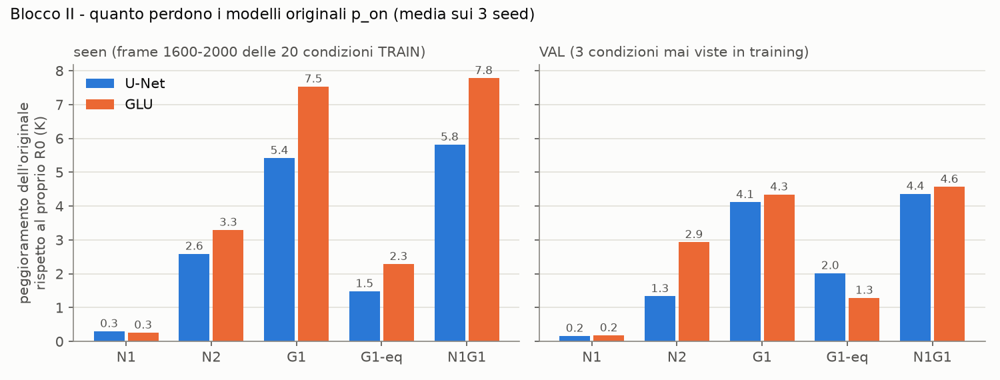
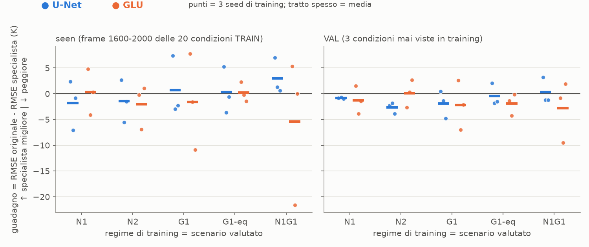
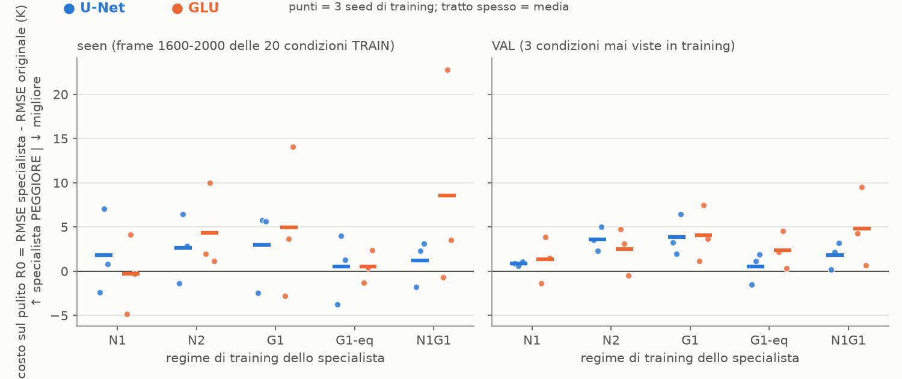
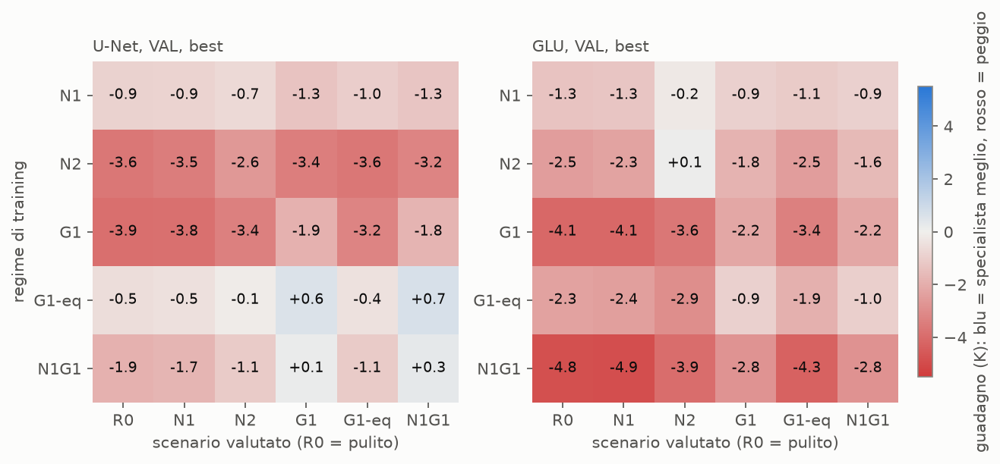
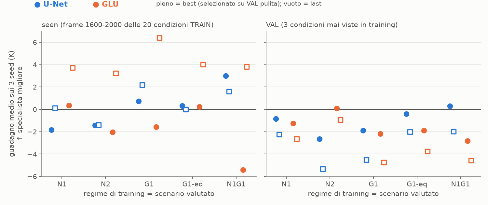

# Studio sulle degradazioni delle osservazioni di velocità: originali (Blocco II) e specialisti (Blocco III)

**Stato della consegna (27 novembre 2026).** Campagna numerica: completata e verificata. Grafici: disponibili (con un limite sui pannelli spaziali appaiati, §1.9). Rapporto: questo documento. Lacune residue: §1.9. **Natura dello studio:** scenari sintetici di classe B/C, non una validazione PIV né misure del nostro combustore; nessun accesso a TEST.

Il documento ha due livelli. La **Parte 1** (§1.1–1.9) è scritta per le persone: che cosa abbiamo fatto, perché, con quali numeri e figure. La **Parte 2** (Appendice A–N) è scritta per un altro agente senza contesto: permette di ricostruire lo studio, rimanda ai dati completi e dichiara che cosa è misurato, stimato o non disponibile. I risultati completi non sono incollati qui: stanno nei CSV/JSON collegati (indice in [results/nonideal/specialists/INDEX.md](../../results/nonideal/specialists/INDEX.md)).

---

# PARTE 1 — Lettura per le persone

## 1.1 In breve

- Abbiamo misurato come reagiscono due famiglie di reti (**U-Net** e **GLU**) quando le osservazioni di velocità da cui ricostruiscono il campo di temperatura sono degradate in modo sintetico: rumore e lacune.
- **Blocco II** (12 modelli originali, già allenati su dati ideali): le lacune contigue fanno più danno del rumore a 0,5 m/s, che è trascurabile. Sulla VAL, peggioramento medio di 4,1–4,3 K con lacune a dischi (G1) contro 0,2 K con rumore a 0,5 m/s (N1) (§1.5, figura A).
- **Blocco III** (30 specialisti, uno per regime di degrado, allenati da zero): su condizioni mai viste (VAL) il guadagno medio sul proprio regime è positivo in 2 celle su 10 (+0,29 K e +0,10 K, entro la dispersione fra seed), e lo specialista è in media peggiore dell'originale sul pulito in tutte e 10 le celle, di 0,5–4,8 K (figure B e C).
- Il trasferimento fra scenari segue soprattutto il **regime con cui lo specialista è stato allenato**: nelle matrici dei guadagni medi, la riga (regime di training) spiega il 67–82 % della variabilità fra le 30 celle su VAL (best), la colonna (scenario valutato) il 9–17 % (figura D, §1.6).
- Queste sono osservazioni su **questi regimi, questi dati e questo protocollo di selezione**: non mostrano che il retraining in generale sia inutile.
- Costo di calcolo dell'intero studio, dall'accounting Slurm: **210,1 GPU-ore** su L40S, di cui 200,7 per i training dei 30 specialisti (95 %), 8,7 per le valutazioni dei due blocchi (§1.8, Appendice L).

## 1.2 Perché lo abbiamo fatto

La tesi chiede quanto bene un modello neurale ricostruisce un campo di temperatura istantaneo da osservazioni incomplete di altre grandezze. Finora le osservazioni di allenamento e valutazione erano ideali: velocità esatta in punti sparsi casuali. Una PIV reale ha rumore e zone senza dati. Prima di costruire un modello di misura PIV (missione 02) volevamo sapere:

1. quanto soffrono i modelli esistenti quando le osservazioni sono degradate (Blocco II);
2. se ri-allenare un modello su quel tipo di degrado (uno specialista) recupera l'errore, a quale costo sul caso pulito, e se il beneficio si trasferisce ad altri degradi (Blocco III).

## 1.3 Che cosa ricevono i modelli e che cosa ricostruiscono

- **Dati.** Simulazioni numeriche di combustione (RealPDEBench, combustion/numerical), 30 condizioni operative (frazione di NH₃ 0/20/40/80 % × rapporto di equivalenza φ da 0,85 a 1,25), 2001 frame per condizione a 4 kHz, griglia 128×128 (celle 0,581×0,758 mm). Le condizioni sono divise intere: 20 TRAIN, 3 VAL, 3 TEST interpolazione, 4 TEST estrapolazione. **TEST non è mai stato usato.**
- **Input.** La velocità (componenti vᵢ e vⱼ, in m/s, normalizzate con media e deviazione standard fissate sui frame di training) in **819 punti su 16 384 (5 %)** scelti a caso e rinnovati a ogni epoca in training. Più, nelle versioni **p_on** usate qui, NH₃ e φ come due numeri di contesto che non vengono mai degradati. **Nessuna temperatura in ingresso** e nessuna correzione termica.
- **Target.** Il campo di temperatura LES completo 128×128, in kelvin, mai degradato.
- **Come lo vedono le reti.** U-Net: immagine a 7 canali (vᵢ, vⱼ, maschera dei punti validi, coordinate x e y, NH₃, φ), con zero normalizzato nei punti mancanti. GLU: una lista di punti validi con coordinate e velocità; i punti rimossi spariscono (nessun riempimento).
- **seen e VAL.** *seen* = 220 frame (20 condizioni × 11, frame 1600–2000) delle **stesse 20 condizioni di training** ma in un blocco temporale successivo ai frame di training (0–1480); non sono frame usati per allenare. *VAL* = 123 frame di 3 condizioni mai viste in training, già usate per selezionare i checkpoint e sviluppare il protocollo, quindi **non una conferma indipendente**. Le due letture sono sempre separate.

## 1.4 Gli scenari di degradazione

| Sigla | Che cosa significa | Perché c'è |
|---|---|---|
| **R0** | osservazioni ideali (il caso pulito) | riferimento |
| **N1** | rumore gaussiano indipendente σ = 0,5 m/s su vᵢ e vⱼ | rumore piccolo |
| **N2** | stesso rumore ×3 (σ = 1,5 m/s) | rumore forte |
| **G1** | zone senza dati: unione di dischi (3–10 mm) fino al 25 % dell'area | lacune contigue, come riflessi o ombre |
| **G1-eq** | stesso numero di punti persi di G1, ma sparsi a caso | controllo: separa il numero di punti dalla loro contiguità |
| **N1G1** | N1 e G1 insieme (stessa regione e stesso rumore) | combinazione |

Sono scenari motivati, non misurati sul combustore; i livelli sono stati congelati prima di vedere qualsiasi risultato. Il rumore e le lacune sono casuali ma **identici per tutti i modelli e seed** a parità di (condizione, frame, replica), così i confronti sono appaiati.

## 1.5 Gli esperimenti e a che cosa servivano

**Blocco II — sensibilità dei 12 modelli originali.** 12 checkpoint già allenati (U-Net/GLU × p_on/p_off × seed 0/1/2), valutati su 6 scenari × 3 repliche di maschera × (220 + 123 frame): 74 088 valutazioni. *Serviva a:* misurare quanto ciascun degrado peggiora l'errore, e se conoscere NH₃/φ aiuta. Nessun training. Risultato, sulla VAL: N1 +0,2 K, N2 +1,3…+2,9 K, G1 +4,1…+4,3 K, G1-eq +1,3…+2,0 K, N1G1 +4,4…+4,6 K (medie sui seed dei modelli p_on; per i p_off e per la lettura completa vedere [02_block2_robustness.md](02_block2_robustness.md)).



*Figura A. Quanto peggiorano i modelli originali p_on in ciascuno scenario, rispetto al proprio R0 (K, media sui 3 seed; barre più alte = peggio). A sinistra seen, a destra VAL. Le lacune contigue (G1, N1G1) dominano; il rumore a 0,5 m/s (N1) è trascurabile.*

**Blocco III — 30 specialisti p_on.** Per ciascuna famiglia, seed (0/1/2) e regime (N1, N2, G1, G1-eq, N1G1) un modello **allenato da zero** vedendo solo quel regime (nessun campione pulito, nessun training misto), con la ricetta degli originali. Ogni checkpoint (best e last) è valutato su tutti e sei gli scenari, seen e VAL separati, 3 repliche: 370 440 valutazioni. Ogni confronto serviva a una domanda diversa:

| Confronto | Domanda |
|---|---|
| specialista vs originale sul **proprio regime** | l'allenamento specifico recupera l'errore? (guadagno) |
| specialista vs originale su **R0** | quanto si perde sul caso pulito? (costo) |
| specialista su **altri scenari** | il beneficio si trasferisce? |
| **seen** vs **VAL** | l'effetto vale anche per condizioni mai viste? |
| **tre seed** | quanto varia da un training all'altro? |
| **best** vs **last** | la selezione sulla VAL pulita cambia il quadro? |
| G1 vs G1-eq | (nel Blocco II e nei regimi) conta la contiguità o il numero di punti? |

**Segno.** *Guadagno* = RMSE dell'originale − RMSE dello specialista, stesso scenario e stesse osservazioni: **positivo = specialista migliore**. *Costo sul pulito* = RMSE specialista − RMSE originale su R0: **positivo = specialista peggiore**. Attenzione: le figure `matrix_delta_*` del pacchetto grafico usano **specialista − baseline**, cioè il segno opposto al guadagno.

## 1.6 Risultati principali

Figure e numeri sono su selezione **best** (primo minimo della RMSE VAL pulita, come per gli originali) se non diversamente indicato. I punti delle figure sono i **tre seed di training**; il tratto spesso è la media; la loro dispersione non è un intervallo di confidenza né incertezza fisica.

**Recupero sul proprio regime.**



*Figura B. Guadagno sul regime di training (K; sopra lo zero = specialista migliore). Per ogni regime, a sinistra la U-Net (blu) e a destra il GLU (arancio); tre punti = tre seed. Su VAL (destra) quasi tutte le medie sono sotto lo zero; su seen (sinistra) il quadro è misto e i seed divergono, fino a −21,6…+7,7 K nel GLU.*

- VAL, best: guadagno medio positivo solo per U-Net N1G1 (+0,29 K) e GLU N2 (+0,10 K); 8 run su 30 hanno guadagno positivo sul proprio scenario (14 su 30 su seen).
- Il degrado che gli originali subiscono sulla VAL è di 0,2 K (N1) fino a circa 4,6 K (N1G1): i guadagni, quando positivi, sono una frazione di questa scala; quelli negativi la superano per N2, G1 e N1G1 in diversi seed.

**Costo sul pulito.**



*Figura C. Costo sul pulito R0 (K; sopra lo zero = lo specialista è PEGGIORE dell'originale). Su VAL il costo medio è positivo in tutti i regimi (U-Net 0,5–3,9 K, GLU 1,3–4,8 K).*

**Trasferimento agli altri scenari.**



*Figura D. Guadagno medio sui 3 seed (K) di ciascun regime di training (righe) valutato su ogni scenario (colonne; R0 = pulito, dove il guadagno è l'opposto del costo). Blu = specialista meglio dell'originale, rosso = peggio. VAL, best. Le righe hanno colore e ordine di grandezza simili su tutte le colonne.*

- Osservazione quantitativa sulle matrici dei guadagni medi (descrittiva, non un test; [tabella](../../results/nonideal/specialists/reading/transfer_row_vs_column_decomposition.csv)): su VAL, best, la **riga** (regime di training) spiega il 82 % (U-Net) e il 67 % (GLU) della variabilità fra le 30 celle, la colonna (scenario valutato) il 9 % e il 17 %. Su seen, best: riga 52 % / 89 %, colonna 25 % / 6 %. Su seen, last, la U-Net fa eccezione (riga 31 %, colonna 64 %).
- Esiste anche un piccolo vantaggio «a casa»: il guadagno sullo scenario di training meno il guadagno medio sugli altri cinque scenari della stessa riga è +0,7 K (U-Net) e +0,9 K (GLU) su VAL, best; è vicino a zero o negativo per N1 e G1-eq e positivo (+0,8…+2,2 K) per N2, G1 e N1G1.
- Solo la U-Net con lacune (G1-eq, N1G1) mostra guadagni positivi sugli scenari con lacune a dischi (G1, N1G1): +0,6/+0,7 e +0,1/+0,3 K su VAL, +0,7…+3,0 K su seen (medie sui seed), con dispersione fra seed grande rispetto alla media (ad esempio, sul proprio scenario seen, G1-eq: +5,2/−3,7/−0,6 K).

**Best contro last.**



*Figura E. Guadagno medio sul proprio regime per il checkpoint best (pieno) e last (vuoto). Su seen il last del GLU è sopra lo zero in tutti i regimi; su VAL il last è peggiore del best in tutte e 10 le celle.*

**Dove si concentra l'errore.** Sulla VAL, nello scenario proprio e per il best, la RMSE degli specialisti cresce soprattutto nelle zone fredde: RMSE nei getti (T vera < 1800 K) +7,8 K (U-Net) e +4,5 K (GLU) rispetto all'originale, fuori dalla zona calda +4,8/+5,5 K; nella zona calda (T ≥ 2100 K) la differenza è −0,5/+0,1 K. Tabelle: [diagnostics_by_run_scenario.csv.gz](../../results/nonideal/specialists/package/tables/diagnostics_by_run_scenario.csv.gz) (bias, centered-RMSE, regioni, picco, IoU, per run, checkpoint, scenario e ruolo, specialista e originale).

Altre figure di supporto, tutte indicizzate in [graphics/INDEX.md](../../results/nonideal/specialists/graphics/INDEX.md):

- [matrici assolute e differenze](../../results/nonideal/specialists/graphics/figures/) (`matrix_absolute_*`, `matrix_delta_*`; *delta = specialista − baseline*);
- [dispersione dei seed](../../results/nonideal/specialists/graphics/figures/seeds_sparse_unet_VAL123.png) (`seeds_*`) e [livello/struttura/regioni](../../results/nonideal/specialists/graphics/figures/level_regions_sparse_unet_VAL123.png) (`level_regions_*`);
- [matrici dell'aggregatore](../../results/nonideal/specialists/package/figures/fig1_gain_matrix_best.png) (guadagno; ordine delle colonne R0, N1, G1, N1G1, G1-eq, N2) e [fig2](../../results/nonideal/specialists/package/figures/fig2_own_scenario.png), [fig3](../../results/nonideal/specialists/package/figures/fig3_clean_cost.png);
- una [scheda di esempio](../../results/nonideal/specialists/graphics/figures/example_card_NI-unet-on-N1G1-s0_20NH3_1.1.png) (T vera, T predetta, errore firmato, siti): le 30 schede complete sono nell'archivio della release (Appendice K).

*Leggibilità delle figure del pacchetto grafico (controllata):* unità e convenzioni di segno sono dichiarate negli assi o nei titoli; nei `seeds_*` il titolo generale si sovrappone ai titoli dei pannelli; nei `level_regions_*` i punti multicolore dei seed sono fitti e vanno letti insieme alle tabelle. Non ho rigenerato queste figure (difetto solo estetico): le figure A–E di questo documento sono pensate per la lettura rapida.

## 1.7 Che cosa abbiamo imparato, limiti, implicazioni per la missione 02

**Cosa abbiamo imparato (osservazioni).**

1. Le lacune contigue pesano più del rumore a 0,5 m/s nei modelli originali; il rumore a 0,5 m/s è trascurabile.
2. Con questi regimi e questo protocollo di selezione, gli specialisti **non recuperano in modo consistente** su condizioni mai viste, in media costano sul pulito, e il quadro cambia molto da un seed all'altro.
3. Il comportamento di uno specialista dipende soprattutto da quale regime ha visto in training, non da quale scenario viene valutato; esiste un modesto vantaggio sullo scenario proprio per N2, G1 e N1G1.
4. Il last dà più «specializzazione» sul seen e meno sul resto rispetto al best.

**Limiti, da non dimenticare nelle conclusioni.**

- Il divario fra seen e VAL **non dimostra da solo sovradattamento**: confronta insiemi di condizioni diversi (TRAIN vs mai viste), con frame e difficoltà diversi; le spiegazioni possibili (adattamento alle condizioni di training, differenza di difficoltà, effetto della selezione sulla VAL pulita, deriva numerica del GLU) non sono separate da questi dati.
- **VAL è già stata usata** per selezione e sviluppo: non è una conferma indipendente.
- I risultati negativi valgono per **questi regimi, questi dati e questo protocollo** (training da zero, un regime per modello, selezione sulla VAL pulita); non provano l'inutilità generale del retraining.
- **Il batching del GLU confonde il confronto** specialista-originale: gli specialisti sono allenati con microbatch 1 e accumulo a batch effettivo 8, gli originali con batch 8 in un forward. È un confondente noto del disegno, non un errore da correggere; i test CPU provano la matematica del gradiente accumulato ma non l'equivalenza delle traiettorie su GPU. Il confronto è più pulito per la U-Net che per il GLU.
- La **dispersione fra i tre seed** non è una soglia universale di significatività né un'incertezza fisica calibrata: con tre seed non si stimano intervalli di confidenza. Come ordine di grandezza locale, le baseline originali differiscono fra seed di 1–4 K di RMSE di VAL.
- Scenari sintetici; le repliche di maschera non sono training indipendenti; seen non è un dominio nuovo.

**Implicazioni per la missione 02 (senza decidere o lanciare nulla).**

- Il punto di partenza per il modello di misura PIV sono i **modelli originali** con la sensibilità del Blocco II; gli specialisti di questo protocollo non sono un sostituto affidabile.
- La scala dei degradi che conta è quella delle **lacune contigue** (circa 4 K sulla VAL), non quella del rumore a 0,5 m/s (0,2 K). Un modello di misura PIV andrebbe valutato soprattutto per le zone senza dati e per la loro contiguità.
- Qualsiasi effetto più piccolo del costo sul pulito (0,5–7 K) o della variabilità fra seed (1–4 K) va letto con cautela.
- Un retraining per la missione 02 andrebbe deciso dopo aver fissato il modello di misura, con gli stessi limiti (VAL già usata, tre seed, batching GLU).
- Le tabelle numeriche bastano per discutere; i pannelli spaziali appaiati non sono una condizione.

## 1.8 Costo di calcolo (sintesi)

Ricostruito dall'accounting Slurm e dai ledger (nessun benchmark nuovo; dettagli, metodo e incertezze in Appendice L).

| Voce | Misurato / stimato | Valore |
|---|---|---|
| Hardware | misurato | 1 GPU NVIDIA L40S per job, 8 CPU, 64 GB; nodi con 48–64 core e circa 1 TB RAM |
| Training dei 30 specialisti | misurato (somma dei record `sacct -D`, tentativi interrotti inclusi) | 200,7 GPU-ore, 23 640 epoche, 2 245 800 aggiornamenti, 17 966 400 presentazioni |
| per famiglia | misurato | U-Net 67,9 GPU-ore (15 run); GLU 132,9 GPU-ore (15 run) |
| tempo per epoca (training + valutazioni periodiche) | stima = GPU-secondi / epoche finali | U-Net 22–25 s, GLU 34–38 s |
| di cui in tentativi poi interrotti (34 preemption) | misurato come tempo, non come lavoro perso | 30,2 GPU-ore (15 %) |
| Valutazioni (Blocco II + III) | misurato | 1,56 + 7,09 GPU-ore |
| Smoke (Blocchi II e III) | misurato | 0,73 GPU-ore |
| Totale GPU | somma | **210,1 GPU-ore** |
| Tempo di calendario del Blocco III | misurato | dalla sottomissione (24/11 20:22 EST) al pacchetto (27/11 01:31): circa 53 h; il calcolo è una frazione, il resto è attesa in coda e fra tentativi |
| Latenza d'inferenza | **non disponibile** | nessuna misura valida: i tempi registrati nelle valutazioni includono costruzione dell'osservazione, I/O e metriche |

## 1.9 Che cosa è disponibile e che cosa manca

| Elemento | Stato |
|---|---|
| Campagna numerica (30 training, 60 valutazioni, 720 righe aggregate) | **verificata** (Appendice H) |
| Grafici: matrici, seed, regioni, 30 schede per run, schede di variabilità | **disponibili**; le schede in un archivio della release tecnica |
| Rapporto | **consegnato** (questo documento) |
| Tabelle complete (per condizione e replica, diagnostiche, per frame) | **pubblicate** (CSV nel repository; per frame nella release) |
| **Pannelli appaiati baseline–specialista (campo per campo)** | **mancanti**: i campi delle baseline sono a frame 0 (VAL) e 1600 (seen), quelli degli specialisti al frame 1000; non si affiancano frame diversi come appaiati. Servirebbe una nuova inferenza degli originali, non autorizzata. I confronti numerici non ne sono toccati (usano gli stessi frame, condizioni e siti, verificati per hash) |
| Latenza d'inferenza | non misurata |
| Controllo del solo batching GLU (3 training puliti a microbatch 1) | non eseguito, non autorizzato |
| Campi 3D/ checkpoint / cache / dataset | non pubblicati (restano sul cluster) |

---

# PARTE 2 — Appendice tecnica per un altro agente

Convenzioni: «misurato» = letto da un artefatto (log, accounting, file); «stima» = ricavato con un metodo indicato; «n.d.» = informazione non disponibile. Percorsi cluster sotto `/home/bontempi/` su Engaging (MIT ORCD). Tutti i file citati nel repository sono nel branch `nonideal/specialist-results`.

## A. Identificatori, SHA, hash, percorsi canonici

| Oggetto | Valore |
|---|---|
| Branch di consegna | `nonideal/specialist-results` (da `nonideal/specialist-retraining` `4fd8775` + merge di `nonideal/block2-specialist-graphics` `1e498dc` e `plan/month3-missions` `2f2faff`; nessun merge in main) |
| SHA training specialisti | `b6fc9fefda5a1d4776c87c9285d7187c0d89fc48`, `/home/bontempi/projects/official_thesis_nonideal_spec_run` |
| SHA post-processing (verifica, freeze, valutazione, aggregazione) | `b1c095507b803e5fa27ad8ba8bdad2febd8d2541`, `/home/bontempi/projects/official_thesis_nonideal_spec_post` |
| SHA grafici (tentativo fallito) | `1e498dccf6e156946377ea4313f8d5edc5218f30`, `/home/bontempi/projects/official_thesis_spec_graphics` |
| SHA grafici (eseguito con successo) | `c5963373c94e8ea7fa3a71855b7cb0493c2481b4`, `/home/bontempi/projects/official_thesis_spec_graphics_v2` (worktree del precedente) |
| SHA Blocco II (valutazione dei 12 originali) | `12ceee6064b228e0014d1e7fecd7797d3b2d5dd4` (esecuzione); base documenti `d4f2e3a58da9c95bb2259f2130cfbe41727df955` |
| Specifica di degradazione | `configs/nonideal/degradation_spec_v1_12models.yaml`, sha256 `0946e6fb7a4572d043f9384bf97ed1a1d2cf7a390a40fe39ccecb7343eab45c4` (deriva da `degradation_spec_v1.yaml`, sha256 `18554a5c…97b5`) |
| Cache C149 | id `month2_dense_unet_cache_opus_c149_v1`, aggregate sha256 `fa1c9358deb3bda0313cd74f9ab6855af87bc969c4069a463073d4c4120f03b4` |
| Normalizzatore | `data/manifests/train_norm_stats_month2_fit.json`, sha256 `678263fb4cb2598350b8fd69a71ce4843f747aa61c19556cf7f0f9c5c3ceac0e` |
| Maschere di valutazione | manifest sha256 `2e2d8ff6edabf62ad56702a155140d064c0b4014d06ee96debf52811efa5c75e`, payload aggregato `7be78f35ffea2ebc598adce8cec39dc719339aac17ecadde3137f2064891ffeb` |
| Matrice delle osservazioni (identica nelle 60 valutazioni) | sha256 `e6a27ef3110265ccedacdaf1578bc453521eb8c87257273fd45dd8a0a2c51ebb` |
| Freeze (`freeze.json`) | sha256 `c1da4e57e1794bdeed3cab389f5863a0b5ba516cdce5bd8f89eeb01b1dff351d` |
| Baseline per frame (Blocco II) | `/home/bontempi/official_thesis_nonideal_b2_pkg/package/tables/per_frame_all.csv.gz`, sha256 `cb96687cf3614c5393bc9658ec3469980313413f495f32930fd2e810ffc070b3` |
| Pacchetto numerico | `/home/bontempi/official_thesis_nonideal_spec_pkg/` (`freeze.json`, `eval/<run>/{best,last}/`, `package/`, `graphics/`, `delivery_check/`, `slurm/`) |
| Run di training | `/home/bontempi/official_thesis_nonideal_spec_runs/` (5,2 GB; `<run>/checkpoints/{best,last,best_seen_diagnostic}.pt`, `_ledger/`) |
| Baseline (originali) | `configs/nonideal/specialist_baselines_v1.json` (hash dei 6 checkpoint e directory di training) |
| Hash di tutti i file del pacchetto numerico | `package/package_manifest.json` (pubblicato in `results/nonideal/specialists/package/`) |
| Manifest grafico | `results/nonideal/specialists/graphics/figure_manifest.json` (179 file con sha256) |

## B. Dati, split, frame, unità, normalizzazione

- Sorgente: RealPDEBench, `combustion/numerical`, 30 condizioni (`<NH3%>NH3_<phi>.h5`), 2001 frame per condizione (indici 0–2000, dt = 0,00025 s), griglia 128×128; canali usati: temperatura (K, canale 10), velocità `velocity_i` (11) e `velocity_j` (12) in m/s; `velocity_k` (13) mai in input. Dominio: x ∈ [−36,9; 36,9] mm, y ∈ [62,9; 159,1] mm, celle 0,581 × 0,758 mm.
- Split per condizione intera (`configs/splits/splits_interp_extrap.yaml`, sha256 `acb87bf95852e7849f88a270af8cbd211ad999d0039c35885232b7bc2a99e7b9`): 20 TRAIN (NH₃ ∈ {0,20,40,80} %, φ ∈ [0,85; 1,25]), 3 VAL (`0NH3_1.05`, `20NH3_1.1`, `40NH3_0.9`), 3 TEST interpolazione, 4 TEST estrapolazione. **TEST mai letto in questo studio.**
- Ruoli e frame (`configs/splits/month2_frame_protocol.yaml` e `…_opus_c149.yaml`):
  - pool di training C149: frame 0:1481:10, 149 per condizione × 20 = 2980 (nessun campione pulito negli specialisti: ogni presentazione è degradata);
  - `train_fit` 760: frame 0:1481:40 (normalizzatore, diagnostiche; non usato per valutare gli specialisti nel pacchetto);
  - `seen_train_eval` 220: frame 1600:2001:40, 11 per condizione, 20 condizioni TRAIN; stesse traiettorie del training, blocco temporale successivo (gap di 120 frame dopo 1480); non sono frame usati per allenare;
  - `val_eval` 123: frame 0:2001:50, 41 per condizione, 3 condizioni VAL.
- Normalizzazione (z-score fit-only sui 760 frame `train_fit`, mai rifatta): `vᵢ` μ = −0,059971, σ = 5,673609 m/s; `vⱼ` μ = 4,272026, σ = 11,909608 m/s. Lo zero normalizzato corrisponde alla velocità media, non a 0 m/s. Temperatura: normalizzata con statistiche fit-only (`temperature_normalized_fit_only`); tutte le metriche sono in K sul campo fisico.
- Contesto p: `nh3_norm` e `phi_norm` (normalizzati), mai degradati, nelle versioni p_on; nelle p_off il contesto è assente (canali a zero nella U-Net; p ignorato nel GLU).

## C. Modello di osservazione, maschere, seed, accoppiamento delle realizzazioni

- Ordine delle operazioni: campo denso fisico (m/s) → siti storici 5 % (819 su 16 384; layout `random_sparse_primary`) → rumore in m/s generato per **tutti** i siti originali prima dell'invalidazione → invalidazione (rimozione, nessun riempimento) → normalizzazione fissa (z-score; la media si cancella sul rumore: `noise_norm = noise_ms/σ`) → ingresso del modello. Media spaziale/finestra di interrogazione: non modellate.
- Maschere TRAIN: 5 % ricampionato per (frame, epoca), `train_mask_seed` 20261118, `set_epoch` obbligatorio. Maschere di valutazione: `eval_mask_seed` 20261116, repliche 0/1/2 (siti, rumore e regione G1 cambiano insieme tra repliche e non sono separabili).
- Seed della degradazione (namespace `nonideal_degradation_v1`): valutazione 20261125 (mai usato per allenare), training 20261201, selezione (metrica VAL specialistica registrata) 20261202. Seed storici vietati: 20261114, 20261116, 20261118. Derivazione: `stable_seed("nonideal_degradation_v1", seed, operatore, sim_id, frame_index, replica_id[, tentativo])`, operatore ∈ {noise, g1, g1_eq}. **Il livello di rumore non è nella chiave**: N2 = 3 × la stessa realizzazione standardizzata di N1 (perfettamente correlate); G1, N1G1 e G1-eq condividono la regione (G1-eq rimuove lo stesso numero di siti, uniformemente). Nel training la chiave è (sim, frame, epoca di maschera), senza seed di modello né famiglia: stessi pacchetti per tutti i seed e le famiglie.
- Accoppiamento: per (condizione, frame, replica, cella) baseline e specialista ricevono osservazioni identiche; verificato per hash dei siti sopravvissuti (`surviving_sites_hash`) nel pacchetto grafico e nei controlli di consegna.

## D. Scenari e operatori

Specifica completa: `configs/nonideal/degradation_spec_v1_12models.yaml`. Sintesi: N1 σ = 0,5 m/s (0,0881 e 0,0420 in unità normalizzate per vᵢ e vⱼ); N2 σ = 1,5 m/s (0,2644; 0,1259); rumore gaussiano i.i.d. per componente, senza correlazione spaziale, bias né peak locking. G1: unione di dischi con diametro uniforme 3–10 mm, centri uniformi nella bounding box dei centri cella, distanza euclidea in mm, dischi aggiunti fino a ≥ ⌈0,25 × 16384⌉ = 4096 celle coperte (l'ultimo disco è tenuto, area effettiva 25,0–26,0 %), troncati ai bordi, fino a 500 dischi; un sito è rimosso se la sua cella è nella regione; rifiuto se 0 siti rimossi o < 16 sopravvissuti (max 20 tentativi, l'indice entra nel seed). Misurato nel Blocco II: 167–243 siti rimossi su 819 (media 207), 0 rifiuti; G1 qualificato su 2280 pacchetti TRAIN (`results/nonideal/block1/g1_train_qualification.json`). G1-eq: stesso numero di siti rimossi di G1 per (frame, replica), selezione uniforme senza reinserimento. Livelli e geometria congelati prima di ogni risultato; N1/N2 sono livelli di scenario, non incertezze misurate.

## E. Architetture, configurazioni, inizializzazioni, run e baseline

- **U-Net mascherata** (`configs/models/unet_sparse.yaml`, `sparse_unet_concat_p_mask`): ingresso 7 canali `[vi_obs_norm, vj_obs_norm, Mv, x_scaled, y_scaled, nh3_norm, phi_norm]`, 128×128; encoder `base_channels` 32, moltiplicatori [1,2,4,8], collo ×8; blocchi con 2 convoluzioni 3×3, GroupNorm (8 gruppi), SiLU; 4 upsampling bilineari con skip per concatenazione; testa conv 1×1 lineare, uscita temperatura normalizzata; init Kaiming (fan_out), testa N(0, 10⁻³); nessuna FiLM, nessun riempimento di velocità nascoste (zero normalizzato). Numero di parametri: n.d. qui.
- **GLU adattato** (`configs/models/glu_minimal.yaml`, `adapted_deterministic_glu`): token `[qx, qy, vi_norm, vj_norm]`, contesto p come embedding additivo (`p_dim` 2); encoder `ThesisDomainAdaptiveEncoder` (All_dim 32, 4 teste, 4 strati latenti, 64 token latenti, 256 frequenze), decoder `ThesisSoftDomainAdaptiveReconstructor` (top_k 16, 64 frequenze, bandwidth_init 0,05, importance_scale 0,5, overlap 0,02, dropout 0); geometria isotropa persistita come buffer; spareggio del top-k per (distanza, indice del sito); nessun padding né token finti; numero di token variabile per esempio. Riferimento upstream non modificato in `external/GLU_Reconstruction/`. Parametri: n.d. qui.
- **Specialisti (30)**: `NI-{unet|glu}-on-{N1|N2|G1|G1eq|N1G1}-s{0|1|2}`; configurazioni in `configs/experiments/nonideal_specialist/*.yaml`, matrice `configs/experiments/nonideal_specialist_matrix.json`, protocollo `configs/nonideal/specialist_protocol_v1.yaml`. Init **da zero**, nessun warm-start, stesso seed (0/1/2) degli originali, init uguale fra i cinque regimi e uguale all'originale (verificato nello smoke), stesso stream di presentazioni in tutti i run (`stream_trace.jsonl`).
- **Baseline (originali, non riallenati)**, tutte `p_on`, checkpoint `best`, pool C149:

| Famiglia/seed | run | epoca del best | training dir |
|---|---|---|---|
| U-Net 0 | `O-C149-on-s0` | 90 | `/home/bontempi/official_thesis_opus_c149_attempt2_runs/` |
| U-Net 1 | `S7-C149-unet-on-s1` | 240 | `/home/bontempi/official_thesis_s7_c149_runs/` |
| U-Net 2 | `S7-C149-unet-on-s2` | 180 | idem |
| GLU 0 | `S7-C149-glu-on-s0` | 290 | idem |
| GLU 1 | `S7-C149-glu-on-s1` | 630 | idem |
| GLU 2 | `S7-C149-glu-on-s2` | 400 | idem |

  Il Blocco II usa in più i 6 modelli `p_off` corrispondenti (12 in tutto; elenco e hash in `degradation_spec_v1_12models.yaml`). La baseline U-Net seed 0 ha un lignaggio di run diverso (`O-C149`) dalle altre (`S7-C149`).

## F. Protocollo di training, selezione, scheduler, budget

- Ricetta (S7, invariata): AdamW, lr 10⁻³, weight decay 10⁻⁴, clip della norma del gradiente a 1,0; batch effettivo 8; 760 presentazioni per epoca scientifica = 95 aggiornamenti per epoca; warm-up 950 aggiornamenti (10 epoche); poi ReduceLROnPlateau (fattore 0,5, pazienza 5 valutazioni, soglia relativa 10⁻³, lr minimo 10⁻⁵); fp32, nessun AMP, TF32 spento, nessun `torch.compile`; `num_workers` 0.
- **GLU specialisti**: microbatch 1 con accumulo dei gradienti a batch effettivo 8 (loss per microbatch × 1/8; clip e passo dell'ottimizzatore una volta per batch effettivo; contatori di aggiornamenti, warm-up e scheduler per batch effettivo); nessun troncamento al minimo, padding o riempimento. **GLU originali**: batch 8 in un forward. **U-Net**: batch 8 in entrambi.
- Valutazione ogni 10 epoche su VAL pulita (macro 5 %, 3 repliche, metrica `val_mean_condition_rmse_K`) e sulla VAL del regime specialistico (solo registrata: `specialist_val_used_for_selection: false`), più seen.
- **Selezione**: `best` = primo minimo assoluto della macro-RMSE VAL **pulita** (come gli originali); `last` = ultima epoca; `best_seen_diagnostic` conservato e non usato. Early stop: abilitato dopo 200 epoche, pazienza 15 valutazioni, miglioramento relativo 10⁻³ (convenzione operativa, non certificazione fisica), azzerata a ogni riduzione di lr.
- **Budget**: tranche di 1000 epoche; un'unica continuazione fino a 1200 per i run a 1000 senza plateau; oltre, `budget_exhausted` (incluso ed etichettato, mai dichiarato convergente; nessuna ulteriore estensione). Esito: 29 run a plateau entro 1000 epoche, 1 con continuazione (plateau a 1070), 0 `budget_exhausted`.
- Esiti per run (epoche finali, epoca del best, valutazioni, tentativi, segnali): [training_diagnostics.csv](../../results/nonideal/specialists/package/tables/training_diagnostics.csv) e [training_by_run.csv](../../results/nonideal/specialists/accounting/training_by_run.csv). Riassunto: epoche finali U-Net 640–760 (mediana 690), GLU 680–1070 (mediana 890); epoca del best U-Net 70–310, GLU 110–560; 390–570 epoche fra best e stop.
- Preemption e ripresa: ripresa solo dal proprio `last.pt` a un confine di epoca (checkpoint con ottimizzatore, scheduler, RNG, storia, `set_epoch` delle maschere); campagna su due pool (11 GLU su `mit_normal_gpu` account/QoS `mit_amf_advanced_gpu`, tentativi da 12 h; 4 GLU seed 2 e 15 U-Net su `mit_preemptable` account `mit_general`, tentativi da 40 h; concorrenza massima 4 per array).

## G. Catena di job, ledger, continuazioni

Sottomissione: 2026-11-24 20:22 EST (`submission.json`, `chain_ids.json`). Tabella completa (131 record, tentativi interrotti inclusi): [jobs_all_attempts.csv](../../results/nonideal/specialists/accounting/jobs_all_attempts.csv).

| Fase | Job |
|---|---|
| Blocco II smoke / verifica / aggregazione | 30388026 (array 4), 30388027 (FAILED, atteso: nessun `VERIFY_OK` nello smoke), 30388028 |
| Blocco II campagna | array 30388340 (12 task), verifica 30388341, aggregazione 30388342 |
| Blocco III smoke | 30401909 (U-Net), 30401910 (GLU), 30402981/30402984 (CANCELLED dopo 7 s), 30403261/30403267 (rumore GPU), 30403215 (smoke_eval FAILED dopo 23 s; causa non ricostruita qui, sostituito da 30403626/30404095/30404656 COMPLETED), 30403627 (resume) |
| Training | array normal 30405180 (11 GLU), array preemptable 30405220 (19 run) |
| Stage B | 30406321 (v2); 30405221 annullato e sostituito (separazione dei checkout training/post, §H) |
| Continuazione 1000→1200 | 30647863_0 (solo NI-glu-on-N1-s2) |
| Stage C (validazione e freeze) | 30647865 |
| Valutazione best/last | array 30673749 (30 task) |
| Aggregazione | 30673750 |
| Grafici | 30685595 (FAILED 128:0, 2 s), 30711670 (COMPLETED, 105 s) |

Ledger per run: `_ledger/<run>.jsonl` (eventi `attempt_start` con partizione/nodo/GPU/azione `fresh|resume|extend`, `signal` TERM, `attempt_end` con epoca raggiunta, `extension_start`), pubblicati in `accounting/raw/runs_meta.tgz`. Preemption: 34 segnali TERM e 34 record `PREEMPTED` (15 GLU, 19 U-Net); fino a 9 tentativi e 8 segnali in un run (NI-glu-on-G1eq-s2). L'epoca di ripresa non è registrata nel ledger: il lavoro rieseguito dopo ogni interruzione non è quantificabile (n.d.).

## H. Test, smoke, gate, soglie, esiti, limiti non risolti

- **Test CPU** (pytest, senza GPU): `tests/test_nonideal_observations.py`, `…_eval.py`, `…_campaign.py`, `…_glu_support.py`, `…_specialist.py`, `…_specialist_graphics.py` (12 test, passati il 27/11), `…_graphics_launcher.py` (3 test, passati il 27/11). Gli esiti storici dei restanti sono nel diario.
- **Smoke GPU** (non scientifico; `03_specialist_handoff.md`, `04_specialist_smoke_criteria_and_budget_policy.md`): cinque regimi × due famiglie, 4 epoche piccole; identità (specialista senza degrado contro training originale): U-Net pesi 5,9·10⁻⁵ contro rumore 5,6·10⁻⁵, loss 3·10⁻⁶, VAL 4·10⁻⁴ K, entro il rumore GPU; **GLU pesi 7,0·10⁻⁵, loss 2,5·10⁻⁴, VAL 0,077 K contro rumore fra run identici 1,1·10⁻⁵ / 1,0·10⁻⁵ / 3,5·10⁻³ K**: differenza non spiegata dal solo rumore, attribuita (ipotesi con evidenza) alla forma del batch; resume reale: stato e stream identici, pesi 10⁻⁵–2·10⁻⁵, `scheduler_state_equal` falso per il GLU (campo float `best`). Misure dello smoke (L40S): U-Net 3,9 s/epoca e 190 s per valutazione completa, GLU 15,4 s/epoca e 206 s; VRAM campionata 1,1 GB (U-Net) e 5,4 GB (GLU).
- **Gate R0**: macro per run/ruolo/replica entro **0,05 K** dalla metrica del loop di training (5 confronti: seen replica 0, VAL repliche 0/1/2 e media). Esito: **60/60 passati**, scarto massimo 0,0024 K. Blocco II: 12/12 (scarto macro 0 K U-Net, 0,0009–0,0028 K GLU). La soglia non è stata modificata.
- **Controllo di consegna** ([script](../../scripts/71_nonideal_specialist_delivery_check.py), [esito](../../results/nonideal/specialists/delivery_check/delivery_check.md)): 30 run validi; 60 `COMPLETE.json`; pesi/epoca/regime uguali al freeze; un solo hash di matrice, cache e specifica; 720 righe con chiavi uniche, 72 gruppi baseline coerenti; aritmetica di guadagno/delta/costo; 720 RMSE ricalcolate dai CSV per frame (scarto massimo 2·10⁻¹⁴ K); hash del manifest e della baseline. Tutti passati.
- **Limiti non risolti**: (i) batching GLU (confondente; il controllo con 3 GLU puliti a microbatch 1 non è stato eseguito né autorizzato); (ii) le riprese non sono bitwise: dopo una preemption il rumore numerico può spostare di un'epoca la decisione di plateau (ampiezza non misurata su modelli allenati); (iii) VAL già usata per selezione; (iv) pannelli spaziali appaiati mancanti (§1.9).
- **Problemi tecnici incontrati e correzioni**: soglia fissa 10⁻⁶ per l'identità della U-Net scritta prima di misurare, giudicata contro il rumore GPU misurato; stage B v1 (30405221) annullato e sostituito da v2 per separare `NI_TRAIN_TIP`/`NI_TRAIN_SHA` (training) da `NI_TIP`/`EXPECT_SHA` (post-processing); politica `budget_exhausted` fissata prima dei risultati; **job grafico 30685595**: `nonideal_graphics.sbatch` ricavava `ROOT` da `$0`, ma Slurm esegue una copia dallo spool, quindi `git rev-parse HEAD` falliva («not a git repository», exit 128, 2 s) prima del codice grafico; corretto con `NI_GRAPHICS_ROOT` ed `EXPECT_GRAPHICS_SHA` obbligatori e `nonideal_graphics_submit.sh` con directory di lavoro e log espliciti (commit `c596337`); le variabili `NI_*` erano corrette. Tentativo fallito e riuscito sono registrati in `results/nonideal/specialists/graphics_hook_v2.json`; `graphics_hook.json` originale non è stato modificato.

## I. Metriche, aggregazioni, convenzioni di segno

- Per frame (K, campo fisico 128×128, errore = predizione − verità): `rmse_K` = √media(err²); `mae_K`; `bias_K` (= `mean_signed_error_K`) = media(err); `abs_bias_K` = |bias|; `centered_rmse_K` = √(rmse² − bias²); `rel_l2` = ‖err‖/‖T‖; `nrmse_train_sigma` = rmse/σ_T(train); `r2`.
- Regioni sulla T **vera**: zona calda Ω_high T ≥ 2100 K (`high_*`; `non_high_*` = complemento); picco T ≥ 2200 K (`peak_*`); getti T < 1800 K (`jet_*`); `high_iou`/`high_dice` = sovrapposizione fra Ω_high vera e predetta; `high_rel_area_error`; `p95_abs_error_K` = |p95(pred) − p95(vero)|; `peak_abs_error_K` = |max pred − max vero|; `true/pred_{mean,p95,peak}_K`. `g1in_*`/`g1out_*`: RMSE, MAE, bias dentro/fuori la regione G1 (definite solo nelle celle con G1; non hanno un R0 corrispondente nella stessa area e non sono deterioramenti).
- **Aggregazione macro**: media sui frame di una condizione → media uniforme sulle condizioni (20 seen, 3 VAL) → media sulle 3 repliche di maschera. Tabelle per replica e condizione: `macro_by_replica`, `per_condition`.
- **Segno**: `gain_vs_baseline_K` = base − specialista (positivo = meglio); `delta_vs_baseline_K` = specialista − base (opposto del guadagno); `clean_cost_K` = specialista R0 − base R0 (positivo = peggio); `baseline_deterioration_K` = base(cella) − base(R0); `specialist_deterioration_K` analogo; `fraction_of_baseline_deterioration_recovered`. Nelle colonne `<m>__diff` della tabella diagnostica: specialista − base.
- Dispersione fra seed: media, minimo, massimo, deviazione standard con ddof = 1 sui tre seed; descrive la variabilità fra training, non un intervallo di confidenza né un'incertezza fisica. Nessun test di significatività.
- Selezione del checkpoint: solo la VAL pulita del protocollo; nessuna selezione post hoc fra checkpoint specialistici.

## J. Risultati completi: file, schema e lettura

Tutti nel repository (`results/nonideal/specialists/`), salvo dove indicato. Gli hash sono in `package/package_manifest.json`; i `.csv.gz` sono compressi senza perdita (gzip) e il contenuto decompresso ha lo sha256 del manifest.

| File | Granularità | Righe | Contenuto |
|---|---|---|---|
| `package/tables/per_run_scenario.csv` | run × checkpoint × scenario × ruolo | 720 | macro RMSE/MAE/bias/centered, base, guadagno, delta, costo, stato del training |
| `package/tables/per_condition.csv.gz` | run × checkpoint × scenario × ruolo × replica × condizione | 24 840 | RMSE, MAE, bias, |bias|, centered per condizione (20 seen + 3 VAL) |
| `package/tables/macro_by_replica.csv.gz` | run × checkpoint × scenario × ruolo × replica | 2 160 | macro per replica con base |
| `package/tables/seed_summary.csv` | famiglia × checkpoint × regime × ruolo × scenario | — | media/min/max sui 3 seed |
| `package/tables/diagonal_own_scenario.csv` | regime proprio | — | guadagno sul proprio scenario |
| `package/tables/training_diagnostics.csv` | run | 30 | epoche, best, valutazioni, tentativi, segnali, clip, stato |
| `package/tables/diagnostics_by_run_scenario.csv.gz` | run × checkpoint × scenario × ruolo | 720 × 83 col. | 25 metriche (bias, centered, regioni, picco, IoU, g1in/out, …) per specialista (`__spec`), originale (`__base`), differenza (`__diff` = spec − base); valori a 6 cifre significative. Generata da [74_nonideal_specialist_diagnostics_table.py](../../scripts/74_nonideal_specialist_diagnostics_table.py) dai CSV per frame |
| `reading/*.csv` | derivate | — | `own_scenario_by_run`, `own_scenario_summary`, `transfer_matrix_gain`, `transfer_row_vs_column_decomposition`, `baseline_deterioration` ([72_…reading.py](../../scripts/72_nonideal_specialist_reading.py)) |
| `accounting/*.csv` | job / fase / run / valutazione | — | vedi Appendice L |
| `freeze.json`, `submission.json`, `chain_ids.json`, `package/*.json` | — | — | provenienza |
| Release (vedi K) | per frame | 370 440 specialisti; 80 000 circa baseline | CSV per frame con tutte le diagnostiche e gli hash dei siti |

Lettura:

```python
import pandas as pd
d  = pd.read_csv("results/nonideal/specialists/package/tables/per_run_scenario.csv")
pc = pd.read_csv("results/nonideal/specialists/package/tables/per_condition.csv.gz")      # compressione trasparente
dg = pd.read_csv("results/nonideal/specialists/package/tables/diagnostics_by_run_scenario.csv.gz")
own = d[(d.cell == d.train_regime) & (d.checkpoint_kind == "best") & (d.role == "val_eval")]
own.groupby(["family", "train_regime"]).gain_vs_baseline_K.agg(["mean", "min", "max"])   # guadagno: positivo = specialista migliore
```

### J.1 Tabelle complete dei tre seed (guadagno e costo)

Formato: media (seed 0 / seed 1 / seed 2), in K.

**Guadagno sul proprio regime, best** (positivo = specialista migliore):

| famiglia | ruolo | N1 | N2 | G1 | G1-eq | N1G1 |
|---|---|---|---|---|---|---|
| U-Net | seen | -1.83 (+2.4/-7.1/-0.8) | -1.44 (+2.7/-5.5/-1.5) | +0.73 (+7.4/-2.9/-2.3) | +0.32 (+5.2/-3.7/-0.6) | +3.00 (+7.0/+1.3/+0.6) |
| U-Net | VAL | -0.85 (-0.8/-0.7/-1.0) | -2.65 (-2.3/-1.8/-3.8) | -1.88 (+0.5/-1.4/-4.8) | -0.42 (+2.1/-1.8/-1.5) | +0.29 (+3.2/-1.2/-1.2) |
| GLU | seen | +0.35 (+4.8/-4.1/+0.3) | -2.02 (-0.2/-6.9/+1.1) | -1.58 (+7.7/-1.6/-10.9) | +0.22 (+2.3/-0.2/-1.4) | -5.41 (+5.3/-21.6/+0.0) |
| GLU | VAL | -1.26 (+1.5/-3.9/-1.5) | +0.10 (-2.7/+0.3/+2.7) | -2.18 (+2.6/-7.0/-2.2) | -1.90 (-1.3/-4.2/-0.1) | -2.81 (-0.8/-9.5/+1.9) |

**Guadagno sul proprio regime, last:**

| famiglia | ruolo | N1 | N2 | G1 | G1-eq | N1G1 |
|---|---|---|---|---|---|---|
| U-Net | seen | +0.11 (+3.0/-0.8/-1.8) | -1.38 (+1.9/-2.9/-3.2) | +2.20 (+6.7/-0.7/+0.6) | -0.01 (+4.2/-1.9/-2.3) | +1.59 (+5.9/-0.0/-1.1) |
| U-Net | VAL | -2.25 (-2.2/-2.7/-1.9) | -5.34 (-5.1/-6.3/-4.5) | -4.51 (-1.9/-5.6/-6.1) | -2.00 (-1.1/-2.3/-2.6) | -1.97 (-0.7/-3.0/-2.2) |
| GLU | seen | +3.73 (+6.8/+0.5/+3.9) | +3.24 (+3.4/+2.1/+4.2) | +6.40 (+10.3/+3.0/+5.9) | +4.02 (+6.9/+1.4/+3.8) | +3.82 (+7.0/-2.0/+6.5) |
| GLU | VAL | -2.65 (-0.6/-5.2/-2.2) | -0.92 (-3.5/-1.4/+2.1) | -4.74 (+0.8/-10.1/-4.9) | -3.74 (-3.4/-6.3/-1.5) | -4.58 (-2.4/-11.9/+0.6) |

**Costo sul pulito R0, best** (positivo = specialista peggiore):

| famiglia | ruolo | N1 | N2 | G1 | G1-eq | N1G1 |
|---|---|---|---|---|---|---|
| U-Net | seen | +1.83 (-2.4/+7.1/+0.8) | +2.64 (-1.4/+6.4/+2.9) | +2.96 (-2.5/+5.7/+5.6) | +0.51 (-3.7/+4.0/+1.3) | +1.21 (-1.7/+2.3/+3.1) |
| U-Net | VAL | +0.86 (+0.9/+0.6/+1.1) | +3.61 (+3.5/+2.3/+5.0) | +3.90 (+3.2/+2.0/+6.5) | +0.53 (-1.5/+1.2/+1.9) | +1.85 (+0.2/+2.2/+3.2) |
| GLU | seen | -0.31 (-4.8/+4.2/-0.3) | +4.37 (+2.0/+10.0/+1.2) | +4.98 (-2.8/+3.6/+14.1) | +0.51 (-1.3/+0.4/+2.4) | +8.53 (-0.7/+22.8/+3.5) |
| GLU | VAL | +1.32 (-1.4/+3.9/+1.5) | +2.48 (+4.8/+3.1/-0.5) | +4.09 (+1.1/+7.5/+3.6) | +2.35 (+2.1/+4.5/+0.4) | +4.83 (+4.3/+9.5/+0.7) |

**Costo sul pulito R0, last:**

| famiglia | ruolo | N1 | N2 | G1 | G1-eq | N1G1 |
|---|---|---|---|---|---|---|
| U-Net | seen | -0.01 (-2.8/+0.9/+1.9) | +3.08 (-0.0/+4.4/+4.9) | +2.05 (-1.6/+4.5/+3.2) | +1.01 (-2.7/+2.6/+3.1) | +3.02 (-0.3/+4.0/+5.3) |
| U-Net | VAL | +2.32 (+2.4/+2.7/+1.9) | +6.60 (+6.6/+7.4/+5.8) | +7.05 (+6.4/+6.9/+7.8) | +2.71 (+2.1/+2.8/+3.2) | +4.52 (+4.8/+4.4/+4.4) |
| GLU | seen | -3.69 (-6.8/-0.4/-3.9) | -0.86 (-1.7/+1.0/-1.9) | -2.81 (-5.3/-1.0/-2.2) | -3.17 (-5.6/-1.2/-2.8) | -0.45 (-2.2/+3.4/-2.5) |
| GLU | VAL | +2.69 (+0.7/+5.2/+2.2) | +3.56 (+5.6/+4.9/+0.1) | +7.34 (+2.6/+10.8/+8.6) | +4.23 (+4.2/+6.6/+1.9) | +7.05 (+6.2/+12.5/+2.4) |

### J.2 Matrici di trasferimento (guadagno medio sui 3 seed, best)


**U-Net, best, VAL**

| addestrato su \ valutato su | R0 | N1 | N2 | G1 | G1-eq | N1G1 |
|---|---|---|---|---|---|---|
| N1 | -0.9 | -0.9 | -0.7 | -1.3 | -1.0 | -1.3 |
| N2 | -3.6 | -3.5 | -2.6 | -3.4 | -3.6 | -3.2 |
| G1 | -3.9 | -3.8 | -3.4 | -1.9 | -3.2 | -1.8 |
| G1-eq | -0.5 | -0.5 | -0.1 | +0.6 | -0.4 | +0.7 |
| N1G1 | -1.9 | -1.7 | -1.1 | +0.1 | -1.1 | +0.3 |

**GLU, best, VAL**

| addestrato su \ valutato su | R0 | N1 | N2 | G1 | G1-eq | N1G1 |
|---|---|---|---|---|---|---|
| N1 | -1.3 | -1.3 | -0.2 | -0.9 | -1.1 | -0.9 |
| N2 | -2.5 | -2.3 | +0.1 | -1.8 | -2.5 | -1.6 |
| G1 | -4.1 | -4.1 | -3.6 | -2.2 | -3.4 | -2.2 |
| G1-eq | -2.3 | -2.4 | -2.9 | -0.9 | -1.9 | -1.0 |
| N1G1 | -4.8 | -4.9 | -3.9 | -2.8 | -4.3 | -2.8 |

**U-Net, best, seen**

| addestrato su \ valutato su | R0 | N1 | N2 | G1 | G1-eq | N1G1 |
|---|---|---|---|---|---|---|
| N1 | -1.8 | -1.8 | -1.6 | -2.4 | -2.0 | -2.3 |
| N2 | -2.6 | -2.5 | -1.4 | -2.4 | -2.5 | -2.2 |
| G1 | -3.0 | -2.8 | -2.1 | +0.7 | -1.8 | +0.9 |
| G1-eq | -0.5 | -0.5 | -0.1 | +2.1 | +0.3 | +2.1 |
| N1G1 | -1.2 | -1.1 | -0.2 | +2.8 | -0.1 | +3.0 |

**GLU, best, seen**

| addestrato su \ valutato su | R0 | N1 | N2 | G1 | G1-eq | N1G1 |
|---|---|---|---|---|---|---|
| N1 | +0.3 | +0.4 | +0.9 | +0.8 | +0.6 | +0.8 |
| N2 | -4.4 | -4.2 | -2.0 | -4.3 | -4.3 | -4.1 |
| G1 | -5.0 | -4.9 | -4.1 | -1.6 | -3.9 | -1.5 |
| G1-eq | -0.5 | -0.6 | -0.9 | +1.2 | +0.2 | +1.1 |
| N1G1 | -8.5 | -8.5 | -7.3 | -5.5 | -7.6 | -5.4 |

Scomposizione descrittiva (riga = regime di training, colonna = scenario, resto): [transfer_row_vs_column_decomposition.csv](../../results/nonideal/specialists/reading/transfer_row_vs_column_decomposition.csv).

## K. Archivi allegati alla release tecnica

Release **non marcata come latest** (pre-release), tag `nonideal-specialists-data-v1`: <https://github.com/EnricoBontempi/official_thesis/releases/tag/nonideal-specialists-data-v1>. Nessun checkpoint, dataset, cache o campo; solo metriche e figure. Checksum (sha256), verificati dopo il trasferimento dal cluster:

| Asset | Contenuto | Dimensione | sha256 |
|---|---|---|---|
| `specialists_graphics_cards_and_variability.tar.gz` | 30 schede per run (PDF e PNG per condizione VAL) e schede di variabilità per famiglia e regime | 81 MB | `73c8c2bee396155afc53ab38de02ab666d2bbb2b23734b9ee18a692577b71c5f` |
| `specialists_eval_per_frame_and_provenance.tar.gz` | `eval/<run>/{best,last}/`: CSV per frame (`per_frame/<cella>/<ruolo>/rep<k>.csv`), `gate.json`, `COMPLETE.json`, `provenance.json`, `setting_costs.csv`, `fields_manifest.json` (senza i file `.npz`) | 180 MB | `81447353ecbd25a4c4ef6ade2c86e2c50482384821ab577f4b3eea86c085bd52` |
| `blockII_per_frame_all.csv.gz` | CSV per frame del Blocco II, 12 modelli originali (copia, stesso hash del file canonico) | 38 MB | `cb96687cf3614c5393bc9658ec3469980313413f495f32930fd2e810ffc070b3` |
| `SHA256SUMS.txt` | elenco dei checksum | — | — |

**Solo sul cluster, non pubblicato:** checkpoint (`best.pt`, `last.pt`, `best_seen_diagnostic.pt`) e directory dei run (5,2 GB); campi spaziali `fields_val_frame1000_best.npz` (30 × circa 2,7 MB: T vera e predetta del frame 1000, derivati dal dataset); `per_condition.csv` e `macro_by_replica.csv` originali non compressi (identici al contenuto dei `.gz`); log Slurm; cache C149 e dataset; CSV per frame degli originali p_off oltre a quanto contenuto nel file del Blocco II.

### K.1 Grafici: esecuzione, verifica e contratto dei campi spaziali

- Job 30711670 (checkout `c5963373`, 105 s, `GRAPHICS_OK`); verifica oltre lo stato Slurm: `graphics/COMPLETE.json` `ok`, 30 run, frame 1000; 179 file di `figure_manifest.json` presenti con sha256 uguali (nessuno mancante; i due file non elencati sono `COMPLETE.json` e il manifest stesso); gli sha256 di freeze, tabella del pacchetto e baseline nel manifest uguali ai valori verificati; i 30 `fields_manifest.json` con frame 1000, replica 0, ruolo VAL, 3 condizioni, 6 scenari e pesi uguali al freeze; le cifre di `NOTE.md` uguali alle tabelle.
- **Specialisti**: `<eval>/<run>/best/fields_val_frame1000_best.npz` + `fields_manifest.json` (`nonideal_specialist_fields_v1`): checkpoint best, **frame 1000, replica 0, ruolo VAL**, condizioni `0NH3_1.05`, `20NH3_1.1`, `40NH3_0.9`, 6 scenari; chiavi `<scenario>|<condizione>|<campo>` con `pred_T_K`, `true_T_K`, `error_signed_K` (= pred − true), `original_sites`, `surviving_sites`, `removed_sites` (indice piatto riga·128 + colonna), `g1_region_mask`; float32 128×128. RMSE dai campi uguale ai CSV entro 0,005 K.
- **Baseline** (`.../official_thesis_nonideal_b2_eval/<run>/fields_figure_frames.npz`, verificato sui 6 p_on): 150 chiavi `cella|ruolo|condizione|frame|campo`; **VAL a frame 0** (stesse tre condizioni), **seen a frame 1600** (`0NH3_0.85`, `80NH3_1.2`); campi `pred_T_K`, `true_T_K`, `kept_sites`, `removed_sites`, `region_mask`; senza `error_signed_K`, `original_sites`, manifest e controllo RMSE.
- Conseguenza: **frame 0/1600 contro 1000, nessun appaiamento campo-per-campo**. Pannelli mancanti: confronti spaziali baseline–specialista per i sei scenari e le tre condizioni VAL al frame 1000, e per seen. Completarli richiede una nuova inferenza degli originali al frame 1000 (elenco in [BASELINE_FIELDS_NEEDED.md](../../results/nonideal/specialists/graphics/BASELINE_FIELDS_NEEDED.md)): non fatta, non autorizzata. I confronti numerici non ne sono toccati.

## L. Rendiconto computazionale

**Metodo.** `sacct -D -u <utente> -S 2026-11-23 -E 2026-11-28 -P` (il flag `-D` mantiene come record distinto ogni tentativo requeued/preempted di un task di array, quindi nessun tentativo è contato due volte e nessuno è perso); GPU-secondi = `ElapsedRaw` × numero di GPU in `AllocTRES` (1 per ogni job); CPU-secondi allocati = `ElapsedRaw` × CPU allocate. Mappatura task→run: indice del task d'array = posizione del run in `submission.json` (`normal_runs`, `preempt_runs`), riscontrata sul ledger di NI-glu-on-N1-s2. Tutti i job della finestra hanno nome `ni_*`: appartengono allo studio. Script: [73_nonideal_compute_accounting.py](../../scripts/73_nonideal_compute_accounting.py); dati grezzi in `accounting/raw/` ([sacct](../../results/nonideal/specialists/accounting/raw/sacct_2026-11-23_2026-11-28.psv), [runs_meta.tgz](../../results/nonideal/specialists/accounting/raw/runs_meta.tgz)). **Copertura:** blocchi II e III, smoke inclusi, grafici e aggregazioni; non include il training degli originali (Mese 2, altre campagne) né il lavoro di sviluppo o i test CPU eseguiti fuori da Slurm.

**Hardware e risorse** (misurato; `scontrol show node` e `AllocTRES`): job GPU con `gres/gpu:l40s=1`, 8 CPU, 64 GB; nodi con 4 × L40S, 2 socket, 48 o 64 core, circa 1 TB RAM, Rocky Linux 8.10; job CPU con 4 CPU e 16–32 GB (stage, verifica, grafici) o 8 CPU e 64 GB (aggregazione). Partizioni: `mit_normal_gpu` (QoS `mit_amf_advanced_gpu`), `mit_preemptable` (account `mit_general`, QoS `normal`), CPU su `mit_normal`. Limiti di tempo richiesti: 12 h per tentativo (pool normale), 2 giorni (preemptable), 2,5 h (valutazione), 1,5 h (aggregazione), 2 h (grafici).

**Per fase** ([phases.csv](../../results/nonideal/specialists/accounting/phases.csv); ore di job, GPU-ore = ore di job × 1):

| Fase | Record | GPU-ore | Note |
|---|---|---|---|
| B2 smoke | 4 | 0,05 | |
| B2 valutazione dei 12 originali | 12 | 1,56 | 5,6–10,2 min per task |
| B3 smoke | 11 | 0,68 | di cui 3 record non COMPLETED (2 annullati, 1 fallito) |
| B3 training, `mit_normal_gpu` | 11 | 95,89 | 11 GLU, un tentativo ciascuno |
| B3 training, `mit_preemptable` | 53 (19 COMPLETED + 34 PREEMPTED) | 104,16 | 4 GLU + 15 U-Net |
| B3 continuazione 1000→1200 | 1 | 0,69 | NI-glu-on-N1-s2, 41 min |
| B3 valutazione dei 30 specialisti | 30 | 7,09 | 10,5–17,8 min per task (best + last) |
| CPU (verifica, aggregazione, stage B/C, grafici) | 9 | 0 GPU; 0,37 CPU-ore allocate in totale | grafico fallito 2 s, riuscito 105 s |
| **Totale GPU** | | **210,12** | |

**Training dei 30 specialisti** ([training_by_run.csv](../../results/nonideal/specialists/accounting/training_by_run.csv), misurato salvo dove indicato):

| Quantità | U-Net (15) | GLU (15) | Totale |
|---|---|---|---|
| epoche finali (somma) | 10 490 | 13 150 | 23 640 |
| aggiornamenti = epoche × 95 | 996 550 | 1 249 250 | 2 245 800 |
| presentazioni = epoche × 760 | 7 972 400 | 9 994 000 | 17 966 400 |
| GPU-ore, tutti i tentativi | 67,88 | 132,85 | 200,73 |
| di cui in record poi `PREEMPTED` | 11,67 | 18,55 | 30,21 |
| GPU-secondi per epoca finale, min–mediana–max (stima) | 22,0–23,2–24,8 | 34,2–36,8–38,0 | |
| presentazioni/s per GPU (stima = 760 / s per epoca) | circa 33 | circa 21 | |
| tempo per epoca di solo training nello smoke (misurato, non nella campagna) | 3,9 s | 15,4 s | |

I GPU-secondi per epoca **includono** valutazioni periodiche (ogni 10 epoche, 190–206 s ciascuna nello smoke, cioè circa 19–21 s per epoca), avvii, caricamento dati, tentativi interrotti e riprese: non sono il tempo puro di training (verosimilmente 3,9 + 19 ≈ 23 s per la U-Net e 15,4 + 21 ≈ 36 s per il GLU, coerente con la stima; il tempo di training puro per tutta la campagna non è misurato). Il lavoro rieseguito dopo le interruzioni non è quantificabile (epoca di ripresa non registrata): i 30,2 GPU-ore dei record `PREEMPTED` sono tempo trascorso, di cui una parte non quantificata è andata persa. Epoche, aggiornamenti e presentazioni sono conteggi finali (epoche registrate nel freeze, 95 aggiornamenti e 760 presentazioni per epoca da configurazione), non somme di lavoro eseguito.

**Valutazione** ([eval_costs_by_run.csv](../../results/nonideal/specialists/accounting/eval_costs_by_run.csv), [eval_costs_by_cell.csv](../../results/nonideal/specialists/accounting/eval_costs_by_cell.csv); misurato dal codice con `perf_counter` attorno a ogni (scenario, ruolo, replica)): per checkpoint (6 174 righe) mediana 326,6 s (U-Net, 310–338 s) e 510 s (GLU, 495–534 s); somma 25 120 s = 6,98 h contro 7,09 GPU-ore di `sacct` (la differenza, circa 1,6 %, è avvio, caricamento checkpoint e dati). Per riga di valutazione: circa 53 ms (U-Net) e 82 ms (GLU) mediani (stima = tempo / righe). **Non è una latenza d'inferenza**: ogni tempo include costruzione dell'osservazione degradata, I/O, forward, metriche e scrittura. Una latenza d'inferenza valida non è disponibile (nessuna misura dedicata in questo studio).

**Memoria** (misurato): picco di memoria **host** `MaxRSS` del passo batch: training 1,6–3,7 GB, valutazione 1,0–2,7 GB, continuazione 3,5 GB (`jobs_all_attempts.csv`; campo non popolato per alcuni record). VRAM: i campi `max_memory_bytes` delle valutazioni (45 681 152 B per il GLU, 170 815 488 B per la U-Net, uguali in tutti i run) sono `torch.cuda.max_memory_allocated()` registrato a fine job: valori costanti, che indicano il picco dell'allocatore alla fine del processo; li riporto come registrati, senza interpretarli come memoria di lavoro. VRAM campionata nello smoke di training: 1,1 GB (U-Net), 5,4 GB (GLU).

**Calendario, attese e preemption (separati dal calcolo)** (misurato):
- Sottomissione 2026-11-24 20:21:58 EST; ultimo training concluso 2026-11-26 19:41; continuazione sottomessa alle 19:43, avviata alle 22:42, conclusa 23:23; stage C 23:25; valutazione 23:27–01:29; aggregazione 01:31; pacchetto numerico completo alle 01:31 del 27/11, circa 53 h dopo la sottomissione.
- Attesa prima del primo tentativo (da sottomissione dell'array all'avvio): mediana 8,0 h, da 0,01 a 18,1 h. Per gli array il valore **include il vincolo di concorrenza massima 4 imposto in sottomissione**, quindi non è tutta attesa dovuta alla coda del cluster.
- Intervalli fra tentativi dopo una preemption (run interrotti, 13 run): mediana 20,2 h, da 9,0 a 38,7 h di calendario senza GPU assegnata.
- Preemption: 34 record, durata mediana 15 min (da 1 min a 5 h), somma 30,2 GPU-ore.
- Un run ha un tempo di calendario di 48,9 h per 10,2 GPU-ore (NI-glu-on-N1-s2): il rapporto calcolo/calendario è basso quando il run vive sul pool preemptable.

**Grafici e aggregazione:** aggregazione 38 s (job 30673750), grafici 105 s (30711670), verifica di consegna 20 s di login node (non su Slurm, non contati); tutti trascurabili rispetto ai 210 GPU-ore.

| Voce | Stato |
|---|---|
| GPU-ore totali, per fase e per run | misurato |
| tempo per epoca, throughput di training | stima (metodo e confondenti sopra) |
| tempo di training puro | n.d. |
| lavoro rieseguito dopo preemption | n.d. |
| latenza d'inferenza | n.d. (nessuna misura valida) |
| energia, costo monetario | n.d. |
| incertezza | l'accounting Slurm ha risoluzione di 1 s per record: errore massimo di circa 0,5 s × 131 record su totali di ore, trascurabile; le stime per epoca hanno l'ampiezza min–max riportata |

## M. Ambiente software

Cluster (ambiente `~/envs/official_thesis`, misurato): Python 3.11.18, PyTorch 2.8.0+cu128 (CUDA 12.8), NumPy 2.4.6, pandas 3.1.1, SciPy 1.17.1, Matplotlib 3.11.2, PyYAML 6.0.3; Rocky Linux 8.10; GPU NVIDIA L40S (driver non interrogabile dai nodi di login). Precisione fp32, TF32 spento (`tf32_policy` nel `progress.json`). Pacchetto `combustion_recon` in `src/`; dipendenze dichiarate in `pyproject.toml`. Controlli locali di questo studio: venv del repository con pytest (CPU).

## N. Come ricostruire lo studio

1. Congelare spec e baseline: `configs/nonideal/degradation_spec_v1_12models.yaml`, `specialist_protocol_v1.yaml`, `specialist_baselines_v1.json` (SHA in Appendice A).
2. Blocco II: `scripts/60_nonideal_eval.py` (valutazione), `61_nonideal_verify.py`, `62_nonideal_aggregate.py`, `63_nonideal_block2_reading.py` (SHA `12ceee6`; Slurm in `scripts/engaging/nonideal_*.sbatch`).
3. Blocco III, codice `b6fc9fef`: configurazioni `configs/experiments/nonideal_specialist/*.yaml` e matrice `nonideal_specialist_matrix.json` (scritta da `63_nonideal_write_specialist_matrix.py`); training su due array con `scripts/engaging/nonideal_train_submit.sh` e `nonideal_train.sbatch`; fasi di catena (stage B/C, continuazione) con `66_nonideal_spec_stage.py`, `nonideal_stage_b.sbatch`, `nonideal_stage_c.sbatch`, `nonideal_extend.sbatch`.
4. Codice `b1c09550`: valutazione `68_nonideal_specialist_eval.py` (best e last, sei scenari), aggregazione `69_nonideal_specialist_aggregate.py`, checkout separato dal training.
5. Grafici: `70_nonideal_specialist_graphics.py` tramite `scripts/engaging/nonideal_graphics_submit.sh <checkout> <sha> <dest>` (SHA `c5963373`).
6. Verifica e lettura (questo documento): `71_nonideal_specialist_delivery_check.py`, `72_nonideal_specialist_reading.py`, `73_nonideal_compute_accounting.py`, `74_nonideal_specialist_diagnostics_table.py`, `75_nonideal_specialist_report_figures.py`.

Una riesecuzione dei training non è riproducibile bit per bit (preemption, non determinismo GPU, batching GLU): le valutazioni sui checkpoint pubblicati lo sono entro 10⁻⁵ K.
