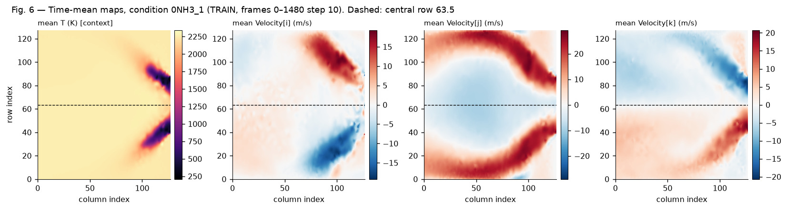
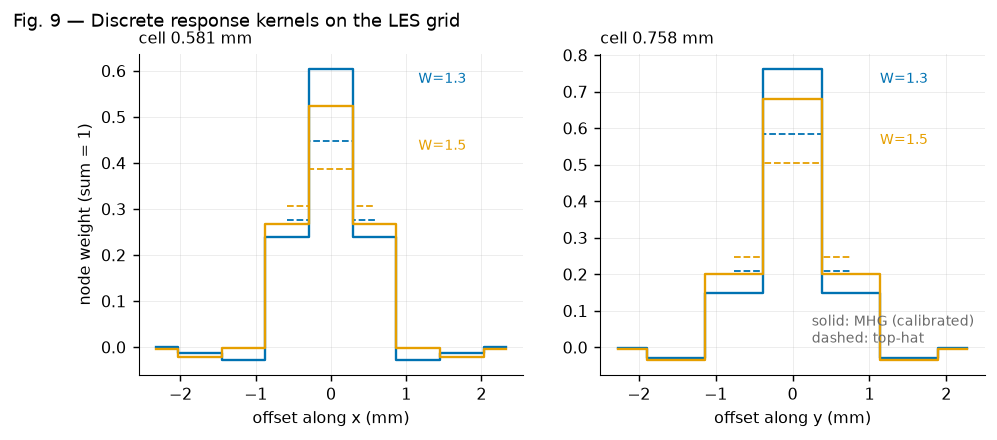
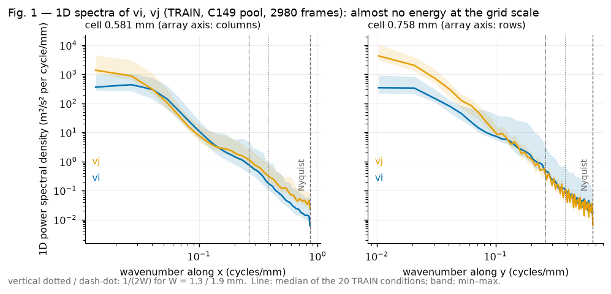
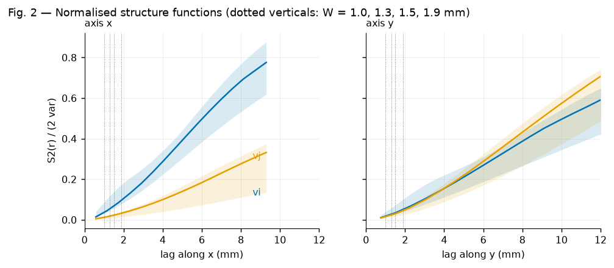
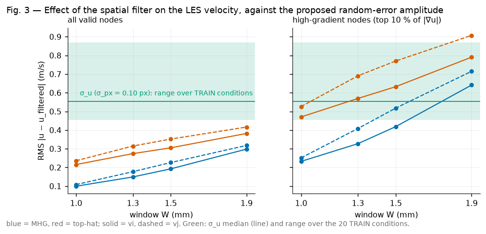
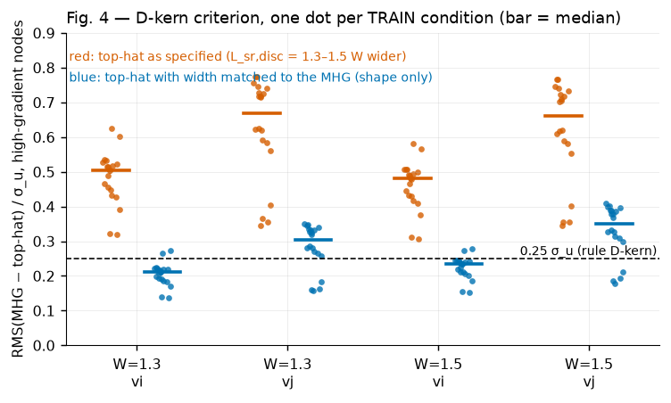
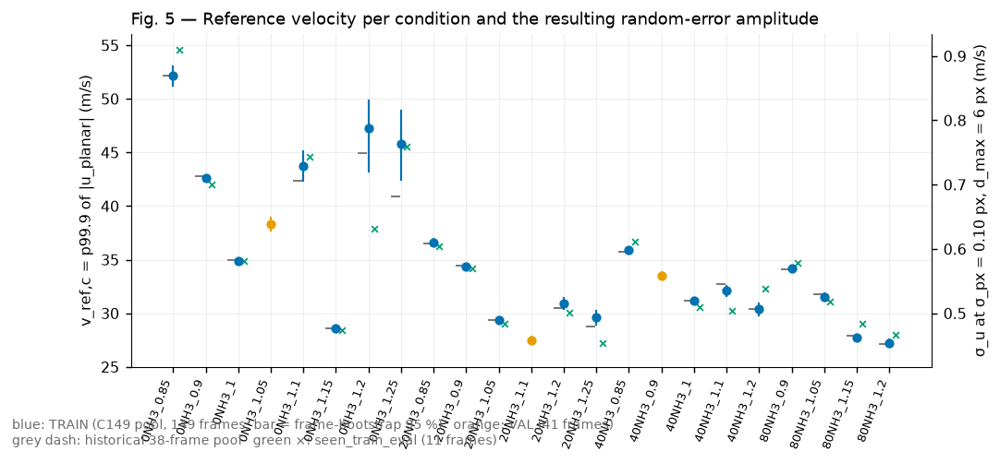

# Missione 02 — Fase 1 fino a R1: orientamento, supporto della griglia, velocità di riferimento

**Data:** 27 novembre 2026 · **Branch:** `mission02/piv-execution` (da `piv/experiment-proposal` @ `d4fecb2a50d1bbb4d49abd219ae6c326aba3abe3`)
**Codice delle analisi:** `6573393345bc2d4e18076b2ebf70486707fc0bb2` e commit successivi sui soli script di tabelle (vedi §9)
**Stato:** consegna per la **revisione R1**. Eseguite F1.1, F1.2, F1.3. Nessun training, nessuna inferenza neurale, nessuna profilazione GPU, nessun accesso a TEST. Fase 2 non avviata.
**Documenti collegati:** [orientation_note.md](orientation_note.md) (F1.1), [roadmap tecnica](roadmap_tecnica_piv.md), indice degli artefatti [results/piv/phase1/INDEX.md](../../results/piv/phase1/INDEX.md).

---

## 1. Per Enrico: che cosa abbiamo trovato

**Che cosa abbiamo fatto.** Prima di costruire il generatore di osservazioni PIV, abbiamo controllato tre cose sui dati di TRAIN, come previsto dalla roadmap:
1. che cosa sono davvero le tre componenti di velocità e in che piano sta la slice;
2. quanto contenuto ha la LES alle scale di una finestra PIV (1–2 mm), cioè se il filtro cambierà davvero i dati;
3. quale velocità di riferimento usare per condizione, da cui dipende l'ampiezza dell'errore casuale.

**Risultati in parole semplici.**

1. **Orientamento: probabile, non confermato.** Nessuna fonte pubblica dice che cosa siano `Velocity[i/j/k]` né il piano della slice. I campi medi però hanno una simmetria nettissima rispetto alla **riga centrale** della griglia: la slice è con ottima probabilità un taglio **per l'asse del bruciatore**, con l'asse lungo le colonne e i getti freddi che entrano dal bordo destro. Ne segue che vj è la componente assiale, vk è fuori piano (azimutale) e vi è la componente trasversale nel piano. **Attenzione:** questo scambia i ruoli rispetto all'ipotesi "vi lungo x, vj lungo y" della roadmap. Per la costruzione delle osservazioni non cambia nulla, ma un'alternativa (vi fuori piano) non è esclusa. Dettagli e prove in [orientation_note.md](orientation_note.md).
2. **La LES è molto liscia alla scala della finestra.** In genere meno dello 0,2 % della varianza della velocità sta a lunghezze d'onda sotto 4 celle (≈2,3–3 mm; massimo 0,5 % in una condizione). Il filtro PIV cambia quindi poco il campo: con W = 1,3 mm lo scarto è di circa 0,15–0,18 m/s RMS su tutta la slice, contro un errore casuale proposto di circa 0,6 m/s. **Ma nelle zone ad alto gradiente (i bordi dei getti) lo scarto sale a 0,3–0,4 m/s, cioè circa 0,6–0,7 volte l'errore casuale:** lì filtro ed errore pesano in modo confrontabile.
3. **Il kernel top-hat differisce dal kernel principale (MHG) più della soglia di decisione.** Con la regola scritta nella roadmap, la differenza in zona ad alto gradiente è in mediana 0,4–0,7 volte l'errore casuale (0,3–0,8 fra condizioni) e supera la soglia di 0,25 in tutte le 20 condizioni. **Ma la maggior parte della differenza viene dalla larghezza, non dalla forma:** il top-hat così discretizzato è 1,2–1,5 volte più largo del MHG alle finestre di PIV-A e PIV-B. A larghezza pareggiata la differenza scende a 0,1–0,4 volte l'errore casuale, in zona di confine con la soglia.
4. **La velocità di riferimento varia molto fra condizioni**: da 27 a 52 m/s in TRAIN (p99,9 di |u|), da 27,5 a 38,3 m/s in VAL. L'errore casuale che ne risulta (con 0,10 px) va da 0,45 a 0,87 m/s in TRAIN, **media 0,59 m/s**, non i ≈0,8 m/s dell'ordine di grandezza della roadmap, che veniva dal valore raggruppato di tutte le condizioni (46,9 m/s). Per due condizioni a φ alto con CH₄ puro il p99,9 è poco stabile (differenze del 12–20 % fra pool di frame diversi).
5. **Un problema concreto di B: la finestra centrale è quasi tutta gas combusto.** La finestra 30×30 mm centrata, quella su cui la roadmap allena PIV-B, contiene lo 0,09 % di gas freddo (T < 1800 K) contro il 9,2 % dell'intera slice: i getti sono quasi assenti. Le posizioni laterali ne hanno il 6–7 %. È una questione di geometria, non di risultati delle reti, e va decisa a R1 (§3).
6. **Nessun problema impedisce di eseguire la Fase 2.** Ci sono alcuni punti da chiudere o precisare (§3).

## 2. Decisioni da chiudere a R1: raccomandazione

| ID | Decisione | Raccomandazione | Motivo |
|---|---|---|---|
| D-ori | 2C in piano? SENS-OOP? | **Esito: probabile.** Procedere con 2C = `(vi, vj)` come ipotesi dichiarata; **non attivare SENS-OOP** | Regola roadmap §5: probabile → 2C. SENS-OOP richiede una provenienza che non c'è e una legge non letta. L'alternativa "vi fuori piano" va dichiarata come limite; aggiungere vk come terza componente richiederebbe un'architettura diversa, che la missione esclude: non lo propongo |
| D-kern | Kernel principale | **MHG resta principale.** Il criterio scritto (RMS < 0,25 σ_u in alto gradiente) **non è soddisfatto** (20/20 condizioni, mediane 0,4–0,7). Per la regola, il top-hat **entra nel piano di training come gruppo condizionato T10**; la decisione di allenarlo si prende comunque a R4 | La regola va applicata come scritta. L'analisi a larghezza pareggiata (0,1–0,4) mostra che la forma da sola è al limite: non c'è un caso in cui il top-hat sia chiaramente trascurabile. Il costo di T10 è piccolo (5 U-Net) |
| Calibrazione dei kernel | Come si fissa σ_r e σ_n | **Confermare la taratura per asse al target discreto** (σ_r e σ_n della tabella 1), come da §2.3 punto 3 | La discretizzazione per cella allarga L_sr di 2–12 %: senza taratura la risposta dichiarata non sarebbe quella realizzata |
| Velocità di riferimento | Quale pool e quale stimatore | **Congelare** v_ref,c da `train_fit` C149 (TRAIN) e `val_eval` (VAL), p99,9 del modulo planare di u, σ_px = 0,10 px, d_max = 6 px (tabelle 6 e 7). Riportare l'incertezza del p99,9 | Il pool C149 è quello su cui si allena. L'incertezza del p99,9 (IC95 fino a ±3 m/s per 0NH3_1,2 e 0NH3_1,25) è minore del fattore 2,5 fra σ_px = 0,06 e 0,15 |
| Posizione di B | Posizione di training di PIV-B | **Da decidere.** Raccomando di non allenare B sulla sola posizione centrale: aggiungere (o sostituire con) una posizione che includa la regione dei getti (colonne 76–127; 13 % di gas freddo) | La regola geometrica approvata era "indipendente dai risultati": questa osservazione riguarda il contenuto della finestra, non le prestazioni delle reti. Va però approvata da Enrico (§3, punto 3) |
| Regioni di F1.2 | Definizione di "alto gradiente" | **Confermare**: nodi con \|∇u\| tra il 10 % più alto della condizione (diagnostica anche al 5 %) | La roadmap non la definisce; il risultato D-kern dipende dalla soglia (al 5 % i rapporti salgono di circa il 20 %) |
| Domanda agli autori | Orientamento e ricampionamento | Decidere se inoltrare la domanda preparata (§6 di orientation_note) | Non bloccante per R1; chiuderebbe l'esito "probabile" |

## 3. Problemi concreti emersi nella roadmap

Nessuno impedisce di proseguire. Sono elencati perché influenzano il significato dei risultati.

1. **La discretizzazione allarga il kernel.** Il campo LES è costante a tratti nella cella (§2.3, punto 3), quindi il peso nodale equivale alla convoluzione della risposta con la cella. L_sr,disc nominale supera il target di 0,93·W del 4–12 % (7 casi su 8 oltre la tolleranza del 5 %); la taratura per asse lo corregge. Con W = 1,0 mm in y (cella 0,758 mm) il kernel ha 2 nodi per lato.
2. **Il top-hat non è confrontabile con il MHG a pari W.** Con L_sr = W e pesi proporzionali alla sovrapposizione, il top-hat realizzato ha L_sr,disc = 1,25–2,23 mm (1,1–1,5 volte il MHG tarato; 1,2–1,5 alle finestre di A e B). La regola D-kern confronta quindi due kernel di larghezza diversa. Nella tabella 4b sono riportate le larghezze di top-hat che pareggiano il MHG (0,68–0,94 W).
3. **La finestra B centrale contiene quasi solo gas combusto.** Con la lettura di F1.1 (riga centrale = asse; colonne = direzione assiale), la regola "x centrato; y centrale ± 30 mm" fa variare la finestra lungo la direzione trasversale, e le due posizioni laterali sono immagini speculari (statisticamente equivalenti), mentre nessuna posizione sposta la finestra verso i getti (colonne > 100). Contenuto delle finestre ([`b_window_content.json`](../../results/piv/phase1/f12/b_window_content.json), T come diagnostica dichiarata):

   | Finestra B | righe × colonne | frazione T < 1800 K | frazione con modulo di u > 20 m/s |
   |---|---|---|---|
   | intera slice | 0–127 × 0–127 | 9,2 % | 15,4 % |
   | centrale (addestramento) | 44–83 × 38–89 | **0,09 %** | 5,1 % |
   | y_mid − 30 mm | 4–43 × 38–89 | 6,2 % | 20,5 % |
   | y_mid + 30 mm | 84–123 × 38–89 | 7,3 % | 21,9 % |
   | alternativa verso i getti | 44–83 × 76–127 | 13,1 % | 13,0 % |

4. **Etichette delle coordinate.** L'asse di simmetria è la riga centrale, ma `y` (62,9–159,1 mm) non è centrato su di essa. Se le etichette `x`/`y` fossero scambiate rispetto agli assi dell'array, le celle per asse si invertirebbero. Misurato: l'effetto sui risultati di F1.2 è fino a circa il 30 %, nessuna conclusione cambia ([orientation_note §5](orientation_note.md)).
5. **Il valore raggruppato di v_ref sovrastima la σ_u tipica.** L'ordine di grandezza del §2.3 punto 4 (v_ref ≈ 47 m/s → σ ≈ 0,8 m/s) è il p99,9 raggruppato (46,9 m/s su 2980 frame): per condizione la media è 35,3 m/s e σ_u = 0,59 m/s (0,45–0,87).
6. **La provenienza pubblica non basta per F1.1.** La roadmap prevede la documentazione ufficiale di STAR-CCM+ e il codice di conversione di RealPDEBench: nessuno dei due è accessibile pubblicamente (il repository contiene solo il loader dei dati già convertiti).

---

## 4. Ambiente e uso dei dati

### 4.1 Ambiente

| Voce | Valore |
|---|---|
| Repository / worktree di esecuzione | `EnricoBontempi/official_thesis`; `~/projects/official_thesis_piv`, branch `mission02/piv-execution` dal commit approvato; checkout principale (branch `mission04/step2-thermal-datasets`, un file non tracciato) non toccato; nessun `AGENTS.md` nella repository |
| Python | 3.13.13; numpy 2.5.4, scipy 1.18.1, pandas 3.1.1, matplotlib 3.11.2, pyarrow 26.0.1 (venv del progetto, `~/projects/official_thesis/.venv`) |
| Dati locali (fuori da Git) | Raw Arrow: 30 shard in `~/projects/official_thesis/data/raw/combustion/hf_dataset/numerical/` (≈62,9 GB); cache C149 `data/processed/month2_dense_unet_cache_c149` (train_fit 2980, seen_train_eval 220, val_eval 123); cache storica A38 `data/processed/month2_dense_unet_cache` (760 / 220 / 123) |
| Cluster | Engaging (ORCD): accesso non interattivo funzionante tramite il socket SSH già aperto (`ssh -F ~/.ssh/config engaging`); dati e checkout sotto `~/orcd/pool/` (`official_thesis`, `official_thesis_data`, `official_thesis_runs`, …). **Non usato in questa fase** (nessun job, nessun trasferimento). `dengvector`: socket non attivo, non necessario |
| Statistiche di normalizzazione | `data/manifests/train_norm_stats_month2_fit.json`, sha256 `678263fb4cb2598350b8fd69a71ce4843f747aa61c19556cf7f0f9c5c3ceac0e` (verificato a ogni lettura): vi μ = −0,060, σ = 5,674 m/s; vj μ = 4,272, σ = 11,910 m/s |

Nessun accesso mancante per la Fase 1.

### 4.2 Che cosa è stato letto (e che cosa no)

| Fase | Ruolo / dati | Uso |
|---|---|---|
| F1.1 | Raw Arrow, **solo** shard TRAIN: `0NH3_1`, `40NH3_1`, `80NH3_1.05`, `20NH3_0.9` (frame 0–1500) | Controlli ausiliari; T e specie solo qui, per la qualifica |
| F1.2 | `train_fit` C149 (20 condizioni TRAIN × 149 frame), solo velocità; T solo per due diagnostiche dichiarate (frazione di gas freddo in una finestra; ripartizione T < 1800 K) | Analisi TRAIN prevista da F1.2 |
| F1.3 | `train_fit` C149 e A38, `seen_train_eval` (TRAIN); **`val_eval` (VAL), solo velocità** | F1.3 autorizza le statistiche di sola velocità anche su VAL. Questo è l'**unico uso di VAL**; non entra in F1.1 né F1.2 |
| TEST | **Mai letto.** `refuse_test` rifiuta i ruoli `test*` e le condizioni TEST per ID; la lista dei file letti, con sha256, è in ogni `*provenance.json` | — |

---

## 5. F1.1 — Orientamento e componenti

Sintesi (prove e limiti in [orientation_note.md](orientation_note.md)):

| Elemento | Esito |
|---|---|
| Significato di `Velocity[i/j/k]` per provenienza | **ignoto** |
| Slice per l'asse del bruciatore, asse lungo le colonne | **probabile** (simmetria dei campi medi: T, vj simmetrici e vi, vk antisimmetrici rispetto alla riga 63,5; frazione di energia 0,98–1,00) |
| vk fuori piano; vj assiale; vi trasversale nel piano | **probabile** (alternativa vi↔vk non esclusa) |
| Segni, origine di y, etichette x/y | **ignoto** |

Il controllo sullo spostamento delle strutture scalari fra frame consecutivi è stato validato su spostamenti sintetici noti (errore ≤ 0,05 celle) ma sui dati reali non dà una relazione quantitativa con nessuna componente: lo si riporta come ausiliario e **non** come prova. La cache coincide con il raw (differenza massima 1,9·10⁻⁶ m/s su 84 confronti).

---

## 6. F1.2 — Supporto della griglia alle scale PIV (solo TRAIN)

### 6.1 Formule, unità, discretizzazione

Tutto in millimetri; il campo LES (Δx = 0,5811 mm lungo le colonne, Δy = 0,7581 mm lungo le righe, uniformi a 10⁻¹³) è trattato come costante a tratti nella cella.

- **Kernel di risposta (MHG)**, per asse, con b = 0,35 (WIE17 Tab. 2.1): F(s) = (1 − b s²/σ²) exp(−s²/2σ²) / ((1−b) σ √(2π)), ∫F ds = 1. Lunghezza di filtro L_sr = 1/∫F² ds = σ √(4π) (1−b)² / (1 − b + 3b²/4). Primitiva (derivata in questo lavoro): G(s) = ½ erf(s/(σ√2)) + b s exp(−s²/2σ²) / ((1−b) σ √(2π)); verificata numericamente (errore massimo sulla derivata 4·10⁻¹⁰; ∫F = 1 a 10⁻¹²; L_sr numerico = formula).
- **Valori nominali** (verificati): σ_r = 0,4607 W per L_sr = 0,93 W; σ_n = 0,5944 W per L_sr,n = 1,2 W; il lobo negativo inizia a |s| = σ/√b = 1,69 σ ≈ 0,78 W.
- **Pesi discreti:** w(i) = G(s_i + Δ/2) − G(s_i − Δ/2), con l'intervallo troncato a ±R, R = 4σ, poi rinormalizzati a somma 1. L_sr,disc = Δ/Σw². Risposta discreta H(k) = Σ w(i) cos(k s_i).
- **Taratura** per asse: se |L_sr,disc/target − 1| > 5 %, σ si ritocca (ricerca per bisezione) finché L_sr,disc = target. Lo stesso per il kernel di rumore (target 1,2 W).
- **Top-hat:** peso = lunghezza di sovrapposizione fra la finestra [−W/2, W/2] e la cella, diviso W.
- **Regola della finestra:** il vettore esiste se [±W/2]² è nel campo (rettangolo dei nodi estremi). Margine = ⌈W/2Δ⌉ nodi: 2 in x e 1 in y per W = 1,3 e 1,5 mm (come atteso dalla roadmap; per W = 1,5 in y il rapporto è 0,99, quindi il margine di 1 nodo regge solo perché Δy = 0,758 > 0,75 mm), 1 e 1 per W = 1,0, 2 e 2 per W = 1,9. Vettori validi: A (W = 1,3) 124×126 = 15 624; B (W = 1,5) 48×38 = 1824 per posizione (finestra di 52 colonne × 40 righe).
- **Bordo:** il kernel è troncato ai nodi del campo e rinormalizzato (la somma del prodotto 2D è il prodotto delle somme per asse, quindi il filtro 2D è separabile anche al bordo).
- **Regioni (solo velocità):** `HG` = nodi con |∇u| = √[(∂ₓvi)² + (∂ᵧvi)² + (∂ₓvj)² + (∂ᵧvj)²] (m/s per mm) nel 10 % più alto della condizione (diagnostica anche al 5 %); `JET` = |u| nel 10 % più alto della condizione; `REST` = il resto. Soglie per condizione in [`f12_context.json`](../../results/piv/phase1/f12/f12_context.json). Ripartizione per T (T < 1800 K) solo come diagnostica dichiarata.
- **σ_u** per il confronto: σ_u,c = σ_px · v_ref,c / d_max, con σ_px = 0,10 px e d_max = 6 px (§2.3 punto 4); media su 20 condizioni TRAIN: **0,59 m/s**.

**Tabella 1 — Kernel di risposta sulla griglia discreta** (target L_sr,disc = 0,93 W)

| W (mm) | asse | cella (mm) | W/cella | margine (nodi) | σ_r nom. (mm) | L_disc nom. (err %) | σ_r tarato (mm) | L_disc tarato (mm) | target 0,93 W | R_r = 4σ (mm) | nodi/lato | L_disc top-hat (mm) |
|---|---|---|---|---|---|---|---|---|---|---|---|---|
| 1 | x | 0.581 | 1.72 | 1 | 0.461 | 1.044 (+12.2) | 0.408 | 0.93 | 0.93 | 1.63 | 3 | 1.37 |
| 1 | y | 0.758 | 1.32 | 1 | 0.461 | 1.043 (+12.1) | 0.414 | 0.93 | 0.93 | 1.66 | 2 | 1.25 |
| 1.3 | x | 0.581 | 2.24 | 2 | 0.599 | 1.310 (+8.3) | 0.545 | 1.21 | 1.21 | 2.18 | 4 | 1.65 |
| 1.3 | y | 0.758 | 1.71 | 1 | 0.599 | 1.357 (+12.3) | 0.531 | 1.21 | 1.21 | 2.12 | 3 | 1.78 |
| 1.5 | x | 0.581 | 2.58 | 2 | 0.691 | 1.483 (+6.3) | 0.644 | 1.4 | 1.4 | 2.58 | 4 | 1.72 |
| 1.5 | y | 0.758 | 1.98 | 1 | 0.691 | 1.539 (+10.3) | 0.617 | 1.4 | 1.4 | 2.47 | 3 | 2.01 |
| 1.9 | x | 0.581 | 3.27 | 2 | 0.875 | 1.837 (+4.0) | 0.875 | 1.84 | 1.77 | 3.5 | 6 | 2.05 |
| 1.9 | y | 0.758 | 2.51 | 2 | 0.875 | 1.886 (+6.7) | 0.812 | 1.77 | 1.77 | 3.25 | 4 | 2.23 |

**Tabella 1b — Kernel di rumore e autocorrelazione discreta** (target 1,2 W; ρ per kernel tarato, ai ritardi di 1–4 nodi; ritardo = nodi × cella)

| W (mm) | asse | σ_n nom. (mm) | L_disc nom. (err %) | σ_n tarato (mm) | target 1,2 W | ρ(1 nodo) | ρ(2) | ρ(3) | ρ(4) |
|---|---|---|---|---|---|---|---|---|---|
| 1 | x | 0.594 | 1.302 (+8.5) | 0.54 | 1.2 | 0.567 | 0.031 | -0.057 | -0.01 |
| 1 | y | 0.594 | 1.348 (+12.3) | 0.527 | 1.2 | 0.342 | -0.036 | -0.015 | 0.001 |
| 1.3 | x | 0.773 | 1.639 (+5.1) | 0.731 | 1.56 | 0.727 | 0.231 | -0.039 | -0.06 |
| 1.3 | y | 0.773 | 1.693 (+8.5) | 0.702 | 1.56 | 0.565 | 0.029 | -0.057 | -0.01 |
| 1.5 | x | 0.892 | 1.869 (+3.8) | 0.892 | 1.8 | 0.805 | 0.389 | 0.057 | -0.066 |
| 1.5 | y | 0.892 | 1.916 (+6.5) | 0.83 | 1.8 | 0.661 | 0.128 | -0.064 | -0.035 |
| 1.9 | x | 1.13 | 2.335 (+2.4) | 1.13 | 2.28 | 0.872 | 0.563 | 0.235 | 0.016 |
| 1.9 | y | 1.13 | 2.373 (+4.1) | 1.13 | 2.28 | 0.794 | 0.365 | 0.038 | -0.069 |

**Tabella 1c — Funzione di trasferimento discreta del MHG tarato**, H(λ)

| W (mm) | asse | λ=2 mm | λ=3 mm | λ=4 mm | λ=6 mm | λ=10 mm |
|---|---|---|---|---|---|---|
| 1 | x | 0.735 | 0.911 | 0.96 | 0.987 | 0.996 |
| 1 | y | 0.809 | 0.917 | 0.959 | 0.984 | 0.995 |
| 1.3 | x | 0.516 | 0.833 | 0.933 | 0.982 | 0.997 |
| 1.3 | y | 0.542 | 0.815 | 0.917 | 0.973 | 0.993 |
| 1.5 | x | 0.358 | 0.749 | 0.897 | 0.975 | 0.996 |
| 1.5 | y | 0.379 | 0.741 | 0.886 | 0.967 | 0.993 |
| 1.9 | x | 0.1 | 0.492 | 0.757 | 0.939 | 0.993 |
| 1.9 | y | 0.136 | 0.541 | 0.783 | 0.942 | 0.991 |

### 6.2 Contenuto spaziale della LES

**Tabella 2 — Indicatori vicino a Nyquist** (mediana su 20 condizioni TRAIN; spettro con finestra Blackman-Harris e detrend lineare per riga)

| comp. | asse | % varianza a λ<4 celle (mediana) | (max cond.) | pendenza 0,15–0,4 k_N | pendenza 0,5–0,95 k_N | PSD(0,9k_N)/PSD(0,2k_N) |
|---|---|---|---|---|---|---|
| vi | x | 0.074 | 0.324 | -2.48 | -3.41 | 0.00767 |
| vi | y | 0.165 | 0.544 | -2.83 | -2.57 | 0.00551 |
| vj | x | 0.076 | 0.128 | -2.05 | -2.84 | 0.0169 |
| vj | y | 0.019 | 0.025 | -3.43 | -2.88 | 0.00742 |

**Tabella 2b — Funzione di struttura normalizzata** S2(r)/(2·var), mediana su 20 condizioni (1 cella = 0,58 mm in x, 0,76 mm in y)

| comp. | asse | S2/2var @1 cella | @2 | @4 | @8 |
|---|---|---|---|---|---|
| vi | x | 0.0142 | 0.0453 | 0.131 | 0.354 |
| vi | y | 0.0104 | 0.0347 | 0.104 | 0.272 |
| vj | x | 0.00483 | 0.0152 | 0.0439 | 0.125 |
| vj | y | 0.00903 | 0.0306 | 0.0992 | 0.292 |

**Lettura.**
- A lunghezze d'onda sotto 4 celle (≈2,3 mm in x, 3,0 mm in y) sta una frazione di varianza compresa fra 0,02 % e 0,17 % (mediana; massimo 0,54 % in una condizione per vi lungo y). Lo spettro cade di oltre due ordini di grandezza fra 0,2 e 0,9 della frequenza di Nyquist.
- Le pendenze spettrali sono ripide già a metà banda (da −2 a −3,4 fra 0,15 e 0,4 k_N). Il campo esportato è quindi liscio alla scala di 2–3 celle: **la risoluzione effettiva è di alcune celle (≈2–3 mm)**, e finestre PIV da 1,0–1,9 mm (1,3–3,3 celle) agiscono su una regione dello spettro che contiene poca energia.
- S2(1 cella)/(2·var) è 0,5–1,4 %: celle adiacenti sono correlate al 99 %. Il numero di nodi supera l'informazione indipendente (nota già in roadmap, punto (1)).
- Il rapporto S2(2)/S2(1) è 3,1–3,4 (< 4, il valore di un campo perfettamente liscio): c'è un po' di contenuto a scala di cella, che l'effetto del filtro misura direttamente.

### 6.3 Effetto del filtro

**Tabella 3 — RMS e p95 di |u − u_filtrato| (m/s)**, nodi validi di TRAIN, tutte le condizioni insieme (2980 frame)

| W (mm) | kernel | vi tutti RMS / p95 | vi alto grad. RMS / p95 | vj tutti RMS / p95 | vj alto grad. RMS / p95 |
|---|---|---|---|---|---|
| 1 | MHG | 0.10 / 0.16 | 0.23 / 0.41 | 0.11 / 0.19 | 0.25 / 0.51 |
| 1 | top-hat | 0.22 / 0.39 | 0.47 / 0.88 | 0.24 / 0.45 | 0.53 / 1.06 |
| 1.3 | MHG | 0.15 / 0.27 | 0.33 / 0.66 | 0.18 / 0.32 | 0.41 / 0.84 |
| 1.3 | top-hat | 0.27 / 0.51 | 0.57 / 1.12 | 0.31 / 0.61 | 0.69 / 1.40 |
| 1.5 | MHG | 0.19 / 0.35 | 0.42 / 0.84 | 0.23 / 0.41 | 0.52 / 1.07 |
| 1.5 | top-hat | 0.31 / 0.57 | 0.63 / 1.25 | 0.35 / 0.68 | 0.77 / 1.57 |
| 1.9 | MHG | 0.30 / 0.55 | 0.64 / 1.28 | 0.32 / 0.60 | 0.71 / 1.43 |
| 1.9 | top-hat | 0.38 / 0.72 | 0.79 / 1.56 | 0.42 / 0.81 | 0.91 / 1.81 |

**Tabella 3a — Per regione, MHG tarato, confrontato con σ_u (media TRAIN 0,59 m/s)**

| W (mm) | regione | vi RMS (m/s) | vi RMS/σ_u | vj RMS (m/s) | vj RMS/σ_u |
|---|---|---|---|---|---|
| 1.3 | all | 0.149 | 0.25 | 0.177 | 0.3 |
| 1.3 | HG_top10pct_gradient | 0.327 | 0.56 | 0.408 | 0.69 |
| 1.3 | HG_top5pct_gradient | 0.398 | 0.68 | 0.502 | 0.85 |
| 1.3 | JET_top10pct_speed | 0.204 | 0.35 | 0.203 | 0.34 |
| 1.3 | REST | 0.113 | 0.19 | 0.13 | 0.22 |
| 1.3 | DIAG_T<1800K | 0.239 | 0.41 | 0.244 | 0.41 |
| 1.3 | DIAG_T>=1800K | 0.137 | 0.23 | 0.169 | 0.29 |
| 1.5 | all | 0.192 | 0.33 | 0.226 | 0.38 |
| 1.5 | HG_top10pct_gradient | 0.419 | 0.71 | 0.518 | 0.88 |
| 1.5 | HG_top5pct_gradient | 0.508 | 0.86 | 0.636 | 1.08 |
| 1.5 | JET_top10pct_speed | 0.266 | 0.45 | 0.261 | 0.44 |
| 1.5 | REST | 0.146 | 0.25 | 0.167 | 0.28 |
| 1.5 | DIAG_T<1800K | 0.309 | 0.53 | 0.315 | 0.54 |
| 1.5 | DIAG_T>=1800K | 0.176 | 0.3 | 0.215 | 0.37 |

**Lettura.**
- A W = 1,3 mm (PIV-A) l'RMS del filtro MHG è 0,15 (vi) e 0,18 (vj) m/s su tutta la slice: 0,25–0,30 volte σ_u. Il p95 è 0,27–0,32 m/s.
- Nei nodi ad alto gradiente sale a 0,33–0,41 m/s (0,56–0,69 σ_u; p95 0,66–0,84 m/s); al 5 % più alto a 0,40–0,50 m/s (0,68–0,85 σ_u). Nel getto veloce (10 % più alto di |u|): 0,20 m/s. Nel resto: 0,11–0,13 m/s.
- A W = 1,5 mm (PIV-B): 0,19–0,23 m/s globali; 0,42–0,52 in alto gradiente (0,71–0,88 σ_u).
- Il top-hat, più largo, scarta circa il doppio (0,27–0,31 m/s globali a W = 1,3 mm).
- **Conclusione per il generatore:** su questa griglia il filtro è un effetto piccolo ovunque tranne nei bordi dei getti, dove è confrontabile con l'errore casuale. Non si è scelto nulla in base al danno sulle reti; si riporta quello che c'è.

### 6.4 D-kern: MHG contro top-hat

**Tabella 4 — RMS(MHG − top-hat) / σ_u,c nei nodi ad alto gradiente** (per condizione: mediana [min–max] su 20; soglia della regola: 0,25)

| W (mm) | comp. | top-hat come da roadmap: mediana [min–max] cond. | n. cond. > 0,25 | top-hat a larghezza pareggiata: mediana [min–max] | n. cond. > 0,25  |
|---|---|---|---|---|---|
| 1 | vi | 0.44 [0.28–0.60] | 20/20 | 0.13 [0.09–0.19] | 0/20 |
| 1 | vj | 0.58 [0.30–0.67] | 20/20 | 0.18 [0.09–0.20] | 0/20 |
| 1.3 | vi | 0.50 [0.32–0.63] | 20/20 | 0.21 [0.14–0.27] | 2/20 |
| 1.3 | vj | 0.67 [0.35–0.77] | 20/20 | 0.30 [0.16–0.35] | 16/20 |
| 1.5 | vi | 0.48 [0.31–0.58] | 20/20 | 0.23 [0.15–0.28] | 2/20 |
| 1.5 | vj | 0.66 [0.34–0.77] | 20/20 | 0.35 [0.18–0.41] | 16/20 |
| 1.9 | vi | 0.45 [0.29–0.51] | 20/20 | 0.29 [0.20–0.34] | 17/20 |
| 1.9 | vj | 0.63 [0.33–0.75] | 20/20 | 0.41 [0.21–0.49] | 17/20 |

**Tabella 4b — Larghezza del top-hat che pareggia L_sr,disc del MHG tarato**

| W (mm) | asse | L_disc MHG (mm) | larghezza top-hat pareggiata (mm) | rapporto a W |
|---|---|---|---|---|
| 1 | x | 0.93 | 0.751 | 0.75 |
| 1 | y | 0.93 | 0.842 | 0.84 |
| 1.3 | x | 1.21 | 0.899 | 0.69 |
| 1.3 | y | 1.21 | 0.977 | 0.75 |
| 1.5 | x | 1.4 | 1.02 | 0.68 |
| 1.5 | y | 1.4 | 1.07 | 0.71 |
| 1.9 | x | 1.84 | 1.79 | 0.94 |
| 1.9 | y | 1.77 | 1.29 | 0.68 |

**Lettura.**
- **Come scritta nella roadmap**, la differenza è 0,28–0,77 σ_u (mediane 0,44–0,67) e supera 0,25 in tutte le 20 condizioni e a tutte le W. **Il criterio non è soddisfatto.**
- **A larghezza pareggiata** (solo forma) la differenza scende a 0,09–0,49: sotto 0,25 per W = 1,0 mm e per vi a W = 1,3–1,5 mm, sopra per vj (16/20 condizioni a W = 1,3 e 1,5 mm) e a W = 1,9 mm. È un caso al limite, che dipende dalla componente.
- Da qui la raccomandazione del §2: applicare la regola come scritta (T10 nella matrice condizionata) e riportare la scomposizione larghezza/forma.

### 6.5 Sensibilità allo scambio delle celle

Con i passi di cella scambiati ([`f12_swapcells/`](../../results/piv/phase1/f12_swapcells/)): RMS del filtro MHG fino a circa il 30 % più basso (W = 1,0 mm in alto gradiente: vi 0,166 contro 0,232 m/s) e meno a W maggiori; rapporto D-kern 0,41–0,65 contro 0,43–0,61. Le conclusioni del §6.3–6.4 non cambiano.

---

## 7. F1.3 — Velocità di riferimento e ampiezze d'errore

**Definizione.** v_ref,c = p99,9 di |u_planare| = √(vi² + vj²) su tutti i nodi dei frame del ruolo usato, in m/s, ricostruita con le statistiche congelate. σ_u,c = σ_px · v_ref,c / d_max per ciascuna componente, con σ_px ∈ {0,06 (SENS-σlo), **0,10 (principale)**, 0,15 (SENS-σhi)} px e d_max = 6 px (dichiarato come inferenza da STO12 nella roadmap). **Uso dei dati:** TRAIN da `train_fit` C149 (ruolo di training della campagna); VAL da `val_eval` (**solo velocità**, autorizzato da F1.3); TEST non letto. L'IC95 è un bootstrap sui frame (200 ricampionamenti, seed 20261127).

**Tabella 6 — TRAIN (20 condizioni; pool C149 di 149 frame ciascuna)**

| condizione | NH3 | φ | n frame | p50 modulo u | p99 | v_ref (p99,9) | IC95 bootstrap | v_ref pool 38 fr. | v_ref seen (11 fr.) | σ_u 0,06 px | σ_u 0,10 px (princ.) | σ_u 0,15 px |
|---|---|---|---|---|---|---|---|---|---|---|---|---|
| 0NH3_0.85 | 0 | 0.85 | 149 | 21 | 47.9 | 52.1 | 51.2–53.0 | 52.2 | 54.6 | 0.52 | 0.87 | 1.3 |
| 0NH3_0.9 | 0 | 0.9 | 149 | 11.7 | 39.5 | 42.6 | 42.5–42.7 | 42.8 | 42.1 | 0.43 | 0.71 | 1.07 |
| 0NH3_1 | 0 | 1 | 149 | 8.8 | 32.4 | 34.9 | 34.7–35.0 | 34.9 | 34.9 | 0.35 | 0.58 | 0.87 |
| 0NH3_1.1 | 0 | 1.1 | 149 | 8.9 | 36.4 | 43.7 | 42.3–45.1 | 42.4 | 44.6 | 0.44 | 0.73 | 1.09 |
| 0NH3_1.15 | 0 | 1.15 | 149 | 7.5 | 26.6 | 28.6 | 28.5–28.8 | 28.6 | 28.4 | 0.29 | 0.48 | 0.72 |
| 0NH3_1.2 | 0 | 1.2 | 149 | 8.5 | 33 | 47.2 | 43.3–49.9 | 45 | 37.9 | 0.47 | 0.79 | 1.18 |
| 0NH3_1.25 | 0 | 1.25 | 149 | 8.5 | 31.4 | 45.8 | 42.5–48.9 | 40.9 | 45.5 | 0.46 | 0.76 | 1.15 |
| 20NH3_0.85 | 0.2 | 0.85 | 149 | 9.5 | 33.4 | 36.6 | 36.3–36.9 | 36.5 | 36.3 | 0.37 | 0.61 | 0.92 |
| 20NH3_0.9 | 0.2 | 0.9 | 149 | 8.9 | 31.5 | 34.4 | 34.1–34.6 | 34.4 | 34.2 | 0.34 | 0.57 | 0.86 |
| 20NH3_1.05 | 0.2 | 1.05 | 149 | 7.5 | 27.3 | 29.4 | 29.1–29.6 | 29.4 | 29.1 | 0.29 | 0.49 | 0.73 |
| 20NH3_1.2 | 0.2 | 1.2 | 149 | 8.7 | 27.1 | 30.9 | 30.4–31.4 | 30.5 | 30 | 0.31 | 0.52 | 0.77 |
| 20NH3_1.25 | 0.2 | 1.25 | 149 | 8.2 | 25.6 | 29.6 | 28.9–30.2 | 28.8 | 27.2 | 0.3 | 0.49 | 0.74 |
| 40NH3_0.85 | 0.4 | 0.85 | 149 | 9.5 | 32.9 | 35.9 | 35.6–36.2 | 35.7 | 36.7 | 0.36 | 0.6 | 0.9 |
| 40NH3_1 | 0.4 | 1 | 149 | 8.3 | 28.5 | 31.2 | 30.9–31.5 | 31.2 | 30.6 | 0.31 | 0.52 | 0.78 |
| 40NH3_1.1 | 0.4 | 1.1 | 149 | 8.8 | 28.5 | 32.1 | 31.6–32.5 | 32.8 | 30.2 | 0.32 | 0.53 | 0.8 |
| 40NH3_1.2 | 0.4 | 1.2 | 149 | 8.6 | 26.3 | 30.4 | 29.8–30.9 | 30.4 | 32.3 | 0.3 | 0.51 | 0.76 |
| 80NH3_0.9 | 0.8 | 0.9 | 149 | 9.9 | 30.9 | 34.2 | 34.0–34.5 | 34.1 | 34.7 | 0.34 | 0.57 | 0.86 |
| 80NH3_1.05 | 0.8 | 1.05 | 149 | 9.2 | 28 | 31.6 | 31.2–31.9 | 31.8 | 31.1 | 0.32 | 0.53 | 0.79 |
| 80NH3_1.15 | 0.8 | 1.15 | 149 | 8.3 | 24.8 | 27.7 | 27.5–28.0 | 27.9 | 29 | 0.28 | 0.46 | 0.69 |
| 80NH3_1.2 | 0.8 | 1.2 | 149 | 7.9 | 24.2 | 27.2 | 26.9–27.5 | 27.2 | 28 | 0.27 | 0.45 | 0.68 |

**Tabella 7 — VAL (3 condizioni, 41 frame ciascuna; sola velocità)**

| condizione | NH3 | φ | n frame | p50 modulo u | p99 | v_ref (p99,9) | IC95 bootstrap | σ_u 0,06 px | σ_u 0,10 px (princ.) | σ_u 0,15 px |
|---|---|---|---|---|---|---|---|---|---|---|
| 0NH3_1.05 | 0 | 1.05 | 41 | 9.3 | 34.4 | 38.3 | 37.7–38.9 | 0.38 | 0.64 | 0.96 |
| 20NH3_1.1 | 0.2 | 1.1 | 41 | 6.9 | 25.6 | 27.5 | 27.3–27.8 | 0.28 | 0.46 | 0.69 |
| 40NH3_0.9 | 0.4 | 0.9 | 41 | 8.8 | 31 | 33.5 | 33.2–33.8 | 0.33 | 0.56 | 0.84 |

**Riepilogo.**
- TRAIN: v_ref da 27,2 a 52,1 m/s (media 35,3); σ_u principale da 0,45 a 0,87 m/s (media 0,59). VAL: v_ref 27,5–38,3 m/s; σ_u 0,46–0,64 m/s. Le condizioni VAL stanno dentro l'intervallo TRAIN.
- **Stabilità del p99,9:** il pool C149 contro il pool storico di 38 frame differisce in media dell'1,1 % e al massimo del 11,9 %; i frame di `seen_train_eval` (11 frame per condizione) dal pool C149 in media dell'−1,0 %, al massimo del 19,7 % (le condizioni peggiori sono 0NH3_1,2 e 0NH3_1,25, con IC95 largo fino a ±3 m/s e massimo di |u| fino a 58 m/s: coda pesante). Il dato è più incerto per quelle condizioni, ma la variazione (≤ 20 %) resta entro il fattore 2,5 fra σ_px = 0,06 e 0,15.
- **Confronto con la missione 00:** σ_u principale (0,45–0,87 m/s) sta fra N1 (σ = 0,5 m/s, effetto trascurabile sui modelli originali: +0,2 K) e N2 (1,5 m/s, +1,3…+2,9 K); σ_u ad alto σ_px (0,15 px) arriva a 1,3 m/s. Ma l'errore PIV è correlato su ≈ 1,2 W e agisce su un layout denso: non ci si aspetta lo stesso risultato della 00.

---

## 8. Che cosa Fase 1 non dimostra

- Che le componenti siano quelle indicate: è un'inferenza dalla simmetria dei campi medi.
- Che la PIV in questo combustore abbia filtro o errore con questi parametri: gli ordini di grandezza vengono dalla letteratura, non da misure sul nostro apparato.
- Che il contenuto spaziale della LES sia fisico: dipende da un filtro e da un ricampionamento della LES che non conosciamo. Su una LES più ricca di piccole scale l'effetto del filtro sarebbe maggiore.
- Che i risultati valgano fuori da TRAIN. La velocità di riferimento di VAL è solo di sola velocità e non guida nessuna scelta.
- Nulla sulle prestazioni delle reti: nessuna rete è stata usata.

## 9. Riproducibilità

| Voce | Valore |
|---|---|
| Comando | `bash scripts/piv_phase1/run_all.sh` dal worktree (variabile `PY` per l'interprete). Tutto è deterministico (seed 20261127 per i bootstrap; seed fissi per il test sintetico) |
| Tempo | ≈ 10 minuti su CPU, 16 core, 25 GB RAM; nessuna GPU |
| SHA del codice | `6573393345bc2d4e18076b2ebf70486707fc0bb2` per tutti i risultati. Commit successivi (`5dd4888a…` e quello di consegna) modificano solo `f11b`/`f11_analyze` (aggiunta di CSV di tracciabilità) e `make_tables` (intestazioni); i risultati numerici non cambiano. Ogni `*provenance.json` registra SHA, stato "dirty" (falso), versioni e file letti con sha256 |
| Cache C149 | payload aggregato sha256 `fa1c9358deb3bda0313cd74f9ab6855af87bc969c4069a463073d4c4120f03b4`; geometria `97e2e9df79c87a3fbf019fa1d9ac270aafe42319f83425afb5f3fb3be8f36ce7` |
| Cache A38 | payload aggregato sha256 `d0b1d06805562cda49a86ea9ab1f289ce202562549482533b272efb19a69c725` |
| Statistiche | `678263fb4cb2598350b8fd69a71ce4843f747aa61c19556cf7f0f9c5c3ceac0e` |
| Split e protocolli | `splits_interp_extrap.yaml` `acb87bf95852e7849f88a270af8cbd211ad999d0039c35885232b7bc2a99e7b9`; `month2_frame_protocol_opus_c149.yaml` `12b04c8406578a81203af8da41c98f348cfd07e982b7eba16dd46a92fea5c741` |
| Shard raw letti (sha256 ricalcolato; i primi tre coincidono con l'inventario remoto) | `data-00008` (`0NH3_1`) `df315dfb5ba7…`; `data-00023` (`40NH3_1`) `335fff3637ad…`; `data-00026` (`80NH3_1.05`) `569a668c9205…`; `data-00011` (`20NH3_0.9`) `4d616a77c753…` |
| Checksum degli artefatti | [`results/piv/phase1/SHA256SUMS`](../../results/piv/phase1/SHA256SUMS) |

Nessuna modifica a `nonideal_observations.py`, alle specifiche della missione 00, ai risultati storici o ai documenti delle missioni 00 e 01. Nessun merge. Il generatore di produzione (F2.2) non è stato implementato.
