# Missione 02 — Fase 2 fino a R2: osservazioni PIV virtuali, generatore e qualifica

**Data:** 27–28 novembre 2026 · **Branch:** `mission02/piv-execution` (da `05414c2`, decisione R1)
**Specifica congelata:** [`configs/observations/piv_observation_spec_v1.yaml`](../../configs/observations/piv_observation_spec_v1.yaml), sha256 `9f24afc9359bf3568aa693cf43fe21135717538924152148c8c50d50893b3d47` (hash del contenuto canonico `3d6610e3d9581d5ea362125075862a6a9080f4565066a5253d914885cc456d38`)
**Codice:** generatore [`src/combustion_recon/data/piv_observations.py`](../../src/combustion_recon/data/piv_observations.py), script `scripts/piv_phase2/`, test [`tests/test_piv_observations.py`](../../tests/test_piv_observations.py); SHA di esecuzione `3105f3ed7b23a4110dbbf4e2d8327eaba89891e7` (vedi §9)
**Stato:** consegna per la **revisione R2**. Eseguite F2.0–F2.6, incluse le verifiche opzionali su Neal e Cardiff. Nessun training, nessuna inferenza neurale, nessuna profilazione GPU, nessun accesso a TEST. F2.7 e Fase 3 non avviate.
**Indice degli artefatti:** [results/piv/phase2/INDEX.md](../../results/piv/phase2/INDEX.md) · manifest dei download: [results/piv/qualification/download_manifest.tsv](../../results/piv/qualification/download_manifest.tsv) · fase precedente: [fase1_report_R1.md](fase1_report_R1.md), [decisione_R1.md](decisione_R1.md)

---

## 1. Per Enrico

**Ecco come abbiamo trasformato le nostre velocità, perché queste trasformazioni rappresentano proprietà PIV documentate, che cosa abbiamo verificato e che cosa resta ipotizzato.**

### 1.1 Come abbiamo trasformato le velocità

Partiamo dalle velocità LES (vi, vj) sulla griglia 128×128 e applichiamo, in quest'ordine, le trasformazioni di una PIV planare:

1. **Media pesata sulla finestra di interrogazione.** Ogni vettore PIV è una media dello spostamento delle particelle su circa 1,3 mm (PIV-A) o 1,5 mm (PIV-B), non il valore puntuale della LES. Il peso ha forma "gaussiana con cappello messicano", la forma che la letteratura metrologica indica per i software multi-passata. L'ampiezza è tarata sulla griglia discreta, non solo sulla formula.
2. **Un vettore per nodo, solo dove la finestra sta nel campo.** Il vettore esiste se la sua finestra è interamente nel campo di vista: 15 624 vettori in A (tutta la slice), 1 824 in ciascuna delle tre finestre B da 30×30 mm (B-in, B-down, B-off).
3. **Errore casuale correlato.** Si somma un errore gaussiano con deviazione standard σ_u = 0,10 px · v_ref / 6 px, dove v_ref è la scala di velocità della condizione: in media 0,59 m/s (da 0,46 a 0,88 m/s secondo la condizione). L'errore è correlato fra vettori vicini su circa 1,2 finestre, come nel modello di rumore di Wieneke.
4. **Nessun rigetto nel modello principale.** Il dato GTMC rilasciato è completo dopo interpolazione. Rigetti e sostituzioni (10 % dei vettori, isolati o a cluster, con o senza segnalazione) compaiono solo nelle **sensibilità**, dichiarate non calibrate.
5. **Normalizzazione congelata e pacchetto per le reti.** U-Net e GLU ricevono lo stesso pacchetto fisico (stessi nodi, stessi valori, stesso hash). Le coordinate in ingresso alle reti restano quelle storiche; le coordinate fisiche ipotizzate per il generatore sono tenute separate.

### 1.2 Perché rappresentano proprietà PIV documentate

| Proprietà della misura | Fonte | Come l'abbiamo riprodotta |
|---|---|---|
| Griglia regolare di vettori, un vettore per finestra a passo ≈ W/2 | BOX10 p.15, SAI16 p.7, KAR20 p.5 | un vettore per nodo LES (passo 0,581 × 0,758 mm, W/passo = 1,7–2,6): **approssimazione dichiarata** |
| Campo pieno a basso rateo; campo 30×30 mm "above the nozzle" ad alto rateo | STO12 §2.3.2–2.3.3 | A = intera slice; B = 52×40 nodi (29,6×29,6 mm) in tre posizioni fissate da geometria e velocità |
| Ogni vettore è una media pesata dello spostamento | WIE17 §2.4–2.6 | kernel MHG, L_sr = 0,93 W sulla griglia discreta |
| Errore casuale con ampiezza fissata dal progetto di Δt per condizione | STO12 §2.3.2; WIE17 §4.4.2 | σ_u,c ∝ v_ref,c, uniforme nel campo |
| Errore correlato fra vettori vicini, con kernel diverso da quello di risposta | WIE17 Tab. 2.4, §4.3 | kernel di rumore con L_sr = 1,2 W |
| Dato rilasciato completo, rigetti non visibili | BOX10 p.31, BAU15 p.49 | nessun rigetto nel principale; sensibilità `flag` e `sub` |

### 1.3 Che cosa abbiamo verificato

- **Il generatore fa quello che dichiara.** 47 test CPU passano: risposta spaziale su sinusoidi (interno e bordo), σ e autocorrelazione dell'errore, campi di vista e nodi validi, rigetti e sostituzioni, determinismo, identità del pacchetto per U-Net e GLU, controlli ideali sugli stessi nodi, assenza di T.
- **Le proprietà prodotte coincidono con quelle richieste.** Su 760 frame TRAIN, σ realizzata / σ attesa = 0,997–1,005 in tutte le 20 condizioni; asimmetria −0,001 e curtosi in eccesso +0,005 (gaussiana); autocorrelazione misurata = analitica entro 0,004; kernel tarati entro 10⁻¹² dal target discreto (tolleranza richiesta 1 %).
- **Quanto pesano le trasformazioni (in numeri, anche dove non si vedono).** In A il filtro cambia la velocità di 0,14 m/s RMS (0,23–0,25 σ_u) e di 0,31–0,33 m/s nei bordi dei getti (0,50–0,58 σ_u). In B-in, la finestra sull'ingresso, sale a 0,32 / 0,20 m/s e a 0,63 / 0,40 m/s in alto gradiente: **qui filtro ed errore sono dello stesso ordine**. L'osservato dista dall'ideale 0,62 m/s (1,03 σ_u) in A.
- **Riferimenti metrologici esterni.**
  - **Neal** (getto freddo, residui contro il riferimento HDR): le code dei residui sono più pesanti della gaussiana (curtosi in eccesso 1,6–2,8), e la correlazione è **anisotropa** e **più bassa del modello al primo ritardo** (0,41 lungo x e 0,13 lungo y al 50 % di overlap, contro 0,68). A ritardo W le misure racchiudono il valore del modello. Dettagli e limiti in §6.
  - **Cardiff** (isoterma): decoder e catena a tre stadi riprodotti. La regola di sostituzione reale somiglia di più a una **media mobile 5×5** che alla 3×3 del generatore. Nessuna frequenza è trasferita.

### 1.4 Che cosa resta ipotizzato

- **Orientamento delle componenti e assegnazione righe/colonne**: *probabile*, non confermato; la convenzione storica è coperta da SENS-SWAP, che cambia i risultati di meno di 0,2 σ_u su tutti i nodi (A: 0,10–0,12; B-in: 0,17–0,21) e di 0,2–0,45 σ_u in alto gradiente.
- **Forma e lunghezza di correlazione dell'errore** (trasferite da DaVis sintetico): Neal non le conferma al primo ritardo.
- **σ_px = 0,10 px e d_max = 6 px**: scelte nell'intervallo delle evidenze; "±0,1 px" non è letto come σ.
- **Tutto ciò che riguarda rigetti e sostituzioni in fiamma**: nessuna frequenza né morfologia documentata.
- **Il contenuto della LES alla scala di finestra** è un limite inferiore rispetto a una fiamma reale (campo liscio a 2–3 mm).
- **Ugello rispetto alla slice**: B-in è un'approssimazione di "above the nozzle".

### 1.5 Che cosa serve decidere (R2)

| Decisione | Raccomandazione |
|---|---|
| **D-ρ (correlazione dell'errore)**: Neal mostra una correlazione al primo ritardo inferiore al modello e anisotropa | **Mantenere il modello principale** e dichiarare il limite. Il kernel di riferimento descrive DaVis multi-passata con finestre gaussiane, mentre su Neal ho usato OpenPIV a passata singola con finestre quadrate, e i residui contengono anche un contributo di grande scala del riferimento. SENS-ρ0 (indipendente) è già nel piano e il caso misurato lungo y (ρ ≈ 0,13 al primo ritardo) sta fra SENS-ρ0 e il principale. Se si vuole chiudere meglio, si può aggiungere una sensibilità con kernel più corto (non l'ho fatto: modifica una specifica già congelata) |
| **Regola di sostituzione** (Cardiff: 5×5 più vicina al reale) | Mantenere la media iterativa 3×3 (pratica documentata di TUM e GTMC). Eventuale variante 5×5: una riga di configurazione, da decidere |
| **Conferma del congelamento** della specifica v1 (hash sopra) | Confermare; ogni modifica richiede una v2 |
| **Domanda agli autori** su componenti, piano ed etichette (R1 §2) | Ancora utile, non bloccante |
| **Prima della profilazione GPU (F2.7) e dei test dei checkpoint** | Nessun blocco tecnico. Servono solo le conferme sopra |

---

## 2. Aggiornamento dei preliminari (F2.0)

Tutti i risultati sono in `results/piv/phase2/f20/` (CSV/JSON con provenienza). Il codice di taratura è quello del generatore, non una copia diagnostica.

### 2.1 Velocità di riferimento sull'intero record

**Definizione (R1 §6).** v_ref,c = p99,9 di |u_planare| = √(vi²+vj²) su tutti i nodi dei frame 0:2001:10 (201 frame) letti dal raw di ciascuna condizione, solo velocità. IC95: bootstrap a blocchi di 10 frame campionati consecutivi (400 ricampionamenti, seed 20261128). Condizioni TRAIN e VAL; TEST non letto. Gli shard sono stati letti per i soli canali `Velocity[i]` e `Velocity[j]`; lo sha256 di tutti e 23 coincide con l'inventario remoto.

| condizione | ruolo | v_ref (p99,9) m/s | IC95 (blocchi di 10 frame) | pool C149 (Fase 1) | diff. relativa | σ_u 0,06 px | σ_u 0,10 px (princ.) | σ_u 0,15 px |
|---|---|---|---|---|---|---|---|---|
| 0NH3_1.05 | VAL | 38.5 | 38.2–38.7 | 38.3 | +0.4 % | 0.38 | 0.64 | 0.96 |
| 20NH3_1.1 | VAL | 27.7 | 27.6–27.8 | 27.5 | +0.6 % | 0.28 | 0.46 | 0.69 |
| 40NH3_0.9 | VAL | 33.7 | 33.5–33.9 | 33.5 | +0.7 % | 0.34 | 0.56 | 0.84 |
| 0NH3_0.85 | TRAIN | 52.9 | 50.4–54.1 | 52.1 | +1.5 % | 0.53 | 0.88 | 1.32 |
| 0NH3_0.9 | TRAIN | 42.6 | 42.4–42.7 | 42.6 | -0.1 % | 0.43 | 0.71 | 1.06 |
| 0NH3_1 | TRAIN | 34.9 | 34.8–35.0 | 34.9 | +0.0 % | 0.35 | 0.58 | 0.87 |
| 0NH3_1.1 | TRAIN | 43.7 | 43.1–44.3 | 43.7 | -0.0 % | 0.44 | 0.73 | 1.09 |
| 0NH3_1.15 | TRAIN | 28.7 | 28.5–28.9 | 28.6 | +0.2 % | 0.29 | 0.48 | 0.72 |
| 0NH3_1.2 | TRAIN | 47 | 44.0–49.2 | 47.2 | -0.4 % | 0.47 | 0.78 | 1.18 |
| 0NH3_1.25 | TRAIN | 45.7 | 43.7–47.9 | 45.8 | -0.2 % | 0.46 | 0.76 | 1.14 |
| 20NH3_0.85 | TRAIN | 36.7 | 36.5–37.1 | 36.6 | +0.3 % | 0.37 | 0.61 | 0.92 |
| 20NH3_0.9 | TRAIN | 34.4 | 34.2–34.6 | 34.4 | +0.2 % | 0.34 | 0.57 | 0.86 |
| 20NH3_1.05 | TRAIN | 29.4 | 29.2–29.7 | 29.4 | +0.3 % | 0.29 | 0.49 | 0.74 |
| 20NH3_1.2 | TRAIN | 30.9 | 30.6–31.3 | 30.9 | +0.1 % | 0.31 | 0.52 | 0.77 |
| 20NH3_1.25 | TRAIN | 29.6 | 29.1–30.0 | 29.6 | -0.0 % | 0.3 | 0.49 | 0.74 |
| 40NH3_0.85 | TRAIN | 36 | 35.8–36.2 | 35.9 | +0.1 % | 0.36 | 0.6 | 0.9 |
| 40NH3_1 | TRAIN | 31.2 | 31.0–31.5 | 31.2 | +0.2 % | 0.31 | 0.52 | 0.78 |
| 40NH3_1.1 | TRAIN | 32.1 | 31.8–32.4 | 32.1 | +0.0 % | 0.32 | 0.54 | 0.8 |
| 40NH3_1.2 | TRAIN | 30.5 | 30.1–30.9 | 30.4 | +0.5 % | 0.31 | 0.51 | 0.76 |
| 80NH3_0.9 | TRAIN | 34.3 | 34.1–34.4 | 34.2 | +0.1 % | 0.34 | 0.57 | 0.86 |
| 80NH3_1.05 | TRAIN | 31.5 | 31.3–31.7 | 31.6 | -0.3 % | 0.31 | 0.52 | 0.79 |
| 80NH3_1.15 | TRAIN | 28.2 | 27.8–28.5 | 27.7 | +1.8 % | 0.28 | 0.47 | 0.71 |
| 80NH3_1.2 | TRAIN | 27.5 | 27.2–27.8 | 27.2 | +0.9 % | 0.27 | 0.46 | 0.69 |

**Lettura.**
- TRAIN: v_ref da 27,5 a 52,9 m/s (media 35,4); σ_u principale da 0,46 a 0,88 m/s (media 0,59). VAL: v_ref 27,7–38,5 m/s.
- **Coincide con la Fase 1.** Il campionamento dell'intero record dà valori che differiscono da quelli del pool C149 (frame 0–1480) in media di 0,3 % e al massimo di 1,8 %. L'instabilità del 12–20 % segnalata in R1 §6 riguardava il confronto fra pool diversi (storico di 38 frame, `seen`), non il record intero.
- **Incertezza.** La semi-ampiezza dell'IC95 ha mediana 0,27 m/s e massimo 2,6 m/s (0NH3_1,2 e 0NH3_1,25, code pesanti). Resta dentro il fattore 2,5 fra σ_px = 0,06 e 0,15.

### 2.2 Registro dei kernel con i passi di R1

Passi: **0,581 mm lungo le righe, 0,758 mm lungo le colonne** (R1 §3). Taratura **sempre** al target discreto, tolleranza 1 %: risposta L_sr,disc = 0,93 W, rumore 1,2 W, top-hat W. La procedura risolve in σ (o in larghezza del top-hat) l'equazione L_sr,disc = target con una bisezione a precisione 10⁻¹², poi verifica che lo scarto resti entro l'1 % e si rifiuta di restituire un kernel se il target non è raggiungibile (scarto relativo massimo ottenuto: 5·10⁻¹³). Il registro completo, con H(λ) e autocorrelazioni discrete, è in `kernel_registry_v2.json/csv`.

| W (mm) | asse | passo (mm) | margine (nodi) | σ_r nom. → tarato (mm) | L_sr,disc nom. (target 0,93 W) | L_sr,disc tarato | nodi/lato | R_r (mm) | σ_n tarato (mm) | L_n,disc (target 1,2 W) | W_eff top-hat (mm) | W_eff/W |
|---|---|---|---|---|---|---|---|---|---|---|---|---|
| 1 | rows | 0.581 | 1 | 0.461 → 0.408 | 1.044 (+12.2 %) | 0.9300 | 3 | 1.63 | 0.54 | 1.2000 | 0.786 | 0.786 |
| 1 | cols | 0.758 | 1 | 0.461 → 0.414 | 1.043 (+12.1 %) | 0.9300 | 2 | 1.66 | 0.527 | 1.2000 | 0.876 | 0.876 |
| 1.3 | rows | 0.581 | 2 | 0.599 → 0.545 | 1.310 (+8.3 %) | 1.2090 | 4 | 2.18 | 0.731 | 1.5600 | 0.955 | 0.734 |
| 1.3 | cols | 0.758 | 1 | 0.599 → 0.531 | 1.357 (+12.3 %) | 1.2090 | 3 | 2.12 | 0.702 | 1.5600 | 1.02 | 0.787 |
| 1.5 | rows | 0.581 | 2 | 0.691 → 0.644 | 1.483 (+6.3 %) | 1.3950 | 4 | 2.58 | 0.856 | 1.8000 | 1.11 | 0.74 |
| 1.5 | cols | 0.758 | 1 | 0.691 → 0.617 | 1.539 (+10.3 %) | 1.3950 | 3 | 2.47 | 0.83 | 1.8000 | 1.13 | 0.752 |
| 1.9 | rows | 0.581 | 2 | 0.875 → 0.839 | 1.837 (+4.0 %) | 1.7670 | 6 | 3.36 | 1.1 | 2.2800 | 1.82 | 0.959 |
| 1.9 | cols | 0.758 | 2 | 0.875 → 0.812 | 1.886 (+6.7 %) | 1.7670 | 4 | 3.25 | 1.08 | 2.2800 | 1.4 | 0.735 |

**Coerenza della taratura (richiesta da R1).**
- **Nessun target è irraggiungibile.** Tutti i target (W ∈ {1,0; 1,3; 1,5; 1,9} mm, tre kernel, due assi, due convenzioni) stanno sopra la dimensione della cella e si ottengono con scarto relativo < 10⁻¹². Nessuna taratura è stata forzata.
- **Radice unica.** La mappa σ → L_sr,disc del MHG non è monotona solo per σ < 0,17 mm (righe) e < 0,22 mm (colonne), cioè per kernel più stretti della cella. Ogni target ha una sola radice ([`kernel_calibration_monotonicity.json`](../../results/piv/phase2/f20/kernel_calibration_monotonicity.json)).
- **Il top-hat deve essere più stretto di W.** Per avere L_sr,disc = W serve un'ampiezza efficace W_eff = 0,73–0,96 W, perché la discretizzazione per cella allarga il kernel (come per il MHG, dove σ nominale cala del 4–12 %).
- **Il margine lungo le colonne con W = 1,5 mm è un caso limite**: W/(2 passo) = 0,989, quindi 1 nodo basta solo perché 0,758 mm > 0,75 mm.
- La stessa tabella per la convenzione **SENS-SWAP** è in [`t2b_kernel_registry_swap.md`](../../results/piv/phase2/tables/t2b_kernel_registry_swap.md).

### 2.3 Tabelle F1.2 riutilizzate (swapcells)

Le tabelle `f12_swapcells` della Fase 1 sono il riferimento F1.2 per la convenzione R1. L'indice sotto confronta la taratura di allora con quella nuova.

| W (mm) | asse (R1) | passo coincide con R1 | σ_r swapcells (mm) | σ_r R1 (mm) | diff. rel. risposta | diff. rel. rumore | tabelle F1.2 riusabili |
|---|---|---|---|---|---|---|---|
| 1 | cols | True | 0.414 | 0.414 | -0.00 % | +0.00 % | True |
| 1 | rows | True | 0.408 | 0.408 | +0.00 % | +0.00 % | True |
| 1.3 | cols | True | 0.531 | 0.531 | +0.00 % | +0.00 % | True |
| 1.3 | rows | True | 0.545 | 0.545 | +0.00 % | +0.00 % | True |
| 1.5 | cols | True | 0.617 | 0.617 | -0.00 % | +0.00 % | True |
| 1.5 | rows | True | 0.644 | 0.644 | +0.00 % | -4.00 % | True |
| 1.9 | cols | True | 0.812 | 0.812 | -0.00 % | -4.24 % | True |
| 1.9 | rows | True | 0.875 | 0.839 | -4.15 % | -2.49 % | False |

**Applicabilità.** Le tabelle del filtro MHG restano valide per W = 1,0; 1,3; 1,5 mm (σ_r identico a 4 cifre). **Non** lo sono per W = 1,9 mm lungo le righe (−4,15 %) né per il top-hat (allora non tarato). Il rumore non entra in F1.2. Per questi casi i valori sono stati ricalcolati direttamente in F2.6 (SENS-W 1,9 e SENS-TH), senza rifare il resto.

### 2.4 Contenuto delle tre finestre B

Velocità: dal pool C149, solo velocità. La frazione di T < 1800 K è una **diagnostica dichiarata**, non una regola.

| finestra | righe × colonne | vettori validi (W) | % nodi con modulo di u > 20 m/s | modulo medio di u (m/s) | RMS di vj (m/s) | % T < 1800 K (diagnostica) |
|---|---|---|---|---|---|---|
| intera slice | 0–127 × 0–127 | A: 15 624 (W = 1,3) | 15.4 | 11.2 | 11.9 | 9.2 |
| B-in | 38–89 × 88–127 | 1824 (W = 1,5) | 21.6 | 13.2 | 15.7 | 27.1 |
| B-down | 38–89 × 48–87 | 1824 (W = 1,5) | 5.3 | 9.8 | 9.9 | 0.4 |
| B-off | 64–115 × 88–127 | 1824 (W = 1,5) | 26.7 | 13.3 | 13.5 | 28.8 |
| B-in (SENS-SWAP) | 44–83 × 76–127 | 1824 (W = 1,5) | 13 | 11.5 | 14.5 | 13.1 |
| B-down (SENS-SWAP) | 44–83 × 24–75 | 1824 (W = 1,5) | 4.4 | 9.6 | 8.8 | 0 |
| B-off (SENS-SWAP) | 64–103 × 76–127 | 1824 (W = 1,5) | 24.1 | 13.3 | 14.4 | 26.9 |

B-in e B-off hanno una quota di nodi veloci maggiore della slice (22–27 % contro 15 %) e sono le finestre con più gas freddo (27–29 % contro 9 %); B-down è quasi tutta gas combusto (0,4 % freddo, 5 % di nodi veloci). Con la convenzione SENS-SWAP la finestra B-in cambia forma (40×52 nodi) e contiene meno getto.

---

## 3. La specifica congelata (F2.1)

[`piv_observation_spec_v1.yaml`](../../configs/observations/piv_observation_spec_v1.yaml) · sha256 del file in [`piv_observation_spec_v1.sha256`](../../configs/observations/piv_observation_spec_v1.sha256) · il generatore e i test rifiutano una specifica con hash diverso.

**Contenuto.**
- **Orientamento** dichiarato *probabile*, con il limite residuo (vi potrebbe essere fuori piano) e SENS-OOP disattivata.
- **Geometria:** passi, convenzione fisica per il generatore (righe ↔ x laterale, colonne ↔ y assiale) e convenzione storica per le reti, che resta invariata (`x_scaled`, `y_scaled`, coordinate GLU, `velocity_coords`).
- **Statistiche di normalizzazione** (sha256 `678263fb…`), **v_ref** per le 23 condizioni TRAIN e VAL con IC95; nessun valore per TEST.
- **Kernel** per convenzione, W e asse, con σ tarati, supporti e margini; formule e procedura di taratura.
- **Finestre B** per le due convenzioni, in indici di nodo.
- **31 configurazioni nominate** (4 principali: `PIV-A`, `PIV-B-in`, `PIV-B-down`, `PIV-B-off`; 9 controlli: `IDEAL-*` ed `IDEAL-full`, `FILT-*` per separare filtro ed errore; 18 sensibilità: `SENS-TH`, `SENS-SWAP`, `SENS-EDGE`, `SENS-SIGLO/HI`, `SENS-RHO0` su A e B-in, `SENS-W1.0/1.9` e quattro `SENS-REJ` su A).
- **Ordine delle operazioni, seed** (nuovo namespace `piv_observation_v1`, ruoli `train` 20261210, `selection` 20261211, `eval` 20261212, distinti dai seed storici e dalla missione 00), chiave `stable_seed(namespace, seed di ruolo, operatore, componente, sim_id, frame, replica o epoca)` senza famiglia né seed del modello.
- **Classificazione di ogni scelta** (27 voci): *documentato*, *trasferimento*, *sensibilità*, *scelta di modellazione (R1)*, *ipotesi*, con la fonte.
- Provenienza: SHA del codice di F2.0 e sha256 di ogni tabella di F2.0.

---

## 4. Il generatore e i test (F2.2–F2.3)

**Generatore.** `PivObservationGenerator.observe(config_id, vi_phys, vj_phys, *, sim_id, frame_index, role, replica)`. La firma non ha argomenti per T, né per la famiglia di modello né per il seed del modello. Riusa `CanonicalSparseObservation`, il pacchetto U-Net a 7 canali e i token GLU, senza modificare `nonideal_observations.py` (verificato da un test contro `d4fecb2`). Rifiuta ruoli `test*`, condizioni senza v_ref (cioè tutte quelle di TEST) e campi di forma errata.

**Test (47, tutti passati, pochi secondi su CPU).**

| Voce della roadmap | Test |
|---|---|
| Identità: IDEAL-full riproduce la cache, IDEAL-A/B i nodi validi | `test_identities_ideal` |
| Nodi validi uguali per PIV, IDEAL e FILT | `test_ideal_and_piv_share_valid_nodes[A,B-in,B-down,B-off]` |
| Pesi: somma 1 dopo troncamento e rinormalizzazione di bordo; L_sr,disc entro 1 % per asse; la ricalibrazione riproduce la specifica | `test_kernel_weights_sum_and_discrete_length[8 combinazioni × 2 convenzioni]`, `test_mhg_formulas`, `test_calibration_refuses_unattainable_target` |
| Trasferimento su sinusoidi, interno e bordo, contro H(k) e contro la somma diretta | `test_transfer_function_interior_and_edge[3 λ × 2 assi]`, `test_response_is_limited_to_the_field` |
| σ e autocorrelazione dell'errore contro i target | `test_noise_variance_and_autocorrelation[1,3; 1,5]`, `test_error_amplitude_in_m_s_and_independence`, `test_sigma_sensitivities_share_the_standardised_realisation`, `test_rho0_is_uncorrelated` |
| Regola della finestra, margini, SENS-EDGE, tre posizioni di B | `test_counts_and_windows`, `test_swap_convention_geometry`, `test_edge_strict_is_a_subset_of_valid` |
| Stazionarietà del rumore fino ai bordi | `test_noise_is_stationary_up_to_the_edges` |
| Frazione e connettività dei rigetti; regola di sostituzione; stessi rigetti nei due livelli | `test_rejection_fraction_and_levels`, `test_cluster_rejections_are_connected`, `test_substitution_rule`, `test_main_configs_have_no_rejections` |
| Determinismo e separazione dei namespace | `test_determinism_and_separation`, `test_refusals`, `test_spec_hash_and_namespace`, `test_no_test_reference_velocity` |
| Equivalenza U-Net/GLU | `test_unet_and_glu_receive_the_same_physical_packet`, `test_hash_does_not_depend_on_model_family` |
| Filtrato − errore = osservato sugli stessi nodi e realizzazioni | `test_filtered_minus_error_decomposition` |
| Assenza di accesso a T (firma, sorgente, indipendenza) | `test_generator_never_sees_temperature`, `test_observation_independent_of_any_temperature_perturbation` |

**Suite completa del repository** (`pytest tests`): 332 passati, 38 saltati, **2 falliti**: `test_opus_c149_cache_contract::test_trainer_passes_contract_into_every_dataset` e `test_sparse_eval_masks::test_baseline_consolidation_join_5pct`. **Entrambi falliscono identici sul commit approvato `d4fecb2`**, quindi non dipendono da questo lavoro; non sono stati toccati.

**Limiti noti del generatore.**
- L'hash dell'osservazione usa valori in virgola mobile a 64 bit: è identico nello stesso ambiente; fra macchine diverse l'ultima cifra può cambiare.
- Il rumore è bianco su una griglia estesa di 16 nodi attorno alla slice, condiviso fra configurazioni: B-in e B-off, che si sovrappongono, hanno lo stesso errore sui nodi in comune (stesso W e stesso kernel). È una proprietà voluta per i confronti appaiati.
- Il kernel è troncato al campo e rinormalizzato vicino ai bordi: approssimazione dichiarata della risposta reale vicino al bordo dell'immagine.

---

## 5. Qualifica delle osservazioni (F2.6)

Dati: `train_fit` storico, **760 frame** (20 condizioni TRAIN × 38), solo velocità, ruolo `train`, replica 0. Regioni (R1 §8): HG = 10 % più alto di |∇u| nella condizione (differenze centrate con i passi R1), JET = 10 % più alto di |u|, REST = il resto; condizioni per le figure scelte con regola fissata prima: v_ref minimo, mediano e massimo fra le TRAIN (80NH3_1,2; 40NH3_1,1; 0NH3_0,85), frame 400 e 1000. Valori fra parentesi nelle tabelle = rapporto con σ_u della condizione (media sui nodi, normalizzata per condizione).

### 5.1 Velocità LES originale, filtrata e osservata

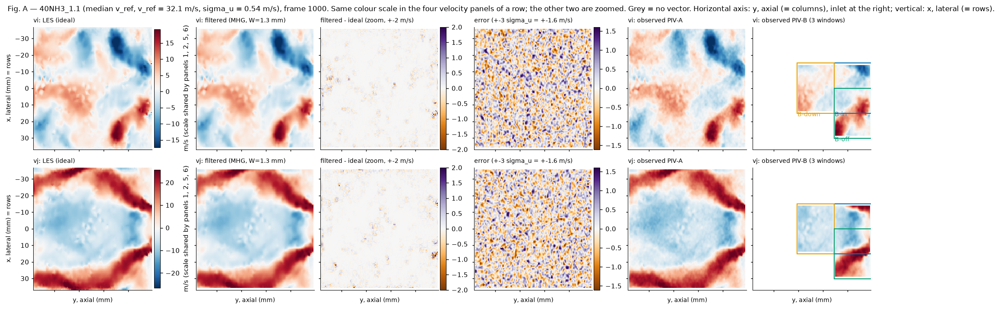

*Figura A, condizione di v_ref mediano, frame 1000.* Le altre cinque combinazioni (condizioni a v_ref basso e alto, frame 400 e 1000) sono in [`results/piv/phase2/f26/figures/`](../../results/piv/phase2/f26/figures/). Nelle quattro colonne di velocità la scala è la stessa; la terza colonna (filtrato − ideale) e la quarta (errore) hanno scala propria, ingrandita. **A occhio il filtro non si vede**: l'effetto è nel pannello ingrandito e nei numeri di §5.3.

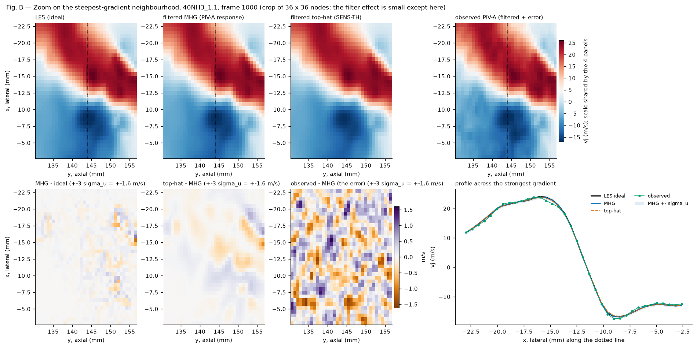

*Figura B: zoom sul gradiente più ripido.* Dove il filtro conta, si vede e si misura: il profilo mostra MHG e top-hat quasi sovrapposti all'ideale, con l'osservato che oscilla dentro ±σ_u.

### 5.2 Maschere e copertura

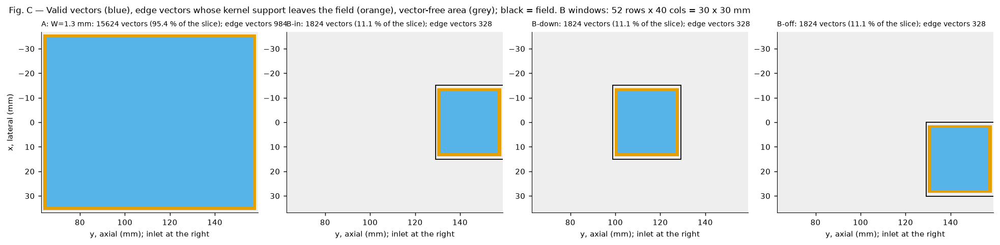

| configurazione | campo (righe0, righe1, col0, col1) | vettori validi | vettori osservati | % della slice | vettori di bordo | rigettati | sostituiti |
|---|---|---|---|---|---|---|---|
| PIV-A | (0, 127, 0, 127) | 15624 | 15624 | 95.4 | 984 | 0 | 0 |
| PIV-B-in | (38, 89, 88, 127) | 1824 | 1824 | 11.1 | 328 | 0 | 0 |
| PIV-B-down | (38, 89, 48, 87) | 1824 | 1824 | 11.1 | 328 | 0 | 0 |
| PIV-B-off | (64, 115, 88, 127) | 1824 | 1824 | 11.1 | 328 | 0 | 0 |
| IDEAL-full | (0, 127, 0, 127) | 16384 | 16384 | 100 | – | 0 | 0 |
| SENS-EDGE-A | (0, 127, 0, 127) | 14640 | 14640 | 89.4 | 0 | 0 | 0 |
| SENS-EDGE-B-in | (38, 89, 88, 127) | 1496 | 1496 | 9.1 | 0 | 0 | 0 |
| SENS-TH-A | (0, 127, 0, 127) | 15624 | 15624 | 95.4 | 0 | 0 | 0 |
| SENS-SWAP-A | (0, 127, 0, 127) | 15624 | 15624 | 95.4 | 984 | 0 | 0 |
| SENS-SWAP-B-in | (44, 83, 76, 127) | 1824 | 1824 | 11.1 | 328 | 0 | 0 |
| SENS-W1.0-A | (0, 127, 0, 127) | 15876 | 15876 | 96.9 | 748 | 0 | 0 |
| SENS-W1.9-A | (0, 127, 0, 127) | 15376 | 15376 | 93.8 | 1456 | 0 | 0 |
| SENS-REJ-iso-flag-A | (0, 127, 0, 127) | 15624 | 14062 | 85.8 | 984 | 1562 | 0 |
| SENS-REJ-clu-sub-A | (0, 127, 0, 127) | 15624 | 15624 | 95.4 | 984 | 1562 | 1562 |

A copre il 95,4 % della slice; ciascuna B l'11,1 %. I vettori "di bordo" sono quelli il cui supporto del kernel esce dal campo: 984 in A (6,3 % dei validi), 328 in B (18 %). Il supporto del top-hat tarato è più piccolo del margine imposto dalla regola della finestra, quindi per SENS-TH non ci sono vettori di bordo (0 nella tabella).

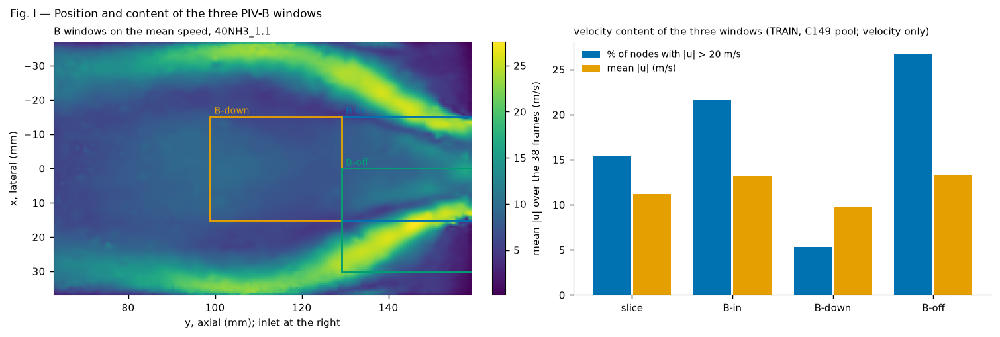

### 5.3 Errore introdotto e filtro, per regione

| quantità | vi all | vi HG | vi JET | vi REST | vi edge | vi interior |
|---|---|---|---|---|---|---|
| A: filtrato − ideale | 0.14 (0.23) | 0.31 (0.50) | 0.21 (0.30) | 0.10 (0.17) | 0.27 (0.44) | 0.12 (0.20) |
| A: errore | 0.60 (1.00) | 0.60 (1.00) | 0.60 (1.00) | 0.60 (1.00) | 0.60 (1.00) | 0.60 (1.00) |
| A: osservato − ideale | 0.62 (1.03) | 0.68 (1.12) | 0.64 (1.04) | 0.61 (1.02) | 0.66 (1.09) | 0.61 (1.02) |
| B-in: filtrato − ideale | 0.32 (0.49) | 0.63 (0.97) | 0.57 (0.79) | 0.15 (0.25) | 0.45 (0.67) | 0.28 (0.44) |
| B-in: errore | 0.60 (1.00) | 0.62 (1.00) | 0.71 (1.00) | 0.58 (1.00) | 0.60 (1.00) | 0.60 (1.00) |
| B-in: osservato − ideale | 0.68 (1.12) | 0.88 (1.39) | 0.91 (1.27) | 0.60 (1.03) | 0.75 (1.21) | 0.66 (1.09) |
| B-down: filtrato − ideale | 0.12 (0.19) | 0.84 (1.10) | 0.58 (0.68) | 0.10 (0.16) | 0.13 (0.20) | 0.12 (0.19) |
| B-down: errore | 0.60 (1.00) | 0.71 (1.00) | 0.81 (0.98) | 0.60 (1.00) | 0.60 (1.00) | 0.60 (1.00) |
| B-off: filtrato − ideale | 0.23 (0.40) | 0.41 (0.71) | 0.24 (0.37) | 0.15 (0.26) | 0.33 (0.55) | 0.21 (0.36) |
| B-off: errore | 0.60 (1.00) | 0.59 (1.00) | 0.61 (1.00) | 0.60 (1.00) | 0.60 (1.01) | 0.60 (1.00) |

| quantità | vj all | vj HG | vj JET | vj REST | vj edge | vj interior |
|---|---|---|---|---|---|---|
| A: filtrato − ideale | 0.14 (0.25) | 0.33 (0.58) | 0.15 (0.27) | 0.11 (0.19) | 0.30 (0.53) | 0.12 (0.22) |
| A: errore | 0.60 (1.00) | 0.60 (1.00) | 0.60 (1.00) | 0.60 (1.00) | 0.60 (1.00) | 0.60 (1.00) |
| A: osservato − ideale | 0.62 (1.03) | 0.69 (1.16) | 0.62 (1.04) | 0.61 (1.02) | 0.67 (1.13) | 0.61 (1.02) |
| B-in: filtrato − ideale | 0.20 (0.37) | 0.40 (0.72) | 0.22 (0.39) | 0.12 (0.22) | 0.27 (0.48) | 0.19 (0.34) |
| B-in: errore | 0.60 (1.00) | 0.62 (1.00) | 0.71 (1.00) | 0.58 (1.00) | 0.60 (1.00) | 0.60 (1.00) |
| B-in: osservato − ideale | 0.63 (1.06) | 0.73 (1.23) | 0.74 (1.08) | 0.59 (1.02) | 0.66 (1.11) | 0.63 (1.05) |
| B-down: filtrato − ideale | 0.07 (0.13) | 0.31 (0.49) | 0.08 (0.11) | 0.07 (0.12) | 0.10 (0.17) | 0.07 (0.12) |
| B-down: errore | 0.60 (1.00) | 0.71 (0.99) | 0.82 (0.99) | 0.60 (1.00) | 0.60 (1.00) | 0.60 (1.00) |
| B-off: filtrato − ideale | 0.24 (0.43) | 0.46 (0.83) | 0.22 (0.40) | 0.14 (0.25) | 0.30 (0.53) | 0.23 (0.41) |
| B-off: errore | 0.60 (1.00) | 0.59 (1.00) | 0.62 (1.00) | 0.60 (1.00) | 0.60 (1.00) | 0.60 (1.00) |

*Ogni cella: RMS in m/s (rapporto con σ_u). Nodi osservati, 760 frame.*

**Lettura.**
- **L'errore è uniforme.** Il rapporto errore/σ_u vale 1,00 in tutte le regioni, interno e bordo, per A e per le tre B. (Le RMS grezze di B-down in JET e HG, 0,71–0,82 m/s, sono un effetto di composizione: quei nodi sono pochi e cadono nelle condizioni con σ_u maggiore; normalizzando per condizione il rapporto torna 0,98–1,00.)
- **Il filtro è piccolo in A, non in B-in.** A: 0,23–0,25 σ_u su tutti i nodi, 0,50–0,58 σ_u nei bordi dei getti. B-in: 0,37–0,49 σ_u su tutti i nodi e **0,72–0,97 σ_u in alto gradiente**, perché la finestra contiene gli strati di taglio dei getti.
- **Interno e bordo.** I vettori di bordo di A hanno un effetto di filtro maggiore (0,27–0,30 m/s contro 0,12), ma la risposta realizzata dei primi vettori validi è quasi uguale a quella interna (Tab. 6 sotto): la differenza viene dal campo che sta ai bordi della slice, non dal troncamento del kernel. A conferma, il baricentro del kernel troncato si sposta di al più 0,02–0,06 mm (meno del 10 % di una cella) sul primo vettore valido e di meno di 0,01 mm dal secondo. È un'inferenza, non un test controllato.
- **Errore + filtro.** L'osservato dista dall'ideale 1,03 σ_u in A e 1,06–1,12 σ_u in B-in; in alto gradiente fino a 1,16 σ_u in A e 1,39 σ_u in B-in (vi).

**Tabella 6 — Risposta realizzata del kernel, interno e bordo** (derivata dagli operatori; |H| a tre lunghezze d'onda e L_sr,disc; "1° vettore valido" è il primo nodo che la regola della finestra conserva; il nodo 0 è escluso)

| asse | campo | W_mm | λ (mm) / L_sr (mm) | interno | 1° vettore valido | 2° vettore valido | nodo 0 (escluso) | indice 1° vettore |
|---|---|---|---|---|---|---|---|---|
| rows | A (128 nodes) | 1.3 | 2.0 | 0.516 | 0.519 | 0.516 | 0.766 | 2 |
| rows | A (128 nodes) | 1.3 | 4.0 | 0.933 | 0.91 | 0.932 | 0.978 | 2 |
| rows | A (128 nodes) | 1.3 | 10.0 | 0.997 | 0.99 | 0.996 | 1 | 2 |
| rows | A (128 nodes) | 1.3 | L_sr | 1.21 | 1.24 | 1.21 | 0.884 | 2 |
| rows | B (40-52 nodes) | 1.5 | 2.0 | 0.358 | 0.366 | 0.359 | 0.68 | 2 |
| rows | B (40-52 nodes) | 1.5 | 4.0 | 0.897 | 0.852 | 0.891 | 0.969 | 2 |
| rows | B (40-52 nodes) | 1.5 | 10.0 | 0.996 | 0.982 | 0.993 | 1 | 2 |
| rows | B (40-52 nodes) | 1.5 | L_sr | 1.4 | 1.47 | 1.41 | 0.977 | 2 |
| cols | A (128 nodes) | 1.3 | 2.0 | 0.542 | 0.529 | 0.542 | 0.755 | 1 |
| cols | A (128 nodes) | 1.3 | 4.0 | 0.917 | 0.869 | 0.915 | 0.962 | 1 |
| cols | A (128 nodes) | 1.3 | 10.0 | 0.993 | 0.981 | 0.992 | 0.997 | 1 |
| cols | A (128 nodes) | 1.3 | L_sr | 1.21 | 1.28 | 1.21 | 0.974 | 1 |
| cols | B (40-52 nodes) | 1.5 | 2.0 | 0.379 | 0.371 | 0.381 | 0.662 | 1 |
| cols | B (40-52 nodes) | 1.5 | 4.0 | 0.886 | 0.825 | 0.878 | 0.952 | 1 |
| cols | B (40-52 nodes) | 1.5 | 10.0 | 0.993 | 0.976 | 0.989 | 0.998 | 1 |
| cols | B (40-52 nodes) | 1.5 | L_sr | 1.4 | 1.51 | 1.41 | 1.06 | 1 |

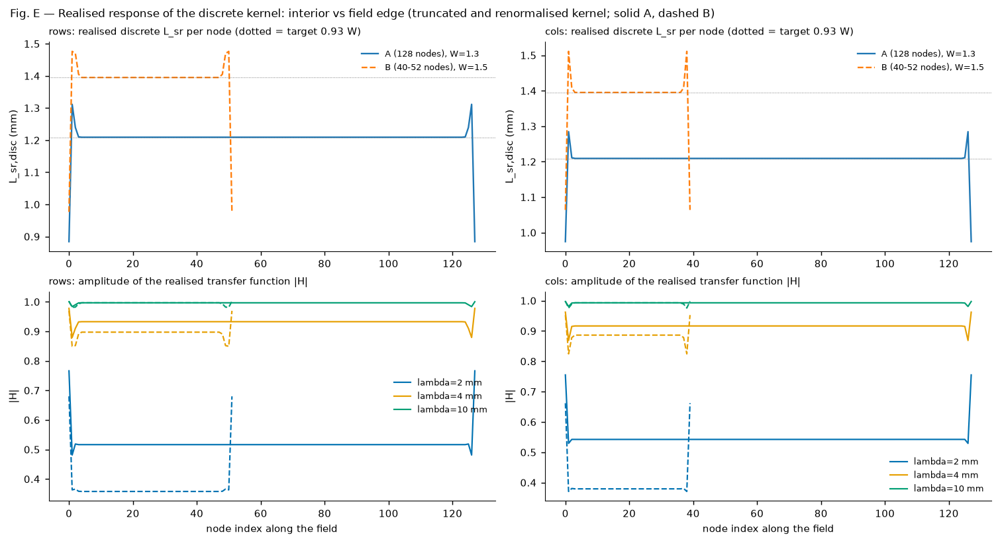

### 5.4 Distribuzione e autocorrelazione dell'errore

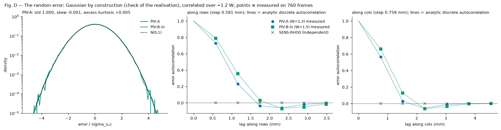

| config | n | media | std | asimmetria | curtosi in eccesso | frazione con modulo di z > 3 | gaussiana |
|---|---|---|---|---|---|---|---|
| PIV-A | 3392640 | -0.0006 | 1 | -0.0014 | 0.0047 | 0.00275 | 0.0027 |
| PIV-B-in | 396720 | 0.0013 | 0.999 | -0.0081 | 0.0009 | 0.0027 | 0.0027 |
| PIV-B-down | 396720 | -0.0012 | 1 | -0 | 0.003 | 0.00293 | 0.0027 |
| PIV-B-off | 396720 | 0.0012 | 1 | -0.0004 | 0.0018 | 0.00286 | 0.0027 |
| SENS-TH-A | 3392640 | -0.0006 | 1 | -0.0014 | 0.0047 | 0.00275 | 0.0027 |
| SENS-SWAP-A | 3392640 | 0.0001 | 1 | 0.0015 | -0.0007 | 0.00268 | 0.0027 |
| SENS-RHO0-A | 3392640 | -0.0003 | 1 | 0.0016 | 0.0044 | 0.00271 | 0.0027 |
| SENS-RHO0-B-in | 396720 | -0.0016 | 1 | 0.0009 | 0.0062 | 0.00277 | 0.0027 |

| config | asse | ritardo (nodi) | ritardo (mm) | ρ misurata | ρ analitica discreta | differenza |
|---|---|---|---|---|---|---|
| PIV-A | rows | 1 | 0.581 | 0.728 | 0.728 | 0.0001 |
| PIV-A | rows | 2 | 1.16 | 0.232 | 0.231 | 0.0004 |
| PIV-A | rows | 3 | 1.74 | -0.0382 | -0.0387 | 0.0006 |
| PIV-A | rows | 4 | 2.32 | -0.0592 | -0.0596 | 0.0004 |
| PIV-A | cols | 1 | 0.758 | 0.564 | 0.565 | -0.0002 |
| PIV-A | cols | 2 | 1.52 | 0.0289 | 0.0294 | -0.0005 |
| PIV-A | cols | 3 | 2.27 | -0.057 | -0.0567 | -0.0003 |
| PIV-A | cols | 4 | 3.03 | -0.0094 | -0.0098 | 0.0004 |
| PIV-B-in | rows | 1 | 0.581 | 0.79 | 0.79 | -0.0003 |
| PIV-B-in | rows | 2 | 1.16 | 0.355 | 0.356 | -0.0011 |
| PIV-B-in | rows | 3 | 1.74 | 0.0294 | 0.0317 | -0.0024 |
| PIV-B-in | rows | 4 | 2.32 | -0.0733 | -0.0695 | -0.0038 |
| PIV-B-in | cols | 1 | 0.758 | 0.661 | 0.66 | 0.0002 |
| PIV-B-in | cols | 2 | 1.52 | 0.128 | 0.128 | 0.0006 |
| PIV-B-in | cols | 3 | 2.27 | -0.0633 | -0.0641 | 0.0008 |
| PIV-B-in | cols | 4 | 3.03 | -0.0347 | -0.035 | 0.0003 |

σ realizzata / σ attesa per condizione: vi 0,998–1,004, vj 0,997–1,002 ([`sigma_u_target_vs_realised_PIV-A.csv`](../../results/piv/phase2/f26/tables/sigma_u_target_vs_realised_PIV-A.csv)).

### 5.5 Comportamento all'interno e vicino ai bordi

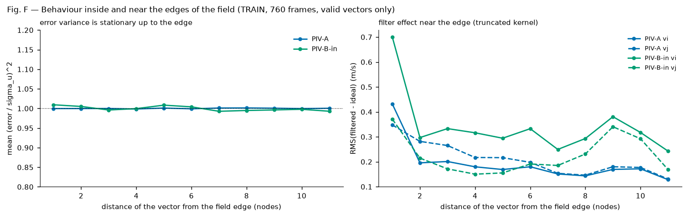

La varianza dell'errore è stazionaria fino al primo vettore valido (a 1 nodo dal bordo del campo): rapporto varianza/σ² 1,000 in A e 0,996–1,009 in B-in a 1–6 nodi dal bordo, come richiesto dalla griglia estesa. L'RMS del filtro è invece più alto vicino al bordo (0,43 / 0,35 m/s per vi / vj a 1 nodo, contro 0,15 a 7–8 nodi), per il motivo discusso sopra.

### 5.6 Sensibilità previste

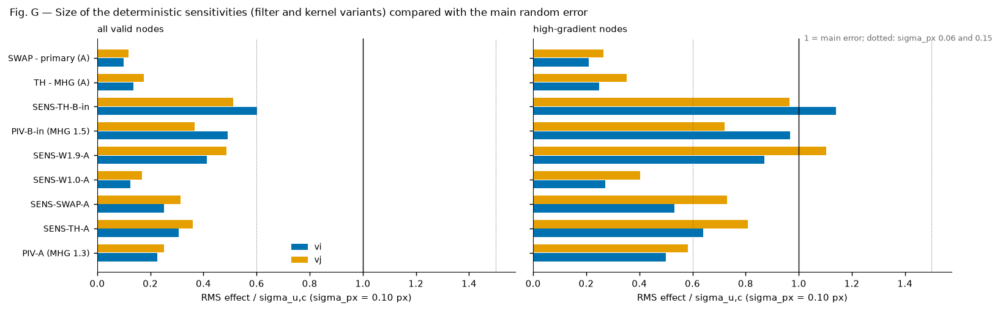

| quantità | vi all | vi HG | vi JET | vi REST | vi edge | vi interior |
|---|---|---|---|---|---|---|
| SENS-TH A: filtrato − ideale | 0.18 (0.31) | 0.39 (0.64) | 0.28 (0.41) | 0.14 (0.24) | – | 0.18 (0.31) |
| A: top-hat − MHG | 0.08 (0.14) | 0.15 (0.25) | 0.12 (0.18) | 0.07 (0.11) | – | – |
| SENS-SWAP A: filtrato − ideale | 0.15 (0.25) | 0.32 (0.53) | 0.21 (0.31) | 0.12 (0.20) | 0.25 (0.43) | 0.14 (0.24) |
| A: SWAP − convenzione R1 | 0.06 (0.10) | 0.13 (0.21) | 0.08 (0.12) | 0.05 (0.08) | – | – |
| SENS-W 1,0 A: filtrato − ideale | 0.07 (0.12) | 0.17 (0.27) | 0.11 (0.16) | 0.05 (0.09) | 0.15 (0.24) | 0.07 (0.12) |
| SENS-W 1,9 A: filtrato − ideale | 0.25 (0.41) | 0.53 (0.87) | 0.35 (0.52) | 0.19 (0.33) | 0.34 (0.59) | 0.23 (0.39) |
| SENS-TH B-in: filtrato − ideale | 0.39 (0.60) | 0.74 (1.14) | 0.70 (0.96) | 0.20 (0.33) | – | 0.39 (0.60) |
| B-in: top-hat − MHG | 0.14 (0.22) | 0.23 (0.36) | 0.26 (0.35) | 0.09 (0.15) | – | – |
| SENS-SWAP B-in: filtrato − ideale | 0.31 (0.48) | 0.75 (1.17) | 0.61 (0.78) | 0.15 (0.25) | 0.41 (0.67) | 0.28 (0.42) |
| B-in: SWAP − R1 | 0.13 (0.21) | 0.28 (0.44) | 0.25 (0.33) | 0.07 (0.11) | – | – |

| quantità | vj all | vj HG | vj JET | vj REST | vj edge | vj interior |
|---|---|---|---|---|---|---|
| SENS-TH A: filtrato − ideale | 0.20 (0.36) | 0.45 (0.81) | 0.24 (0.43) | 0.15 (0.27) | – | 0.20 (0.36) |
| A: top-hat − MHG | 0.10 (0.18) | 0.20 (0.35) | 0.14 (0.25) | 0.08 (0.14) | – | – |
| SENS-SWAP A: filtrato − ideale | 0.18 (0.31) | 0.41 (0.73) | 0.20 (0.37) | 0.13 (0.23) | 0.40 (0.71) | 0.15 (0.27) |
| A: SWAP − convenzione R1 | 0.07 (0.12) | 0.15 (0.26) | 0.07 (0.13) | 0.05 (0.09) | – | – |
| SENS-W 1,0 A: filtrato − ideale | 0.09 (0.17) | 0.23 (0.40) | 0.13 (0.23) | 0.07 (0.11) | 0.30 (0.53) | 0.07 (0.13) |
| SENS-W 1,9 A: filtrato − ideale | 0.27 (0.49) | 0.62 (1.10) | 0.32 (0.57) | 0.21 (0.37) | 0.53 (0.94) | 0.23 (0.41) |
| SENS-TH B-in: filtrato − ideale | 0.28 (0.51) | 0.53 (0.97) | 0.32 (0.57) | 0.18 (0.33) | – | 0.28 (0.51) |
| B-in: top-hat − MHG | 0.15 (0.27) | 0.24 (0.44) | 0.18 (0.32) | 0.11 (0.19) | – | – |
| SENS-SWAP B-in: filtrato − ideale | 0.21 (0.37) | 0.50 (0.90) | 0.17 (0.27) | 0.13 (0.23) | 0.25 (0.46) | 0.19 (0.34) |
| B-in: SWAP − R1 | 0.10 (0.17) | 0.21 (0.37) | 0.07 (0.11) | 0.06 (0.11) | – | – |

- **SENS-TH** (top-hat tarato a L_sr = W): differisce dal MHG di 0,08 / 0,10 m/s in A (0,14–0,18 σ_u) e di 0,15–0,20 m/s in alto gradiente (0,25–0,35 σ_u); in B-in di 0,14 / 0,15 m/s globali e 0,23–0,24 m/s (0,36–0,44 σ_u) in alto gradiente. È descrittivo: il criterio D-kern non si applica più.
- **SENS-SWAP** (passi scambiati): 0,06 / 0,07 m/s in A (0,10–0,12 σ_u) e 0,13–0,15 m/s in alto gradiente (0,21–0,26 σ_u); in B-in 0,10–0,13 m/s globali e 0,21–0,28 m/s in alto gradiente. Il risultato conferma che la scelta della convenzione sposta poco il filtro.
- **SENS-W**: W = 1,0 mm dà 0,07–0,09 m/s (0,12–0,17 σ_u); W = 1,9 mm dà 0,25–0,27 m/s (0,41–0,49 σ_u), e 0,53–0,62 m/s (0,87–1,10 σ_u) in alto gradiente.
- **SENS-σlo/hi e SENS-ρ0** cambiano solo l'errore (stessa realizzazione standardizzata: errore × 0,6 e × 1,5 esatti, verificato da un test; ρ0 non ha autocorrelazione).
- **SENS-EDGE**: 14 640 vettori in A e 1 496 in B-in, tutti con supporto interamente nel campo.

### 5.7 Rigetti espliciti e valori sostituiti (solo sensibilità)

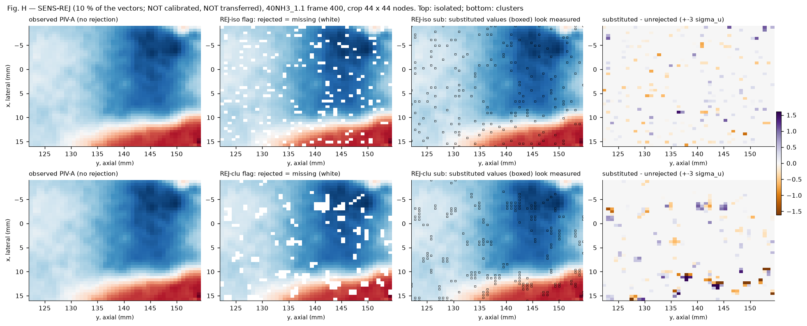

| tipo | frazione realizzata | cluster per frame | dimensione media (nodi) | mediana | p90 | max | % dei rigettati in cluster ≥ 3 | % in cluster ≥ 10 | passate di sostituzione medie/max |
|---|---|---|---|---|---|---|---|---|---|
| iso | 0.1 | 1.01e+03 | 1.55 | 1 | 3 | 19 | 31.1 | 0.4 | 1.00 / 1 |
| clu | 0.1 | 395 | 3.96 | 3 | 9 | 69 | 82.9 | 27 | 1.99 / 3 |

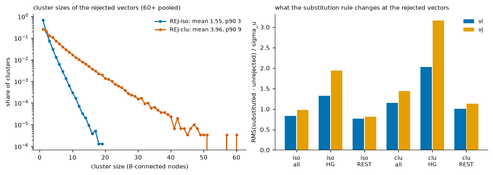

**Che cosa cambia la sostituzione ai vettori rigettati** (RMS(sostituito − non rigettato), PIV-A, 760 frame; rapporto con σ_u normalizzato per condizione):

| rigetti | regione | vi: RMS(sostituito − non rigettato) (m/s) | vi / σ_u | vj: RMS(sostituito − non rigettato) (m/s) | vj / σ_u |
|---|---|---|---|---|---|
| iso | all | 0.498 | 0.836 | 0.565 | 0.976 |
| iso | HG | 0.795 | 1.33 | 1.1 | 1.94 |
| iso | REST | 0.451 | 0.762 | 0.477 | 0.814 |
| clu | all | 0.681 | 1.15 | 0.827 | 1.44 |
| clu | HG | 1.21 | 2.03 | 1.79 | 3.17 |
| clu | REST | 0.593 | 1.01 | 0.657 | 1.13 |

**Lettura.** La frazione realizzata è esattamente il 10 % dei vettori validi in entrambe le morfologie e i rigetti coincidono nei livelli `flag` e `sub`. I cluster hanno dimensione media 3,96 nodi contro 1,55 degli isolati e l'83 % dei vettori rigettati sta in cluster di almeno 3 nodi (31 % per gli isolati); il campo correlato su scala W produce quindi cluster modesti (p90 = 9 nodi, massimo 69), non lacune estese. La sostituzione introduce un errore di 0,5–0,8 m/s in media (0,84–1,44 σ_u), che sale a 1,2–1,8 m/s (2,0–3,2 σ_u) per i cluster in alto gradiente: **è un effetto della stessa grandezza dell'errore principale, e maggiore dove si ricostruisce la T con più difficoltà**. Resta un'ipotesi non calibrata: il 10 % è uno scenario, non una frequenza.

### 5.8 Confronto fra proprietà richieste e proprietà prodotte

| Proprietà richiesta | Valore prodotto | Esito |
|---|---|---|
| Un vettore per nodo, griglia regolare | 15 624 (A) e 1 824 per posizione (B); pacchetto identico per U-Net e GLU | **Soddisfatta**, con passo ≠ W/2 dichiarato (W/passo = 1,7–2,6) |
| A = intera slice; B = 30×30 mm in tre posizioni | 52×40 nodi = 29,6×29,6 mm; posizioni da geometria e velocità | **Soddisfatta**; nozzle rispetto alla slice ignoto |
| Risposta MHG con L_sr = 0,93 W | scarto dal target discreto < 10⁻¹² (tolleranza 1 %); trasferimento su sinusoidi = H(k) atteso entro 10⁻¹⁰ | **Soddisfatta** all'interno; ai bordi kernel troncato (approssimazione dichiarata) |
| Errore con σ_u = 0,10 px · v_ref/6 per condizione | σ realizzata / attesa = 0,997–1,005 | **Soddisfatta** |
| Errore gaussiano, componenti indipendenti | asimmetria −0,001, curtosi in eccesso +0,005; correlazione fra vi e vj < 0,02 | **Soddisfatta** (la gaussianità è un'ipotesi di modello) |
| Errore correlato con L_sr = 1,2 W | ρ misurata = analitica entro 0,004; L_n,disc = 1,2 W | **Soddisfatta come specifica**; vedi Neal per la validità del modello |
| Errore stazionario fino ai bordi | rapporto varianza/σ² 0,996–1,009 da 1 a 6 nodi dal bordo | **Soddisfatta** |
| Nessun bias | media dell'errore ≈ 0 (−0,0006 σ_u) | **Soddisfatta** (scelta dichiarata) |
| Nessun rigetto nel principale | 0 rigettati, 0 sostituiti | **Soddisfatta** (approssimazione dichiarata) |
| Rigetti al 10 %, stesse posizioni nei due livelli | 10,00 %; posizioni identiche (test) | **Soddisfatta**; morfologia e frequenza non calibrate |
| Sostituzione come pratica documentata | media iterativa 3×3, passate 1,0 (isolati) e 2,0 (cluster) | **Soddisfatta**; Cardiff suggerisce 5×5 |
| Spessore del foglio, rifrazione, traiettorie | non rappresentabili | **Esclusa** |
| Errore dipendente da particelle rade e moto fuori piano | non rappresentato (errore uniforme) | **Esclusa** (documentata come non quantificata) |

---

## 6. Verifica metrologica su Neal (F2.4, opzionale)

**Dati.** Neal et al., "unsteady inviscid core", 4TU (CC0), DOI 10.4121/13663376.v1: zip intero da 271 827 177 byte, MD5 `eb6d86228f534d6285859ccc0f16c369` **coincidente con quello dichiarato dal repository**; sha256 dello zip e di ogni membro nel [manifest](../../results/piv/qualification/download_manifest.tsv). Dati e ambiente OpenPIV fuori dalla repository (`~/piv_qualification_data/`). Due serie (F001, seeding medio-basso; F005, medio-alto), 120 coppie ciascuna (una ogni 3 frame, dalla 10).

**Metodo.** Elaborazione delle immagini MS con OpenPIV 0.26.3 (correlazione FFT a passata singola, sub-pixel gaussiano) con finestre di 16 e 32 px e overlap 50 e 75 %; riferimento HDR (DaVis 8.1.6, media su 5 coppie, finestra 32 px al 75 %, outlier interpolati) interpolato bilinearmente nei centri dei vettori; residuo = MS − HDR in pixel; maschera degli outlier a 5 MAD. L'allineamento fra file HDR e coppia di immagini non è documentato: il minimo è debole (σ robusta 0,141 px con spostamento +1 contro 0,145 con 0 per F001), e si usa +1 per entrambe le serie.

| serie | W (px) | overlap | vettori con riferimento | σ residuo u, dopo media per coppia (px) | σ robusta (MAD) (px) | frazione outlier > 5 MAD | curtosi in eccesso (pulita) | ρ x a ritardo 1 / 2 passi | ρ y a ritardo 1 / 2 passi | modello a 1 / 2 passi | ρ a ritardo = W: x / y |
|---|---|---|---|---|---|---|---|---|---|---|---|
| F001 | 16 | 50 % | 23745 | 0.152 | 0.115 | 0.018 | 1.63 | 0.41 / 0.18 | 0.13 / 0.01 | 0.68 / 0.15 | 0.18 / 0.01 (modello 0.15) |
| F001 | 16 | 75 % | 96289 | 0.162 | 0.124 | 0.026 | 1.69 | 0.60 / 0.40 | 0.51 / 0.14 | 0.91 / 0.68 | 0.18 / 0.03 (modello 0.15) |
| F001 | 32 | 50 % | 6480 | 0.193 | 0.137 | 0.059 | 1.83 | 0.43 / 0.19 | 0.05 / -0.01 | 0.68 / 0.15 | 0.19 / -0.01 (modello 0.15) |
| F001 | 32 | 75 % | 23760 | 0.201 | 0.142 | 0.047 | 1.76 | 0.70 / 0.49 | 0.12 / 0.01 | 0.91 / 0.68 | 0.23 / -0.02 (modello 0.15) |
| F005 | 16 | 50 % | 23758 | 0.153 | 0.115 | 0.017 | 1.58 | 0.45 / 0.23 | 0.18 / -0.03 | 0.68 / 0.15 | 0.23 / -0.03 (modello 0.15) |
| F005 | 16 | 75 % | 93766 | 0.154 | 0.12 | 0.038 | 1.71 | 0.62 / 0.45 | 0.57 / 0.19 | 0.91 / 0.68 | 0.23 / -0.02 (modello 0.15) |
| F005 | 32 | 50 % | 6480 | 0.247 | 0.197 | 0.1 | 2.79 | 0.56 / 0.26 | -0.02 / -0.11 | 0.68 / 0.15 | 0.26 / -0.11 (modello 0.15) |
| F005 | 32 | 75 % | 23760 | 0.211 | 0.16 | 0.076 | 2.09 | 0.73 / 0.55 | 0.10 / -0.04 | 0.91 / 0.68 | 0.26 / -0.12 (modello 0.15) |

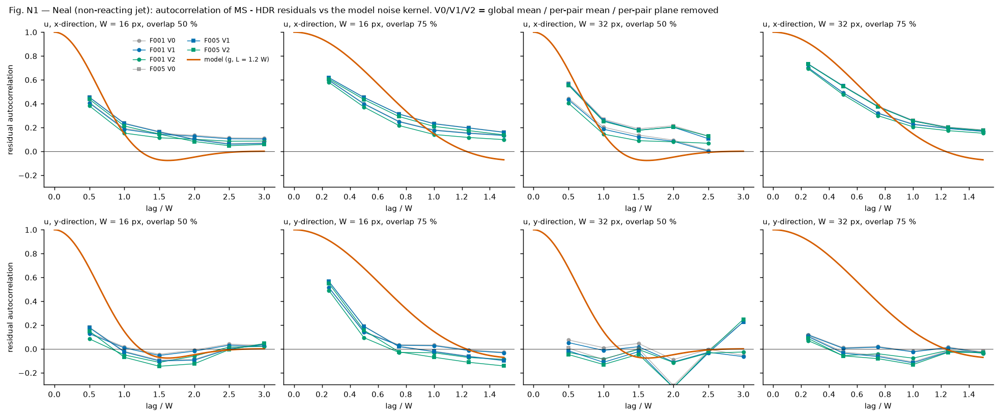

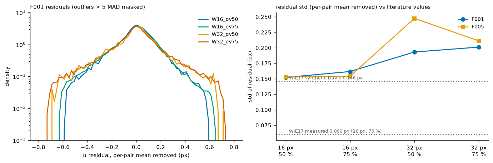

**Lettura (e perché va letta con prudenza).**
- **Ampiezza.** La σ del residuo (dopo aver tolto la media per coppia) è 0,15–0,25 px, sopra lo 0,06 px misurato e lo 0,146 px sintetico di WIE17. Include però il bias di una passata singola (da −0,07 a −0,29 px su u) e il disallineamento temporale fra riferimento (media su 5 coppie) e coppia istantanea in un nucleo che pulsa: non è una misura della sola incertezza casuale. **Non si usa per modificare σ_px.**
- **Forma.** Dopo la maschera a 5 MAD la curtosi in eccesso è 1,6–2,8: le code sono più pesanti della gaussiana (l'8–10 % di outlier a 32 px con la serie a seeding alto).
- **Correlazione.** La correlazione dei residui è **anisotropa** e **non coincide con il modello**: lungo x (la direzione del flusso) ρ(1 passo) = 0,41–0,45 e ρ(2) = 0,18–0,23 al 50 % di overlap con finestra da 16 px (modello 0,68 e 0,15); lungo y ρ(1) = 0,13–0,18 e ρ(2) ≈ 0. A ritardo W le due direzioni racchiudono il valore del modello (0,18–0,26 lungo x, da −0,11 a +0,01 lungo y, modello 0,15). Il modello sovrastima la correlazione a ritardi corti in entrambe le direzioni e la sottostima a ritardi lunghi lungo x. L'esito non dipende da come si tolgono le componenti a grande scala (media globale, per coppia, piano per coppia: figura N1).
- **Confronto con i riferimenti della letteratura al 50 %.** ρ(2d) = ρ(W): 0,11 (WIE17, rappresentativo), 0 (rassegna), 0,15 (modello); misurato 0,18–0,26 lungo x e da −0,11 a +0,01 lungo y.
- **Limiti.** OpenPIV a passata singola con finestre quadrate non è DaVis multi-passata con finestre gaussiane (la sorgente del modello); il riferimento ha risoluzione, media su 5 coppie, outlier interpolati e ricampionamento propri; il getto è freddo e non reagente. **Questo qualifica la forma dell'errore con questo processamento in un getto freddo; non certifica una PIV reagente né il processamento del GTMC.** È coerente con il dubbio già dichiarato in roadmap (§2.3 punto 5: ρ(2d) fra 0 e 0,11 non risolto).

**Conseguenza per D-ρ (roadmap §5).** Il criterio dice di rivedere il kernel se i residui mostrano una correlazione incompatibile con esso. L'evidenza è mista: incompatibile al primo ritardo, compatibile a ritardo W. Data la differenza di processamento, **raccomando di non modificare il modello principale e di riportare sempre SENS-ρ0**; la decisione è di R2 (§1.5).

---

## 7. Verifica su Cardiff (F2.5, opzionale)

**Dati.** Runyon et al., Cardiff (CC BY 4.0), DOI 10.17035/d.2017.0011500240, figshare 27051964 v1. L'archivio è di 7 301 821 358 byte (dimensione coincidente con quella dichiarata); **non è stato scaricato**: sono stati recuperati con richieste HTTP Range i 1 553 membri previsti dal §10.2 (≈ 793 MB: 514 file × 3 stadi, la statistica `StatisticsVec#0`, gli XML, `Run.xml`, `README.txt`, la maschera `MaskDefine#0`). Ogni membro è stato verificato contro il CRC-32 e la dimensione della directory centrale (**1 553 su 1 553 corretti**) e ha il suo sha256 nel manifest. Strumenti dello scout (`ee9948e`): lettore Range e decoder **non ufficiale** di DynamicStudio.

**Incidente.** Un primo tentativo con 10 richieste parallele ha ricevuto HTTP 429 (limite di richieste) per 1 212 membri. Non c'è stata alcuna discrepanza di checksum: i file erano semplicemente non recuperati. Sono stati ripresi in seguito con 2 thread e backoff, senza riscaricare quelli già verificati.

| voce | valore |
|---|---|
| frame decodificati | 514 / 514; errori di decodifica: 0 |
| sha256 dei 12 file già estratti dallo scout riprodotti | 12 / 12 |
| regione non finita al primo stadio (frame 0, 1, 257, 513) | [801, 801, 800, 799] vettori; intersezione 799, unione 804 |
| statistica `StatisticsVec#0` confrontata con la media dei 514 campi | NON eseguibile: ValueError('rank-2 Vector array not found') |
| quota media di codice 16 allo stadio finale (min–max per frame) | 29.8 % (25.2–34.9 %), di cui 16.2 % non finiti già al primo stadio |
| vettori con codice 0 modificati fra primo e ultimo stadio | 0 |

**Esiti delle verifiche previste.**
- **Riproduzione degli sha256 dei 12 file dello scout:** 12 su 12 corrispondono.
- **Regione non finita del primo stadio contro la maschera:** la regione è fissa (799 nodi comuni a quattro frame su 801–804, 16,2 %). Con l'ipotesi che il payload di `MaskDefine#0.image` sia una bitmap 1344×1024 a 1 byte per pixel (non documentata), la regione non finita è contenuta per il 95 % nei nodi con valore 1 della maschera, ma la maschera ne copre 2 183 (44 %): **corrispondenza solo parziale e decodifica della maschera non verificata**.
- **Media dei 514 campi contro la statistica `V.*` di DynamicStudio:** **non eseguibile**. Il decoder non legge `StatisticsVec#0.vectors`, che ha una struttura diversa dai file `VectorMap` (errore "rank-2 Vector array not found"). Quindi la validazione del decoder contro l'output ufficiale non è stata fatta; restano i controlli interni (12 sha256, 514 frame decodificati senza errori, 0 vettori con codice 0 modificati fra primo e ultimo stadio).

**Descrizione della catena** (solo questo dataset isotermo; **nessuna frazione è trasferita alla combustione né a SENS-REJ**):
- allo stadio finale il codice 16 copre in media il 29,8 % dei vettori (25,2–34,9 % per frame), di cui il 16,2 % è la regione fissa non finita già al primo stadio;
- i vettori con codice 0 non vengono mai modificati dagli stadi successivi: i valori cambiano solo dove il codice finale è 16.

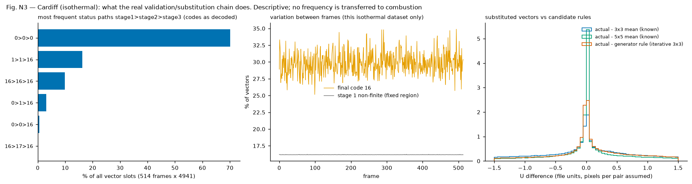

**Confronto con la regola di sostituzione del generatore** (differenza fra il valore sostituito reale e: media 3×3 dei vettori noti, media 5×5, regola iterativa 3×3 del generatore; unità del file, pixel per coppia presumibilmente, non verificato):

| componente | vettori sostituiti confrontabili | mediana dello scarto assoluto reale − 3×3 | mediana dello scarto assoluto reale − 5×5 | mediana dello scarto assoluto reale − generatore | RMS reale − 3×3 | RMS reale − 5×5 | scala di variabilità (RMS vettore valido − media dei vicini) |
|---|---|---|---|---|---|---|---|
| U | 406582 | 1.68 | 0.914 | 1.68 | 6.16 | 3.71 | 5.38 |
| V | 406582 | 2.44 | 1.22 | 2.44 | 7.25 | 4.34 | 5.52 |

La media 5×5 (che l'XML del dataset dichiara come area della media mobile) si avvicina al valore reale con una mediana circa metà di quella della 3×3. Ma anche la 5×5 ha RMS (3,7–4,3) dello stesso ordine della variabilità locale (5,4–5,5): la sostituzione reale **non è riprodotta da nessuna media semplice dei vicini**. Il confronto è fatto sul 54 % dei vettori sostituiti (406 582 su 757 805), quelli con almeno un vicino noto: gli altri stanno nella regione fissa senza dati. Su questi la regola iterativa del generatore si ferma alla prima passata e coincide con la 3×3. **Esito:** la regola 3×3 è una pratica documentata di TUM e GTMC, ma non è quella di questa catena reale; la differenza fra 3×3 e 5×5 è una questione di scala di lisciatura dei valori sostituiti. Resta nella specifica la 3×3.

---

## 8. Limiti, problemi rimasti e che cosa non si dimostra

**Problemi rimasti.**
1. **Correlazione dell'errore non confermata da Neal** al primo ritardo (§6). Decisione D-ρ di R2.
2. **Decoder Cardiff non validato contro la statistica ufficiale**, e mappatura della maschera non verificata (§7).
3. **Due test preesistenti falliscono** sul commit approvato e su quello corrente, in aree non toccate (§4).
4. **Allineamento HDR–coppia di Neal debole** (+1 file): influenza poco i risultati, ma non è documentato dalla sorgente.
5. **La domanda agli autori resta aperta** (componenti, piano, etichette): la specifica dichiara l'orientamento come *probabile*.

**Che cosa questa fase non dimostra.**
- Che le osservazioni riproducano una PIV del nostro combustore: rappresentano una classe documentata (GTMC) con trasferimenti dichiarati.
- Che il contenuto della LES alla scala di finestra sia fisico: il campo è liscio a 2–3 mm e l'effetto del filtro è un limite inferiore.
- Che il modello dell'errore valga in fiamma: l'uniformità e la forma gaussiana sono ipotesi; Neal e Cardiff riguardano flussi non reagenti o isotermi.
- Che i rigetti e le sostituzioni siano irrilevanti o rilevanti: sono sensibilità non calibrate.
- Nulla sulle prestazioni delle reti: nessuna rete è stata usata.
- Una validazione sperimentale della T ricostruita.

**Limite per le reti (R1).** Le coordinate in ingresso alle reti restano quelle storiche (colonne ↔ x): la metrica dei vicini del GLU e le coordinate U-Net seguono quella convenzione, non quella fisica ipotizzata per il generatore.

---

## 9. Riproducibilità

| Voce | Valore |
|---|---|
| Comando | `bash scripts/piv_phase2/run_phase2.sh` dal worktree (≈ 25 min su CPU; la prima volta serve la rete per Neal e Cardiff) |
| Ambiente | Python 3.13.13, numpy 2.5.4, scipy 1.18.1 (venv del progetto); Neal: OpenPIV 0.26.3, numpy 2.5.5, tifffile e imagecodecs in un venv separato; Cardiff: `python3 -I` con la sola libreria standard più numpy |
| SHA del codice | `3105f3ed7b23a4110dbbf4e2d8327eaba89891e7` per tutti i risultati e i test. Due script sono cambiati dopo: `f26_figures.py` e `f2_tables.py` (commit `9102086`) per aggiungere i primi vettori validi alla tabella della risposta realizzata e formattare i conteggi; solo figure e tabelle sono state rigenerate. Ogni `*provenance.json` registra SHA, stato "dirty" (falso), versioni e file letti con sha256 |
| Specifica | `9f24afc9359bf3568aa693cf43fe21135717538924152148c8c50d50893b3d47` (file); `3d6610e3d9581d5ea362125075862a6a9080f4565066a5253d914885cc456d38` (contenuto canonico) |
| Statistiche, cache, split | come in Fase 1: `678263fb…`; cache C149 `fa1c9358…`, A38 `d0b1d068…`; split `acb87bf9…` |
| Neal | zip sha256 `be86ad84c1900890da73107bd0a81977447f9a052e75879cf6db7df967db80eb`, MD5 verificato; manifest con 3 550 righe (zip, membri e file interni) |
| Cardiff | 1 553 membri, CRC-32 e sha256 per membro nel manifest; scout `ee9948e`; strumenti e dati in `~/piv_qualification_data/` (fuori dalla repository) |
| Checksum degli artefatti | [`results/piv/phase2/SHA256SUMS`](../../results/piv/phase2/SHA256SUMS) |

Nessuna modifica a `nonideal_observations.py`, ai risultati storici, alle specifiche della missione 00 o ai documenti delle missioni 00 e 01. Nessun contatto con gli autori. Nessun merge.

---

## 5.9 Appendice R2 — Qualifica supplementare della specifica v1.1 (SENS-TAIL e sostituzione 5×5)

Richiesta da [decisione_R2.md](decisione_R2.md) §8. Stesso campione di F2.6 (760 frame `train_fit`, solo velocità, ruolo `train`, replica 0). Script `scripts/piv_phase2/f29_qualify_v11.py`, risultati in `results/piv/phase2/f29/`. Specifica v1.1: `configs/observations/piv_observation_spec_v1_1.yaml`, sha256 `607510895c24a324a230e3f96a739daf6507f30c531693ffbc7bb2f0a2d842d2` (v1 non modificata).

**Regressione.** Le 31 configurazioni di v1 danno in v1.1 pacchetti **identici bit a bit** rispetto alle impronte (hash) calcolate con il codice precedente alle estensioni (`scripts/piv_phase2/f28_golden.py --compare`, `tests/test_piv_observations_v11.py`).

**SENS-TAIL** (ν = 7, mappa marginale a t di Student sullo stesso campo gaussiano correlato):

| Configurazione | σ realizzata / attesa | asimmetria | eccesso di curtosi | frazione \|z\| > 3 (gauss. 0,0027; t7 a varianza unitaria 0,0093) |
|---|---|---|---|---|
| PIV-A | 1,0006 | +0,0005 | −0,005 | 0,0027 |
| SENS-TAIL-A | 1,0004 | −0,002 | **+1,96** | 0,0093 |
| PIV-B-in | 1,0007 | −0,006 | +0,006 | 0,0027 |
| SENS-TAIL-B-in | 1,0010 | −0,009 | **+2,00** | 0,0095 |

σ conservata (entro 0,1 %), eccesso di curtosi 2 ± 0,04, correlazione di rango identica (test), stessi nodi. La **correlazione di Pearson** cambia poco: lungo le righe ρ(1 nodo) 0,728 → 0,723 e ρ(2) 0,232 → 0,229 in A; lungo le colonne 0,564 → 0,559 (tabella completa in `tail_autocorrelation.csv`).

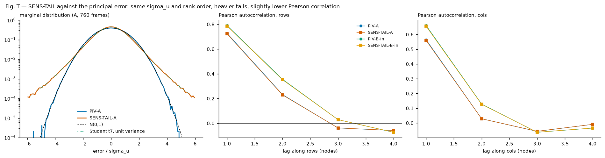

**Sostituzione 5×5** (stessi rigetti di `sub`; RMS(sostituito − non rigettato) / σ_u, nodi rigettati, 760 frame):

| Rigetti | Regione | 3×3 vi / vj | 5×5 vi / vj |
|---|---|---|---|
| isolati | tutti | 0,84 / 0,98 | 1,39 / 1,66 |
| isolati | alto gradiente | 1,33 / 1,94 | 2,21 / 3,22 |
| cluster | tutti | 1,15 / 1,44 | 1,52 / 1,84 |
| cluster | alto gradiente | 2,03 / 3,17 | 2,49 / 3,67 |

La media 5×5 è **più lisciante**: l'errore introdotto ai vettori sostituiti è 1,7 volte quello della 3×3 per i rigetti isolati e 1,2–1,3 volte per i cluster. Numero di passate: 3×3 isolati 1, cluster in media 1,99 (massimo 3); 5×5 isolati 1, cluster 1,00 (massimo 2); nessun caso con più di 3 passate. Il test sulla prima passata (valore = media dei vicini noti 5×5) è verde.

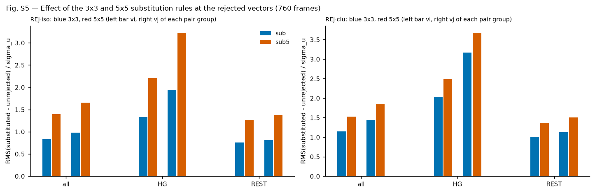

**Controllo fra macchine** (decisione_R2 §8 punto 4). Stessi pacchetti PIV-A, PIV-B-in, IDEAL-A, FILT-A per 3 condizioni × 2 frame, generati sul cluster e in locale (`results/piv/campaign/profiling/xcheck/`): **nodi identici e differenza massima dei valori 0,0 m/s** (criterio ≤ 10⁻⁹ m/s). La Fase 3 usa comunque confronti a tolleranza.
