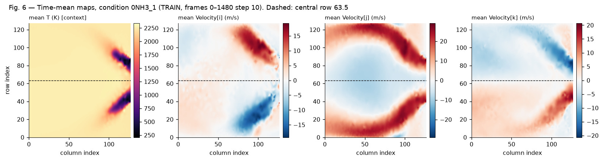
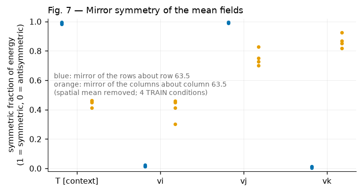
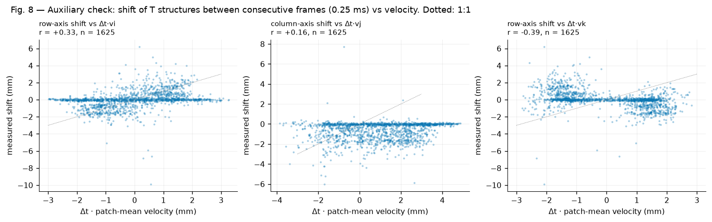

# Missione 02 — F1.1: orientamento e componenti della slice (`orientation_note.md`)

**Data:** 27 novembre 2026 · **Branch:** `mission02/piv-execution` · **Codice:** SHA `6573393345bc2d4e18076b2ebf70486707fc0bb2` (script in `scripts/piv_phase1/`)
**Esito complessivo:** **probabile** (non confermato dalla provenienza). Per D-ori vale la regola della roadmap §5: si procede con 2C, `(vi, vj)`. SENS-OOP **non** si attiva (§2.3, punto 7: richiede che la provenienza stabilisca che k è normale alla slice, e la legge di perdita di coppie non è stata letta).

Il report principale è [fase1_report_R1.md](fase1_report_R1.md). Qui sono raccolte le prove, la loro forza e le domande aperte.

---

## 1. In breve

1. **La provenienza pubblica non dice nulla** sul significato di `Velocity[i/j/k]`, sul piano della sezione, sull'origine delle coordinate né sul ricampionamento. Non è stata trovata la documentazione ufficiale di STAR-CCM+ che definisca il sistema di riferimento delle componenti. Quindi **per provenienza l'esito è "ignoto"**.
2. **I campi medi in TRAIN dicono molto di più.** Le mappe medie di T, vi, vj, vk sono simmetriche o antisimmetriche rispetto alla **riga centrale** della griglia (riga 63,5), con una regolarità forte (frazione di energia 0,98–1,00 in tutte le condizioni controllate). Il disegno è quello di un **flusso con swirl tagliato da un piano che passa per l'asse del bruciatore**, con l'asse lungo la direzione delle colonne e i getti freddi che entrano dal bordo destro.
3. **Lettura coerente** (probabile, non provata):
   - **vk è fuori piano** (componente azimutale: antisimmetrica rispetto all'asse);
   - **vj è la componente assiale, lungo l'asse delle colonne**, simmetrica rispetto all'asse; positiva verso l'uscita, cioè verso le colonne decrescenti;
   - **vi è la componente trasversale/radiale, lungo l'asse delle righe**, antisimmetrica; positiva verso l'esterno.
4. **Attenzione:** questo non è il "vi lungo x (colonne), vj lungo y (righe)" che la roadmap assume implicitamente. Per la generazione delle osservazioni non cambia nulla (il filtro e l'errore non dipendono dalla componente), ma cambia la lettura fisica, e un'alternativa **non è esclusa**: che i ruoli di vi e vk siano scambiati, cioè che la coppia nel piano sia `(vj, vk)` e vi sia fuori piano. Le prove disponibili favoriscono vk fuori piano ma non lo dimostrano.
5. **Segni e coordinate fisiche restano ignoti** (segno rispetto a +x/+y, origine di y a 62,9 mm, assegnazione delle etichette `x`/`y` agli assi dell'array: vedi §5).

## 2. Provenienza (che cosa dicono le fonti)

| Fonte | Che cosa dice | Cosa non dice |
|---|---|---|
| `combustion__channels.json` (manifest locale della card) | Indici 11/12/13 = `Velocity[i]`, `[j]`, `[k]`; 14 = `Velocity_Magnitude` (non euclidea: missione 01). `x`, `y` come array 1D | Sistema di coordinate, assi fisici, segno |
| Missione 01 (inventario B-data-audit-001; ricognizione §1.2, §9.2; C1) | Colonne = x, righe = y verificati sulle coordinate; "definizione di i/j/k, segno e piano non dichiarati"; due note storiche incoerenti ("bruciatore sotto, y assiale" nel pilota; "getti a destra, V verso sinistra, `Velocity[j]` assiale" nell'audit del 14/11) | — |
| Paper RealPDEBench (arXiv:2601.01829) §3.2, App. B.1–B.2 | "cross-sectional data of 3D swirl-stabilized NH₃/CH₄/air flames"; LES 3D implicita, STAR-CCM+ 2022.1, EDC; due inlet a portata massica | Piano di taglio, interpolazione sulla griglia 128×128, filtri, assi |
| Pagina del progetto, card HF, repository GitHub (`combustion_dataset.py`, `generate_surrogate_data.py`) | Tabella dei canali; il loader legge le chiavi HDF5 `measured_data`, `x`, `y`, `time`; sottocampionamento a passo (`::sub_s`), non interpolazione | Nessuno script di conversione STAR-CCM+ → array |
| Documentazione ufficiale STAR-CCM+ | **Non trovata** (la pagina docs.sw.siemens.com non era raggiungibile dal fetch). L'idea che `Velocity[i/j/k]` siano le componenti nel sistema di riferimento scelto nel modello (i=x, j=y, k=z nel sistema "Laboratory", altrimenti quelle del sistema locale, per esempio cilindrico) è **non verificata**: non la si usa come fonte | — |

La lettura del paper è stata verificata nelle sezioni raggiungibili dal fetch (HTML fino a circa il 25 % del testo, §3.2 incluso); l'Appendice B.1–B.2 è quella già letta verbatim dalla missione 01 e non è stata riletta. Non è stato contattato nessuno.

## 3. Controlli ausiliari (mai prova)

Tutti su condizioni **TRAIN**; i raw sono stati letti solo per `0NH3_1`, `40NH3_1`, `80NH3_1.05` e `20NH3_0.9` (shard 8, 23, 26, 11; `refuse_test` attivo). T e specie servono solo per questa qualifica.

**Identità cache–raw.** I campi `vi`, `vj` della cache C149, ricostruiti con le statistiche congelate, coincidono con `numerical[...,11]` e `[...,12]` dei raw su 84 confronti: differenza massima **1,9·10⁻⁶ m/s**. L'ordine dei canali e la normalizzazione sono quindi confermati (non l'orientamento fisico).

### 3.1 Simmetria dei campi medi (la prova più informativa)

Medie temporali su 150 frame TRAIN per 4 condizioni, media spaziale tolta (altrimenti l'offset rende simmetrica qualunque mappa). Si specchia la mappa attorno alla riga centrale o alla colonna centrale e si calcola la frazione di energia simmetrica.

| Campo | Specchio sulle righe (riga 63,5): frazione simmetrica, min / mediana / max | Specchio sulle colonne (colonna 63,5) |
|---|---|---|
| T [contesto] | 0,983 / 0,991 / 0,995 | 0,412 / 0,455 / 0,462 |
| vi | 0,013 / 0,016 / 0,024 (antisimmetrico) | 0,303 / 0,431 / 0,461 |
| vj | 0,990 / 0,995 / 0,996 (simmetrico) | 0,702 / 0,741 / 0,828 |
| vk | 0,005 / 0,010 / 0,015 (antisimmetrico) | 0,817 / 0,859 / 0,926 |

**Lettura.** In un flusso assialsimmetrico tagliato da un piano per l'asse, rispetto alla linea dell'asse:
- la componente assiale è simmetrica;
- la componente radiale nel piano è antisimmetrica;
- la componente azimutale (fuori piano) è antisimmetrica.

Vale proprio il pattern osservato: **vj assiale** (simmetrico), **vi e vk antisimmetrici**. La simmetria da sola stabilisce che j è lungo la direzione delle colonne (la linea dell'asse) e che `{i, k}` = `{trasversale nel piano, fuori piano}`, ma **non** quale dei due sia quale. Dalla Figura 6: i getti freddi entrano dal bordo destro (colonne > 100) con vj > 0 e proseguono verso sinistra, quindi +j punta verso le colonne decrescenti; vi > 0 nella metà alta, cioè verso l'esterno.

**Limiti.** Presuppone un flusso medio assialsimmetrico e una slice che passa per l'asse. Lo specchio sulle colonne non produce un pattern netto per T (0,46) e non è atteso, perché l'ingresso è su un bordo.

### 3.2 Spostamento delle strutture scalari fra frame consecutivi (0,25 ms)

Template matching (correlazione normalizzata, picco sub-cella) di finestre 32×32 celle di T (e, per un controllo, di frazioni molari di CH₄ e NH₃) fra i frame f e f+1, su 14 frame × 3 condizioni TRAIN. Il metodo è stato **validato su spostamenti sintetici noti**: errore mediano ≤ 0,05 celle su cinque spostamenti da 0 a 9 celle.

Regressione dello spostamento misurato (mm, tracciante T, patch con contrasto ≥ 0,3, picco ≥ 0,9, escludendo il bordo dell'intervallo di ricerca) sullo spostamento previsto Δt·v. IC95 con bootstrap a cluster su (condizione, frame):

| Sottoinsieme | n | Spostamento | Predittore | r [IC95] | Pendenza [IC95] |
|---|---|---|---|---|---|
| tutte le strutture | 1625 | lungo le righe | Δt·vi | +0,33 [+0,23, +0,41] | +0,26 [+0,14, +0,37] |
| | | lungo le righe | Δt·vj | −0,03 [−0,10, +0,01] | −0,02 |
| | | lungo le righe | Δt·vk | −0,39 [−0,53, −0,24] | −0,29 |
| | | lungo le colonne | Δt·vj | +0,16 [+0,07, +0,25] | +0,08 [+0,03, +0,13] |
| | | lungo le colonne | Δt·vi, Δt·vk | ≈ 0 | ≈ 0 |
| getti freddi (T media < 1800 K) | 464 | lungo le righe | Δt·vi | +0,68 [+0,58, +0,76] | +0,58 [+0,41, +0,73] |
| | | lungo le righe | Δt·vk | −0,70 [−0,80, −0,56] | −0,55 [−0,69, −0,38] |
| | | lungo le colonne | Δt·vj | +0,16 [−0,00, +0,34] | +0,12 |

**Che cosa mostra e che cosa no.**
- Lo spostamento lungo le **righe** segue vi (e −vk). Nei getti freddi vi e vk sono fortemente anticorrelati (r = −0,72 su tutti i patch, −0,90 nei getti): **l'esperimento non li separa**.
- Lo spostamento lungo le **colonne** non è spiegato da nessuna componente (R² ≤ 0,05). A livello di medie, però, lo spostamento medio è **−0,65 mm** (−0,98 mm nei getti freddi) contro un Δt·vj medio di **+0,98 mm** (+1,76 mm): segno e ordine di grandezza sono coerenti con +j verso le colonne decrescenti. Dentro il campione la pendenza è invece debole e di segno opposto (+0,08): **segno non confermato**.
- Le pendenze sono lontane da 1 (0,1–0,6): le strutture di T non si avvettano rigidamente con la velocità del piano (propagazione di fiamma, evoluzione fuori piano, finestre di 32 celle). Lo spostamento medio assoluto cresce invece con il lag (tracciante NH₃: 0,8, 2,0 e 2,8 mm a 1, 2 e 4 frame; CH₄: 0,13, 0,35 e 0,74 mm; [`lag_joint_regressions.csv`](../../results/piv/phase1/f11/lag_joint_regressions.csv)): le strutture traslano davvero, ma la relazione con le componenti non è quantitativa. **Il controllo non è una prova, e non lo si usa come tale.**

### 3.3 Che cosa fa decorrelare le strutture

Se k esce dal piano, le strutture con abs(vk) grande perdono correlazione fra frame consecutivi più delle altre. Regressione della perdita (1 − picco) su abs(vi), abs(vj), abs(vk) standardizzati, bootstrap a cluster:

| Tracciante | lag | n | coef. abs(vi) | coef. abs(vj) | coef. abs(vk) |
|---|---|---|---|---|---|
| NH₃ | 1 | 1182 | −0,0057 [−0,0088, −0,0022] | +0,0048 [+0,0018, +0,0075] | **+0,0101 [+0,0054, +0,0148]** |
| NH₃ | 2 | 1214 | −0,0240 | +0,0176 | **+0,0324 [+0,0081, +0,0493]** |
| CH₄ | 1 | 716 | −0,0021 | −0,0000 | +0,0017 [−0,0017, +0,0040] |
| CH₄ | 4 | 739 | −0,0111 | +0,0069 | +0,0046 [−0,0014, +0,0101] |

(tabella completa: [`t6b_decorrelation.md`](../../results/piv/phase1/tables/t6b_decorrelation.md)). Con il tracciante NH₃ il coefficiente di abs(vk) è positivo e il più grande, in modo significativo; con CH₄ l'IC include lo zero. Il coefficiente di abs(vi) è negativo (non spiegato). **Evidenza debole**, coerente con k fuori piano, non conclusiva.

## 4. Classificazione per elemento

| Elemento | Esito | Base |
|---|---|---|
| Significato di `Velocity[i/j/k]` (sistema di riferimento) | **ignoto** | Nessuna fonte; documentazione STAR-CCM+ non trovata |
| Piano della slice: contiene l'asse del bruciatore, asse lungo le colonne | **probabile** | Simmetria dei campi medi (§3.1); coerente con "cross-sectional data of a swirl-stabilized flame" |
| vk normale al piano (azimutale) | **probabile** | Antisimmetria di vk (§3.1) e decorrelazione con abs(vk) per NH₃ (§3.3); l'alternativa vi fuori piano non è esclusa |
| vj assiale, lungo le colonne, +j verso le colonne decrescenti | **probabile** | Simmetria di vj, getti dal bordo destro (§3.1); segno non confermato dal controllo sullo spostamento (§3.2) |
| vi trasversale nel piano, lungo le righe, +i verso l'esterno | **probabile** | Antisimmetria di vi, correlazione con lo spostamento lungo le righe (§3.1–3.2) |
| Assegnazione delle etichette `x`, `y` agli assi dell'array | **ignoto** | Vedi §5 |
| Origine fisica di y (62,9 mm), segno rispetto a +x/+y | **ignoto** | Nessuna fonte |

## 5. Domanda aperta: etichette delle coordinate

L'asse di simmetria è la **riga centrale**, mentre il vettore `x` (±36,9 mm) è centrato sullo zero e `y` (62,9–159,1 mm) è centrato a 111 mm. Se le coordinate fossero attaccate agli assi giusti, l'asse del bruciatore sarebbe a y ≈ 111 mm, con origine non dichiarata. Se invece le etichette fossero scambiate rispetto agli assi dell'array (le righe laterali, ±36,9 mm; le colonne assiali, 62,9–159,1 mm), l'asse sarebbe a 0 e la distanza assiale andrebbe da 63 a 159 mm: una configurazione fisicamente più naturale. **Le forme dei due vettori (128 e 128) non permettono di decidere.** La verifica della missione 01 sugli assi è basata sull'ordine e sui nomi, non su una prova indipendente.

**Conseguenza misurata.** Le celle per asse (0,581 e 0,758 mm) si scambierebbero. Ho ripetuto F1.2 con i passi scambiati ([`results/piv/phase1/f12_swapcells/`](../../results/piv/phase1/f12_swapcells/)): RMS del filtro cambia fino a circa il 30 % (a W = 1,0 mm; meno a W maggiori), il rapporto D-kern resta 0,41–0,65 (contro 0,43–0,61), le conclusioni non cambiano. **Non blocca R1.**

## 6. Domanda per Enrico (non inviata a nessuno)

Se Enrico lo ritiene utile, domanda agli autori di RealPDEBench (in inglese, da inoltrare):

> *We use the combustion/numerical arrays (T, H, W, 15) with `numerical_axis_names` Velocity[i], Velocity[j], Velocity[k]. (1) In which coordinate system are these components expressed (global Cartesian, or a local/cylindrical system)? (2) Which plane was exported (does it contain the burner axis, and along which array axis does the axis run)? (3) Which array axis carries the coordinate vector `x` (±36.9 mm) and which `y` (62.9–159.1 mm), and what is the origin? (4) How was the LES mesh resampled to 128×128 (interpolation method, any filter or crop)?*

## 7. Aggiornamento proposto per la missione 01 (non applicato)

Non modifico i documenti della missione 01. Se la 01 vuole recepire questi risultati, la proposta è di annotare nell'inventario (C1, Q1):
- la riga di simmetria (riga 63,5) e la lettura "slice per l'asse, asse lungo le colonne", con esito *probabile*;
- che il significato di `Velocity[i/j/k]` resta ignoto per provenienza;
- che la nota del pilota ("y assiale, `Velocity[j]` assiale con +j ≈ +y") è incoerente con la simmetria osservata, in linea con la riclassificazione già fatta dalla 01;
- la domanda aperta sulle etichette `x`/`y` (§5).

## 8. Conseguenze per la missione

- **2C:** si procede con `(vi, vj)` come ipotesi dichiarata, esito *probabile*. Nessun cambiamento alla firma delle osservazioni.
- **Alternativa non esclusa:** se la coppia nel piano fosse `(vj, vk)`, l'osservazione `(vi, vj)` conterrebbe una componente fuori piano. Aggiungere vk come terza componente richiederebbe un canale in più per U-Net e GLU, quindi un cambio di architettura che la missione esclude: **non lo propongo**, lo segnalo come limite.
- **SENS-OOP:** non attivata. Resta eventualmente un esercizio di sola valutazione (|vk| è già nei raw), da decidere solo dopo la lettura di Keane & Adrian e se Enrico lo ritiene utile.
- **Segno e origine:** non influenzano il generatore. Influirebbero solo sul confronto con una PIV reale.

Artefatti: [`results/piv/phase1/f11/`](../../results/piv/phase1/f11/) (CSV, JSON, provenienza), [`scripts/piv_phase1/f11*.py`](../../scripts/piv_phase1/).
