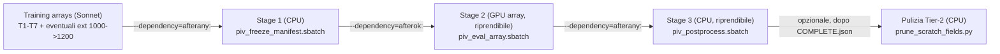

# Missione 02 (PIV virtuale) — Guida al post-processing, politica di salvataggio e integrazione con il launcher di Sonnet

**Branch:** `mission02/piv-postprocessing` (basato su `mission02/piv-execution` @ `6660adb`)  
**Riferimenti:** [`roadmap_tecnica_piv.md`](roadmap_tecnica_piv.md) · [`decisione_R1.md`](decisione_R1.md) · [`fase2_report_R2.md`](fase2_report_R2.md) · [`configs/observations/piv_observation_spec_v1.yaml`](../../configs/observations/piv_observation_spec_v1.yaml)  
**Stato:** strumenti pronti e verificati su CPU con test mirati. **Nessun training, nessuna inferenza neurale, nessun job GPU, nessun accesso a TEST.**

---

## 1. Perimetro e vincoli rispettati

- **Invariato:** nessun file di `mission02/piv-execution`, generatore (`piv_observations.py`), specifica congelata (`piv_observation_spec_v1.yaml`), architetture (`models/*`), loop di training o codice della Missione 00 (`nonideal_observations.py`, `nonideal_eval.py`, `nonideal_campaign.py`) è stato modificato.
- **Riuso esplicito della Missione 00:**
  - metriche termiche e di bias via `month2_evaluator.evaluate_frame_prediction` e `evaluation/metrics.py`;
  - stati e convenzioni di `budget_exhausted` da `training/nonideal_campaign.py`;
  - accounting Slurm con `sacct -D -P` (stesso metodo di `scripts/73_nonideal_compute_accounting.py`);
  - gerarchia di aggregazione `frame → condizione → macro per replica → media su repliche → riepilogo fra seed`.
- **Nessun percorso, job ID o checkpoint futuro inventato:** l'intera pipeline riceve in ingresso un **run manifest** (`piv_postproc_manifest_v1`), popolato dal launcher di Sonnet con i percorsi e gli ID reali.
- **Protezione TEST:** tutti i ruoli `test*` sono rifiutati di default sia dal caricatore del manifest sia dal loop di valutazione. L'eventuale apertura a R5 richiede un blocco esplicito `r5_test_authorization` con `authorized: true` e `preregistration_sha256`.
- **Compatibilità con eventuali modifiche R2:** se a R2 la specifica delle osservazioni diventa `v2`, non serve modificare il codice di post-processing: basta aggiornare `observation_spec_path` e `observation_spec_sha256` nel manifest.

---

## 2. Architettura del codice

| Modulo / Script | Ruolo |
|---|---|
| [`src/combustion_recon/evaluation/piv_metrics.py`](../../src/combustion_recon/evaluation/piv_metrics.py) | Metriche per frame Missione 02 (riusa `evaluate_frame_prediction` + distanza simmetrica isoterme 1800/2100 K in mm con flag maschere vuote, trasformata di distanza dal vettore valido più vicino con classi R1 §8, dentro/fuori campo, nodi `SENS-REJ`, regioni di velocità HG/JET/REST opzionali, `SpatialErrorAccumulator` online e variabilità spaziale fra seed). |
| [`src/combustion_recon/evaluation/piv_manifest.py`](../../src/combustion_recon/evaluation/piv_manifest.py) | Validatore del manifest `piv_postproc_manifest_v1`, rifiuto TEST, tassonomia della matrice T1–T7 / T8–T11 / P3, audit degli stati (`missing`, `failed`, `incomplete`, `budget_exhausted`, `plateau` / `complete`, `same_as_best`), frame rappresentativi fissati a priori, regola esplicita best/worst e `StageStateManager` per riprendibilità idempotente. |
| [`src/combustion_recon/evaluation/piv_eval.py`](../../src/combustion_recon/evaluation/piv_eval.py) | Loop di valutazione riprendibile per singolo `(run, checkpoint)`: riusa `PivObservationGenerator`, calcola tutte le metriche a campo pieno + accumulatori spaziali in una sola passata prima di scartare i campi, gestisce `.ok.json` e scritture atomiche senza duplicare righe. |
| [`src/combustion_recon/evaluation/piv_aggregate.py`](../../src/combustion_recon/evaluation/piv_aggregate.py) | Aggregazione gerarchica completa, contrasti confermativi C1–C12 contro la std fra seed del controllo, indicatori di supporto decisionale R4 (`D-REJ`, `D-mix`, `D-kern-train / T10`), matrici di trasferimento, sweep di sensibilità, posizioni B e profili di distanza, nodi `SENS-REJ`, ponte `T7`, bootstrap gerarchico a blocchi descrittivo, tabelle esplorative e parser curve di training (`curves.csv.gz`, `eval_history.json`). |
| [`src/combustion_recon/evaluation/piv_accounting.py`](../../src/combustion_recon/evaluation/piv_accounting.py) | Parser `sacct -D -P`, ledger `_ledger/*.jsonl` e `setting_costs.csv` (tempi end-to-end, non latenze di inferenza). |
| [`src/combustion_recon/evaluation/piv_plots_main.py`](../../src/combustion_recon/evaluation/piv_plots_main.py) | Figure principali confermative (`figures/main/figM1`–`figM8`), curate e interpretabili. |
| [`src/combustion_recon/evaluation/piv_plots_atlas.py`](../../src/combustion_recon/evaluation/piv_plots_atlas.py) | Atlante diagnostico esplorativo strutturato in 7 sezioni (`figures/atlas/01`–`07`). |
| [`scripts/piv_postproc/audit_and_freeze.py`](../../scripts/piv_postproc/audit_and_freeze.py) | CLI CPU per Stage 1: audit stato training/valutazione, emissione `STATUS_REPORT.md` ed elenco dei run validi per l'array di valutazione. |
| [`scripts/piv_postproc/run_postprocessing.py`](../../scripts/piv_postproc/run_postprocessing.py) | Orchestratore CPU riprendibile (6 stadi con stato in `.state/`) per tabelle, accounting, figure principali, atlante, provenienza e `package_manifest.json`. |
| [`scripts/piv_postproc/prune_scratch_fields.py`](../../scripts/piv_postproc/prune_scratch_fields.py) | Pulizia sicura dei campi scratch Tier-2 solo dopo verifica delle metriche a campo pieno, degli accumulatori spaziali e dei bundle selezionati (default `--dry-run`). |

---

## 3. Interfaccia che il launcher di Sonnet deve rispettare

### 3.1 Manifest in ingresso (`piv_postproc_manifest_v1`)

Template annotato: [`configs/piv/piv_postproc_manifest_example.json`](../../configs/piv/piv_postproc_manifest_example.json).  
Campi principali attesi:
- `schema`: `"piv_postproc_manifest_v1"`
- `observation_spec_path` e `observation_spec_sha256` (es. `piv_observation_spec_v1.yaml` e relativo SHA-256 congelato)
- `normalization_stats_path` e `normalization_stats_sha256` (`678263fb...`)
- `training_git_sha` (SHA del checkout pulito usato per i training)
- `authorized_roles`: `["seen_train_eval", "val_eval"]`
- `expected_replicas`: `[0, 1, 2]`
- `expected_checkpoints`: `["best", "last"]`
- `eval_configs`: lista delle configurazioni valutate (principali `IDEAL-*`, `FILT-*`, `PIV-*`, posizioni `B-in/down/off`, sensibilità `SENS-*`, e `E0` per `T7`)
- `mission00_baseline_csv` *(opzionale)*: tabella macro originale Missione 00 per il confronto ponte `T7`
- `slurm_accounting` *(opzionale)*: `sacct_psv`, `array_run_map` / `job_run_map`
- `runs`: lista di oggetti con `run_id`, `group` (`T1`..`T11` o `P3`), `family` (`sparse_unet` | `adapted_glu` | `dense_unet`), `variant` (`p_on` | `p_off`), `train_cell` (`IDEAL-A`, `PIV-A`, `IDEAL-B`, `PIV-B`, `BRIDGE-5pct-IDEAL`), `train_config_id` (`IDEAL-A`, `PIV-A`, `IDEAL-B-in`, `PIV-B-in`, `E0`), `b_position` (`null` | `B-in` | `B-down` | `B-off`), `model_seed`, `conditional`, `training_dir`, `eval_dir`, `ledger_path`.

### 3.2 Layout atteso per ogni `training_dir` (già prodotto da `SparseScientificTrainer`)

Verificato su `src/combustion_recon/training/sparse_scientific_loop.py` e `nonideal_campaign.py`:
- `summary.json` (`status`, `stop_reason`, `epochs_completed`, `best_val_epoch`, `best_val_metric`, `clip_events`, `elapsed_s`)
- `progress.json`
- `run_identity.json` (`run_id`, `family`, `p_conditioning`, `git_sha`, blocco `piv_observation` con `spec_sha256`)
- `init_manifest.json` (`init_state_dict_sha256`, verificato coerente fra celle con stesso `(family, seed)`)
- `eval_history.json` (lista per epoca con `val_mean_condition_rmse_K`, `seen_mean_condition_rmse_K`, `lr`)
- `curves.csv.gz` (`epoch`, `update`, `loss`, `lr`, `grad_norm_pre_clip`)
- `checkpoints/best.pt` e `checkpoints/last.pt`
- Ledger opzionale `_ledger/<run_id>.jsonl` (`attempt_start`, `extension_start`, `signal`).

### 3.3 Layout atteso per ogni `eval_dir` (prodotto chiamando `piv_eval.run_resumable_checkpoint_eval`)

```text
<eval_dir>/
  best/
    per_frame/<eval_config>/<role>/rep<0|1|2>.csv
    per_frame/<eval_config>/<role>/rep<0|1|2>.ok.json
    spatial/<eval_config>/<role>_rep0.npz
    fields_selected_best.npz
    fields_manifest.json
    setting_costs.csv
    gate.json
    provenance.json
    COMPLETE.json
  last/
    (stessa struttura di best/, oppure SAME_AS_BEST.json quando weights_sha256 coincide con best)
```

Il wrapper GPU di Sonnet deve soltanto:
1. caricare modello e checkpoint (`best`/`last`) verificando l'hash dei pesi e il gate di replay (`≤ 0.05 K`);
2. fornire a `piv_eval.run_resumable_checkpoint_eval` una `forward_fn(packets) -> pred_T_K (B, 128, 128)` denormalizzata in Kelvin;
3. passare `--resume` così eventuali riavvii Slurm saltano automaticamente le unità già validate da `.ok.json`.

---

## 4. Analisi confermative vs diagnostiche esplorative

| Categoria | Output nel pacchetto | Ruolo scientifico |
|---|---|---|
| **Confermativa** (`roadmap_tecnica_piv.md` §§4.2, 5, 7.2, 7.3; `decisione_R1.md` §§5, 8) | `tables/confirmatory/*`, `figures/main/figM1`–`figM8` | Matrice T1–T7 (`best`/`last`), gerarchia `frame → condizione → macro(replica) → run → seed`, contrasti appaiati C1–C12 valutati contro la std fra seed del controllo, indicatori R4 (`D-REJ`, `D-mix`, `D-kern-train`), matrici di trasferimento, sensibilità `SENS-*`, posizioni B e classi di distanza R1, nodi `SENS-REJ`, ponte `T7`, bootstrap gerarchico a blocchi descrittivo (nessun test di significatività a priori). |
| **Esplorativa — Atlante diagnostico** | `tables/exploratory/*`, `figures/atlas/01`–`07` | Curve di training/validazione, distribuzioni per frame e scatter appaiati (`PIV-A` vs `IDEAL-A`, `U-Net` vs `GLU`), andamento per condizione vs `v_ref`/`σ_u`, decomposizione bias/cRMSE, mappe spaziali di errore medio / RMSE / variabilità fra seed, matrici di trasferimento ausiliarie (`last`, isoterma 2100 K, IoU zona calda), profili copertura–distanza, schede visive su frame fissati a priori + casi migliori/peggiori da regola esplicita, stato run e accounting GPU/preemption. |

### Regole congelate di selezione dei casi visivi
- **Frame rappresentativi fissati a priori** (prima di qualsiasi risultato, coerenti con F2.6 e Missione 00):
  - `val_eval`: tutte e 3 le condizioni (`0NH3_1.05.h5`, `20NH3_1.1.h5`, `40NH3_0.9.h5`), frame `400` e `1000`, replica `0`.
  - `seen_train_eval`: le 3 condizioni TRAIN di F2.6 (`80NH3_1.2.h5` v_ref min, `40NH3_1.1.h5` mediana, `0NH3_0.85.h5` max), frame `1600` e `2000`, replica `0`.
- **Casi migliori e peggiori (`selected_cases.json`):** selezione deterministica su `val_eval`, `best`, replica `0`, sulla configurazione diagonale (`eval_config == train_config_id`), ordinando i frame per `rmse_K` medio fra seed della cella (spareggio deterministico per `(condition, frame_index)`), prendendo `top_k = 2` migliori e peggiori per `(family, train_cell)`. Tutti i confronti visivi di uno stesso frame condividono scale comuni per temperatura `T` e per errore firmato `pred - true`.

---

## 5. Segnalazione separata degli stati dei run

`audit_manifest` classifica ogni run in categorie mutualmente esclusive e le riporta separatamente in `STATUS_REPORT.md`, `run_status_audit.csv`, `run_status_summary.json` e `atlas_run_status_matrix.png`:
- **Training:** `plateau` (valido, regola early-stop operativa), `budget_exhausted` (valido a 1200 epoche dopo l'unica continuazione autorizzata, **incluso con marcatore vuoto e mai dichiarato convergente**), `incomplete` (manca `summary.json`, `stopped_wall_time`, o fermo a 1000 epoche in attesa di continuazione), `failed` (errore, hash errato, valori non finiti), `missing` (directory assente).
- **Valutazione (`run_id/checkpoint`):** `complete`, `same_as_best` (`last` con pesi identici a `best`), `incomplete`, `failed` (es. `GATE_FAILED.json`, hash specifica diverso), `missing`.
- **Modalità stretta (default) vs parziale:** se almeno un run richiesto è `missing`, `failed` o `incomplete`, `run_postprocessing.py` **rifiuta** di emettere `COMPLETE.json`, scrive `BLOCK_REPORT.md` ed esce con codice `3`. Passando `--allow-partial` produce comunque tabelle e atlante chiaramente marcati `PARTIAL_DIAGNOSTIC.json` (mai confermativi).

---

## 6. Politica di salvataggio, spazio disco e I/O (nessuna inferenza duplicata)

Salvare tutti i campi 128×128 predetti per 35 run × 2 checkpoint × ~29 configurazioni × 3 repliche × 343 frame richiederebbe **> 130 GB** e I/O eccessivo. La pipeline adotta una politica a 3 livelli:

| Livello | Artefatto | Stima spazio (campagna 35 run) | Politica |
|---|---|---:|---|
| **Tier 1 (permanente)** | Tabelle `per_frame/.../rep<r>.csv` (con tutte le metriche a campo pieno già calcolate) + tabelle aggregate `.csv`/`.csv.gz` | ~40–90 MB | Conservato permanentemente; tutte le metriche dipendenti dal campo 2D (isoterme, distanza, dentro/fuori campo, nodi `SENS-REJ`) sono calcolate **prima** di scartare `pred_T_K`. |
| **Tier 1 (permanente)** | Accumulatori spaziali compressi `spatial/<cfg>/<role>_rep0.npz` (`mean_error_K`, `rmse_K`, `mae_K` per condizione + macro) | ~120–250 MB | Conservato permanentemente; fornisce tutte le mappe spaziali dell'errore medio, RMSE e variabilità fra seed sull'intero dataset senza tenere i frame. |
| **Tier 1 (permanente)** | Bundle campi selezionati `fields_selected_best.npz` (frame rappresentativi a priori + eventuali casi best/worst estratti, `float32` compresso) | ~60–150 MB | Conservato permanentemente con `fields_manifest.json` e controllo `|RMSE_campo - RMSE_csv| ≤ 5e-3 K`. |
| **Tier 2 (scratch temporaneo, opzionale)** | `scratch_val_rep0_<cfg>.npz` (solo `val_eval` replica 0 per configurazione diagonale: 123 × 128 × 128 `float32` ≈ 3–4 MB compressi/run) | ~120–160 MB | Consente di estrarre i campi dei casi best/worst senza una seconda inferenza GPU. Eliminabile dopo la chiusura del pacchetto con `scripts/piv_postproc/prune_scratch_fields.py --execute` (che rifiuta la cancellazione finché Tier 1 e `COMPLETE.json` non sono verificati). |
| **Tier 3 (mai scritto su disco)** | Campi 2D completi di `seen_train_eval` (eccetto i 6 frame rappresentativi), repliche `1` e `2`, checkpoint `last` | 0 MB | Scartati in RAM al termine di ogni batch **dopo** il calcolo delle metriche a campo pieno e l'aggiornamento degli accumulatori spaziali. |

**Spazio totale permanente stimato per l'intera campagna principale (35 run):** **~0,3–0,5 GB** invece di > 130 GB, con **zero inferenze duplicate**.

---

## 7. Catena Slurm, dipendenze e riprendibilità



Template pronti in `scripts/engaging/` (convenzioni cluster MIT Engaging `mit_amf_advanced_cpu` / `mit_amf_advanced_gpu`, controllo `HEAD == EXPECT_SHA` e checkout pulito):
- [`scripts/engaging/piv_freeze_manifest.sbatch`](../../scripts/engaging/piv_freeze_manifest.sbatch)
- [`scripts/engaging/piv_eval_array.sbatch`](../../scripts/engaging/piv_eval_array.sbatch)
- [`scripts/engaging/piv_postprocess.sbatch`](../../scripts/engaging/piv_postprocess.sbatch) (include l'export opzionale `sacct -D -P` se `PIV_SACCT_START` è impostato)
- [`scripts/engaging/piv_submit_postproc_chain.sh`](../../scripts/engaging/piv_submit_postproc_chain.sh) (supporta `--dry-run` per ispezionare i comandi `sbatch` prima della sottomissione).

**Riprendibilità senza duplicazione:**
- In valutazione: ogni unità `(eval_config, role, replica)` scrive atomically `rep<r>.csv` + `rep<r>.ok.json` con firma SHA-256 di `(run_id, checkpoint_kind, weights_sha256, eval_config, role, replica, spec_sha256, n_expected_frames)`. Alla ripresa vengono saltate le unità già complete e valide.
- Nel post-processing CPU: ogni stadio (`audit`, `aggregate`, `accounting`, `figures_main`, `figures_atlas`, `report`) registra firma di ingresso e SHA-256 degli output in `<dest>/.state/<stage>.json`. Una riesecuzione salta gli stadi invariati senza mai appendere o duplicare righe.

---

## 8. Checklist dei punti da collegare al launcher di Sonnet

1. **Generazione del manifest reale:** al termine della configurazione della campagna (Fase 3 o Fase 4), il launcher di Sonnet scrive il manifest reale in formato `piv_postproc_manifest_v1` (partendo da `configs/piv/piv_postproc_manifest_example.json`) con i veri `training_dir`, `eval_dir`, `ledger_path`, `training_git_sha`, `observation_spec_path` e `observation_spec_sha256` (v1 o v2 dopo R2).
2. **Wrapper GPU di valutazione (`PIV_EVAL_CMD`):** implementare un sottile script GPU (analogo a `scripts/68_nonideal_specialist_eval.py`) che carica il checkpoint, verifica il replay gate (`≤ 0.05 K` contro `eval_history.json`) e chiama `combustion_recon.evaluation.piv_eval.run_resumable_checkpoint_eval(..., resume=True, save_fields=True)`. Per `last` con `weights_sha256 == best`, scrivere `SAME_AS_BEST.json` senza rieseguire l'inferenza.
3. **Collegamento dei job ID reali:** invocare `scripts/engaging/piv_submit_postproc_chain.sh` passando `--train-jobs <REAL_ARRAY_IDS>`, `--eval-cmd <WRAPPER_PATH>`, `--run-ids <VALID_RUN_IDS>` e `--sacct-start <YYYY-MM-DD>`.
4. **Riferimento Missione 00 per il ponte `T7`:** valorizzare `mission00_baseline_csv` nel manifest con il percorso reale del CSV macro dei modelli GLU originali della Missione 00.
5. **Eventuale pulizia Tier-2:** solo dopo la revisione di `INDEX.md` e `COMPLETE.json`, eseguire `scripts/piv_postproc/prune_scratch_fields.py --manifest <M> --package-dest <DEST>` (prima in dry-run, poi con `--execute`).
