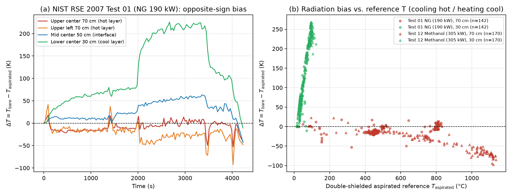
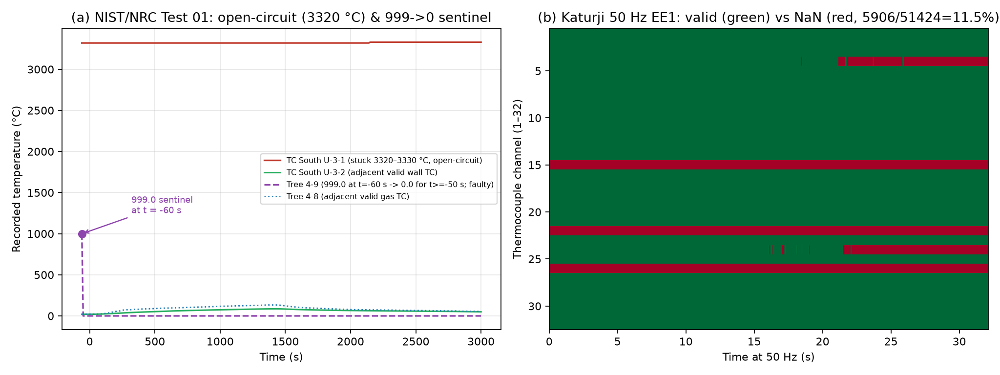

# Missione 04 — Step 2: dataset sperimentali di temperatura per qualificare osservazioni termiche realistiche

**Stato:** consegna autonoma dell'Agente B (dataset sperimentali di temperatura) — da confrontare con la consegna parallela dell'Agente A (modelli e strumenti di misura) nella chat di coordinamento della Missione 04. **Nessuna scelta definitiva** di scenario, sensori, target, dataset o architettura.  
**Data:** 27 novembre 2026.  
**Branch:** `mission04/step2-thermal-datasets` (base `a19ccc4c9c5a9416eefe40e2679a6fa08366e524`).  
**Documenti e artefatti collegati:**
- Registro delle ricerche, verifiche, esclusioni e provenienza dei campioni: [step2_dataset_fonti_e_verifiche.md](step2_dataset_fonti_e_verifiche.md)
- Script riproducibili, manifest SHA-256, output strutturato e figure diagnostiche: [step2_dataset_checks/README.md](step2_dataset_checks/README.md), [inspect_all_samples.py](step2_dataset_checks/inspect_all_samples.py), [inspection_summary.json](step2_dataset_checks/inspection_summary.json), [samples_manifest.json](step2_dataset_checks/samples_manifest.json), [generate_verification_figures.py](step2_dataset_checks/generate_verification_figures.py)
- Contesto di partenza: [step1_pratica_sperimentale_temperatura.md](step1_pratica_sperimentale_temperatura.md), [step1_fonti_e_ricerche.md](step1_fonti_e_ricerche.md), [roadmap04.md](roadmap04.md).

---

## 0. Perimetro, convenzioni e criteri di verifica

**Etichette epistemiche** (coerenti con le missioni 01–04):
- **[D] Documentato / Verificato:** affermato in una fonte primaria letta o verificato numericamente aprendo i file del dataset (`inspection_summary.json`).
- **[I] Inferenza:** interpretazione tecnica motivata a partire da evidenze `[D]`.
- **[M] Mancante / Non identificabile:** informazione assente nei metadati/file aperti, oppure grandezza non identificabile senza un riferimento indipendente o una calibrazione nota.

**Stato di accesso** (distinzione obbligatoria):
- **`accessibile (ispezionato)`** — file scaricati in locale (campione leggero) e verificati numericamente via script (`ISP`).
- **`accessibile (verificato TOC/README)`** — archivio HTTP 200 verificato via README scaricato o indice ZIP remoto via HTTP `Range`, non scaricato integralmente perché pesante (`TOC`).
- **`bloccato dall'ambiente`** — metadati verificati via API DataCite/DOI, ma il portale di download risponde `HTTP 403` / sfida anti-bot (`BLC`), mai aggirata.
- **`su richiesta`** — dati esplicitamente distribuiti solo tramite contatto/accordo con il laboratorio o con link pubblico rotto che rimanda a contatto (`REQ`).
- **`non individuato`** — nessun archivio digitale pubblico reperito nei repository interrogati; disponibili solo articolo/rapporto PDF con figure (`DOC` / `NI`).
- **`controllo negativo (accessibile, senza T)`** — dataset aperto e ispezionato, ma confermato privo di colonne/file di temperatura nonostante l'articolo associato menzioni misure termiche (`NEG`).

**Disciplina analitica.** Ogni numero riporta esplicitamente campione, denominatore, unità e limiti. Non si interpretano automaticamente: (i) fluttuazioni turbolente come rumore strumentale; (ii) uno `0` come dato mancante (salvo schema documentato o anomalia verificata); (iii) un salto temporale come outlier; (iv) l'assenza di `NaN` nei dati rilasciati come assenza di rigetti a monte; (v) uno spettro non referenziato come funzione di trasferimento della sonda.

---

## 1. Sintesi esecutiva

Tra il 26 e il 27 novembre 2026 sono stati censiti e verificati **40 dataset e archivi sperimentali** su 14 canali (TNF Workshop, Sydney Thermofluids, MaCFP, `firemodels/exp`, Zenodo, Figshare/Cardiff, 4TU.ResearchData, Cambridge Apollo, OSTI/NETL EDX, NIST PDR, Mendeley Data, Dryad, DataCite su 9 prefissi istituzionali, PoliMi IRIS, ISF Workshop). Di questi, **16 dataset (82 file, 49,6 MB totali in locale fuori repository)** sono stati effettivamente scaricati come campioni rappresentativi e ispezionati in sola lettura tramite [inspect_all_samples.py](step2_dataset_checks/inspect_all_samples.py); altri **2 archivi pesanti** (`NETL ESSB` 96,9 MB e `TU Delft Swirl Burner` 133 MB) sono stati verificati a livello di contenuto tramite indice ZIP remoto HTTP `Range` senza download massivo.

**Evidenze principali [D]:**
1. **Esiste un analogo sperimentale aperto molto vicino alla geometria di RealPDEBench (`HYLON Phase 2`, rilascio TNF gennaio 2026):** combustore swirl coassiale doppio confinato (camera quadrata $78\times 78\times 145\text{ mm}$, $p=1\text{ bar}$, fiamme H$_2$/aria ancorata `A.1` e sollevata `L.1`), con profili aperti di **termocoppia a doppia giunzione nel gas caldo**, **Raman 1D** (`T`, `T_rms`, specie), **pareti interne LIP** (quarzo, metallo, backplane), **PIV** in due configurazioni di finestra (`4Quartz` vs `2Steel2Quartz`) e CAD validato a raggi X. Tuttavia le diagnostiche provengono da **campagne separate** (stessa condizione nominale, non stessa realizzazione) e il dataset rilascia solo medie/RMS. L'ispezione diretta mostra scostamenti locali TC vs Raman fino a **`+512,8 K` (`+42,2%`) nella CRZ** di `L.1` (perturbazione della sonda sulla fiamma/ricircolo, confermando l'avvertimento degli autori §5.7), **`-234,2 K` (`-11,0%`) sul picco di fiamma** (media spaziale su $\pm 4\text{ mm}$), esclusione spaziale del nucleo caldo $|x|<13\text{ mm}$ in `A.1` per $z\le 12{,}7\text{ mm}$, e differenze PIV fino a **`6,91 m/s` (`RMS 3,06 m/s`)** al cambio di finestre (`2Steel2Quartz` vs `4Quartz`).
2. **I bias fisici e operativi delle termocoppie sono quantificabili su dati aperti in quattro famiglie complementari:**
   - **Bias radiativo diretto di segno opposto (`NIST_RSE_2007`):** 5 coppie co-localizzate di termocoppie tipo K a giunzione nuda vs aspirate a doppio schermo. A $t=0\text{ s}$ (pre-ignizione) l'accordo è entro $|\Delta T|\le 0{,}7\text{ K}$; durante la combustione la giunzione nuda legge **più freddo nello strato caldo superiore** (media `-7,7` / `-22,2` / `-38,1 K`, picchi fino a `-175,7 K` in Test 02 a $T_{\text{asp}}\approx 1105\text{ °C}$) e **molto più caldo nello strato freddo inferiore** per irraggiamento dalla fiamma/strato caldo (media **`+122,2` / `+186,7` / `+163,4 K`**, picchi fino a **`+268,5 K`** a $T_{\text{asp}}\approx 71\text{ °C}$).
   - **Attenuazione inerziale delle fluttuazioni e correzione radiativa in funzione del diametro (`NIST_Pool_Fires`):** coppie grezzo/corretto (`TC`, `TC_RMS` vs `TG`, `TG_RMS`, tipo S nuda da `39` a `199 µm`). La correzione media `TG - TC` cresce da `+2,3 K` (`39 µm`) a `+13,1 K` (`199 µm`, picco `+50 K` alla base a bassa velocità), mentre il fattore di recupero RMS **`TG_RMS / TC_RMS`** (attenuazione da inerzia termica, stimata da modello) sale da mediana **`1,09`** (`39 µm`) a **`1,27–1,34`** (`52 µm`), **`1,38–1,48`** (`153 µm`, max `1,76`), **`1,69`** (`199 µm`) e **`2,16`** (`125 µm` etanolo).
   - **Guasti reali, codici sentinella, dropout e deriva (`NIST/NRC`, `NIST_RSE_2007`, `Katurji 50 Hz`, `CAM.94523`, `MetForTC`):** canali morti marcati con `999.0` al solo istante `t = -60 s` e poi **`0.0` per tutto il resto della serie** (25/255 colonne in `NIST/NRC Test 01 file_1`, incluso `Tree 4-9`), canale bloccato a **`3320–3330 °C`** non segnalato (`TC South U-3-1`), guasto termico a caldo reversibile non segnalato (`TD70LBB` in `NIST_RSE_2007 Test 12`, scarto fino a `-681,9 K`), `11,48%–12,50%` di `NaN` in array TC a 50 Hz (`Katurji`) con 3–4 canali morti e 2 canali a dropout intermittente (`33,7%–33,8%` di `NaN` a metà prova), e fino a **`46,9%` di colpi rigettati** (sostituiti da scalare `uint8([0])`) in termometria ottica LIGS in combustore swirl pressurizzato (`CAM.94523`).
   - **Discrepanze sistematiche fra documentazione e file reali:** riscontrate in **9 dataset su 16 ispezionati** (unità °C dichiarate ma valori in K e `T_std` assente in `ULB`; zero array TC in `CAM.94523`; `NaN` anziché zero-padding in `Brzosko`; CSV compositi privi di newline in `Waterloo`; pirometro IR scambiato per TC e cambio hardware in `Sydney Surface_Temp_BB.doc`; sensore di flusso termico SBG scambiato per TC e salto temporale `-10 s` in `Pelzmann`; assenza di dati T in due depositi Cardiff i cui paper riportano termocoppie; simmetrizzazione artificiale fino a `152,4 K` di scarto locale in `NIST Smyth`).
3. **Lacune strutturali confermate (che cosa NON esiste nei dati aperti oggi) [D/M]:**
   - **Nessun dataset aperto** fornisce `T_gas` e `PIV` acquisiti **simultaneamente nella stessa realizzazione** in un combustore swirl confinato confrontabile con RealPDEBench.
   - **Nessun dataset aperto** scaricabile fornisce serie temporali grezze ad alta frequenza ($\ge\text{kHz}$) di **doppia termocoppia a due diametri** in fiamma per validare sperimentalmente la compensazione dinamica $\tau(t)$.
   - **Nessun dataset aperto** fornisce **risposte sperimentali a gradino/impulso laser/immersione** grezze $T(t)$ di termocoppie per identificare direttamente la funzione di trasferimento della sonda.
   - I dataset di motori ottici **Deep Blue TCC-III** e **TUdatalib Darmstadt** (incluso pistone a fosfori H$_2$ `tudatalib-2291` e Raman NH$_3$/H$_2$ `tudatalib-1819`) sono dichiarati aperti ma **bloccati dall'ambiente (`HTTP 403`)**; **Virginia Tech (`OSTI 1463254`)**, **PoliMi (`Solero 2017`)**, **TU Delft (`Sampat`, `van den Berg`)**, **DLR GTMC/PRECCINSTA** e **ISF-3** non hanno archivi digitali pubblici scaricabili (solo PDF, su richiesta o link storici rotti).

---

## 2. Inventario ampio e tabella sintetica

La tabella seguente riassume i **40 archivi/dataset verificati**, distinti per classe di accesso, strumento/tipo di temperatura, supporto spazio-temporale, relazione con la velocità e ruolo utile.

| ID | Dataset / Archivio | Accesso verificato | Tipo di T e strumento | Supporto e tempo | Relazione con velocità | Ruolo d'uso principale |
|---|---|---|---|---|---|---|
| **D01** | **HYLON Phase 2** (`TNF 2026-01`, IMFT/CERFACS/KAUST) | **accessibile (ispezionato)** | Gas: doppia TC + Raman 1D; Parete: LIP (`Mg3.5FGeO5:Mn`) | Profili radiali/assiali ($z=2{,}7\text{–}62{,}7\text{ mm}$); solo medie/RMS | PIV reagente + freddo in **campagne separate** (`4Q` vs `2S2Q`) | Layout/posizioni; statistiche; confronto TC vs Raman & cambio hardware |
| **D02** | **NIST RSE 2007** (`firemodels/exp`, TN 1483) | **accessibile (ispezionato)** | Gas: 5 coppie TC tipo K nuda vs aspirata; pareti TC | Punti fissi simultanei; serie regolari $\Delta t=30\text{ s}$ ($4230\text{–}6390\text{ s}$) | 9 sonde bidirezionali (`VD*`, m/s) **simultanei**, stessa prova | Studio sensore (bias radiativo nuda vs aspirata; guasti) |
| **D03** | **NIST/NRC Compartment** (`firemodels/exp`, SP 1013-1) | **accessibile (ispezionato)** | Gas: 70 TC nude + 6 aspirate (`ATC`); pareti/cavi TC | Griglia 3D fissa; serie $\Delta t=10\text{ s}$ ($t\in[-60,3000]\text{ s}$) | Sonde bidirezionali porta (`BP Door`) **simultanei** (molti canali `999->0`) | Studio sensore (codici sentinella `999->0`, guasti a 3320 °C, QC) |
| **D04** | **NIST Pool Fires** (`MaCFP`, Sung 2021/2024) | **accessibile (ispezionato)** | Gas: TC tipo S nuda (`39–199 µm`) grezza (`TC`) + corretta (`TG`); fase liquida TC | Profili assiali/radiali (medie/RMS da 60–500 Hz); serie liquida $\Delta t=10\text{ s}$ | Velocità assiale $U$ in `Methane 37 cm` (campagna separata) | Studio sensore (scaling diametro `TG-TC` e `TG_RMS/TC_RMS`) |
| **D05** | **Cambridge LIGS Swirl Press.** (`10.17863/CAM.94523`) | **accessibile (ispezionato)** | Gas: ottica LIGS (sub-µs, fino ~1800 K). **Nessun dato TC nei file!** | 2 altezze ($30,50\text{ mm}$), 12–13 stazioni radiali; PDF + 4000 colpi grezzi | Nessuna velocità nel deposito | Studio sensore ottico (dropout colpi fino al 46,9%); controllo dichiarato/effettivo |
| **D06** | **Katurji 50 Hz In-Fire TC Array** (`10.6084/m9.figshare.16615174.v2`) | **accessibile (ispezionato)** | Gas: array 32 TC a filo fine in fiamma (non corrette) + 23 `TbC` | Array fisso simultaneo; serie grezze **50 Hz** ($\Delta t=20\text{ ms}$, ~32–75 s) | Nessuna velocità nei file `.mat` scaricati | Studio sensore (canali morti, dropout intermittenti a 50 Hz; errore **non identificabile**) |
| **D07** | **ULB 20 kW Semi-Industrial Furnace** (`10.5281/zenodo.7624702` & `7624630`) | **accessibile (ispezionato)** | Gas: pirometro a suzione raffreddato ad aria con TC tipo B | Traversata 2D $(x,y)$ ($8\times 9$ quote), 37 condizioni; sole medie (+ replicati non etichettati) | Nessuna velocità (presenti OH*/CH* medi e FTIR scarico) | Layout/statistiche; ripetibilità su replicati; controllo metadati |
| **D08** | **NIST Smyth Wolfhard-Parker Slot Burner** (`firemodels/exp`) | **accessibile (ispezionato)** | Gas: TC sottile corretta per irraggiamento (versione originale + simmetrizzata) | Profili laterali a 5–9 altezze ($H=3\text{–}19\text{ mm}$); solo medie stazionarie | LDV 2C (`U`, `V`) in **campagna separata** (stessa condizione) | Studio processamento (effetto della simmetrizzazione fino a 152 K); statistiche |
| **D09** | **Waterloo Methanol Pool Fire** (`MaCFP`, Weckman 1996) | **accessibile (ispezionato)** | Gas: TC tipo S `50 µm` (bead `75–100 µm`), 125 Hz, compensata inerzialmente (no rad.) | Traversata radiale/assiale; sole medie, RMS e correlazioni $\langle u'T'\rangle, \langle v'T'\rangle$ | **LDA 2C simultanea** alla TC (ma rilasciate solo statistiche aggregate!) | Statistiche congiunte ($u'T', v'T'$); controllo qualità packaging |
| **D10** | **Cardiff NH$_3$/H$_2$ Swirl Radiation** (`10.17035/cardiff.31141438`) | **accessibile (ispezionato)** | Gas scarico (TC) + parete interna/esterna (TC) su 9 $\Phi$ (`0,6–1,4`) | 3 punti fissi (scarico, parete int/est); singole medie per $\Phi$, zero RMS | Nessuna velocità (presenti emissioni, radiazione, OH*/NH$_2$*) | Condizioni al contorno parete/scarico in rig swirl NH$_3$ |
| **D11** | **FM Burner** (`MaCFP`, aggiornamento ott. 2025) | **accessibile (ispezionato)** | Gas: TC nuda (medie, RMS e PDF a 200 bin, $260\text{–}2300\text{ K}$) | Profili radiali a più altezze ($z/D$); statistiche e PDF aggregate | Velocità 2C (media) stessa condizione, campagne separate | Confronto statistiche e PDF; gestione celle vuote (`9/693`) |
| **D12** | **UMD Line Burner** (`MaCFP`, White 2016) | **accessibile (ispezionato)** | Gas: TC nuda (medie e RMS assiali e laterali) | Linea verticale ($24$ pt) + 4 quote laterali ($14$ pt); medie/RMS | Nessuna velocità nei file T (solo calorimetria e O$_2$) | Statistiche; controllo discrepanze di unità (`TC_Data` °C vs K) |
| **D13** | **Wang Aero-Engine Exhaust MWIR vs TC** (`10.5281/zenodo.23054326`) | **accessibile (ispezionato)** | Gas scarico turbogetto: MWIR vs TC tipo K di riferimento (+ tabella analitica rad.) | 4 stati stazionari/accelerazione (0°); medie e deviazioni | Nessuna velocità | Confronto ottica IR vs TC (`-35` / `-50 K`); controllo modello vs misura |
| **D14** | **MetForTC Drift Tests** (`10.5281/zenodo.8189490` & `8186928`) + **Pearce Drift** (`4972091`) | **accessibile (ispezionato)** | Calibrazione metrologica NMI: deriva TC tipo K e S (punto di Curie, 24–370 °C) + survey 1972–2021 (`.opju`) | Forno di riferimento; serie raw Keithley (fino a 12.054 righe, `V`, `StandDev V`, impedenza) | Non applicabile (metrologia in forno) | Studio sensore (floor elettronico/deriva; non combustione) |
| **D15** | **Brzosko 12-TC Grid** (`10.5281/zenodo.21371063`) | **accessibile (ispezionato)** | Solido (non combustione): 12 TC incassate in pin freno a 10 Hz | 211 sequenze $\times$ 532 passi $\times$ 12 canali, `mask` esplicita (`1,90%` `NaN`) | Non applicabile (tribometro) | Controllo metadati (`NaN` vs zero-padding) e pattern di masking multi-TC |
| **D16** | **Sydney Thermofluids** (`SM1.zip` + `Surface_Temp_BB.doc`) & **TNF Sandia D–F** (`pmCDEF.zip`) | **accessibile (ispezionato)** | Gas: Raman/Rayleigh/LIF singolo colpo (`133.389` colpi SM1; `9.339` colpi D15); Superficie bluff body: **pirometro IR Mikron M90-D** (NON TC!) | Linee/punti radiali; singolo colpo indipendente (no serie temporale) + medie/RMS + `TDNR` | LDV/PIV in archivi separati (stessa condizione; in `Surface_Temp_BB` hardware cambiato!) | Statistiche single-shot; outlier ottici sub-ambiente (`9` colpi `<250 K`); controllo cambio hardware |
| **D17** | **Pelzmann & Robert McKenna Flat Flames** (`10.17632/jvvvgpdy48.6`) | **accessibile (ispezionato)** | **Solo flusso termico SBG** (`U [mV], Q [W]`), IR, OH*, Cantera + log ambiente `TPH` (nessun file TC gas) | Serie 1 Hz/10 s di flusso termico e ambiente (`244` righe) | Nessuna velocità | Controllo negativo TC gas; anomalia timestamp reale (`dt = -10 s`) |
| **D18** | **NETL Enclosed Sydney Swirl Burner Rel. 1.0** (`10.18141/2478453`, EDX) | **accessibile (verificato TOC)** | Parete/superficie o gas: `Thermal Imaging/` (`HM1aTemps`, `SMH2aTemps`, `V1Temps.xlsx`, 69 MB tot.) + OH-PLIF | 3 fiamme swirl confinate (`HM1a`, `SMH2a`, `V1`), `96,9 MB` ZIP (`115` file) | LDA velocità (`HM1a`, `SMH2a`, `V1`) in campagne separate | Candidato futuro per combustore swirl confinato con mappe termiche + LDA |
| **D19** | **TU Delft GOx/CH$_4$ Resonance Igniter** (`10.4121/dbaa8f0f-59d2-4d58-8cc9-494af1b966f1.v1`) | **accessibile (verificato README)** | Parete esterna punta risonatore: TC tipo K saldata (`TC2`, `TC0`) a **100 Hz** (`.tdms`) + `sensors.py` | Serie temporali continue a 100 Hz + script Python di correzione risposta TC (`2,05 GB` ZIP) | Nessuna velocità (presenti pressioni 2,5 kHz e microfono 100 kHz) | Studio sensore (correzione dinamica parete + script riproducibile) |
| **D20** | **TU Delft Swirl CH$_4$/H$_2$ Burner** (`10.4121/7e680c48-7408-4e35-8880-10220814afd5.v1`) | **controllo negativo (verificato TOC/README)** | **ZERO dati di temperatura** (solo PIV reagente/freddo, SPOD, OH-PLIF, NO/CO$_2$) | 95 file (`133 MB` ZIP) | Solo PIV + OH-PLIF | Escluso per temperatura (utile solo come riferimento velocità/swirl) |
| **D21** | **Cardiff COG/NH$_3$ (`10.17035/cardiff.30234904`) & Mashruk 2022 (`d.2022.0217184646`)** | **controllo negativo (ispezionato)** | **ZERO colonne/fogli di temperatura** nei file Excel aperti (solo emissioni e chemiluminescenza/OES) | Tabelle per $\Phi$ | Nessuna velocità | Controllo negativo: paper cita TC ma deposito omette T |
| **D22** | **TNF KAUST Piloted Cracked NH$_3$** (`tnfworkshop.org`, feb. 2026) | **accessibile (HTTP 200)** | Gas: Raman/Rayleigh/LIF (`T`, specie) in getti pilotati NH$_3$ crackata | `24,9 MB` ZIP (non scaricato) | Verificare velocità nel pacchetto | Statistiche ottiche per fiamme NH$_3$/H$_2$ |
| **D23** | **TNF Delft III / DLR A–B / Sandia H$_2$–CO / HYLON Phase 1** | **accessibile (HTTP 200)** | Gas: Raman/Rayleigh/CARS (`T`, specie); HYLON Phase 1 (`35,2 MB`) | Archivi storici TNF (`HTTP 200`) | LDV/PIV in campagne separate (Delft III, DLR A/B, HYLON P1) | Statistiche ottiche standard (fiamme aperte e HYLON v1) |
| **D24** | **Cambridge Stratified Slot Burner** (`10.17863/CAM.1489` / `1810/226470`) | **accessibile (HTTP 200, All Rights Reserved)** | Gas: Raman/Rayleigh (`T`, specie) | Profili radiali/assiali | Filo caldo / LDV separato | Statistiche ottiche (licenza restrittiva *All Rights Reserved*) |
| **D25** | **Fischer FWI Test Bench** (`10.17632/jtmk3pg36k.1`, Mendeley) | **accessibile (API 200)** | Parete: temperatura di parete da conduzione inversa (IHC) + BC ingresso | Mappa BC di parete per CFD FWI | Profili ingresso flusso (separati) | Condizioni al contorno termiche di parete |
| **D26** | **ETH Bonciolini & Noiray** (`10.5061/dryad.4cj4k`, CC0) | **accessibile (API 200)** | Acustica/transizioni in combustore (`.tdms`, `302 MB`); presenza canali TC non verificata nei file | Serie temporali continue `.tdms` | Nessuna PIV | Non ispezionato (pesante, focus termoacustico) |
| **D27** | **Zenodo vari recenti** (`23062725` KIT Jet-A1/H$_2$, `23037088` KIT H$_2$, `19004211` NH$_3$ swirl, `3693670` NPL pirometro, `20446928` Weir 668 MB) | **accessibile (API 200)** | Misti: pirometria ultraveloce (`3693670`), combustori H$_2$/NH$_3$ (`23062725`, `23037088`, `19004211`), sensori spettrali+TC (`20446928`) | Non ispezionati (priorità secondaria o >600 MB) | Assente o separata | Piste secondarie documentate nel registro |
| **D28** | **UMich Deep Blue TCC-III** (`10.7302/z2hq3x4s`, `z2ms3qp3`, `z2h41pcd`, `z2cc0xnp`) | **bloccato dall'ambiente (`HTTP 403`)** | Parete/flusso termico: TC coassiale rapida in testa cilindro + T esterne/ingresso (`z2hq3x4s`); motored/fired | Metadati DataCite confermati; file non scaricabili per 403 | PIV ad alta frequenza nello stesso rig (`z2hq3x4s` near-wall) | Alto interesse per parete+PIV motore ottico (richiede download manuale fuori sandbox) |
| **D29** | **TU Darmstadt TUdatalib — H$_2$ ICE Piston Phosphor** (`10.48328/tudatalib-2291`, CC BY 4.0) | **bloccato dall'ambiente (`HTTP 403` Anubis)** | Superficie pistone: fosfori termografici in motore ottico H$_2$ | Metadati DataCite 2026 confermati | Propagazione fiamma / diagnostica motore (verificare in download manuale) | Alto interesse per termometria a fosfori su parete mobile |
| **D30** | **TU Darmstadt TUdatalib — Engine DBs & NH$_3$/H$_2$ Raman** (`tudatalib-1535`, `1532`, `1113/1114`, `1819`, `2135`, `2194`) | **bloccato dall'ambiente (`HTTP 403` Anubis)** | Gas: Raman/Rayleigh NH$_3$/H$_2$/N$_2$ (`1819`) e H$_2$ (`2135`), TDLAS (`2194`); BC motore (`1113`, `1535/1532`) | Metadati DataCite 2023–2026 confermati (`CC BY-NC 4.0` / `CC BY 4.0`) | Velocità flow-bench (`1114`) e PIV motore (`1535/1532`) separate | Alto interesse per statistiche Raman NH$_3$/H$_2$ e BC motore (download manuale) |
| **D31** | **NIST Fire Calorimetry Database (FCD)** (`10.18434/mds2-2314`) & **PDR Pool/Plume** (`M32135`, `T4/1502568`, `mds2-2812`) | **accessibile (API/web, parziale)** | Gas/plume TC e calorimetria; `mds2-2314` via portale dinamico (API `0` file diretti); `M32135` 9,9 kB | Misti (serie o tabelle Excel) | Assente | Pista secondaria rispetto a `firemodels/exp` e `MaCFP` già ispezionati |
| **D32** | **Virginia Tech Optical Swirl Combustor** (`OSTI 1463254`, DOE-VT-001176-2) | **non individuato / su richiesta** | Gas: TC tipo B traversata (320 nodi, 400–1600 K, bead 0,762 mm, $\tau\approx 1{,}5\text{ s}$); liner IR | **Solo rapporto PDF** (264 pp.); zero dataset su `data.lib.vt.edu` | PIV in campagne separate (liner rimosso per scansione TC) | Riferimento documentale chiave per layout TC in gas caldo, dati digitali assenti |
| **D33** | **PoliMi Swirl Combustor** (Solero 2017 `IJETR2102.pdf`; Olivani 2007 `etfsPAPER2007.pdf`) | **non individuato (solo PDF / login)** | Gas: TC nuda tipo R (Pt/Pt-13%Rh, bead `0,3 mm`, 500 Hz, 5000 campioni = 10 s), corr. Morgan 1991 | **Solo figure nel PDF** (`Solero 2017` scaricato e letto); `Olivani 2007` login-gated | PIV + LDA reagente a doppia semina in **campagne separate**, velocità usata per $h$ della TC | Riferimento metodologico (velocità usata per correggere TC), dati digitali assenti |
| **D34** | **TU Delft Step 1 Leads** (Sampat *Fuel* 2025/GT2022; van den Berg *AECS* 2024; X. Huang 2018; DJHC) | **non individuato / su richiesta** | Gas: TC tipo S inguainata traversata (camera d'acciaio gemella) | Non depositati su 4TU.ResearchData né TU Delft Repository | PIV in campagne separate (in JHC PIV a freddo per correggere TC) | Riferimento documentale (Step 1 v2), dati digitali non pubblicati |
| **D35** | **DLR GTMC / PRECCINSTA / SFB 606 / HBK / FRS** | **su richiesta** | Gas: Raman, fs-CARS 5 kHz, FRS; Parete: fosfori 2D/1 kHz | Solo articoli (elib/OSTI); dati distribuiti solo tramite accordo DLR | Campagne separate alla stessa condizione | Non direttamente scaricabili; fuori portata senza contatto |
| **D36** | **ISF Workshop (ISF-3 DLR pressurizzato & Adelaide CET)** | **su richiesta / link rotti** | Soot + T (CARS/TC/fosfori) in fiamme fuligginose | Link live Adelaide CET rotti post-fusione universitaria; `isfworkshop.org` rinvia a Wayback 2025 | Campagne separate | Non direttamente scaricabile oggi |
| **D37** | **TNF/Darmstadt TSF & SWQ, CSSB scalari/fosfori, TECFLAM, Lund LSB, EM2C, KIT Kraus, Adelaide JHC, OSU McManus FRS+PIV, Volvo rig** | **su richiesta / non individuato** | Misti: CARS/Raman/FRS/fosfori/TC parete | Non depositati in archivi aperti diretti (salvo CSSB LDA `1810/243259`, senza T) | Separata (simultanea FRS+PIV solo in OSU McManus, dati non depositati) | Esclusi dall'ispezione diretta |
| **D38** | **Cambridge Apollo solo velocità/ottica** (`CAM.96660` CCB, `CAM.90803` LEAFINNOX, `CAM.106960` Yoko, `1810/243259` CSSB LDA) | **controllo negativo (metadati API)** | Nessuna misura di temperatura nei file depositati | PIV / OH-PLIF / LDV / acustica | Solo velocità/imaging | Esclusi per assenza di dati termici |
| **D39** | **EngineBench** (`arXiv:2406.03325`) | **controllo negativo (verificato)** | **Nessuna temperatura** (solo PIV motored a freddo derivata da TCC-III) | Campi PIV 2D motored | Solo PIV senza combustione | Escluso per assenza di combustione e temperatura |
| **D40** | **TU Berlin AHEAD (`tnfworkshop.org`, 3,47 GB) & NTNU Bluff-Body H$_2$** | **controllo negativo / non prioritario** | OH-PLIF / PIV (nessun profilo termico dichiarato nei metadati TNF) | Archivi massivi (`3,47 GB`) | Solo flusso/fiamma | Esclusi dall'ispezione |

---

## 3. Schede approfondite dei candidati utili (7 dimensioni)

Di seguito le schede complete secondo le **7 dimensioni richieste** per i candidati più informativi ai fini della Missione 04.

### 3.1 HYLON TNF Phase 2-1 (`D01`) — Combustore swirl confinato H$_2$/aria multi-diagnostica

1. **Identità e accesso:** *HYLON TNF 2026 01 Phase2-1: Dataset Hydrogen/Air flames in a dual swirl coaxial injector* — S. Marragou, M. Vilespy, Z. Al Hadi, A. Teixeira, H. Magnes, L. Selle, G. Magnotti, T. Guiberti, T. Poinsot, T. Schuller (IMFT / CERFACS / KAUST). URL: `https://tnfworkshop.org/wp-content/uploads/2026/01/HYLON_TNF_2026_01_Phase2-1.zip` (`9,27 MB`, 73 file reali esclusi metadati macOS). Versione: `2026 01 Phase2-1` (21 gennaio 2026). Articolo associato: Vilespy et al., *Combust. Flame* 283 (2026) 114536 (`10.1016/j.combustflame.2025.114536`). Licenza/condizioni: archivio pubblico TNF, nessuna licenza SPDX esplicita; il PDF di documentazione (p. 2) impone la restrizione **`NO-LIF measurements have not been published yet. It cannot be used in a paper before being published`** (e chiede registrazione via email per gli aggiornamenti, qui non effettuata per rispetto dei limiti). Accesso: **`accessibile (ispezionato)`** [D].
2. **Apparato e strumento:** Iniettore coassiale a doppio swirl (H$_2$ centrale $d_i=5{,}9\text{ mm}$, $S_i=0{,}6$, recesso $z_i=4{,}3\text{ mm}$; aria anulare $d_e=18\text{ mm}$, $S_e=1{,}2$), camera quadrata confinata $78\times 78\times 145\text{ mm}$ con convergente finale (rapporto di contrazione `0,51`), $p=101325\text{ Pa}$, $T_{\text{in}}=298\text{ K}$, $\Phi_g=0{,}421$. Due regimi: **Flame A.1** (ancorata, $P_{\text{th}}=2{,}513\text{ kW}$, $U_b^a=11{,}8\text{ m/s}$, $U_b^h=9{,}3\text{ m/s}$) e **Flame L.1** (sollevata a V, $P_{\text{th}}=5{,}026\text{ kW}$, $U_b^a=23{,}7\text{ m/s}$, $U_b^h=18{,}6\text{ m/s}$). Strumenti termici [D, `HYLON_TNF_2026_01_Phase2-1_PDF.pdf` §5.1, §5.4, §5.7]:
   - **Gas (termocoppia):** sonda a **doppia giunzione** (*double-bead thermocouple*) introdotta attraverso piastra forata (fori $\varnothing\,1\text{ cm}$ sigillati con lana di vetro), risoluzione spaziale dichiarata **`±4 mm`** in ogni direzione; diametro esatto dei fili e tipo di lega non riportati nel PDF (`[M]`).
   - **Gas (ottica):** spettroscopia **Raman 1D** (3 Nd:YAG combinati, impulso stirato ~500 ns, 0,85 J, shutter 980 ns, binning 12 px $\rightarrow \Delta x\approx 0{,}105\text{ mm}$, **senza Rayleigh**).
   - **Pareti interne:** **LIP** (*Laser-Induced Phosphorescence*, vernice $\text{Mg}_{3.5}\text{FGeO}_5\text{:Mn}$, laser 266 nm a 50 Hz, PMT + oscilloscopio 2,5 MHz).
3. **Posizioni e supporto:** Tutte le misure fluido giacciono sul piano assiale $(x,z)$ a $y=0\text{ mm}$, coordinate in `mm`. **TC:** traversata puntuale a 6 quote $z=2{,}7;\;12{,}7;\;22{,}7;\;32{,}7;\;47{,}7;\;62{,}7\text{ mm}$ ($6\text{–}12$ punti radiali/quota, $x\in[0,38]\text{ mm}$). In **Flame A.1**, a $z=2{,}7$ e $12{,}7\text{ mm}$ la TC copre **solo $x\ge 13\text{ mm}$** (esclusione del nucleo caldo fino a `2043 K`!). **Raman 1D:** linee radiali ($x\in[-3{,}05;\;12{,}95\text{–}22{,}95]\text{ mm}$, 119–248 punti, $\Delta x=0{,}1051\text{ mm}$) a $z=2{,}7;\;7{,}7;\;12{,}7;\;22{,}7\text{ mm}$. **LIP pareti:** 6 punti sul backplane ($r\in[6,31]\text{ mm}$, inclusi labbri iniettore), 8 punti sulla finestra metallica (acciaio 304L, $z\in[7{,}5,80]\text{ mm}$) e 8 sulla finestra in quarzo JSG1 ($z\in[7{,}5,80]\text{ mm}$). Distinzione netta fra $T_{\text{gas}}$ (Raman e TC corretta) e $T_{\text{parete}}$ interna (LIP).
4. **Tempo:** Nessuna serie temporale rilasciata (`[D]`): solo **statistiche aggregate stazionarie** dopo equilibrio termico ($>15\text{ min}$ per scarico). LIP: media di 100 colpi a 50 Hz (`2 s`/punto). PIV: media/RMS di almeno 1000 coppie di immagini a 10 Hz. Raman: media e RMS di colpi indipendenti (frequenza/numero esatto di colpi non indicato nel PDF `[M]`). TC: sola media puntuale (`T_mean`, zero `T_rms`, zero frequenza o durata di integrazione `[M]`).
5. **Relazione con la velocità:** PIV 2C (aria e H$_2$ seminati con $\text{TiO}_2$, $D_{32}=200\text{ nm}$, foglio 1 mm) a $z=2;\;7;\;12;\;22;\;32\text{ mm}$ (reagente) e freddo, in **campagne separate** da Raman, TC e LIP (stessa condizione nominale, **non** stessa realizzazione). Fondamentale: la PIV è rilasciata in **due configurazioni hardware** — baseline `4Quartz` (4 finestre in quarzo) e configurazione Raman `2Steel2Quartz` (2 finestre in acciaio forate con 8 coppie di fori $\varnothing\,4\text{ mm}$ per il fascio laser), permettendo di quantificare direttamente l'effetto del cambio di hardware (§4.4).
6. **Processamento:**
   - **TC:** estrapolazione lineare a superficie nulla $T_{\text{fluid}} = T_s + S_s(T_s - T_l)/(S_s - S_l)$ (Eq. 4, senza necessità di composizione gas); rilasciata solo `T_fluid` già corretta (nessun `T_s`, `T_l` grezzo `[M]`), incertezza dichiarata **`±10%`** uniforme e **`±4 mm`** in $x$. Avvertimento esplicito (§5.7): *«When crossing the flame, the thermocouple induces local perturbations of the flow and the flame, which may affect the measurements in the CRZ»*.
   - **Raman:** inversione ibrida (Fuest 2011) calibrata su fiamme piatte McKenna ($\phi=0{,}9\text{–}1{,}8$); accuratezza dichiarata **`±60 K`**, precisione single-shot **`4,6 K`** (aria ambiente) fino a **`77 K`** (`4,53%`) a stechiometria (peggiorata dall'assenza del canale Rayleigh).
   - **LIP:** tempi di decadimento calibrati 300–1000 K contro TC tipo K verniciata; incertezza relativa verificata nei file **`2,50%`** (`7,9–25,1 K`).
7. **Contenuto effettivo:** 73 file reali: CAD `.igs` (fluido + solido validati a raggi X), PDF 24 pp., profili ASCII `.txt` per Flame `A1` e `L1` (`A1/L1_Major_species_T_NO`, `Flow_velocity` 4Q/2S2Q/cold, `T_flow_thermocouple`, `Wall_Temp` backplane/metal/quartz, `NOx_exhaust`, immagini `OHstar` `.png`). Nessun `NaN` nei file ispezionati; 5 coppie replicate in `A1` TC (`|ΔT|` mediana `9,5 K`, max `29,25 K`).

---

### 3.2 NIST Reduced-Scale Enclosure 2007 (`D02`) — Bias radiativo diretto TC nuda vs aspirata

1. **Identità e accesso:** *NIST Reduced Scale Enclosure Experiments, 2007* (`NIST_RSE_2007`, Bundy et al., NIST TN 1483). URL: `https://github.com/firemodels/exp/tree/master/NIST_RSE_2007` (ramo `master`). Licenza: Pubblico Dominio (opera del governo USA, NIST). Ispezionati 3 file CSV: `NIST_RSE_2007_01.csv` (gas naturale `190 kW`), `02.csv` (gas naturale `395 kW`), `12.csv` (metanolo `305 kW`). Accesso: **`accessibile (ispezionato)`** [D].
2. **Apparato e strumento:** Compartimento a scala ridotta $0{,}95\times 1{,}42\times 0{,}98\text{ m}$ con porta frontale, pressione atmosferica, bruciatori a gas naturale/metanolo/idrocarburi. Termocoppie gas **tipo K**: 5 coppie **co-localizzate** sulla porta fra **giunzione nuda** (`*BB`) e **termocoppia aspirata a doppio schermo** (`*A`) a $z=30, 50, 70\text{ cm}$ (`TD70LA/LBB`, `TD70CA/CBB`, `TD50CA/CBB`, `TD30LA/LBB`, `TD30CA/CBB`), più TC aspirate interne (`TR*A`, `TF*A`) e TC di superficie parete/soffitto/pavimento (`TWall*`, `TCeil*`, `TFloor*`).
3. **Posizioni e supporto:** Sensori puntuali fissi simultanei nella sezione di porta e nell'enclosure; separazione esplicita fra $T_{\text{giunzione nuda}}$ (`*BB`), $T_{\text{gas aspirata}}$ (`*A`, proxy vicino a $T_{\text{gas}}$) e $T_{\text{parete}}$ (`TWall*/TCeil*/TFloor*`). Unità nei file: `C` (°C) per T, `m/s` per velocità, `s` per tempo.
4. **Tempo:** Serie temporali continue, **perfettamente regolari** con $\Delta t = 30{,}0\text{ s}$ (`0` salti non positivi o irregolari >1% nei 3 test): `142` righe (`0–4230 s`, Test 01), `214` righe (`0–6390 s`, Test 02), `170` righe (`0–5070 s`, Test 12). Un valore iniziale a $t=0\text{ s}$ (pre-ignizione). Risoluzione temporale troppo lenta (`0,033 Hz`) per studiare la dinamica rapida della giunzione ($\tau\sim 0{,}01\text{–}1\text{ s}$), ideale per regime quasi-stazionario e derive lente.
5. **Relazione con la velocità:** **9 sonde di velocità bidirezionali** (`VD79L/C/R`, `VD60C`, `VD40C`, `VD20L/C/R`, `VD5C`, m/s) acquisite **simultaneamente nella stessa realizzazione** sullo stesso asse verticale della porta (range `-7,04` a `+6,39 m/s`), con identici timestamp a `30 s`.
6. **Processamento:** Nessuna correzione radiativa applicata alle colonne `*BB` (appositamente confrontabili con `*A`). Presenti valori `NaN` espliciti per sensori guasti/offline (es. `TFloorF`, `TCeilF`, `TWallUR` `142/142` `NaN` in Test 01; `8/214` `NaN` sulle TC aspirate in Test 02). **Tuttavia** l'ispezione ha rivelato un **guasto severo non segnalato** su `TD70LBB` in Test 12 (§4.1).
7. **Contenuto effettivo:** CSV a 2 righe di intestazione (nome + unità), `64` colonne ciascuno (tempo, HRR, gas $\text{O}_2/\text{CO}_2/\text{CO}/\text{THC}$, soot, flussi termici, 20+ canali T, 9 velocità `VD*`).

---

### 3.3 NIST/NRC Compartment Fire Experiments (`D03`) — Anatomia di guasti e codici sentinella

1. **Identità e accesso:** *NIST/NRC Compartment Experiments* (`NIST_NRC`, Hamins et al., NIST SP 1013-1, 15 prove grandi, giugno 2003). URL: `https://github.com/firemodels/exp/tree/master/NIST_NRC`. Licenza: Pubblico Dominio. Ispezionati: `NIST_NRC_Test_01_file_1.csv` (`256` col), `Test_01_file_2.csv` (`69` col), `Test_04_file_1.csv` (`256` col). Accesso: **`accessibile (ispezionato)`** [D].
2. **Apparato e strumento:** Compartimento a grande scala ($21{,}7\times 7{,}04\times 3{,}82\text{ m}$), fuochi a spruzzo di eptano/toluene (`350 kW`–`2 MW`), pressione atmosferica. 7 alberi verticali da 10 TC nude ciascuno (`Tree 1–7`, 70 TC gas), 2 TC aspirate in camera (`ATC-5`, `ATC-6`), 4 TC aspirate porta/scarico (`ATC Door-1..3`, `ATC Exhaust-4`), TC di parete (`TC North/South *`) e su cavi (`D-Ts-*`, `E-Tc-*`).
3. **Posizioni e supporto:** Griglia 3D fissa simultanea (coordinate nel report NIST SP 1013-1 e FDS Validation Guide), distinguendo gas nudo (`Tree *`), gas aspirato (`ATC-*`) e superfici solide (`TC North/South*`, cavi). Unità: `°C`, `s`.
4. **Tempo:** Serie temporali regolari con $\Delta t = 10{,}0\text{ s}$ esatti (`0` anomalie temporali): `307` righe (`t ∈ [-60, 3000] s`, Test 01) e `140` righe (`t ∈ [-60, 1330] s`, Test 04). Include `60 s` di baseline pre-ignizione (`t = -60..-10 s`).
5. **Relazione con la velocità:** Sonde bidirezionali porta (`BP Door-1..13`, file 2) e portate in porta (`Door flow in/out`, file 1) nella **stessa realizzazione** (tuttavia in Test 01 a porta chiusa `16/68` canali in `file_2`, fra cui `BP Door-1..13`, sono inattivi con schema sentinella `999.0 -> 0.0`).
6. **Processamento:** Nessuna correzione radiativa sulle `Tree *`. **Codifica critica scoperta dall'ispezione [D]:** (i) i canali inattivi/malfunzionanti (`25/255` colonne in Test 01 `file_1`, incluso `Tree 4-9`, e `11/255` in Test 04 `file_1`) riportano **`999.0` SOLO alla prima riga (`t = -60 s`) e poi `0.0` per tutte le restanti 306/139 righe**; (ii) il canale di parete **`TC South U-3-1`** in Test 01 è bloccato a **`3320,0–3330,0 °C`** su `307/307` righe (circuito aperto non filtrato né segnalato nei CSV); (iii) solo 4 canali analizzatore gas (`O2-1`, `O2-2`, `CO-3`, `CO2-4`) usano `NaN` espliciti (`150/307` righe in Test 01, `22/140` in Test 04).
7. **Contenuto effettivo:** CSV a **1 sola riga di intestazione** (senza riga unità dedicata, a differenza di `NIST_RSE_2007` — dettaglio critico per il parsing), `307×256` e `307×69` celle.

---

### 3.4 NIST Pool Fires (`D04`) — Scaling di diametro per bias radiativo e inerzia termica

1. **Identità e accesso:** *NIST Pool Fires* (`MaCFP/macfp-db/Liquid_Pool_Fires/NIST_Pool_Fires`, Sung, Hamins et al., NIST TN 2083r1 & TN 2162r1). URL: `https://github.com/MaCFP/macfp-db/tree/master/Liquid_Pool_Fires/NIST_Pool_Fires`. Licenza: MIT (repository MaCFP) / Pubblico Dominio (NIST). Ispezionati **10 CSV** (8 profili gas TC metanolo 30/100 cm, etanolo 30 cm, metano 37 cm, propano 37 cm; 1 profilo velocità `Methane_37_cm_U_r=0`; 1 serie temporale liquida `Acetone_30_cm_TC`). Accesso: **`accessibile (ispezionato)`** [D].
2. **Apparato e strumento:** Vasche/bruciatori circolari da `30`, `37` e `100 cm` a pressione atmosferica, combustibili metanolo, etanolo, acetone, metano, propano (50 kW). Termocoppie gas **tipo S a filo fine, giunzione nuda** quasi sferica ispezionata al microscopio (emissività Pt vergine) con **6 diametri di giunzione dichiarati** (`D_bead = 39, 52, 119, 125, 153, 199 µm`).
3. **Posizioni e supporto:** Traversate verticali lungo l'asse ($r=0$, $11\text{–}18$ quote $z$) e radiali ($z=21, 61, 101\text{ cm}$, $7$ punti $r$) in `cm`; serie liquida su 10 posizioni fisse ($z\in[-8{,}0,+8{,}5]\text{ cm}$, `K`). Distinzione chiara fra `TC` (giunzione non corretta), `TG` (gas stimato da modello) e fase liquida.
4. **Tempo:** Per la fase gas sono rilasciate **solo medie e RMS stazionarie** (acquisite a 60–500 Hz per ~120 s nei report NIST, ma nessuna serie temporale raw è depositata `[M]`). Per l'acetone in fase liquida (`Acetone_30_cm_TC_Sung_2024.csv`), serie temporale regolare `299` righe, $\Delta t=10{,}0\text{ s}$, $t\in[-60, 2920]\text{ s}$, `0` `NaN`, $T\in[287{,}6;\;408{,}2]\text{ K}$.
5. **Relazione con la velocità:** Profilo di velocità media verticale $U(z)$ lungo $r=0$ in `Methane_37_cm_U_r=0_Sung_2024.csv` (`14` quote, $U\in[0{,}64;\;3{,}44]\text{ m/s}$, con incertezza `Uc_U`), acquisito in **campagna separata** alla stessa condizione e utilizzato nella modellazione dello scambio convettivo per la correzione TC.
6. **Processamento:** Il dataset rilascia **affiancate** la lettura della giunzione non corretta (`TC`, `TC_RMS`), la temperatura del gas corretta per **irraggiamento + inerzia termica** (`TG`, `TG_RMS`), l'incertezza estesa `UC_TG` (~`5,2%`, `16–71 K`) e il diametro della giunzione `D_bead`. **Limite epistemico cruciale [I]:** `TG` e `TG_RMS` sono uscite di un **modello inverso** applicato ai segnali TC, **non** una verità ottica indipendente — quantificano quindi l'ampiezza della correzione stimata dal modello NIST in funzione di $D_{\text{bead}}$, non un errore residuo validato esternamente.
7. **Contenuto effettivo:** CSV puliti senza `NaN`, ma con **eterogeneità di schema** fra `Sung_2021` (2 righe di intestazione, nomi `TC`/`D_bead`) e `Sung_2024` (1 riga di intestazione, nomi `TC_K`/`D_bead_um`, e `Bead_D_um` nel solo file `Methane`).

---

### 3.5 Cambridge Pressurized Swirl Burner LIGS (`D05`) — Dropout ottico reale e verifica dichiarato/effettivo

1. **Identità e accesso:** *Research data supporting "Spatial temperature and water molar concentration measurements using thermal and electrostrictive LIGS during operation of a swirl burner at pressure"* — L. Weller, P. Shah, A. Giles, F. De Domenico, S. Morris, B. A. O. Williams, S. Hochgreb (Univ. Cambridge / Cardiff). DOI: `10.17863/CAM.94523` (2023). Licenza: `CC BY 4.0`. Ispezionati **tutti e 7 i file `.mat`** (`11,48 MB` totali). Accesso: **`accessibile (ispezionato)`** [D].
2. **Apparato e strumento:** Combustore swirl pressurizzato (impianto Port Talbot / Cardiff), termometria ottica **LIGS** (*Laser-Induced Grating Spectroscopy* termica ed elettrostrittiva, risoluzione sub-$\mu\text{s}$, volume ~`5 mm`, $T$ fino a ~`1800 K`, $X_{\text{H}_2\text{O}}\in[0{,}01;\;0{,}12]$).
3. **Posizioni e supporto:** Profili radiali a 2 quote assiali (`temperature30mm`: 12 stazioni $r\in[-55,55]\text{ mm}$; `temperature50mm`: 13 stazioni $r\in[-65,55]\text{ mm}$), 200 bin di PDF per stazione (nota: la stazione $r=-5\text{ mm}$ ha `600` righe, 3 blocchi impilati). Temperatura esclusivamente del **gas** via segnale ottico.
4. **Tempo:** Campioni ottici single-shot sub-$\mu\text{s}$ (`Signalss_thermal.mat..4.mat`: 4 serie da `1000` colpi ciascuna, tracce di oscillazione temporale da `1260` o `2500` campioni su `time_offset` $\in[-46,\;458/954]\text{ ns}$) + istogrammi/PDF aggregate in `FigureData.mat`. Non sono serie temporali risolte del flusso turbolento.
5. **Relazione con la velocità:** Nessuna misura di velocità nel deposito.
6. **Processamento:** Filtraggio/rigetto dei colpi LIGS con SNR insufficiente: nei 4 file `Signalss_thermal*.mat` i colpi rigettati sono esplicitamente sostituiti dallo scalare **`uint8([0])`** invece di un vettore di 1260/2500 float64. Tassi di rigetto effettivi verificati [D]: **`395/1000` (`39,5%`)**, **`469/1000` (`46,9%`)**, **`82/1000` (`8,2%`)**, **`2/1000` (`0,2%`)**.
7. **Contenuto effettivo (e discrepanza critica):** `FigureData.mat` contiene `61` variabili (`temperature30mm`, `temperature50mm`, `fftsignal_1..6`, `ligssignal_1..6`, istogrammi 200 bin, 4 scalari `mean_val_1..4 = [1609,29; 680,95; 1000; 290]`). **Discrepanza verificata [D]:** l'abstract dichiara che la temperatura media LIGS è *«14% higher than measurements made with a thermocouple, uncorrected for radiation losses»*, ma **nessuna delle 61 variabili di `FigureData.mat` (né gli altri 6 `.mat`) contiene dati di termocoppia** (`thermocouple_named_variables_found = []`).

---

### 3.6 Katurji 50 Hz In-Fire TC Array (`D06`) — Serie grezze dinamiche e pattern di dropout

1. **Identità e accesso:** *Flame thermocouple data* — M. Katurji et al. (Univ. Canterbury / NZ). DOI: `10.6084/m9.figshare.16615174.v2`. Licenza: `CC BY 4.0`. Ispezionati entrambi i file `.mat`: `TC_Array_50Hz_left_front_EE1.mat` (`964 kB`) e `EE3.mat` (`335 kB`). Accesso: **`accessibile (ispezionato)`** [D].
2. **Apparato e strumento:** Due bruciature sperimentali in campo aperto (*experimental burns* `EE1`, `EE3`) strumentate con array da 32 termocoppie a filo fine in fiamma (`TC_1to32`) e 23 canali ausiliari (`TbC_1to23` in `EE1`). Tipo di lega e diametro esatto della giunzione non sono codificati nei file `.mat` (`[M]`).
3. **Posizioni e supporto:** Array fisso simultaneo (32 canali in parallelo); le coordinate fisiche dei singoli canali non sono incluse nei `.mat` (`[M]`). Lettura di **giunzione non corretta** immersa in fiamma.
4. **Tempo:** **Serie temporali continue ad alta cadenza (`50 Hz`, $\Delta t = 20\text{ ms}$)**: `EE1` `TC_1to32` = `1607×32` (`32,12 s`), `EE1` `TbC_1to23` = `3750×23` (`74,98 s`), `EE3` `TC_1to32` = `1587×32` (`31,72 s`). Timestamp MATLAB `datetime` serializzati come oggetti MCOS (`dates_*`).
5. **Relazione con la velocità:** Nessun dato di velocità nei `.mat` depositati.
6. **Processamento:** Segnali apparentemente grezzi/non corretti per irraggiamento o inerzia, con `NaN` espliciti per canali guasti/persi [D]:
   - `EE1` (`TC_1to32`): **`5.906 / 51.424` `NaN` (`11,48%`)** — 3 canali totalmente morti (`ch 15, 22, 26`) + **2 canali con dropout intermittente a metà fiamma** (`ch 4`: `542/1607 = 33,73%` `NaN` in 8 blocchi contigui da indice `923`; `ch 24`: `543/1607 = 33,79%` `NaN` in 11 blocchi da indice `805`). `15` valori `<10 °C` (min `0,26 °C`).
   - `EE1` (`TbC_1to23`): **`0 / 86.250` `NaN` (`0%`)**, $T\in[46{,}3;\;707{,}0]\text{ °C}$.
   - `EE3` (`TC_1to32`): **`6.348 / 50.784` `NaN` (`12,50%`)** — 4 canali totalmente morti (`ch 11, 16, 19, 21`), `0` dropout parziali, $T\in[22{,}3;\;1068{,}8]\text{ °C}$.
   - **Limite epistemico rigoroso [M]:** Pur registrando passi $|\Delta T|$ in `20 ms` con mediana `6,65–8,97 K`, p99 `158,1–163,8 K` e massimo `357,5 K`, in assenza di un riferimento indipendente o di un ingresso noto **non è identificabile** quanta parte sia fluttuazione turbolenta/intermittenza di fiamma, quanta rumore elettronico e quanta attenuazione da inerzia termica $\tau$.
7. **Contenuto effettivo:** Matrici float64 2D dense (`1607×32`, `3750×23`, `1587×32`) in °C.

---

### 3.7 ULB 20 kW Semi-Industrial Furnace (`D07`) — Pirometro a suzione, replicati e controlli metadati

1. **Identità e accesso:** *Experimental investigation on hydrogen-rich fuel mixtures (H2/CH4/CO) doped with C6H6 in a 20 kW semi-industrial scale furnace* — M. Cafiero, S. Sharma, M. M. Kamal, A. Coussement, A. Parente (ULB). DOI: `10.5281/zenodo.7624702` (v4, 2022) + dataset gemello MILD (`NH3/H2`, `CH4/H2`, `DME`) `10.5281/zenodo.7624630` (2023). Licenza: `CC BY 4.0`. Ispezionati `Flame_Temperatures_data_V4.xlsx`, `README_V4.txt`, `README_General.txt`. Accesso: **`accessibile (ispezionato)`** [D].
2. **Apparato e strumento:** Forno semi-industriale ULB da `20 kW` (`P_cool = 7,7–8,9 kW`, ugello aria ID `25 mm`, regime Flame), miscele H$_2$/CH$_4$/CO drogate con `0–5% v/v` $\text{C}_6\text{H}_6$, 37 condizioni ($\Phi\in[0{,}71;\;1{,}20]$). Strumento: **pirometro a suzione raffreddato ad aria con termocoppia tipo B** (riduce fortemente il bias radiativo).
3. **Posizioni e supporto:** Traversata 2D nel piano $(x,y)$: $x\in\{0,10,15,20,30,40,60,100\}\text{ mm}$, $y\in\{70,80,100,150,200,250,300,400,500\}\text{ mm}$. Temperatura del **gas aspirato** (media locale).
4. **Tempo:** Solo medie stazionarie di traversata (nessuna serie temporale; nessuna colonna `T_std` effettiva nonostante il README).
5. **Relazione con la velocità:** Nessuna velocità misurata nel deposito (presenti immagini medie OH*/CH* su $x\in[-40,40], y\in[40,230]\text{ mm}$ e composizione FTIR allo scarico).
6. **Processamento e discrepanze critiche verificate [D]:** Incertezza massima dichiarata `±20 K (±1%)`. L'ispezione del foglio Excel ha rilevato **tre discrepanze dirette**:
   - `README_V4.txt` dichiara *«expressed in degrees Celsius»*, ma il foglio `data` ha intestazione `T_mean [K]` e valori **`1144,9–1926,7 K`** (Kelvin!);
   - `README_V4.txt` dichiara *«standard deviations ... are also reported»* e il foglio `units` elenca 11 colonne (`data`, `cog`, ..., `T_std`, `T_median`, `T_iqr`), ma il foglio `data` ha **solo 5 colonne (`A–E`) e zero `T_std`**;
   - **`545 / 5.060` righe (`10,77%`)** hanno la colonna `A` (`C6H6 %`) vuota/mancante, e **`2.211` chiavi `(C6H6, phi, x, y)` su `2.304`** presentano replicati impilati senza colonna data — che tuttavia consentono una stima empirica preziosa della **ripetibilità fra prove**: escursione (*span*) mediana **`11,3 K`** (deviazione standard mediana `8,0 K`), **95° percentile `40,5 K`**, massimo **`89,2 K`** (superando la fascia dichiarata `±20 K` nella coda alta!).
7. **Contenuto effettivo:** `Flame_Temperatures_data_V4.xlsx` (`175 kB`, 2 fogli: `data` `5060` righe, `units` 11 colonne).

---

### 3.8 Schede compatte degli altri candidati ispezionati e verificati (`D08`–`D19`, `D28`–`D30`)

- **NIST Smyth Wolfhard-Parker Slot Burner (`D08`, `firemodels/exp`, Pubblico Dominio, `ISP`):** Fiamma laminare diffusiva CH$_4$/aria su slot burner, TC fine corretta per irraggiamento (`H = 3..19 mm`, `101` posizioni $x\in[-10,10]\text{ mm}$, $T\in[329;\;2114{,}4]\text{ K}$) + LDV 2C (`51` posizioni $x\in[-12{,}7;12{,}7]\text{ mm}$, campagna separata). **Esito chiave dell'ispezione [D]:** il file standard `Temperature-thermocouple.txt` (5 altezze) è stato **artificialmente simmetrizzato** (`asimmetria max = 0,0 K`), mentre `Temperature-thermocouple-radiation-corrected-original.txt` (9 altezze) conserva l'asimmetria reale destra-sinistra (`max 323,0 K`, mediana `109,5 K`). Lo scarto fra versione simmetrizzata e originale sulle 5 quote comuni è **`RMS 36,4 K`**, **max `152,4 K`**, con differenza di picco fino a `24,25 K` (`2086,6` vs `2062,35 K` a `H=7 mm`) — dimostrazione empirica di quanto il post-processamento di simmetrizzazione alteri un profilo termico.
- **Waterloo Methanol Pool Fire (`D09`, `MaCFP`, Weckman & Strong 1996, MIT, `ISP`):** Vasca metanolo `0,3 m`, unico archivio aperto ispezionato con **LDA 2C + TC tipo S `50 µm` (bead `75–100 µm`, 125 Hz, 40.000 campioni/pt) acquisite simultaneamente**, con compensazione digitale dell'inerzia termica e **nessuna** correzione radiativa/catalitica (<5% stimato). Tuttavia rilascia **solo statistiche aggregate** (`T-bar`, `T-rms` e flussi turbolenti congiunti $\langle u'T'\rangle \in [3{,}4;\;152{,}4]\text{ m·K/s}$, $\langle v'T'\rangle \in [4{,}4;\;66{,}9]\text{ m·K/s}$ a $z=10\text{ cm}$, $T_{\text{bar}}\in[348{,}3;\;1308{,}0]\text{ K}$, $T_{\text{rms}}$ fino a `403,4 K`), nessuna serie temporale raw. **Bug upstream scoperto [D]:** entrambi i file compositi (`Mean_and_rms_values.csv`, `Estimated_correlations.csv`) hanno **`0` byte LF e `0` byte CR** (tutte le righe fuse su una sola linea corrotta!), mentre i singoli slice per quota (`*_z10cm.csv`) sono CSV validi.
- **Cardiff NH$_3$/H$_2$ Swirl Radiation (`D10`, `10.17035/cardiff.31141438`, Sato et al. *AECS* 2026, CC BY 4.0, `ISP`):** Combustore swirl NH$_3$/H$_2$ e NH$_3$ crackata, 9 rapporti di equivalenza ($\Phi=0{,}6\text{–}1{,}4$). `Radiation_Supplementary.xlsx` fornisce TC gas allo scarico (`1146–1321 K` NH$_3$/H$_2$; `1145–1264 K` NH$_3$ crackata), TC parete interna (`505,8–550,8 K`) e parete esterna (`483,5–521,0 K`, gradiente di parete $\Delta T=18{,}6\text{–}36{,}0\text{ K}$). Zero colonne RMS o incertezza; `3/9` celle NH$_3$ vuote; nessuna velocità.
- **FM Burner (`D11`, `MaCFP` ott. 2025, MIT, `ISP`) & UMD Line Burner (`D12`, `MaCFP`, MIT, `ISP`):** `FM Burner` offre medie/RMS e **PDF a 200 bin** ($260{,}3\text{–}2300{,}0\text{ K}$, $\Delta T=10{,}3\text{ K}$, integrali verificati `0,9992–0,9998`) + velocità 2C (campagna separata), con `9/693` (`1,30%`) celle esplicitamente vuote in `temperature_mean.csv` (dove `--` è rimosso dallo script di plot). `UMD Line Burner` offre profili TC nuda assiali (`24` pt, `504–1180 K`, `T_rms` max `391,8 K`) e laterali (`14` pt × 4 quote, `327–1121 K`, `0` `NaN`); `TC_Data.csv` riporta valori `41,4–897,6` non documentati nel README (verosimilmente °C rispetto ai K di `TCz`/`TCx`).
- **Wang Aero-Engine Exhaust MWIR vs TC (`D13`, `10.5281/zenodo.23054326`, CC BY 4.0, `ISP`):** Scarico turbogetto: 4 stati a `0°` mostrano che la termometria MWIR (`812–982 K`) sottostima sistematicamente la TC tipo K di riferimento (`847–1032 K`) di **`-35` fino a `-50 K`** (`-3,80%` a `-4,84%`), attribuito a emissività effettiva `<1` ($\varepsilon_{\text{eff}}\approx 0{,}82\text{–}0{,}86$). L'ispezione chiarisce che `analysis_tc_radiation_error.csv` (`181` righe, $h\in[50,500]\text{ W/m}^2\text{K}$) è una **tabella analitica parametrica**, non misure TC grezze.
- **MetForTC Drift (`D14`, `10.5281/zenodo.8189490`, Turzo-Andras 2023, CC BY 4.0, `ISP`) + Pearce (`4972091`, `ISP`):** Metrologia NMI su forni di riferimento (punto di Curie, `24–370 °C`), 4 fogli raw Keithley (`2021 K` `12.054` righe con `TC Voltage`, `StandDev V` max `6,1 µV` in mV-scale/V-scale, `Impedance`; `2022 K` `5.845` righe compattate con virgole; `2022 BRML S` `591` righe; `2023 S` `178` righe). Utile per ordini di grandezza del rumore di acquisizione e deriva a lungo termine, ma **non** in fiamma. `Pearce` (`4972091`) raccoglie derive dal 1972 in 9 file proprietari OriginPro `.opju` (non leggibili nativamente in Python).
- **Brzosko 12-TC Grid (`D15`, `10.5281/zenodo.21371063`, CC BY 4.0, `ISP`):** Non combustione (tribometro freno a 10 Hz, 12 TC nel solido, tensor `(211, 532, 12)`, $T\in[324{,}8;\;517{,}3]\text{ K}$). **Discrepanza verificata [D]:** la descrizione Zenodo dichiara `"zero-padded"`, ma le `25.608 / 1.347.024` celle mascherate (`1,90%`) sono **`NaN`** (e non esiste alcuno `0.0` nell'intero array).
- **Sydney Thermofluids (`D16`, `SM1.zip` + `Surface_Temp_BB.doc`, `ISP`) & TNF Sandia D–F (`pmCDEF.zip`, `ISP`):** Raman/Rayleigh/LIF single-shot su fiamme swirl `SM1` (9 file `.YAL`, `133.389` colpi totali, `TDNR` mediana `0,987–1,029`) e getto pilotato `Sandia D` (`D15.Yall`: `9.339` colpi, $T\in[276,2100]\text{ K}$, `0` non-finiti). L'ispezione individua **`9` outlier ottici sub-ambiente (`T < 250 K`, fino a `196 K`)** in `SM1B_10.YAL` (`n=13.438`). Inoltre l'apertura diretta di `Surface_Temp_BB.doc` **corregge un equivoco frequente [D]**: le temperature del bluff body ceramico (`HM1=680 °C`, `HM2=734 °C`, `HM3=777 °C` a $r=12{,}5\text{ mm}$) sono state misurate con un **pirometro IR Mikron M90-D (`500–1500 °C`)**, **non** con termocoppie, e su **hardware scambiato** (bruciatore swirl a swirl nullo con coflow `25,3 m/s` anziché `40 m/s` usato nelle campagne LDV/Raman!).
- **Verificati via TOC/README senza download completo (`D18` NETL ESSB `10.18141/2478453`, `D19` 4TU Neeser `10.4121/dbaa8f0f-...`):** `NETL ESSB` (`96,9 MB`, 115 file, *No License Restrictions*) contiene 3 fiamme swirl confinate (`HM1a`, `SMH2a`, `V1`) con LDA, OH-PLIF e `Thermal Imaging/` (`HM1aTemps.xlsx` 30,5 MB, `SMH2aTemps.xlsx` 18,9 MB, `V1Temps.xlsx` 19,7 MB). `4TU Neeser` (`2,05 GB`, CC BY 4.0 + GPLv3) contiene serie `.tdms` a **100 Hz** di TC tipo K saldata su parete (`TC2`, `TC0`) in un accenditore a risonanza GOx/CH$_4$, corredate dello script `sensors.py` per la correzione del tempo di risposta della TC.
- **Candidati ad alto valore bloccati dall'ambiente (`D28` Deep Blue TCC-III & `D29–D30` TUdatalib Darmstadt):** confermati esistenti via API DataCite, con metadati coerenti con lo Step 1 (`z2hq3x4s` TCC-III near-wall PIV + TC coassiale rapida di flusso termico in testa cilindro; `tudatalib-2291` fosfori su pistone motore H$_2$ 2026; `tudatalib-1819` e `2135` Raman/Rayleigh NH$_3$/H$_2$ e H$_2$; `tudatalib-1535/1532` database motori ottici), ma **inaccessibili automaticamente per `HTTP 403`** (protezione anti-bot / Anubis). Se ritenuti prioritari nella discussione di coordinamento, richiedono download manuale da browser dell'utente.

---

## 4. Risultati delle ispezioni e verifiche quantitative

Tutte le metriche seguenti derivano direttamente da [inspect_all_samples.py](step2_dataset_checks/inspect_all_samples.py) ([inspection_summary.json](step2_dataset_checks/inspection_summary.json)) e sono illustrate nelle 4 figure riproducibili in `step2_dataset_checks/figures/`.

### 4.1 Bias radiativo di segno opposto e guasto a caldo non segnalato (`NIST_RSE_2007`)

| Prova (`NIST_RSE_2007`) | Coppia (porta) | Campione attivo $n$ (`Δt=30 s`) | Pre-ign. $\Delta T$ ($t=0\text{ s}$) [K] | $\overline{T}_{\text{asp}}$ / $\max T_{\text{asp}}$ [°C] | $\overline{\Delta T}_{\text{BB}-\text{ASP}}$ ($\pm\text{std}$) [K] | Min / Max $\Delta T_{\text{BB}-\text{ASP}}$ [K] | Limiti / note |
|---|---|---:|---:|---:|---:|---:|---|
| Test 01 (NG 190 kW) | `TD70CA/CBB` (sup. 70 cm) | 131 / 142 | `-0,5` | `587,6` / `831,4` | **`-7,7`** (±10,7) | `-52,9` / `+17,0` | Nuda raffreddata da irraggiamento verso pareti/esterno |
| Test 01 (NG 190 kW) | `TD30CA/CBB` (inf. 30 cm) | 131 / 142 | `+0,3` | `53,3` / `93,6` | **`+122,2`** (±68,5) | `+19,6` / `+225,9` | Nuda riscaldata da irraggiamento dello strato caldo |
| Test 02 (NG 395 kW) | `TD70CA/CBB` (sup. 70 cm) | 182 / 214 (`8 NaN` su A) | `-0,2` | `831,1` / `1105,2` | **`-22,2`** (±43,6) | **`-175,7`** / `+84,1` | Perdita radiativa marcata sopra 900 °C |
| Test 02 (NG 395 kW) | `TD30CA/CBB` (inf. 30 cm) | 182 / 214 (`8 NaN` su A) | `+0,1` | `90,7` / `125,9` | **`+186,7`** (±59,2) | `+24,9` / **`+246,9`** | Bias positivo >200% della sovratemperatura del gas |
| Test 12 (Metanolo 305 kW) | `TD70CA/CBB` (sup. 70 cm) | 158 / 170 | `0,0` | `758,2` / `1135,4` | **`-38,1`** (±25,0) | `-97,9` / `-7,1` | Strato caldo pulito (metanolo) |
| Test 12 (Metanolo 305 kW) | `TD30CA/CBB` (inf. 30 cm) | 158 / 170 | `0,0` | `70,8` / `122,3` | **`+163,4`** (±77,7) | `+26,6` / **`+268,5`** | Massimo bias radiativo positivo osservato |
| **Test 12 (anomalia)** | **`TD70LA/LBB`** (sup. sx) | 158 / 170 | `+0,2` | `823,1` / `1159,8` | **`-308,2`** (±264,5) | **`-681,9`** / `-21,2` | **Guasto non segnalato su `TD70LBB`:** crolla/saturo a `462–521 °C` per $t\in[1800,4050]\text{ s}$, poi recupera in raffreddamento (`93 °C`) |

**[D/I] Implicazione per i modelli di misura:** l'errore radiativo di una termocoppia nuda in cavità confinata **non ha segno fisso**: è negativo nelle regioni di gas più calde delle pareti circostanti e fortemente **positivo** (oltre `+200 K`) nelle regioni fredde esposte all'irraggiamento di fiamma o gas caldi. L'accordo a $t=0\text{ s}$ ($|\Delta T|\le 0{,}7\text{ K}$) esclude offset statici di calibrazione. Un singolo modello radiativo con $T_{\text{surr}}$ uniforme e costante non cattura l'inversione di segno.

### 4.2 Anomalie di canale, codici sentinella e dropout a 50 Hz (`NIST/NRC` & `Katurji`)

- **`NIST/NRC` (`Test 01 file_1`, `307×256`):** `25/255` canali (tra cui **`Tree 4-9`**, `North U-2/4`, `TC North U-2-1/3-1`, `D-Ts-12`) valgono **`999.0` al solo istante `t = -60 s` e `0.0` per tutte le restanti `306` righe** (mentre gli adiacenti `Tree 4-8` e `Tree 4-10` raggiungono `133 °C` e `208 °C`); schema identico in `16/68` canali di `file_2` e `11/255` canali di `Test 04 file_1`. Una pipeline che scarti `t < 0` scambia silenziosamente canali morti per `0,0 °C`. Inoltre **`TC South U-3-1`** è bloccato a **`3320–3330 °C`** su `307/307` righe senza alcun flag.
- **`Katurji 50 Hz` (`EE1` & `EE3`):** `11,48%` (`5.906/51.424`) di `NaN` in `EE1` `TC_1to32` (`3` canali morti `ch 15, 22, 26` + `2` canali a dropout intermittente `ch 4` `542/1607 = 33,7%` e `ch 24` `543/1607 = 33,8%` a partire rispettivamente dagli indici `923` e `805`), e `12,50%` (`6.348/50.784`) in `EE3` (`4` canali morti `ch 11, 16, 19, 21`). I salti in `20 ms` (`|ΔT|` p99 `158–164 K`, max `357,5 K`) **non** sono classificabili come outlier o rumore senza sensore di riferimento [M].

### 4.3 Scaling del diametro di giunzione: bias medio e attenuazione RMS (`NIST_Pool_Fires`)

| Combustibile / file (`NIST_Pool_Fires`) | $D_{\text{bead}}$ [µm] | Punti $n$ | `TC` min–max [K] | `TG - TC` media / max [K] | `TG_RMS / TC_RMS` mediana / max [-] | `UC_TG` [K] | Limite epistemico |
|---|---:|---:|---:|---:|---:|---:|---|
| Propano 37 cm 50 kW ($r=0$) | `39` | 17 | `425–1209` | `+2,3` / `+5,0` | **`1,09`** / `1,16` | `22–63` | Correzione da modello NIST, non riferimento ottico indipendente |
| Metanolo 30 cm ($r=0$) | `52` | 18 | `335–1280` | `+6,4` / **`+50,0`** | **`1,34`** / `4,00`* | `17–67` | *Max `4,0` a $z=0$ dovuto ad arrotondamento intero (`8/2 K`) |
| Metano 37 cm ($r=0$) | `52` | 10 | `591–1350` | `+5,8` / `+10,0` | **`1,27`** / `1,46` | `31–71` | $U(z)$ misurata separatamente (`0,64–3,44 m/s`) |
| Metano 37 cm ($r=0$) | `119` | 1 | `862` | `+1,0` / `+1,0` | **`1,91`** / `1,91` | `45` | Campione $n=1$ (singolo punto) |
| Etanolo 30 cm ($r=0$) | `125` | 3 | `430–490` | `0,0` / `0,0` | **`2,16`** / `2,26` | `22–26` | Zona fredda/bassa $T$ ($n=3$) |
| Metanolo 100 cm ($r=0$) | `153` | 16 | `458–1347` | `+8,6` / `+24,0` | **`1,42`** / `1,76` | `24–71` | A $z=21\text{ cm}$ (`r` radiale, $n=7$): `TG-TC` media `+11,7 K`, ratio med. `1,48` |
| Etanolo 30 cm ($r=0$) | `199` | 10 | `730–1268` | **`+13,1`** / `+23,0` | **`1,69`** / `1,86` | `38–67` | Giunzione più grande: perdita RMS ~41–46% |

**[D/I] Evidenza chiave:** anche per una termocoppia sottilissima da `52 µm` (decisamente più fine delle sonde industriali `0,3–1,5 mm` viste nello Step 1), l'attenuazione inerziale sulle fluttuazioni turbolente (`TG_RMS / TC_RMS ≈ 1,27–1,34`) è già rilevante e raddoppia oltre `120–199 µm`, mentre il bias radiativo medio di un filo nudo da `39–52 µm` in metanolo/propano resta moderato (`2–10 K`, fino a `50 K` solo a bassa velocità vicino alla base).

### 4.4 Confronto TC vs Raman, esclusione spaziale, pareti LIP e cambio hardware (`HYLON Phase 2`)

1. **Esclusione spaziale nel nucleo caldo (`Flame A.1`) [D]:** a $z=2{,}7$ e $12{,}7\text{ mm}$, le misure con doppia TC iniziano solo a $x = 13\text{ mm}$, escludendo interamente il nucleo di fiamma $|x|<13\text{ mm}$ dove il Raman misura fino a **`2043,1 K`** ($z=12{,}7\text{ mm}$).
2. **Sovrapposizione diretta doppia TC vs Raman 1D (`n = 4` punti in `A.1`, `n = 11` punti in `L.1`) [D]:**
   - In **`Flame A.1`**, sul bordo dello strato di taglio ($z=12{,}7\text{ mm}, x=13\text{ mm}$, dove `T_Raman_rms = 546,3 K`), la TC legge **`-355,5 K` (`-31,7%`) in meno** del Raman (`767,3` vs `1122,8 K`); nella CRZ a $z=22{,}7\text{ mm}$ ($x=3$ e $8\text{ mm}$), la TC legge **`+181,8 K` (`+18,2%`) e `+318,0 K` (`+31,8%`) in più** del Raman (`1180,7/1318,4 K` vs `998,9/1000,5 K`).
   - In **`Flame L.1`**, a $z=12{,}7\text{ mm}$ sull'asse CRZ ($x=0\text{ mm}$, `T_Raman_rms = 77,0 K`), la doppia TC legge **`+512,8 K` (`+42,2%`) in più** del Raman (`1728,4` vs `1215,6 K`), mentre sul picco stretto di fiamma a $x=10\text{ mm}$ legge **`-234,2 K` (`-11,0%`) in meno** (`1891,1` vs `2125,3 K`, coerente con la media spaziale su $\pm 4\text{ mm}$). Più a valle ($z=22{,}7\text{ mm}$, $x=0\text{–}15\text{ mm}$), dove i gradienti si attenuano, lo scarto scende a **`0,1%–5,3%`** (`1,0–68,0 K`), prima di risalire a `-255,2 K` (`-15,9%`) sul bordo shear ad alta intermittenza ($x=20\text{ mm}$, `T_Raman_rms = 454,8 K`).
   - **Significato [D/I]:** pur applicando la correzione radiativa a doppia giunzione (incertezza dichiarata `±10%`), la combinazione di **perturbazione aerodinamica/di fiamma nella CRZ** e **smoothing spaziale (`±4 mm`)** su gradienti ripidi introduce scostamenti sistematici che superano di `3–4×` la fascia di incertezza nominale.
3. **Temperature di parete interne LIP (`rel_unc = 2,50%`) [D]:**
   - `Flame A.1`: backplane `416,8–510,6 K` (`6` pt), finestra quarzo `669,7–873,1 K` (`8` pt), parete metallica `698,0–888,8 K` (`8` pt).
   - `Flame L.1`: backplane `317,9–602,4 K` (`6` pt), finestra quarzo `779,9–988,3 K` (`8` pt), parete metallica `818,6–1003,1 K` (`8` pt). Differenze locali fino a ~`39 K` fra parete in acciaio e finestra in quarzo a parità di quota $z$.
4. **Effetto del cambio di hardware fra campagne PIV (`2Steel2Quartz` forato per Raman vs `4Quartz` baseline) [D]:**
   - `Flame A.1`: a $z=12{,}7 / 22{,}7\text{ mm}$, `Uz` `RMS diff = 0,87 / 0,77 m/s`, `max |ΔUz| = 2,23 / 1,42 m/s`.
   - `Flame L.1`: a $z=12{,}7 / 22{,}7\text{ mm}$, **`Uz` `RMS diff = 2,29 / 3,06 m/s`**, **`max |ΔUz| = 3,87 / 6,91 m/s`** (il picco a $z=22{,}7\text{ mm}$ si sposta da `16,03` a `19,04 m/s`, `+18,7%`!). Ciò quantifica l'errore sistematico nascosto nell'accoppiare misure provenienti da campagne con finestre modificate (anche quando gli autori qualificano le differenze come "piccole").

---

## 5. Confronto fra caratteristiche dichiarate ed effettive

L'apertura diretta degli 82 file ha fatto emergere **10 discrepanze documentate** fra quanto dichiarato in abstract/README/letteratura e il contenuto reale dei file:

| Dataset | Dichiarazione nella fonte / README / citazione | Contenuto effettivo verificato nei file `[D]` | Impatto per l'uso nella Missione 04 |
|---|---|---|---|
| **Cambridge `CAM.94523`** | Abstract: confronto LIGS vs *«thermocouple, uncorrected for radiation losses»* (`+14%`) | `FigureData.mat` (61 variabili) e i 6 file `Signalss_*.mat` contengono **ZERO array di termocoppia** (solo LIGS ottica) | Non usabile per confrontare TC vs ottica; resta utile per dropout ottico (`0,2–46,9%`) |
| **ULB `zenodo.7624702`** | `README_V4.txt`: temperature in `°C`, `T_std` riportata per tutti i punti | Foglio `data` è in **Kelvin (`1145–1927 K`)**, ha solo **5 colonne (`A–E`, zero `T_std`)**, **`545/5060` righe (`10,77%`)** senza `C6H6 %`, e `2211` replicati non etichettati (span p95 `40,5 K` > `±20 K` dichiarati) | Evita errori di unità (`+273 K`) e mostra che la ripetibilità empirica supera l'incertezza nominale nella coda alta |
| **Sydney `Surface_Temp_BB.doc`** | Spesso citato genericamente come temperatura superficiale di riferimento per HM1–HM3 | Misurata con **pirometro IR Mikron M90-D**, **NON termocoppia**, e su **bruciatore swirl a swirl zero** (`Ue = 25,3 m/s` vs `40 m/s` di LDV/Raman) | Non attribuibile a TC di parete né esattamente allo stesso setup aerodinamico di HM1–HM3 |
| **Pelzmann `jvvvgpdy48.6`** | Spesso scambiato per dataset TC su fiamme McKenna | I file `SBG_FFC_*` sono **sensori di flusso termico Schmidt-Boelter** (`U [mV], Q [W]`), non TC gas; inoltre `20201104_TPH_log.txt` ha un **salto temporale all'indietro (`dt = -10 s` alla riga 4)** | Escluso per TC gas; esempio reale di timestamp non monotoni in log sperimentali |
| **Cardiff `30234904` & `d.2022.0217184646`** | Articoli associati riportano misure termiche con termocoppie | I file Excel depositati contengono **ZERO colonne/fogli di temperatura** (solo emissioni e chemiluminescenza/OES) | Conferma che l'esistenza di un paper + DOI dati **non** implica presenza dei canali T |
| **Brzosko `zenodo.21371063`** | Descrizione Zenodo: sequenze `"zero-padded"` | Le `25.608` celle mascherate (`1,90%`) sono **`NaN`**; esistono **`0` valori `0.0`** in tutto il dataset | Esempio di convenzione di masking documentata in modo inesatto |
| **Waterloo `MaCFP`** | File compositi `Mean_and_rms_values.csv` e `Estimated_correlations.csv` | Entrambi i CSV compositi hanno **`0` LF e `0` CR** (file corrotti su 1 singola riga); intatti solo i singoli slice (`*_z10cm.csv`) | Parsing sicuro richiede gli slice per quota |
| **NIST `Smyth_Slot_Burner`** | `Temperature-thermocouple.txt` come profilo standard del bruciatore | **Artificialmente simmetrizzato** (`asimmetria 0,0 K`); scarto rispetto al file originale asimmetrico fino a **`152,4 K`** (`RMS 36,4 K`, asimmetria reale `323 K`) | Il processamento post-acquisizione può rimuovere asimmetrie fisiche reali |
| **NIST/NRC `Test_01/04`** | CSV a serie temporali continue | `25/255` colonne marcano il sensore guasto con **`999.0` al solo `t=-60 s` e poi `0.0`**; `TC South U-3-1` bloccata a **`3320–3330 °C`** non segnalata | Dimostra il rischio di trattare `0.0` come fisico o di filtrare `t>=0` senza ispezione |
| **NIST `RSE_2007 Test 12`** | Serie temporali validate per FDS Validation Guide | `TD70LBB` subisce un **guasto reversibile a caldo non segnalato** (`462–521 °C` mentre `TD70LA` tocca `1140 °C`, scarto `-681,9 K`) | Esempio reale di guasto silenzioso tipo K (shunting / giunzione virtuale) in dati pubblicati |

---

## 6. Confronto con i fenomeni descritti in letteratura

La matrice seguente classifica i principali fenomeni delle misure termiche emersi dallo Step 1 ([step1_pratica_sperimentale_temperatura.md](step1_pratica_sperimentale_temperatura.md)) rispetto a ciò che è effettivamente verificabile nei dati sperimentali aperti ispezionati:

| Fenomeno / problema di misura | Classificazione | Evidenza nei dati aperti (campione, denominatore, unità e limiti) |
|---|---|---|
| **Bias radiativo della TC a giunzione nuda** (segno dipendente dal contesto radiativo) | **Osservabile e quantificabile nei dati** | **`NIST_RSE_2007`** (5 coppie co-localizzate, 3 test, $n=131\text{–}182$ passi attivi): bias **negativo** nello strato caldo (media `-7,7` / `-22,2` / `-38,1 K`, min `-175,7 K`) e **positivo** nello strato freddo (media `+122,2` / `+186,7` / `+163,4 K`, max `+268,5 K`). **`NIST_Pool_Fires`**: `TG - TC` media `+2,3` (`39 µm`) → `+13,1 K` (`199 µm`, max `+50 K`), *limite*: stima da modello, non ottica indipendente. |
| **Attenuazione delle fluttuazioni per inerzia termica ($\tau$)** | **Documentato ma già corretto prima del rilascio** *(quantificato solo come rapporto aggregato da modello in `NIST_Pool_Fires`)* | **`NIST_Pool_Fires`** ($n=84$ punti su 8 profili, $D_{\text{bead}}=39\text{–}199\text{ µm}$): `TG_RMS / TC_RMS` mediana da `1,09` (`39 µm`) a `1,69` (`199 µm`) e `2,16` (`125 µm`, $n=3$). **`Waterloo`**: compensazione digitale eseguita prima del rilascio (nessuna coppia grezzo/compensato). **Non verificabile** direttamente su serie temporali raw a doppia TC in fiamma. |
| **Perturbazione intrusiva della sonda e media spaziale su gradienti ripidi** | **Osservabile e quantificabile nei dati** | **`HYLON Phase 2`** (TC a doppia giunzione `±4 mm` vs Raman 1D `0,105 mm`, $n=4$ punti `A.1` + $n=11$ `L.1`): sovrastima TC in CRZ fino a **`+512,8 K` (`+42,2%`)** (`L.1`, $z=12{,}7, x=0$) e `+318,0 K` (`+31,8%`) (`A.1`, $z=22{,}7, x=8$); sottostima sul picco fiamma `-234,2 K` (`-11,0%`) e sullo shear `-355,5 K` (`-31,7%`). *Limite:* campagne separate. |
| **Esclusione spaziale della zona di fiamma calda** | **Osservabile e quantificabile nei dati** | **`HYLON Phase 2` (`Flame A.1`)**: a $z=2{,}7$ e $12{,}7\text{ mm}$, la TC esclude $|x|<13\text{ mm}$ (dove il Raman raggiunge `2043,1 K`). Documentata anche nei report non aperti (`GT-VT` liner rimosso; `DLR` $h<8\text{ mm}, r>27\text{ mm}$). |
| **Cambio di hardware fra campagne PIV e termometria** | **Osservabile e quantificabile nei dati** | **`HYLON Phase 2`** (`2Steel2Quartz` forato per Raman vs `4Quartz` baseline): in `L.1` a $z=22{,}7\text{ mm}$, **`Uz` `RMS diff = 3,06 m/s`, `max = 6,91 m/s`** (`16,0 → 19,0 m/s`). **`Sydney Surface_Temp_BB.doc`**: bruciatore swirl usato a swirl zero (`Ue=25,3` vs `40 m/s`). |
| **Guasti di canale, codici sentinella e dropout** | **Osservabile e quantificabile nei dati** | **`NIST/NRC`** (`25/255` canali `999.0 -> 0.0` in Test 01; `1` canale bloccato a `3320–3330 °C`); **`NIST_RSE_2007`** (`TD70LBB` Test 12 guasto a caldo `-681,9 K`, + `NaN` su `TFloor/TCeil/TWall`); **`Katurji 50 Hz`** (`11,5%–12,5%` `NaN`, 3–4 canali morti, 2 canali dropout `33,7%–33,8%`); **`CAM.94523`** (`0,2%–46,9%` colpi LIGS rigettati `uint8([0])`). |
| **Non-stazionarietà / ripetibilità fra prove e differenze fra pareti** | **Osservabile e quantificabile nei dati** | **`ULB 20 kW`** (`2.211` chiavi replicate): span mediano `11,3 K`, **p95 `40,5 K`**, max `89,2 K`. **`HYLON A.1`** (`n=5` coppie TC): `|ΔT|` mediano `9,5 K`, max `29,25 K`. **`HYLON LIP`**: quarzo vs acciaio differiscono fino a ~`39 K`; **`Cardiff 31141438`**: parete int. vs est. $\Delta T=18{,}6\text{–}36{,}0\text{ K}$. |
| **Effetti del post-processamento (simmetrizzazione, filtraggio, anomalie timestamp)** | **Osservabile e quantificabile nei dati** | **`NIST Smyth`**: simmetrizzazione introduce scarto **`RMS 36,4 K`, max `152,4 K`** vs originale asimmetrico. **`Pelzmann`**: salto timestamp `-10 s` nel log `TPH`. **`FM Burner`**: `9/693` celle vuote; **`Sydney SM1B_10`**: `9/13.438` colpi ottici `<250 K` (min `196 K`). |
| **Bias di emissività nella termometria ottica IR/MWIR vs TC** | **Osservabile e quantificabile nei dati** | **`Wang MWIR vs TC`** ($n=4$ stati `0°`): MWIR inferiore alla TC di **`-35` a `-50 K`** (`-3,80%` a `-4,84%`). |
| **Correzione radiativa/catalitica già applicata nei dati rilasciati** | **Documentato ma già corretto prima del rilascio** | **`HYLON` TC** (solo `T_fluid` estrapolata da doppia giunzione, nessun `T_s`/`T_l` grezzo); **`Smyth`** (già corretta per irraggiamento); **`ULB`** (pirometro a suzione, solo `T_mean`); **`Waterloo`** (inerzia già compensata, no radiazione). |
| **Lacune / valori non finiti nei profili medi finali** | **Non riscontrato nel campione** *(precisando il campione — non dimostra assenza di rigetti!)* | **`HYLON`** (tutti i profili Raman/TC/LIP: `0 NaN`), **`NIST_Pool_Fires`** (`10` file: `0 NaN`), **`UMD Line Burner`** (`TCz`/`TCx`: `0 NaN`), **`Sandia D15.Yall`** (`9.339` colpi: `0 NaN`), **`Katurji EE1 TbC`** (`86.250` celle: `0 NaN`). |
| **Conduzione lungo i fili/supporti della TC** | **Non verificabile** | Nessun dataset aperto ispezionato varia separatamente $L/D$ dei fili o isola il termine conduttivo da quello radiativo. |
| **Funzione di trasferimento dinamica $\tau(t, U, T)$ / risposta a gradino sperimentale** | **Non verificabile** | Nessun dataset aperto scaricabile contiene ingressi noti a gradino/impulso laser su TC né serie kHz raw a due diametri in fiamma (`4TU Neeser` ha 100 Hz su parete solida + `sensors.py`, non gas di fiamma). |
| **Rumore elettronico di acquisizione in fiamma vs fluttuazioni turbolente** | **Non verificabile** *(in fiamma)* | In **`Katurji 50 Hz`** manca un riferimento isotermo o ottico co-localizzato; in **`MetForTC`** (`StandDev V` in forno) il dato è di laboratorio metrologico, non di ambiente elettromagnetico/turbolento di combustore. |
| **Effetto della semina PIV ($\text{TiO}_2$/olio) sul segnale o rivestimento della TC** | **Non verificabile** | Nessun dataset aperto combina TC in fiamma e PIV simultanee o confronta TC prima/dopo esposizione a semina PIV. |
| **Effetti catalitici su giunzioni Pt/Pt-Rh non rivestite in fiamme H$_2$/NH$_3$** | **Non verificabile** | Nessun dataset aperto confronta giunzione Pt nuda vs rivestita ($\text{SiO}_2$/$\text{BeO}$-$\text{Y}_2\text{O}_3$) nello stesso punto di fiamma (in `HYLON` i dettagli su materiale/rivestimento della doppia TC non sono documentati). |

---

## 7. Limiti strutturali e informazioni non identificabili

L'esito empirico di questa ricerca mette in chiaro **quattro limiti strutturali dell'ecosistema aperto** (da non mascherare con assunzioni arbitrarie nello Step 3):

1. **Assenza di un benchmark aperto con `T_gas` + `PIV` simultanei nella stessa realizzazione in un combustore swirl confinato [D]:** nemmeno l'analogo più vicino a RealPDEBench (`HYLON Phase 2`) acquisisce velocità e temperatura nella stessa prova; la sola configurazione aperta veramente simultanea ispezionata (`Waterloo Methanol`, LDA + TC 50 µm) è una fiamma di pozza galleggiante e rilascia solo momenti/correlazioni aggregate, mentre `NIST_RSE_2007` è un compartimento d'incendio con campionamento ogni `30 s` e sonde puntuali. Di conseguenza, **nessun dataset aperto oggi ispezionato consente una validazione end-to-end a livello di singola realizzazione di una ricostruzione congiunta PIV + T in un combustore swirl**.
2. **Non identificabilità della costante di tempo $\tau$ e del rumore strumentale da serie non referenziate [M]:** senza una sorgente di riferimento indipendente, un ingresso noto o due giunzioni di diametro diverso campionate in parallelo, uno spettro di potenza di una TC in fiamma (`Katurji 50 Hz`) mescola inseparabilmente turbolenza del flusso, intermittenza di fiamma, filtro passa-basso termico della giunzione e rumore di acquisizione. I parametri del filtro dinamico nello Step 3 dovranno quindi provenire dai **modelli fisici dell'Agente A** (bilancio termico della giunzione in funzione di $D_{\text{bead}}$, proprietà del gas e velocità locale $|u|$), usando `NIST_Pool_Fires` solo come **controllo di coerenza** sull'ordine di grandezza di `TG_RMS / TC_RMS`.
3. **Accessibilità bloccata su due archivi di rilievo (`HTTP 403`) [D]:** i depositi istituzionali `UMich Deep Blue` (`TCC-III`) e `TUdatalib Darmstadt` (fosfori su pistone H$_2$ `tudatalib-2291`, Raman NH$_3$/H$_2$ `1819`, H$_2$ `2135`) sono aperti per licenza ma non ispezionabili automaticamente da questo ambiente. I dati restano potenzialmente recuperabili manualmente da browser se ritenuti utili dal gruppo di coordinamento.
4. **Dati mancanti sui rig più citati nello Step 1 [D]:** `Virginia Tech` (320 nodi TC tipo B), `PoliMi` (TC tipo R `0,3 mm` corretta con PIV/LDA), `TU Delft` (`Sampat`, `van den Berg`), `DLR GTMC/PRECCINSTA` e `ISF-3` non hanno file numerici scaricabili pubblicamente; possono informare **layout, strumenti e ordini di grandezza**, ma non forniscono dati ispezionabili.

---

## 8. Classificazione per ruolo d'uso e candidati motivati per il confronto con l'Agente A (modelli)

### 8.1 Classificazione dei dataset secondo i quattro ruoli richiesti

| Ruolo d'uso | Dataset aperti idonei (verificati) | Che cosa consentono di verificare / qualificare | Che cosa NON consentono |
|---|---|---|---|
| **1. Studiare il sensore** *(errori, bias, attenuazione, guasti, dropout)* | **`NIST_RSE_2007` (`D02`)**, **`NIST_Pool_Fires` (`D04`)**, **`NIST/NRC` (`D03`)**, **`Katurji 50 Hz` (`D06`)**, **`CAM.94523` (`D05`)**, **`MetForTC` (`D14`)**, **`Wang MWIR` (`D13`)**, *(+ `4TU Neeser` `D19` per script parete)* | Bias radiativo nuda vs aspirata di segno opposto (`-176` a `+269 K`); scaling `TG-TC` e `TG_RMS/TC_RMS` con $D_{\text{bead}}$ (`39–199 µm`); guasti silenziosi (`TD70LBB`, `3320 °C`), codici sentinella (`999->0`), dropout intermittenti (`34%` a 50 Hz) e rigetti ottici (`46,9%`); bias emissività IR (`-35/-50 K`); floor elettronico/deriva in forno. | Non identificano direttamente $\tau(t)$ su serie raw kHz in fiamma; non misurano conduzione o catalisi separatamente; non sono combustori swirl (eccetto `CAM.94523` per solo LIGS). |
| **2. Motivare posizione e layout** *(dove stanno i sensori, zone escluse, pareti vs gas, cambio hardware)* | **`HYLON Phase 2` (`D01`)**, **`ULB 20 kW` (`D07`)**, **`Cardiff 31141438` (`D10`)**, *(+ riferimenti documentali Step 1/2: `VT`, `PoliMi`, `Delft`)* | Posizioni realistiche di TC traversate (ORZ, a valle della fiamma, esclusione del nucleo $|x|<13\text{ mm}$ in `HYLON A.1`), griglie 2D in camera (`ULB`), stazioni di parete LIP (backplane + quarzo + metallo in `HYLON`) e scarico/parete (`Cardiff`), quantificazione della perturbazione in CRZ (`+513 K`) e del cambio finestre (`6,9 m/s`). | Non forniscono serie temporali dinamiche sincronizzate con PIV. |
| **3. Confrontare statistiche** *(medie, RMS, PDF, correlazioni velocità–temperatura)* | **`HYLON Phase 2` (`D01`)**, **`Waterloo Methanol` (`D09`)**, **`FM Burner` (`D11`)**, **`UMD Line Burner` (`D12`)**, **`NIST Smyth` (`D08`)**, **`Sydney SM1` & `Sandia D–F` (`D16`)** | Profili medi e RMS di $T$, PDF a 200 bin (`FM Burner`, `CAM.94523`), distribuzioni single-shot (`SM1`, `Sandia D`), correlazioni turbolente congiunte $\langle u'T'\rangle$ e $\langle v'T'\rangle$ (`Waterloo`), impatto della simmetrizzazione (`Smyth`). | Non consentono validazione istantanea frame-by-frame di una ricostruzione (tranne confronto su statistiche di condizione). |
| **4. Validare potenzialmente una ricostruzione congiunta** *(velocità + temperatura nella stessa realizzazione)* | **Nessun dataset aperto in combustore swirl confinato.** *Proxy parziali non-swirl:* **`NIST_RSE_2007` (`D02`)** (enclosure lento `30 s`, sonde puntuali); **`Waterloo` (`D09`)** (solo statistiche congiunte $\langle u'T'\rangle$, no serie raw); *candidato futuro bloccato:* **`Deep Blue TCC-III` (`D28`, `HTTP 403`)** (motore ottico, parete + PIV). | `NIST_RSE_2007` offre serie temporali simultanee $T(t)+V(t)$ nella stessa prova (scala lenta di compartimento); `Waterloo` offre target statistici $\langle u'T'\rangle$ da misure simultanee. | **Nessuno** di questi replica la coppia `PIV 2D/kHz + T_gas` in un combustore swirl confinato analogo a RealPDEBench. La validazione congiunta a livello di realizzazione resterà quindi numerica (su LES con modello di osservazione qualificato) o statistica/di condizione (`HYLON`), decisione rimandata allo Step 3. |

### 8.2 Shortlist motivata per il confronto con l'Agente A (modelli di misura)

Per la seduta congiunta tra Agente A (modelli fisici di misura) e Agente B (dataset sperimentali), si propongono **cinque dataset prioritari** come banco di riscontro empirico delle ipotesi di modellazione (senza compiere alcuna scelta progettuale):

1. **`HYLON Phase 2` (`D01`, TNF 2026-01):** riferimento geometrico e operativo primario per discutere **posizionamento, esclusione spaziale, pareti (LIP) vs gas (doppia TC / Raman)**, entità dell'errore intrusivo in CRZ (`+182` a `+513 K`) vs media spaziale (`±4 mm`) sul fronte di fiamma (`-234 K`), e discrepanze da cambio hardware fra campagne (`2S2Q` vs `4Q`).
2. **`NIST_RSE_2007` (`D02`, `firemodels/exp`):** banco di prova empirico diretto per il **modello di bilancio radiativo della termocoppia nuda** (verifica della capacità del modello dell'Agente A di riprodurre sia il bias negativo nello strato caldo sia il bias fortemente positivo `+120..+269 K` nello strato freddo esposto alla fiamma) e per discutere i **guasti reversibili a caldo** (`TD70LBB` Test 12).
3. **`NIST_Pool_Fires` (`D04`, `MaCFP`):** riscontro quantitativo dello **scaling con $D_{\text{bead}}$ (`39–199 µm`)** sia per lo scostamento medio `TG - TC` sia per l'attenuazione della varianza `TG_RMS / TC_RMS` (`1,09 → 2,16`), da confrontare con le formule di costante di tempo $\tau(D_{\text{bead}}, U, T)$ e di filtraggio passa-basso proposte dall'Agente A.
4. **`NIST/NRC` (`D03`) + `Katurji 50 Hz` (`D06`) + `CAM.94523` (`D05`):** repertorio empirico reale di **difetti di acquisizione, dropout e dati mancanti** (canali morti permanenti, dropout intermittenti a blocchi fino al `33,8%` a 50 Hz, sensori bloccati fuori scala `3320 °C`, codici sentinella `999 -> 0`, rigetto colpi ottici fino al `46,9%`), utile per verificare se e quali meccanismi di mascheramento/guasto abbia senso includere — o esplicitamente escludere — nello Step 3.
5. **`ULB 20 kW` (`D07`, `zenodo.7624702`) + `Waterloo Methanol` (`D09`):** il primo qualifica la **ripetibilità empirica fra prove** di un pirometro a suzione (`mediana 11,3 K`, `p95 40,5 K`) rispetto all'incertezza nominale (`±20 K`); il secondo fornisce un riferimento reale su **correlazioni velocità–temperatura $\langle u'T'\rangle, \langle v'T'\rangle$** misurate simultaneamente con TC sottile compensata + LDA.
