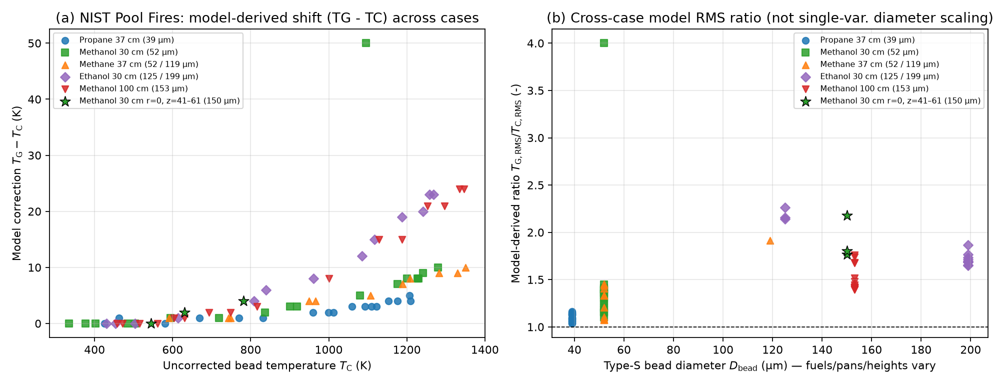
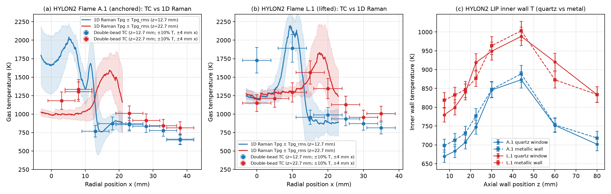

# Missione 04 — Step 2: dataset sperimentali di temperatura per qualificare osservazioni termiche realistiche

**Versione:** v2, revisione mirata della consegna v1 (commit `6ae6795`) dopo l'esame del coordinatore. Nota di revisione al §R.  
**Stato:** consegna autonoma revisionata dell'Agente B (dataset sperimentali di temperatura) — da confrontare con la consegna parallela dell'Agente A (modelli e strumenti di misura) nella chat di coordinamento della Missione 04. **Nessuna scelta definitiva** di scenario, sensori, target, dataset, architettura o tipo finale di validazione.  
**Data:** 27 novembre 2026.  
**Branch:** `mission04/step2-thermal-datasets` (base `a19ccc4c9c5a9416eefe40e2679a6fa08366e524`).  
**Documenti e artefatti collegati:**
- Registro delle ricerche, verifiche, esclusioni e provenienza dei campioni: [step2_dataset_fonti_e_verifiche.md](step2_dataset_fonti_e_verifiche.md)
- Script riproducibili, manifest SHA-256 (`85` file), output JSON e figure diagnostiche: [step2_dataset_checks/README.md](step2_dataset_checks/README.md), [inspect_all_samples.py](step2_dataset_checks/inspect_all_samples.py), [inspection_summary.json](step2_dataset_checks/inspection_summary.json), [samples_manifest.json](step2_dataset_checks/samples_manifest.json), [generate_verification_figures.py](step2_dataset_checks/generate_verification_figures.py)
- Contesto di partenza: [step1_pratica_sperimentale_temperatura.md](step1_pratica_sperimentale_temperatura.md), [step1_fonti_e_ricerche.md](step1_fonti_e_ricerche.md), [roadmap04.md](roadmap04.md).

---

## R. Nota di revisione (v1 → v2)

La revisione v2 riparte dal commit `6ae6795` senza ampliare l'inventario dei 40 dataset censiti (sono stati aggiunti solo 3 piccoli file radiali, `990 B` totali, già appartenenti al dataset `NIST_Pool_Fires` per verificare l'unico punto di sovrapposizione nella stessa fiamma). Sono state corrette attribuzioni causali, verifiche di confrontabilità, controlli nello script e limiti di validità:

- **Conclusioni confermate:**
  1. Accessibilità, struttura e contenuto dei 16 dataset ispezionati (`85` file locali verificati per SHA-256), dei 2 archivi verificati via TOC remoto HTTP `Range` (`NETL ESSB`, `4TU Link`), dei 2 archivi istituzionali bloccati da `HTTP 403` (`Deep Blue TCC-III`, `TUdatalib`) e dei rig non pubblicati in forma digitale (`VT`, `PoliMi Solero 2017`, `TU Delft Sampat/van den Berg`, `DLR`, `ISF-3`).
  2. In `NIST_RSE_2007`, la confrontabilità geometrica delle 5 coppie di porta `*A`/`*BB` è ora **verificata sui file FDS primari (`RSE_01.fds`, `RSE_12.fds`)**: identiche coordinate nominali `(X, Y, Z)` sul piano `X = -0,05 m`, con bias di segno opposto fra strato caldo e strato freddo e accordo pre-ignizione entro `0,7 K`. (Le 9 sonde `VD*` giacciono sullo stesso piano ma sono sfalsate verticalmente di `9–10 cm`.)
  3. In `Cambridge CAM.94523`, la verifica esplicita su tutte le `4 × 1000` celle di `Signalss_thermal*.mat` conferma che ogni cella corta è esattamente `shape=(1,1), dtype=uint8, value=0` (`395`, `469`, `82`, `2` su `1000`), distinta dalle tracce valide `float64` (`1260×1` / `2500×1`), con `0` altri casi `size <= 1`.
  4. Le discrepanze documentali effettive (`ULB` °C vs K e `T_std` assente; `Brzosko` `NaN` vs zero-padding; `Waterloo` CSV compositi con `0` LF/CR; `Sydney Surface_Temp_BB.doc` pirometro IR Mikron M90-D su bruciatore senza swirl; `Pelzmann` SBG e `dt = -10 s`; `Cardiff` negativi senza T; `Smyth` simmetrizzazione).

- **Conclusioni ridimensionate o cambiate:**
  1. **HYLON `TC–Raman` e `PIV 2S2Q–4Q` (§3.1, §4.4):** in v1 gli scostamenti venivano attribuiti troppo direttamente a intrusività/media spaziale della TC e al solo cambio finestre PIV. La verifica completa mostra invece che: (a) per `A.1 z=12,7 mm x=18 mm` la soglia `<= 0,5 mm` aveva escluso un punto dove il Raman ha un gap (`dx = -0,949 mm`); (b) su `A.1 z=12,7 x=13 mm` (`dT/dx = -460,1 K/mm`) già `dx = -0,053 mm` sposta il Raman di `24,9 K`, e l'intervallo Raman in `x ± 4 mm` (`[759, 1688] K`) copre pienamente `T_TC ± 10%` (`767,2 ± 76,7 K`); analogamente su `L.1 z=12,7 x=10 mm` (`T_Ram[x±4mm] = [1049, 2197] K`, media `1788 K`); (c) solo nei punti CRZ a basso gradiente (`L.1 z=12,7 x=0 mm`: `+512,8 K`; `A.1 z=22,7 x=8 mm`: `+318,0 K`) lo scarto eccede sia `dx` sia `±4 mm` sia le barre dichiarate — coerentemente con l'avvertimento degli autori §5.7, ma senza separare in modo esclusivo campagne separate, piastra forata, modello Eq. (4) e diversa definizione di media; (d) rilevato un **typo upstream nei commenti dei CSV `FLAME_L1` TC** (`m_a/m_h` di Flame A); (e) nel confronto PIV `2S2Q–4Q` su tutte e 5 le quote (`Reactive` e `Cold`), coesistono diversa griglia (`n = 128` vs `1251`; `85` vs `68`), offset in `z_col` fino a `0,24 mm`, `U_z_rms ≈ 10 m/s`, asimmetria sperimentale e differenze fino a `10,03 m/s` anche in flusso a freddo: lo scarto non è attribuibile al solo hardware.
  2. **NIST Pool Fires (§3.4, §4.3, `fig3`):** rimossa la presentazione come "scaling del diametro". I profili fra combustibili/vasche/quote diverse sono ora presentati come **comparazione fra casi** (in `Ethanol 30 cm`, `125 µm` a `z=76–101 cm` ha `TG_RMS/TC_RMS = 2,16–2,26`, maggiore del `199 µm` a `z=2–61 cm`!). Isolato separatamente l'unico confronto parzialmente sovrapposto nella stessa fiamma (`Methanol 30 cm`, `r=0, z=41–61 cm`, `52` vs `150 µm`, traverse separate): `TC_RMS` misurata cala (`265→239`, `208→150`, `153→146 K`), ma `TC` media differisce di `+36..+62 K` fra le due traverse e `TG_RMS` da modello non coincide (`369` vs `422 K`, ecc.). Ribadito che `TG` e `TG_RMS` sono uscite di modello e non validano in modo indipendente quel modello.
  3. **Anomalie e guasti (§4.1, §4.2, §6, `fig2`):** separati rigidamente sentinelle/rigetti, guasti confermati dalla documentazione (`Tree 4-9` in `NIST/NRC`), anomalie osservate non confermate (`TD70LBB` Test 12 in `NIST_RSE_2007`, `TC South U-3-1` a `3320 °C` in `NIST/NRC`, `NaN` in `Katurji`) e meccanismi solo ipotizzati (rimosse le diagnosi assertive "shunting / giunzione virtuale" e "open-circuit").
  4. **Ripetibilità e incertezza (`ULB`, `Wang MWIR`, §3.7, §3.8, §5):** in `ULB`, l'audit mostra bias sistematici di `-16` a `-25 K` fra 2ª e 1ª occorrenza su intere mappe `phi = 1,0/1,2` e colonne `data`/`cog`/`air_excess` omesse dal foglio `data`: le `2.211` coppie **non** sono dimostrabili come repliche pure della stessa identica condizione, e lo span `|T_2 - T_1|` non è equivalente a un'incertezza estesa `±20 K` (semispan p95 = `20,27 K`; `5,3%` oltre `40 K = 2 × 20 K`). In `Wang`, `analysis_error_budget.csv` mostra `U = 4,1%` (`k=2`) per il confronto MWIR–TC: differenze del `3,8%–4,8%` **non** isolano da sole il bias di emissività.
  5. **Cambridge e script (`inspect_all_samples.py`, `README.md`):** rimossi i booleani hardcoded (`has_thermocouple_data_in_deposit`, `has_rms_or_uncertainty_cols`, `condition01_is_heatflux_SBG_not_TC`), aggiunto inventario completo di tutti e 7 i `.mat`, corretto il comando README Python 3.10+ (il precedente aveva un backslash in f-string), verificati `85/85` hash SHA-256 e documentata la distinzione fra controlli automatici e verifiche documentali.
  6. **Limiti e validazione (§1, §7, §8):** tutte le conclusioni negative sono circoscritte al materiale cercato e ispezionato; rimossa ogni pre-decisione sul tipo finale di validazione (lasciata aperta allo Step 3).

- **Questioni irrisolte:**
  - Contenuto numerico effettivo degli archivi istituzionali bloccati da `HTTP 403` (`Deep Blue TCC-III`, `TUdatalib Darmstadt`: `tudatalib-2291`, `1819`, `2135`, `1535/1532`) e di quelli verificati via solo TOC/README (`NETL ESSB` `Thermal Imaging/`, `4TU Neeser` `.tdms` + `sensors.py`).
  - Origine esatta delle coppie duplicate e dei `545` record senza `C6H6 %` in `ULB` (non deducibile senza le colonne `data`/`cog`/`air_excess` omesse dal foglio `data`).
  - Causa fisica delle anomalie non documentate in `NIST_RSE_2007 Test 12` (`TD70LBB`), `NIST/NRC Test 01` (`TC South U-3-1`) e dei `NaN` in `Katurji 50 Hz`.
  - Esistenza di dataset non pubblici o non indicizzati nei 14 canali interrogati contenenti `T_gas + PIV` simultanei o serie raw kHz a doppia termocoppia in fiamma.

---

## 0. Perimetro, convenzioni e criteri di verifica

**Separazione epistemica** (coerente con le missioni 01–04):
- **`[D-calcolato]`** — grandezza o controllo calcolato automaticamente da [inspect_all_samples.py](step2_dataset_checks/inspect_all_samples.py) sui file scaricati ([inspection_summary.json](step2_dataset_checks/inspection_summary.json)).
- **`[D-fonte]`** — affermazione, parametro, coordinata o avvertimento letto direttamente nella documentazione primaria o nei metadati ufficiali del dataset.
- **`[I]`** — interpretazione tecnica o ipotesi motivata a partire da evidenze `[D-calcolato]` / `[D-fonte]`, mai presentata come causa dimostrata.
- **`[M]`** — informazione assente nei file/metadati aperti, oppure grandezza non identificabile con il materiale disponibile.

**Stato di accesso:** `accessibile (ispezionato)` (`ISP`), `accessibile (verificato TOC/README)` (`TOC`), `bloccato dall'ambiente` (`HTTP 403`, mai aggirato), `su richiesta` (`REQ`), `non individuato` (`DOC`/`NI`), `controllo negativo (accessibile, senza T)` (`NEG`).

**Disciplina analitica.** Ogni statistica indica campione, denominatore, unità e limiti. Non si interpretano automaticamente: fluttuazioni turbolente come rumore; uno `0` come dato mancante (salvo verifica di forma/tipo/schema); un salto temporale come outlier; una differenza fra diagnostiche come errore di una sola sonda; l'assenza di `NaN` nei dati rilasciati come assenza di rigetti a monte; uno spettro non referenziato come funzione di trasferimento della sonda; un'uscita di modello (`TG`, `TG_RMS`) come validazione indipendente del modello stesso.

---

## 1. Sintesi esecutiva

Tra il 26 e il 27 novembre 2026 sono stati censiti e verificati **40 dataset e archivi sperimentali** su 14 canali (TNF Workshop, Sydney Thermofluids, MaCFP, `firemodels/exp`, Zenodo, Figshare/Cardiff, 4TU.ResearchData, Cambridge Apollo, OSTI/NETL EDX, NIST PDR, Mendeley Data, Dryad, DataCite su 9 prefissi istituzionali, PoliMi IRIS, ISF Workshop). Di questi, **16 dataset (85 file, 49,6 MB totali in locale fuori repository, 85/85 hash SHA-256 verificati)** sono stati scaricati come campioni rappresentativi e ispezionati in sola lettura tramite [inspect_all_samples.py](step2_dataset_checks/inspect_all_samples.py); altri **2 archivi pesanti** (`NETL ESSB` `96,9 MB` e `TU Delft Swirl Burner` `133 MB`) sono stati verificati via indice ZIP remoto HTTP `Range`.

**Sintesi delle evidenze (distinguendo fatti calcolati, affermazioni delle fonti e limiti):**
1. **`HYLON Phase 2` (TNF gennaio 2026) è l'analogo geometrico/operativo più vicino a RealPDEBench individuato nel materiale aperto ispezionato `[D-fonte]`:** combustore swirl coassiale doppio confinato ($78\times 78\times 145\text{ mm}$, $p=1\text{ bar}$, fiamme H$_2$/aria `A.1` e `L.1`), con doppia TC gas, Raman 1D, pareti interne LIP, PIV (`4Quartz` e `2Steel2Quartz`) e CAD a raggi X, ma acquisiti in **campagne separate** (sole medie/RMS rilasciate). `[D-calcolato]` Nei punti di sovrapposizione TC–Raman (`5` in `A.1`, `11` in `L.1`), lo scarto è in vari punti compatibile con l'incertezza di posizione `±4 mm` su gradienti ripidi e la fascia `±10%` (`A.1 z=12,7 x=13 mm` ha `dT/dx = -460,1 K/mm`; `L.1 z=12,7 x=10 mm` ha `T_Ram[x±4mm] = [1049, 2197] K`), mentre nella CRZ a basso gradiente (`L.1 z=12,7 x=0 mm`: `+512,8 K`; `A.1 z=22,7 x=8 mm`: `+318,0 K`) eccede nettamente le barre e il supporto `±4 mm`. `[I]` Ciò è coerente con l'avvertimento degli autori §5.7 sulla perturbazione della CRZ, ma non isola in modo esclusivo la causa rispetto a campagne separate, piastra forata e modello Eq. (4). Nel confronto PIV `2S2Q` vs `4Q` su 5 quote (`Reactive` e `Cold`), le differenze (`max |ΔUz|` fino a `6,92 m/s` in `L.1 Reactive z=22,7 mm` e fino a `10,03 m/s` in `L.1 Cold z=2,7 mm`) coesistono con diverse griglie, lievi offset in `z_col`, alta `U_z_rms` e asimmetria sperimentale.
2. **Fenomeni di misura verificabili su dati aperti `[D-calcolato]`/`[D-fonte]`:**
   - **Bias radiativo di segno opposto (`NIST_RSE_2007`):** su 5 coppie di porta verificate a coordinate nominali `(X,Y,Z)` identiche (`RSE_01/12.fds`), accordo pre-ignizione `|ΔT| <= 0,7 K`, poi in combustione la TC nuda legge più freddo nello strato caldo (`-7,7` / `-22,2` / `-38,1 K` media, min `-175,7 K`) e molto più caldo nello strato freddo inferiore (`+122,2` / `+186,7` / `+163,4 K` media, max `+268,5 K`).
   - **Comparazione fra casi e punti sovrapposti (`NIST_Pool_Fires`):** coppie grezzo (`TC`, `TC_RMS`) vs corretto da modello NIST (`TG`, `TG_RMS`) su diametri `39–199 µm` in combustibili/vasche/quote diverse (non uno scaling causale a singola variabile). Negli unici 3 punti sovrapposti nella stessa fiamma (`Methanol 30 cm`, `r=0, z=41–61 cm`, `52` vs `150 µm` in traverse separate), `TC_RMS` misurata cala da `265/208/153 K` a `239/150/146 K`, ma `TC` media varia di `+36..+62 K` fra le due traverse.
   - **Guasti documentati, sentinelle osservate e anomalie non documentate (`NIST/NRC`, `NIST_RSE_2007`, `Katurji 50 Hz`, `CAM.94523`):** guasto confermato `Tree 4-9` con pattern `999.0` a `t=-60 s` → `0.0` (osservato su `25/255` col. in Test 01 `file_1`); anomalie non confermate dalla documentazione in `NIST/NRC Test 01` (`TC South U-3-1` a `3320–3330 °C`) e `NIST_RSE_2007 Test 12` (`TD70LBB` fino a `-681,9 K`); `11,48%–12,50%` `NaN` in `Katurji 50 Hz`; scalari esatti `(1,1) uint8 == 0` dallo `0,2%` al `46,9%` dei colpi in `CAM.94523`.
   - **Discrepanze sistematiche tra documentazione e file reali** in 9 dei 16 dataset ispezionati (§5).
3. **Limiti circoscritti al materiale cercato e ispezionato `[D-calcolato]`/`[M]`:** nei 14 canali interrogati e nei file accessibili **non sono stati individuati**: (i) dataset aperti con `T_gas + PIV` simultanei nella stessa realizzazione in un combustore swirl confinato; (ii) serie temporali grezze $\ge\text{kHz}$ a doppia termocoppia in fiamma; (iii) serie sperimentali grezze di risposta a gradino/impulso laser di termocoppie. `Deep Blue TCC-III` e `TUdatalib` sono bloccati da `HTTP 403` in questo ambiente; `VT`, `PoliMi`, `TU Delft (Sampat/van den Berg)`, `DLR` e `ISF-3` non dispongono di archivi numerici direttamente scaricabili. Queste constatazioni valgono per il perimetro cercato e non dimostrano inesistenza universale né fissano oggi il tipo finale di validazione.

---

## 2. Inventario ampio e tabella sintetica

I **40 archivi/dataset verificati** (invariati rispetto a v1) sono classificati per accesso verificato, strumento/tipo di temperatura, supporto/tempo, relazione con la velocità e ruolo d'uso.

| ID | Dataset / Archivio | Accesso verificato | Tipo di T e strumento | Supporto e tempo | Relazione con velocità | Ruolo d'uso principale |
|---|---|---|---|---|---|---|
| **D01** | **HYLON Phase 2** (`TNF 2026-01`, IMFT/CERFACS/KAUST) | **accessibile (ispezionato)** | Gas: doppia TC + Raman 1D; Parete: LIP (`Mg3.5FGeO5:Mn`) | Profili radiali/assiali ($z=2{,}7\text{–}62{,}7\text{ mm}$); solo medie/RMS | PIV reagente + freddo in **campagne separate** (`4Q` vs `2S2Q`) | Layout/posizioni; statistiche; confronto TC–Raman & PIV fra campagne |
| **D02** | **NIST RSE 2007** (`firemodels/exp`, TN 1483) | **accessibile (ispezionato)** | Gas: 5 coppie porta TC tipo K nuda vs aspirata (identico `(X,Y,Z)`); pareti TC | Punti fissi simultanei; serie regolari $\Delta t=30\text{ s}$ ($4230\text{–}6390\text{ s}$) | 9 sonde bidirezionali (`VD*`, m/s) **simultanei**, stesso piano `X=-0,05 m`, sfalsate `9–10 cm` in `Z` | Studio sensore (bias radiativo nuda vs aspirata; anomalia `TD70LBB`) |
| **D03** | **NIST/NRC Compartment** (`firemodels/exp`, SP 1013-1) | **accessibile (ispezionato)** | Gas: 70 TC nude + 6 aspirate (`ATC`); pareti/cavi TC | Griglia 3D fissa; serie $\Delta t=10\text{ s}$ ($t\in[-60,3000]\text{ s}$) | Sonde porta (`BP Door`) **simultanei** (inattive `999->0` nei test a porta chiusa) | Studio sensore (guasto documentato `Tree 4-9`, pattern `999->0`, anomalia `3320 °C`) |
| **D04** | **NIST Pool Fires** (`MaCFP`, Sung 2021/2024) | **accessibile (ispezionato)** | Gas: TC tipo S nuda (`39–199 µm`) misurata (`TC/TC_RMS`) + corretta da modello (`TG/TG_RMS`); liquida TC | Profili assiali/radiali (medie/RMS); serie liquida $\Delta t=10\text{ s}$ | Velocità assiale $U$ in `Methane 37 cm` (campagna separata) | Studio sensore (comparazione fra casi + 3 pt `52` vs `150 µm` in `Methanol 30 cm`) |
| **D05** | **Cambridge LIGS Swirl Press.** (`10.17863/CAM.94523`) | **accessibile (ispezionato)** | Gas: ottica LIGS (sub-µs, fino ~1800 K). **0 match TC su 7 `.mat`** | 2 altezze ($30,50\text{ mm}$), 12–13 stazioni radiali; PDF + `4×1000` colpi raw | Nessuna velocità nel deposito | Studio sensore ottico (scalari `(1,1) uint8==0` fino al `46,9%`); audit variabili |
| **D06** | **Katurji 50 Hz In-Fire TC Array** (`10.6084/m9.figshare.16615174.v2`) | **accessibile (ispezionato)** | Gas: array 32 TC a filo fine in fiamma + 23 `TbC` (non corrette) | Array fisso simultaneo; serie grezze **50 Hz** ($\Delta t=20\text{ ms}$, ~32–75 s) | Nessuna velocità nei file `.mat` scaricati | Studio sensore (`NaN` permanenti e parziali a 50 Hz; errore **non identificabile**) |
| **D07** | **ULB 20 kW Semi-Industrial Furnace** (`10.5281/zenodo.7624702` & `7624630`) | **accessibile (ispezionato)** | Gas: pirometro a suzione raffreddato ad aria con TC tipo B | Traversata 2D $(x,y)$ ($8\times 9$ quote), 37 condizioni; sole medie (`2211` coppie ambigue) | Nessuna velocità (presenti OH*/CH* medi e FTIR scarico) | Layout/statistiche; controllo qualità metadati e colonne omesse |
| **D08** | **NIST Smyth Wolfhard-Parker Slot Burner** (`firemodels/exp`) | **accessibile (ispezionato)** | Gas: TC sottile corretta per irraggiamento (versione originale + simmetrizzata) | Profili laterali a 5–9 altezze ($H=3\text{–}19\text{ mm}$); solo medie stazionarie | LDV 2C (`U`, `V`) in **campagna separata** (stessa condizione) | Studio processamento (effetto simmetrizzazione fino a `152,4 K`); statistiche |
| **D09** | **Waterloo Methanol Pool Fire** (`MaCFP`, Weckman 1996) | **accessibile (ispezionato)** | Gas: TC tipo S `50 µm` (bead `75–100 µm`), 125 Hz, compensata inerzialmente (no rad.) | Traversata radiale/assiale; sole medie, RMS e correlazioni $\langle u'T'\rangle, \langle v'T'\rangle$ | **LDA 2C simultanea** alla TC (rilasciate solo statistiche aggregate) | Statistiche congiunte ($\langle u'T'\rangle, \langle v'T'\rangle$); controllo packaging CSV |
| **D10** | **Cardiff NH$_3$/H$_2$ Swirl Radiation** (`10.17035/cardiff.31141438`) | **accessibile (ispezionato)** | Gas scarico (TC) + parete interna/esterna (TC) su 9 $\Phi$ (`0,6–1,4`) | 3 punti fissi (scarico, parete int/est); singole medie per $\Phi$, zero RMS | Nessuna velocità (presenti emissioni, radiazione, OH*/NH$_2$*) | Condizioni al contorno parete/scarico in rig swirl NH$_3$ |
| **D11** | **FM Burner** (`MaCFP`, aggiornamento ott. 2025) | **accessibile (ispezionato)** | Gas: TC nuda (medie, RMS e PDF a 200 bin, $260\text{–}2300\text{ K}$) | Profili radiali a più altezze ($z/D$); statistiche e PDF aggregate | Velocità 2C (media) stessa condizione, campagne separate | Confronto statistiche e PDF; gestione celle vuote (`9/693`) |
| **D12** | **UMD Line Burner** (`MaCFP`, White 2016) | **accessibile (ispezionato)** | Gas: TC nuda (medie e RMS assiali e laterali) | Linea verticale (`24` pt) + 4 quote laterali (`14` pt); medie/RMS | Nessuna velocità nei file T (solo calorimetria e O$_2$) | Statistiche; controllo discrepanze di unità (`TC_Data` °C vs K) |
| **D13** | **Wang Aero-Engine Exhaust MWIR vs TC** (`10.5281/zenodo.23054326`) | **accessibile (ispezionato)** | Gas scarico turbogetto: MWIR vs TC tipo K di riferimento (+ tabella analitica rad. + error budget) | 4 stati stazionari/accelerazione (0°); medie, SD, CI95 | Nessuna velocità | Confronto ottica IR vs TC (incertezza confronto `U=4,1%` vs scarti `3,8–4,8%`) |
| **D14** | **MetForTC Drift Tests** (`10.5281/zenodo.8189490` & `8186928`) + **Pearce Drift** (`4972091`) | **accessibile (ispezionato)** | Metrologia NMI: deriva TC tipo K e S (punto di Curie, 24–370 °C) + survey 1972–2021 (`.opju`) | Forno di riferimento; serie raw Keithley (fino a `12.054` righe, `V`, `StandDev V`, impedenza) | Non applicabile (metrologia in forno) | Studio sensore (floor elettronico/deriva in forno; non combustione) |
| **D15** | **Brzosko 12-TC Grid** (`10.5281/zenodo.21371063`) | **accessibile (ispezionato)** | Solido (non combustione): 12 TC incassate in pin freno a 10 Hz | 211 sequenze $\times$ 532 passi $\times$ 12 canali, `mask` esplicita (`1,90%` `NaN`) | Non applicabile (tribometro) | Controllo metadati (`NaN` vs zero-padding) e pattern di masking multi-TC |
| **D16** | **Sydney Thermofluids** (`SM1.zip` + `Surface_Temp_BB.doc`) & **TNF Sandia D–F** (`pmCDEF.zip`) | **accessibile (ispezionato)** | Gas: Raman/Rayleigh/LIF singolo colpo (`133.389` SM1; `9.339` D15); Superficie bluff body: **pirometro IR Mikron M90-D** (NON TC) | Linee/punti radiali; singolo colpo indipendente + medie/RMS + `TDNR` | LDV/PIV in archivi separati (in `Surface_Temp_BB` hardware scambiato) | Statistiche single-shot; outlier ottici `<250 K` (`9` colpi); controllo cambio hardware |
| **D17** | **Pelzmann & Robert McKenna Flat Flames** (`10.17632/jvvvgpdy48.6`) | **accessibile (ispezionato)** | **Solo flusso termico SBG** (`U [mV], Q [W]`), IR, OH*, Cantera + log ambiente `TPH` | Serie di flusso termico e ambiente (`244` righe) | Nessuna velocità | Controllo negativo TC gas; anomalia timestamp reale (`dt = -10 s`) |
| **D18** | **NETL Enclosed Sydney Swirl Burner Rel. 1.0** (`10.18141/2478453`, EDX) | **accessibile (verificato TOC)** | `Thermal Imaging/` (`HM1aTemps`, `SMH2aTemps`, `V1Temps.xlsx`, 69 MB tot.) + OH-PLIF | 3 fiamme swirl confinate (`HM1a`, `SMH2a`, `V1`), `96,9 MB` ZIP (`115` file) | LDA velocità (`HM1a`, `SMH2a`, `V1`) in campagne separate | Candidato futuro per combustore swirl confinato con mappe termiche + LDA |
| **D19** | **TU Delft GOx/CH$_4$ Resonance Igniter** (`10.4121/dbaa8f0f-59d2-4d58-8cc9-494af1b966f1.v1`) | **accessibile (verificato README)** | Parete esterna punta risonatore: TC tipo K saldata (`TC2`, `TC0`) a **100 Hz** (`.tdms`) + `sensors.py` | Serie temporali continue a 100 Hz + script Python di correzione risposta TC (`2,05 GB` ZIP) | Nessuna velocità (presenti pressioni 2,5 kHz e microfono 100 kHz) | Studio sensore (correzione dinamica parete + script riproducibile) |
| **D20** | **TU Delft Swirl CH$_4$/H$_2$ Burner** (`10.4121/7e680c48-7408-4e35-8880-10220814afd5.v1`) | **controllo negativo (verificato TOC/README)** | **ZERO dati di temperatura** (solo PIV reagente/freddo, SPOD, OH-PLIF, NO/CO$_2$) | 95 file (`133 MB` ZIP) | Solo PIV + OH-PLIF | Escluso per temperatura |
| **D21** | **Cardiff COG/NH$_3$ (`10.17035/cardiff.30234904`) & Mashruk 2022 (`d.2022.0217184646`)** | **controllo negativo (ispezionato)** | **ZERO colonne/fogli di temperatura** nei file Excel aperti (solo emissioni e OES) | Tabelle per $\Phi$ | Nessuna velocità | Controllo negativo: paper cita TC ma deposito omette T |
| **D22** | **TNF KAUST Piloted Cracked NH$_3$** (`tnfworkshop.org`, feb. 2026) | **accessibile (HTTP 200)** | Gas: Raman/Rayleigh/LIF (`T`, specie) in getti pilotati NH$_3$ crackata | `24,9 MB` ZIP (non scaricato) | Non verificata nei file | Statistiche ottiche per fiamme NH$_3$/H$_2$ |
| **D23** | **TNF Delft III / DLR A–B / Sandia H$_2$–CO / HYLON Phase 1** | **accessibile (HTTP 200)** | Gas: Raman/Rayleigh/CARS (`T`, specie); HYLON Phase 1 (`35,2 MB`) | Archivi storici TNF (`HTTP 200`) | LDV/PIV in campagne separate | Statistiche ottiche standard |
| **D24** | **Cambridge Stratified Slot Burner** (`10.17863/CAM.1489` / `1810/226470`) | **accessibile (HTTP 200, All Rights Reserved)** | Gas: Raman/Rayleigh (`T`, specie) | Profili radiali/assiali | Filo caldo / LDV separato | Statistiche ottiche (licenza restrittiva *All Rights Reserved*) |
| **D25** | **Fischer FWI Test Bench** (`10.17632/jtmk3pg36k.1`, Mendeley) | **accessibile (API 200)** | Parete: temperatura di parete da conduzione inversa (IHC) + BC ingresso | Mappa BC di parete per CFD FWI | Profili ingresso flusso (separati) | Condizioni al contorno termiche di parete |
| **D26** | **ETH Bonciolini & Noiray** (`10.5061/dryad.4cj4k`, CC0) | **accessibile (API 200)** | Acustica/transizioni in combustore (`.tdms`, `302 MB`); canali TC non verificati nei file | Serie temporali continue `.tdms` | Nessuna PIV | Non ispezionato (pesante, focus termoacustico) |
| **D27** | **Zenodo vari recenti** (`23062725`, `23037088`, `19004211`, `3693670`, `20446928`) | **accessibile (API 200)** | Misti: pirometria (`3693670`), combustori H$_2$/NH$_3$ (`23062725`, `23037088`, `19004211`), sensori spettrali+TC (`20446928`) | Non ispezionati (priorità secondaria o >600 MB) | Assente o separata | Piste secondarie documentate nel registro |
| **D28** | **UMich Deep Blue TCC-III** (`10.7302/z2hq3x4s`, `z2ms3qp3`, `z2h41pcd`, `z2cc0xnp`) | **bloccato dall'ambiente (`HTTP 403`)** | Parete/flusso termico: TC coassiale rapida in testa cilindro + T esterne/ingresso (`z2hq3x4s`) | Metadati DataCite confermati; file non scaricabili per 403 | PIV ad alta frequenza nello stesso rig (`z2hq3x4s` near-wall) | Alto interesse parete+PIV motore ottico (richiede download manuale fuori ambiente) |
| **D29** | **TU Darmstadt TUdatalib — H$_2$ ICE Piston Phosphor** (`10.48328/tudatalib-2291`, CC BY 4.0) | **bloccato dall'ambiente (`HTTP 403` Anubis)** | Superficie pistone: fosfori termografici in motore ottico H$_2$ | Metadati DataCite 2026 confermati | Propagazione fiamma / diagnostica motore | Alto interesse per fosfori su parete mobile (download manuale) |
| **D30** | **TU Darmstadt TUdatalib — Engine DBs & NH$_3$/H$_2$ Raman** (`tudatalib-1535`, `1532`, `1113/1114`, `1819`, `2135`, `2194`) | **bloccato dall'ambiente (`HTTP 403` Anubis)** | Gas: Raman/Rayleigh NH$_3$/H$_2$/N$_2$ (`1819`), H$_2$ (`2135`), TDLAS (`2194`); BC motore (`1113`, `1535/1532`) | Metadati DataCite 2023–2026 confermati (`CC BY-NC 4.0` / `CC BY 4.0`) | Velocità flow-bench (`1114`) e PIV motore (`1535/1532`) separate | Alto interesse per Raman NH$_3$/H$_2$ e BC motore (download manuale) |
| **D31** | **NIST Fire Calorimetry Database (FCD)** (`10.18434/mds2-2314`) & **PDR Pool/Plume** (`M32135`, `T4/1502568`, `mds2-2812`) | **accessibile (API/web, parziale)** | Gas/plume TC e calorimetria (`mds2-2314` via portale dinamico; `M32135` 9,9 kB) | Misti | Assente | Pista secondaria rispetto a `firemodels/exp` e `MaCFP` |
| **D32** | **Virginia Tech Optical Swirl Combustor** (`OSTI 1463254`, DOE-VT-001176-2) | **non individuato / su richiesta** | Gas: TC tipo B traversata (320 nodi, 400–1600 K, bead 0,762 mm, $\tau\approx 1{,}5\text{ s}$); liner IR | **Solo rapporto PDF** (264 pp.); zero dataset su `data.lib.vt.edu` | PIV in campagne separate (liner rimosso per scansione TC) | Riferimento documentale per layout TC in gas caldo, dati digitali assenti |
| **D33** | **PoliMi Swirl Combustor** (Solero 2017 `IJETR2102.pdf`; Olivani 2007 `etfsPAPER2007.pdf`) | **non individuato (solo PDF / login)** | Gas: TC nuda tipo R (Pt/Pt-13%Rh, bead `0,3 mm`, 500 Hz, 5000 campioni = 10 s), corr. Morgan 1991 | **Solo figure nel PDF** (`Solero 2017` letto); `Olivani 2007` login-gated | PIV + LDA reagente a doppia semina in **campagne separate**, velocità usata per $h$ della TC | Riferimento metodologico, dati digitali assenti |
| **D34** | **TU Delft Step 1 Leads** (Sampat *Fuel* 2025/GT2022; van den Berg *AECS* 2024; X. Huang 2018; DJHC) | **non individuato / su richiesta** | Gas: TC tipo S inguainata traversata (camera d'acciaio gemella) | Non depositati su 4TU.ResearchData né TU Delft Repository | PIV in campagne separate (in JHC PIV a freddo per correggere TC) | Riferimento documentale (Step 1 v2), dati digitali non pubblicati |
| **D35** | **DLR GTMC / PRECCINSTA / SFB 606 / HBK / FRS** | **su richiesta** | Gas: Raman, fs-CARS 5 kHz, FRS; Parete: fosfori 2D/1 kHz | Solo articoli (elib/OSTI); dati distribuiti tramite accordo DLR | Campagne separate alla stessa condizione | Non direttamente scaricabili senza contatto |
| **D36** | **ISF Workshop (ISF-3 DLR pressurizzato & Adelaide CET)** | **su richiesta / link rotti** | Soot + T (CARS/TC/fosfori) in fiamme fuligginose | Link live Adelaide CET rotti post-fusione universitaria; `isfworkshop.org` rinvia a Wayback 2025 | Campagne separate | Non direttamente scaricabile oggi |
| **D37** | **TNF/Darmstadt TSF & SWQ, CSSB scalari/fosfori, TECFLAM, Lund LSB, EM2C, KIT Kraus, Adelaide JHC, OSU McManus, Volvo rig** | **su richiesta / non individuato** | Misti: CARS/Raman/FRS/fosfori/TC parete | Non depositati in archivi aperti diretti (salvo CSSB LDA `1810/243259`, senza T) | Separata (simultanea FRS+PIV in OSU McManus, dati non depositati) | Esclusi dall'ispezione diretta |
| **D38** | **Cambridge Apollo solo velocità/ottica** (`CAM.96660`, `CAM.90803`, `CAM.106960`, `1810/243259`) | **controllo negativo (metadati API)** | Nessuna misura di temperatura nei file depositati | PIV / OH-PLIF / LDV / acustica | Solo velocità/imaging | Esclusi per assenza di dati termici |
| **D39** | **EngineBench** (`arXiv:2406.03325`) | **controllo negativo (verificato)** | **Nessuna temperatura** (solo PIV motored a freddo derivata da TCC-III) | Campi PIV 2D motored | Solo PIV senza combustione | Escluso per assenza di combustione e temperatura |
| **D40** | **TU Berlin AHEAD (`3,47 GB`) & NTNU Bluff-Body H$_2$** | **controllo negativo / non prioritario** | OH-PLIF / PIV (nessun profilo termico dichiarato nei metadati TNF) | Archivi massivi (`3,47 GB`) | Solo flusso/fiamma | Esclusi dall'ispezione |

---

## 3. Schede approfondite dei candidati utili (7 dimensioni)

### 3.1 HYLON TNF Phase 2-1 (`D01`) — Combustore swirl confinato H$_2$/aria multi-diagnostica

1. **Identità e accesso:** *HYLON TNF 2026 01 Phase2-1: Dataset Hydrogen/Air flames in a dual swirl coaxial injector* — S. Marragou, M. Vilespy, Z. Al Hadi, A. Teixeira, H. Magnes, L. Selle, G. Magnotti, T. Guiberti, T. Poinsot, T. Schuller (IMFT / CERFACS / KAUST). URL: `https://tnfworkshop.org/wp-content/uploads/2026/01/HYLON_TNF_2026_01_Phase2-1.zip` (`9,27 MB`, `73` file reali esclusi metadati macOS). Versione: `2026 01 Phase2-1` (21 gennaio 2026). Articolo: Vilespy et al., *Combust. Flame* 283 (2026) 114536 (`10.1016/j.combustflame.2025.114536`). Licenza: archivio pubblico TNF senza licenza SPDX esplicita; restrizione esplicita nel PDF (p. 2): **`NO-LIF measurements have not been published yet. It cannot be used in a paper before being published`**. Accesso: **`accessibile (ispezionato)`** `[D-calcolato]`.
2. **Apparato e strumento:** Iniettore coassiale a doppio swirl (H$_2$ centrale $d_i=5{,}9\text{ mm}$, $S_i=0{,}6$, recesso $z_i=4{,}3\text{ mm}$; aria anulare $d_e=18\text{ mm}$, $S_e=1{,}2$), camera quadrata confinata $78\times 78\times 145\text{ mm}$ con convergente finale (rapporto `0,51`), $p=101325\text{ Pa}$, $T_{\text{in}}=298\text{ K}$, $\Phi_g=0{,}421$. Due regimi `[D-fonte, HYLON_TNF_2026_01_Phase2-1_PDF.pdf §3.3]`: **Flame A.1** (ancorata, $P_{\text{th}}=2{,}513\text{ kW}$, $\dot m_a=1{,}7054\text{ g/s}$, $\dot m_h=0{,}02094\text{ g/s}$) e **Flame L.1** (sollevata a V, $P_{\text{th}}=5{,}026\text{ kW}$, $\dot m_a=3{,}4108\text{ g/s}$, $\dot m_h=0{,}0419\text{ g/s}$). **Anomalia documentale nei CSV `[D-calcolato]`:** i commenti di testa di tutti i file `FLAME_L1` TC (`HYLON-KAUST_Isolated_Fla_L_EXP_z+*.csv`) riportano erroneamente `#Flame L; ... m_a = 1.7054 g/s; m_h = 0.02094 g/s` (portate di Flame A copiate per errore; i dati numerici e i file Raman/PIV `L1` corrispondono a Flame L). Strumenti termici `[D-fonte, PDF §5.1, §5.4, §5.7]`:
   - **Gas (TC):** sonda a doppia giunzione attraverso piastra forata ($\varnothing\,1\text{ cm}$ sigillati con lana di vetro), risoluzione spaziale dichiarata `±4 mm` in ciascuna direzione; lega, diametri dei fili e eventuale rivestimento non dichiarati `[M]`.
   - **Gas (Raman 1D):** 3 Nd:YAG combinati (~500 ns, 0,85 J, shutter 980 ns, binning 12 px $\rightarrow \Delta x\approx 0{,}105\text{ mm}$, senza Rayleigh), eseguito a KAUST attraverso 2 finestre in acciaio con 8 coppie di fori $\varnothing\,4\text{ mm}$.
   - **Pareti interne (LIP):** $\text{Mg}_{3.5}\text{FGeO}_5\text{:Mn}$, eccitazione 266 nm a 50 Hz, tempi di decadimento (100 colpi), calibrata 300–1000 K contro TC tipo K.
3. **Posizioni e supporto:** Piano assiale $(x,z)$ a $y=0\text{ mm}$, coordinate in `mm`. **TC:** traversata a 6 quote $z=2{,}7;\;12{,}7;\;22{,}7;\;32{,}7;\;47{,}7;\;62{,}7\text{ mm}$ ($6\text{–}12$ punti/quota, $x\in[0,38]\text{ mm}$); in `Flame A.1`, a $z=2{,}7$ e $12{,}7\text{ mm}$ la TC inizia a $x=13\text{ mm}$ (nessun punto in $|x|<13\text{ mm}$). **Raman 1D:** $x\in[-3{,}05;\;12{,}95\text{–}22{,}95]\text{ mm}$, $119\text{–}248$ punti, passo mediano `0,1051 mm`, con lacune locali di griglia fino a `dx_max_gap` oltre `0,9 mm` (es. intorno a $x=18\text{ mm}$ in `A.1 z=12,7 mm`). **LIP pareti:** 6 punti backplane, 8 finestra metallica, 8 finestra quarzo. Distinzione netta fra $T_{\text{gas}}$ e $T_{\text{parete}}$ interna.
4. **Tempo e definizione delle medie:** Nessuna serie temporale `[D-calcolato]`. **Raman (`Tpg`, `Tpg_rms`):** media d'insieme e deviazione standard su colpi laser indipendenti (numero/frequenza non indicati nel PDF `[M]`); `Tpg_rms` **non** è la barra di incertezza della media, bensì combina fluttuazione turbolenta fisica e precisione single-shot (`4,6 K` in aria ambiente fino a `77 K` a stechiometria `[D-fonte, §5.1]`). **TC (`T`, `error_T`, `error_x`):** sola media stazionaria della temperatura estrapolata (`0` `T_rms`, frequenza/durata di integrazione non dichiarate `[M]`), con barre costanti **`±10%` in $T$** (intervallo di confidenza del metodo di estrapolazione, §5.7) e **`±4 mm` in $x$** (supporto spaziale della sonda). **LIP:** media di 100 colpi (`2 s`/punto), incertezza `2,50%`. **PIV:** media/RMS su almeno 1000 coppie di immagini a 10 Hz.
5. **Relazione con la velocità:** PIV 2C reagente e a freddo ($\text{TiO}_2$, $D_{32}=200\text{ nm}$, foglio 1 mm) a $z=2{,}7;\;7{,}7;\;12{,}7;\;22{,}7;\;32{,}7\text{ mm}$ in **campagne separate** da Raman, TC e LIP (stessa condizione nominale, non stessa realizzazione). Rilasciate due configurazioni camera: `4Quartz` e `2Steel2Quartz` (con diverse griglie `n=128` vs `1251` in `A.1` e `85` vs `68` in `L.1`, e lievi scarti della colonna `z` fino a `0,24 mm`; §4.4).
6. **Processamento:** TC già corretta tramite estrapolazione lineare a superficie nulla $T_{\text{fluid}} = T_s + S_s(T_s - T_l)/(S_s - S_l)$ (Eq. 4, che assume campo omogeneo nel volume della sonda `[D-fonte, §5.7]`; nessun `T_s`/`T_l` grezzo rilasciato `[M]`). Avvertimento testuale degli autori (§5.7): *«When crossing the flame, the thermocouple induces local perturbations of the flow and the flame, which may affect the measurements in the CRZ»*. Raman: inversione ibrida Fuest (2011), accuratezza dichiarata `±60 K`.
7. **Contenuto effettivo:** 73 file reali (`CAD .igs` fluido+solido, PDF 24 pp., profili ASCII CSV/TXT, `OHstar` PNG). Zero `NaN` nei file ispezionati; `5` coppie replicate in `A.1` TC (`|ΔT|` mediano `9,5 K`, max `29,25 K`).

### 3.2 NIST Reduced-Scale Enclosure 2007 (`D02`) — Bias radiativo diretto TC nuda vs aspirata

1. **Identità e accesso:** *NIST Reduced Scale Enclosure Experiments, 2007* (`NIST_RSE_2007`, Bundy et al., NIST TN 1483). URL: `https://github.com/firemodels/exp/tree/master/NIST_RSE_2007`. Licenza: Pubblico Dominio (NIST). Ispezionati: `NIST_RSE_2007_01.csv` (NG `190 kW`), `02.csv` (NG `395 kW`), `12.csv` (metanolo `305 kW`). Accesso: **`accessibile (ispezionato)`** `[D-calcolato]`.
2. **Apparato e strumento:** Compartimento $0{,}95\times 1{,}42\times 0{,}98\text{ m}$ con porta frontale ($48\text{ cm}$ nei 3 test), $p=1\text{ atm}$. 5 coppie di porta TC tipo K **giunzione nuda** (`*BB`) vs **aspirata a doppio schermo** (`*A`) (`TD70LA/LBB`, `TD70CA/CBB`, `TD50CA/CBB`, `TD30LA/LBB`, `TD30CA/CBB`), più TC aspirate interne e TC di superficie.
3. **Posizioni, supporto e verifica di confrontabilità `[D-fonte, RSE_01.fds & RSE_12.fds]`:** Confermato che ciascuna delle 5 coppie `*A`/`*BB` ha **identiche coordinate nominali `(X, Y, Z)`** sul piano della porta `X = -0,05 m`: `TD70LA/LBB = (-0,05; 0,32; 0,70) m`, `TD70CA/CBB = (-0,05; 0,48; 0,70) m`, `TD50CA/CBB = (-0,05; 0,48; 0,50) m`, `TD30LA/LBB = (-0,05; 0,32; 0,30) m`, `TD30CA/CBB = (-0,05; 0,48; 0,30) m`. Distinzione chiara fra $T_{\text{giunzione nuda}}$, $T_{\text{aspirata}}$ e $T_{\text{parete}}$. Unità: `°C`, `m/s`, `s`.
4. **Tempo:** Serie temporali continue, perfettamente regolari $\Delta t = 30{,}0\text{ s}$ (`0` irregolarità >1%): `142` (`0–4230 s`), `214` (`0–6390 s`), `170` righe (`0–5070 s`), con baseline a $t=0\text{ s}$. Troppo lente (`0,033 Hz`) per la dinamica rapida della giunzione, idonee al regime quasi-stazionario.
5. **Relazione con la velocità:** 9 sonde bidirezionali (`VD*`, m/s) **simultanei nella stessa realizzazione** sullo stesso piano `X = -0,05 m`, ma a quote `Z = 0,05; 0,20; 0,40; 0,60; 0,79 m` (sfalsate verticalmente di `9–10 cm` rispetto alle coppie TC `[D-fonte]`).
6. **Processamento:** Nessuna correzione radiativa sulle `*BB`. Presenti `NaN` espliciti (`TFloorF/TCeilF/TWallUR` `142/142` `NaN` in Test 01; `8/214` `NaN` sulle aspirate in Test 02). In Test 12, `TD70LBB` presenta una **severa anomalia osservata non segnalata nei CSV e non confermata come guasto nella FDS Validation Guide** (§4.1).
7. **Contenuto effettivo:** CSV a 2 intestazioni (nome + unità), `64` colonne ciascuno.

### 3.3 NIST/NRC Compartment Fire Experiments (`D03`) — Guasto documentato, sentinelle e anomalie

1. **Identità e accesso:** *NIST/NRC Compartment Experiments* (Hamins et al., NIST SP 1013-1, giugno 2003). URL: `https://github.com/firemodels/exp/tree/master/NIST_NRC`. Licenza: Pubblico Dominio. Ispezionati: `Test_01_file_1.csv` (`256` col), `Test_01_file_2.csv` (`69` col), `Test_04_file_1.csv` (`256` col). Accesso: **`accessibile (ispezionato)`** `[D-calcolato]`.
2. **Apparato e strumento:** Compartimento $21{,}7\times 7{,}1\times 3{,}8\text{ m}$, fuochi a spruzzo (`350 kW–2,2 MW`), 7 alberi da 10 TC nude (`Tree 1–7`), 6 TC aspirate (`ATC`), TC di parete e cavi.
3. **Posizioni e supporto:** Griglia 3D fissa simultanea (`°C`, `s`), separando gas nudo, gas aspirato e superfici.
4. **Tempo:** Serie regolari $\Delta t = 10{,}0\text{ s}$ (`0` irregolarità), `307` righe (`t ∈ [-60, 3000] s`, Test 01) e `140` righe (`t ∈ [-60, 1330] s`, Test 04).
5. **Relazione con la velocità:** Sonde bidirezionali porta (`BP Door`) e flussi porta nella stessa realizzazione (inattivi nei test a porta chiusa `Test 01` e `Test 04`).
6. **Processamento e distinzione guasti/anomalie:**
   - **Guasto confermato dalla documentazione `[D-fonte, FDS Validation Guide HGL_Chapter.tex]`:** `Tree 4-9` (*«Tree 4 was not used because one of its thermocouples (TC 4-9) malfunctioned during most of the experiments»*); `Surface_Temperature_Chapter.tex` conferma inoltre fallimenti multipli di TC/sensori di superficie.
   - **Pattern sentinella osservato `[D-calcolato]`:** `999.0` al solo `t = -60 s` seguito da `0.0` per tutte le restanti `306/139` righe su `25/255` colonne in Test 01 `file_1` (incluso il guasto confermato `Tree 4-9`), `16/68` in `file_2` (inclusi `BP Door-1..13` a porta chiusa) e `11/255` in Test 04 `file_1`. Tale codifica non è documentata esplicitamente nei CSV `[M]`.
   - **Anomalia osservata non confermata singolarmente `[D-calcolato]`:** `TC South U-3-1` in Test 01 è costante a `3320,0–3330,0 °C` su `307/307` righe (mentre il canale adiacente `TC South U-3-2` varia normalmente); un guasto di circuito aperto/saturazione è solo un'ipotesi fisica `[I]`, non una diagnosi documentata.
   - **Valori `NaN` espliciti `[D-calcolato]`:** solo su 4 canali gas (`O2-1`, `O2-2`, `CO-3`, `CO2-4`, `150/307` righe in Test 01).
7. **Contenuto effettivo:** CSV a **1 sola riga di intestazione** (senza riga unità dedicata).

### 3.4 NIST Pool Fires (`D04`) — Comparazione fra casi e punti sovrapposti `52` vs `150 µm`

1. **Identità e accesso:** *NIST Pool Fires* (`MaCFP/macfp-db/Liquid_Pool_Fires/NIST_Pool_Fires`, Sung, Hamins et al., NIST TN 2083r1 / 2162r1). Licenza: MIT / Pubblico Dominio. Ispezionati **13 CSV** (8 profili assiali/radiali v1 + 3 profili radiali `Methanol_30_cm_TC_z={41,51,61}_cm_Sung_2024.csv` aggiunti in v2 per il controllo sullo stesso combustibile + `Methane_37_cm_U_r=0` + serie liquida `Acetone_30_cm_TC`). Accesso: **`accessibile (ispezionato)`** `[D-calcolato]`.
2. **Apparato e strumento:** Vasche/bruciatori circolari da `30`, `37` e `100 cm` ($p=1\text{ atm}$), metanolo, etanolo, acetone, metano, propano (50 kW). TC gas tipo S a filo fine, giunzione nuda quasi sferica (emissività Pt vergine `[D-fonte, README §4.1]`), con diametri `39, 52, 119, 125, 150, 153, 199 µm`.
3. **Posizioni e supporto:** Traversate assiali (`r=0`) e radiali (`cm`); serie liquida su 10 posizioni (`z ∈ [-8, +8,5] cm`). **Verifica di controllabilità sul diametro `[D-calcolato]`:** nella quasi totalità dei file variano simultaneamente combustibile, diametro del bruciatore (`30/37/100 cm`) e quota `z` (anche dentro uno stesso profilo: `Methane 37 cm` usa `52 µm` per `z=1–60 cm` e `119 µm` solo a `z=75 cm`; `Ethanol 30 cm` usa `199 µm` per `z=2–61 cm` e `125 µm` per `z=76–101 cm`). **Solo `Methanol 30 cm`** presenta **3 punti sovrapposti a identica posizione nominale `(r=0, z=41, 51, 61 cm)`** fra `52 µm` (profilo assiale) e `150 µm` (profili radiali, traverse separate; §4.3).
4. **Tempo:** Solo medie e RMS stazionarie per la fase gas (nessuna serie temporale raw depositata `[M]`). Per l'acetone liquido, serie regolare `299` righe, $\Delta t=10{,}0\text{ s}$, `0` `NaN`, $T\in[287{,}6;\;408{,}2]\text{ K}$.
5. **Relazione con la velocità:** Profili medi verticali $U(z)$ da sonde bidirezionali in campagne separate (es. `Methane 37 cm`: `14` quote, $U\in[0{,}64;\;3{,}44]\text{ m/s}$).
6. **Processamento e limite epistemico `[D-fonte]`/`[I]`:** `TC` e `TC_RMS` sono letture misurate della giunzione; `TG` e `TG_RMS` sono **quantità stimate mediante il modello radiativo e inerziale NIST** (incertezza dichiarata `UC_TG ≈ 5,2%`), **non** misure ottiche indipendenti. Di conseguenza, `TG - TC` e `TG_RMS / TC_RMS` documentano l'ampiezza della correzione prodotta da quel modello, ma **non costituiscono una validazione indipendente del modello né della sua funzione di risposta**.
7. **Contenuto effettivo:** CSV senza `NaN`; eterogeneità di schema fra `Sung_2021` (2 intestazioni) e `Sung_2024` (1 intestazione, nomi `D_bead_um` / `Bead_D_um`).

### 3.5 Cambridge Pressurized Swirl Burner LIGS (`D05`) — Struttura colpi LIGS e inventario variabili

1. **Identità e accesso:** *Research data supporting "Spatial temperature and water molar concentration measurements using thermal and electrostrictive LIGS during operation of a swirl burner at pressure"* — L. Weller et al. (2023). DOI: `10.17863/CAM.94523`. Licenza: `CC BY 4.0`. Ispezionati tutti e 7 i file `.mat` (`11,48 MB`). Accesso: **`accessibile (ispezionato)`** `[D-calcolato]`.
2. **Apparato e strumento:** Combustore swirl pressurizzato (Port Talbot / Cardiff), termometria ottica LIGS sub-µs (~5 mm, fino ~1800 K).
3. **Posizioni e supporto:** Profili radiali a 2 altezze (`temperature30mm`: 12 stazioni `r ∈ [-55, 55] mm`; `temperature50mm`: 13 stazioni `r ∈ [-65, 55] mm`; PDF 200 bin/stazione, con `600` righe a `r = -5 mm`).
4. **Tempo:** `4 × 1000` colpi single-shot sub-µs (`time_offset` fino a `458 / 954 ns`) + istogrammi aggregati.
5. **Relazione con la velocità:** Assente nel deposito.
6. **Processamento e verifica esplicita `shape/dtype/value` `[D-calcolato]`:** Su tutte le `4000` celle dei 4 file `Signalss_thermal*.mat`, lo script verifica forma, tipo e valore esatto di ogni singolo elemento: ogni traccia valida è un vettore `float64` `(1260, 1)` o `(2500, 1)` (valori in `[-0,0089; +0,4491]`), mentre ogni elemento corto (`size <= 1`) è **esattamente uno scalare `shape=(1,1), dtype=uint8, value=0`** (`0` altri casi): **`395/1000` (`39,5%`)**, **`469/1000` (`46,9%`)**, **`82/1000` (`8,2%`)**, **`2/1000` (`0,2%`)**. Poiché il deposito non include uno script o README che definisca formalmente il codice `uint8(0)`, lo si classifica come **sentinella scalare verificata su forma/tipo/valore**, interpretabile `[I]` come colpo rigettato/scartato.
7. **Contenuto effettivo e separazione inventario vs inferenza `[D-calcolato]`/`[I]`:** L'inventario automatico di tutti e 7 i `.mat` (registrato in `inspection_summary.json`) elenca tutte le `61` variabili di `FigureData.mat` e rileva **`0` match automatici** su parole chiave TC. L'esame ispettivo dei nomi, forme e range di tutte le `61` variabili mostra solo segnali LIGS, FFT, istogrammi e 4 scalari (`mean_val_1..4 = [1609,29; 680,95; 1000; 290]`), da cui l'**inferenza `[I]`** che il deposito non includa gli array della termocoppia citata nell'abstract (*«14% higher than measurements made with a thermocouple»*).

### 3.6 Katurji 50 Hz In-Fire TC Array (`D06`) — Serie grezze a 50 Hz e mappa `NaN`

1. **Identità e accesso:** *Flame thermocouple data* — M. Katurji et al., DOI `10.6084/m9.figshare.16615174.v2`, `CC BY 4.0`. Ispezionati `EE1.mat` e `EE3.mat`. Accesso: **`accessibile (ispezionato)`** `[D-calcolato]`.
2. **Apparato e strumento:** Due bruciature in campo aperto (`EE1`, `EE3`), array `32` TC in fiamma (`TC_1to32`) + `23` canali (`TbC_1to23` in `EE1`); lega, diametro e coordinate dei canali non codificati nei `.mat` `[M]`.
3. **Posizioni e supporto:** Array fisso simultaneo (letture di giunzione non corrette).
4. **Tempo:** Serie temporali continue a `50 Hz` ($\Delta t = 20\text{ ms}$): `1607×32` (`32,12 s`), `3750×23` (`74,98 s`), `1587×32` (`31,72 s`).
5. **Relazione con la velocità:** Nessuna velocità nei `.mat` scaricati.
6. **Processamento e anomalie osservate `[D-calcolato]`:** `EE1` `TC_1to32`: `5.906/51.424` `NaN` (`11,48%`) — 3 canali totalmente `NaN` (`ch 15, 22, 26`) + 2 canali parzialmente `NaN` (`ch 4`: `542/1607 = 33,73%` in 8 blocchi da indice `923`; `ch 24`: `543/1607 = 33,79%` in 11 blocchi da indice `805`); `15` valori `<10 °C` (min `0,26 °C`). `EE1` `TbC`: `0/86.250` `NaN`. `EE3` `TC_1to32`: `6.348/50.784` `NaN` (`12,50%`) — 4 canali totalmente `NaN` (`ch 11, 16, 19, 21`). La causa fisica dei `NaN` (rottura fisica, distacco o mascheramento QC) non è documentata `[M]`. I passi in `20 ms` (`|ΔT|` p99 `158–164 K`, max `357,5 K`) **non** permettono di separare turbolenza/intermittenza, inerzia $\tau$ e rumore elettronico `[M]`.
7. **Contenuto effettivo:** Matrici float64 2D in °C + `datetime` MATLAB MCOS.

### 3.7 ULB 20 kW Semi-Industrial Furnace (`D07`) — Pirometro a suzione e audit chiavi duplicate

1. **Identità e accesso:** M. Cafiero, S. Sharma, M. M. Kamal, A. Coussement, A. Parente (ULB), DOI `10.5281/zenodo.7624702` (v4, 2022) + dataset gemello MILD `10.5281/zenodo.7624630` (2023), `CC BY 4.0`. Ispezionati `Flame_Temperatures_data_V4.xlsx` e i 2 README. Accesso: **`accessibile (ispezionato)`** `[D-calcolato]`.
2. **Apparato e strumento:** Forno semi-industriale `20 kW` (`P_cool = 7,7–8,9 kW`, ugello aria ID `25 mm`, regime Flame), miscele H$_2$/CH$_4$/CO + `0–5%` $\text{C}_6\text{H}_6$, 37 condizioni ($\Phi\in[0{,}71;\;1{,}20]$). **Pirometro a suzione raffreddato ad aria con TC tipo B.**
3. **Posizioni e supporto:** Traversata 2D $(x,y)$: $x\in\{0..100\}\text{ mm}$, $y\in\{70..500\}\text{ mm}$, gas aspirato.
4. **Tempo:** Sole medie stazionarie (nessuna serie temporale; nessuna colonna `T_std` effettiva).
5. **Relazione con la velocità:** Assente (presenti OH*/CH* medi e FTIR scarico).
6. **Processamento, metadati omessi e audit delle chiavi duplicate `[D-calcolato]`/`[I]`:**
   - Incertezza massima dichiarata nel `README_V4.txt`: `±20 K (±1%)` `[D-fonte]`.
   - **Discrepanze verificate `[D-calcolato]`:** `README_V4.txt` dichiara `°C` e presenza di `T_std`, ma il foglio `data` è in **Kelvin (`1144,9–1926,7 K`)** e contiene solo 5 colonne (`A–E`, zero `T_std`); inoltre `545/5.060` righe (`10,77%`, righe `4445..5061` in 5 blocchi) mancano della colonna `A` (`C6H6 %`).
   - **Audit delle `2.211` chiavi duplicate `(C6H6, phi, x, y)` (tutte con molteplicità esatta `2`, più `93` singole) `[D-calcolato]`:** la differenza con segno `(2ª - 1ª occorrenza)` ha media globale `-4,47 K` (mediana `-5,50 K`, std `19,37 K`), ma mostra **shift medi sistematici di `-16` a `-25 K` su intere mappe `phi = 1,0` e `1,2`** (es. `C6H6=2,0%, phi=1,2`: `-25,4 K` su `n=48`; `C6H6=1,12%, phi=1,2`: `-21,9 K` su `n=72`; tutte le 5 condizioni `phi=1,0`: da `-16,1` a `-19,7 K`). Poiché il foglio `units` elenca le colonne `data (yyyy-mm-dd)`, `cog (-)` e `air_excess (-)` che sono assenti dal foglio `data`, **non è dimostrabile `[M]`** che le coppie duplicate rappresentino ripetizioni identiche della stessa condizione operativa/termica (potrebbero riflettere giornate, regimi di `P_cool` o un metadato omesso come `cog`).
   - **Limite del confronto con `±20 K`:** anche qualora si trattasse di repliche, lo span `|T_2 - T_1|` (mediana `11,26 K`, p95 `40,54 K`, max `89,20 K`) **non è direttamente confrontabile** con la semilarghezza di un'incertezza estesa `±20 K` (ampiezza totale `40 K`): la semilarghezza `|T_2 - T_1|/2` ha mediana `5,63 K` e p95 `20,27 K`, e solo il **`5,29%`** delle coppie supera `40 K` (`24,42%` supera `20 K`).
7. **Contenuto effettivo:** `Flame_Temperatures_data_V4.xlsx` (`175 kB`, fogli `data` e `units`).

### 3.8 Schede compatte degli altri candidati ispezionati e verificati (`D08`–`D19`, `D28`–`D30`)

- **NIST Smyth Wolfhard-Parker Slot Burner (`D08`, `ISP`):** TC fine corretta per irraggiamento (`H=3..19 mm`, $T\in[329;\;2114{,}4]\text{ K}$) + LDV 2C in campagna separata. `[D-calcolato]` `Temperature-thermocouple.txt` è perfettamente simmetrizzato (`asimmetria max 0,0 K`), mentre `Temperature-thermocouple-radiation-corrected-original.txt` conserva asimmetria reale (`max 323,0 K`, mediana `109,5 K`), con scarto fra i due file di `RMS 36,4 K` (max `152,4 K`, differenza di picco fino a `24,25 K`).
- **Waterloo Methanol Pool Fire (`D09`, `MaCFP`, `ISP`):** Vasca metanolo `0,3 m`, **LDA 2C + TC tipo S `50 µm` (125 Hz, compensata inerzialmente, no rad.) simultanee** `[D-fonte]`, ma rilascia solo statistiche aggregate (`z=10 cm`: `T-bar ∈ [348,3; 1308,0] K`, `T-rms ∈ [131,7; 403,4] K`, `<u'T'> ∈ [3,4; 152,4] m·K/s`, `<v'T'> ∈ [4,4; 66,9] m·K/s`). `[D-calcolato]` I 2 file compositi hanno `0 LF` e `0 CR` (corruzione upstream su 1 riga); integri solo gli slice per quota (`*_z10cm.csv`).
- **Cardiff NH$_3$/H$_2$ Swirl Radiation (`D10`, `10.17035/cardiff.31141438`, `ISP`):** 9 condizioni ($\Phi=0{,}6\text{–}1{,}4$): TC gas scarico (`1146–1321 K` NH$_3$/H$_2$; `1145–1264 K` NH$_3$ crackata), TC parete interna (`505,8–550,8 K`) ed esterna (`483,5–521,0 K`, $\Delta T = 18{,}6\text{–}36{,}0\text{ K}$); `0` match automatici per colonne RMS/incertezza; `3/9` celle emissione NH$_3$ vuote.
- **FM Burner (`D11`, `MaCFP` ott. 2025, `ISP`) & UMD Line Burner (`D12`, `MaCFP`, `ISP`):** `FM Burner`: medie/RMS + PDF 200 bin (`260,3–2300,0 K`, integrali `0,9992–0,9998`) + velocità 2C separata, `9/693` (`1,30%`) celle vuote. `UMD Line Burner`: profili TC nuda (`TCz` `24` pt, `TCx` `14` pt × 4 quote, `0 NaN`); `TC_Data.csv` (`41,4–897,6`) privo di unità documentate nel README (compatibile con °C vs K di `TCz`/`TCx`).
- **Wang Aero-Engine Exhaust MWIR vs TC (`D13`, `10.5281/zenodo.23054326`, `ISP`):** Scarico turbogetto: 4 stati a `0°` mostrano `MWIR - TC` da **`-35` a `-50 K`** (`-3,80%` a `-4,84%` `[D-calcolato]`). **Limite di identificabilità `[D-fonte, analysis_error_budget.csv]`/`[I]`:** il budget di incertezza degli stessi autori assegna `U = 2,6%` (`k=2`) alla MWIR, `u ≈ 1,6%` alla TC di riferimento (includendo il bias radiativo della TC stessa!) e **`U = 4,1%` (`k=2`) alla quantità di confronto MWIR–TC**. Poiché gli scarti osservati (`3,80%–4,84%`) sono in gran parte coperti o di poco superiori a `U = 4,1%`, **la differenza MWIR–TC non identifica da sola il bias di emissività** ($\varepsilon_{\text{eff}} = 0{,}82\text{–}0{,}86$ è un'emissività implicata dal modello degli autori, non separata sperimentalmente). `analysis_tc_radiation_error.csv` (`181` righe) è una tabella parametrica analitica, non misure TC grezze.
- **MetForTC (`D14`, `zenodo.8189490`, `ISP`) + Pearce (`4972091`, `ISP`) & Brzosko (`D15`, `zenodo.21371063`, `ISP`):** `MetForTC` fornisce 4 fogli raw Keithley in forno di calibrazione (`24–370 °C`, non combustione); `Pearce` usa file proprietari `.opju`. `Brzosko` (non combustione, 12 TC in pin freno a 10 Hz) smentisce la descrizione `"zero-padded"` (`25.608` celle mascherate = `1,90%` sono `NaN`, con `0` zeri nell'intero tensore).
- **Sydney (`D16`, `SM1.zip` + `Surface_Temp_BB.doc`, `ISP`) & Sandia (`pmCDEF.zip`, `ISP`):** `SM1.zip` (`133.389` colpi Raman/Rayleigh/LIF, `9/13.438` colpi `<250 K` in `SM1B_10.YAL`, min `196 K`); `D15.Yall` (`9.339` colpi, `0` non-finiti). `Surface_Temp_BB.doc` verifica automaticamente i testi `Mikron M90-D`, `infrared pyrometer` e `swirl burner operated with no swirl` (`Ue = 25,3` vs `40 m/s` delle campagne LDV/Raman): **non** è una termocoppia ed è stato acquisito su hardware diverso.
- **Verificati TOC/README (`D18` NETL ESSB `96,9 MB`, `D19` 4TU Neeser `2,05 GB`) & Bloccati `HTTP 403` (`D28` Deep Blue TCC-III, `D29–D30` TUdatalib Darmstadt):** invariati rispetto a v1 (nessun download massivo, nessun aggiramento 403).

---

## 4. Risultati delle ispezioni e verifiche quantitative

Tutte le cifre `[D-calcolato]` derivano da [inspect_all_samples.py](step2_dataset_checks/inspect_all_samples.py) ([inspection_summary.json](step2_dataset_checks/inspection_summary.json)).

### 4.1 Differenza TC nuda vs aspirata e anomalia `TD70LBB` (`NIST_RSE_2007`)

| Prova (`NIST_RSE_2007`) | Coppia (identico `(X,Y,Z)` da `RSE_01/12.fds`) | Campione attivo $n$ (`Δt=30 s`) | Pre-ign. $\Delta T$ ($t=0\text{ s}$) [K] | $\overline{T}_{\text{asp}}$ / $\max T_{\text{asp}}$ [°C] | $\overline{\Delta T}_{\text{BB}-\text{ASP}}$ ($\pm\text{std}$) [K] | Min / Max $\Delta T$ [K] | Classificazione / limiti |
|---|---|---:|---:|---:|---:|---:|---|
| Test 01 (NG 190 kW) | `TD70CA/CBB` (`z=0,70 m`) | 131 / 142 | `-0,5` | `587,6` / `831,4` | **`-7,7`** (±10,7) | `-52,9` / `+17,0` | Bias negativo nello strato caldo `[D-calcolato]` |
| Test 01 (NG 190 kW) | `TD30CA/CBB` (`z=0,30 m`) | 131 / 142 | `+0,3` | `53,3` / `93,6` | **`+122,2`** (±68,5) | `+19,6` / `+225,9` | Bias positivo nello strato freddo `[D-calcolato]` |
| Test 02 (NG 395 kW) | `TD70CA/CBB` (`z=0,70 m`) | 182 / 214 (`8 NaN` su A) | `-0,2` | `831,1` / `1105,2` | **`-22,2`** (±43,6) | **`-175,7`** / `+84,1` | `8 NaN` documentati su canali aspirati |
| Test 02 (NG 395 kW) | `TD30CA/CBB` (`z=0,30 m`) | 182 / 214 (`8 NaN` su A) | `+0,1` | `90,7` / `125,9` | **`+186,7`** (±59,2) | `+24,9` / **`+246,9`** | Forte riscaldamento radiativo della nuda |
| Test 12 (Metanolo 305 kW) | `TD70CA/CBB` (`z=0,70 m`) | 158 / 170 | `0,0` | `758,2` / `1135,4` | **`-38,1`** (±25,0) | `-97,9` / `-7,1` | Coerente con perdita radiativa a caldo |
| Test 12 (Metanolo 305 kW) | `TD30CA/CBB` (`z=0,30 m`) | 158 / 170 | `0,0` | `70,8` / `122,3` | **`+163,4`** (±77,7) | `+26,6` / **`+268,5`** | Massimo bias positivo osservato |
| **Test 12 (anomalia)** | **`TD70LA/LBB`** (`z=0,70 m` sx) | 158 / 170 | `+0,2` | `823,1` / `1159,8` | **`-308,2`** (±264,5) | **`-681,9`** / `-21,2` | **Anomalia osservata (non confermata in doc):** per $t\in[30,1440]\text{ s}$ $\Delta T\in[-104,4;\;+23,8]\text{ K}$; per $t\in[1800,4080]\text{ s}$ `TD70LBB` resta in `414,7–520,6 °C` mentre `TD70LA` è `587,2–1159,8 °C`; a $t=5070\text{ s}$ tornano `79,6` vs `86,2 °C`. Causa fisica non identificabile dai soli CSV `[M]`. |

### 4.2 Guasti documentati, sentinelle osservate e `NaN` (`NIST/NRC` & `Katurji`)

- **`NIST/NRC`:** `Tree 4-9` è un **guasto confermato dalla documentazione** (`HGL_Chapter.tex`) e presenta il pattern `999.0` a `t=-60 s` seguito da `0.0` per tutte le restanti `306/139` righe (`Test 01` e `Test 04`); lo stesso pattern compare in `25/255` colonne di Test 01 `file_1`, `16/68` di `file_2` (inclusi `BP Door-1..13` a porta chiusa) e `11/255` di Test 04 `file_1`. `TC South U-3-1` (`3320–3330 °C` su `307/307` righe in Test 01) è invece classificata come **anomalia severa osservata non confermata singolarmente nella documentazione** (possibile circuito aperto/saturazione solo come ipotesi `[I]`).
- **`Katurji 50 Hz`:** `11,48%` `NaN` in `EE1` (`5.906/51.424`: 3 canali interamente `NaN`, 2 con `NaN` parziali del `33,7%–33,8%`) e `12,50%` in `EE3` (`6.348/50.784`: 4 canali interamente `NaN`). Sono **valori mancanti osservati** di causa non documentata `[M]`; i salti in `20 ms` (fino a `357,5 K`) non sono attribuibili a rumore o outlier `[M]`.

### 4.3 Comparazione fra casi e confronto nella stessa fiamma (`NIST_Pool_Fires`)

**A. Comparazione fra casi diversi (combustibili, diametri vasca e quote non controllati) `[D-calcolato]`:**

| Caso (`NIST_Pool_Fires`, $r=0$) | $D_{\text{bead}}$ [µm] | Quote $z$ [cm] ($n$) | `TC` min–max [K] | Modello `TG - TC` media / max [K] | Modello `TG_RMS / TC_RMS` med. / max [-] | `UC_TG` [K] |
|---|---:|---|---:|---:|---:|---:|
| Propano 37 cm 50 kW | `39` | `2–150` (`17`) | `425–1209` | `+2,3` / `+5,0` | `1,09` / `1,16` | `22–63` |
| Metanolo 30 cm | `52` | `0–111` (`18`) | `335–1280` | `+6,4` / `+50,0` | `1,34` / `4,00`* | `17–67` |
| Metano 37 cm (tratto `52 µm`) | `52` | `1–60` (`10`) | `743–1350` | `+5,8` / `+10,0` | `1,27` / `1,46` | `39–71` |
| Metano 37 cm (punto singolo `119 µm`) | `119` | `75` (`1`) | `591` | `+1,0` / `+1,0` | `1,91` / `1,91` | `31` |
| Etanolo 30 cm (tratto alto `125 µm`) | `125` | `76–101` (`3`) | `430–503` | `0,0` / `0,0` | **`2,16`** / `2,26` | `22–26` |
| Metanolo 100 cm | `153` | `6–211` (`16`) | `458–1347` | `+8,6` / `+24,0` | `1,42` / `1,76` | `24–71` |
| Etanolo 30 cm (tratto fiamma `199 µm`) | `199` | `2–61` (`10`) | `614–1268` | `+13,1` / `+23,0` | **`1,69`** / `1,86` | `32–67` |

*\*In `Methanol 30 cm`, `4,00` a $z=0$ deriva da arrotondamento intero (`8/2 K`).* **Nota critica `[D-calcolato]`/`[I]`:** in `Ethanol 30 cm`, la sonda più piccola (`125 µm`, usata solo nel pennacchio freddo $z=76\text{–}101\text{ cm}$) ha un rapporto da modello `TG_RMS / TC_RMS` (`2,16–2,26`) **superiore** a quello della sonda più grande (`199 µm`, $z=2\text{–}61\text{ cm}$, `1,65–1,86`), dimostrando che quota, regime fluidodinamico e scala del bruciatore confondono fortemente l'effetto del diametro; questa tabella è dunque una **comparazione fra casi**, non uno scaling causale del solo diametro. Inoltre `TG` e `TG_RMS` sono **uscite del modello NIST**, non validazione indipendente.

**B. Unici 3 punti sovrapposti nella stessa fiamma (`Methanol 30 cm`, `r=0 cm`, traverse separate `52 µm` vs `150 µm`) `[D-calcolato]`:**

| Quota $z$ (`r=0 cm`) | `52 µm`: `TC` / `TC_RMS` [K] *(misurati)* | `150 µm`: `TC` / `TC_RMS` [K] *(misurati)* | Scarto tra traverse `TC_150 - TC_52` [K] | Variazione misurata `TC_RMS` (`150/52`) | Modello `TG` / `TG_RMS` (`52 µm`) [K] | Modello `TG` / `TG_RMS` (`150 µm`) [K] |
|---:|---:|---:|---:|---:|---:|---:|
| `41 cm` | `719` / `265` | `781` / `239` | **`+62`** | `-26 K` (`0,90×`) | `720` / `369` (`1,39×`) | `785` / `422` (`1,77×`) |
| `51 cm` | `594` / `208` | `630` / `150` | **`+36`** | `-58 K` (`0,72×`) | `595` / `285` (`1,37×`) | `632` / `327` (`2,18×`) |
| `61 cm` | `503` / `153` | `545` / `146` | **`+42`** | `-7 K` (`0,95×`) | `503` / `216` (`1,41×`) | `545` / `263` (`1,80×`) |

**[D-calcolato]`/`[I]`:** pur mostrando una riduzione consistente della `TC_RMS` misurata passando da `52` a `150 µm` (`-7` a `-58 K`), le due traverse non sono simultanee: la stessa `TC` media è sistematicamente più alta di `+36..+62 K` nei profili radiali (eccedendo `Uc_TG = 26–41 K`) e anche `TG_RMS` stimata dal modello differisce fra le due prove di `+42..+53 K`.

### 4.4 Confronto TC–Raman, supporto spaziale e confronto PIV `2S2Q–4Q` (`HYLON Phase 2`)

**A. Sovrapposizione completa TC vs Raman 1D (tutti i punti in `[rx_min, rx_max]`: `5` in `A.1`, `11` in `L.1`) `[D-calcolato]`:**

| Fiamma / $z$ [mm] | $x_{\text{TC}}$ [mm] | $x_{\text{Ram,nn}}$ (`dx` [mm]) | `dT/dx` [K/mm] | `T_TC ± err_T` [K] | `T_Ram,nn` / `T_Ram,lin` [K] (`rms`) | `T_Ram` in `x±4 mm` (`[min,max]`, med.) [K] | `T_TC - T_Ram,lin` [K] (`%`) | Overlap barre (`±10%` & `±4 mm`)? |
|---|---:|---:|---:|---:|---:|---:|---:|:---:|
| `A.1` `2,7` | `13,0` | `12,947` (`-0,053`) | `-5,7` | `837,1 ± 83,7` | `941,5` / `941,6` (`80,5`) | `[350, 950]`, `871` | `-104,5` (`-11,1%`) | **Sì** |
| `A.1` `12,7` | `13,0` | `12,947` (`-0,053`) | **`-460,1`** | `767,2 ± 76,7` | `1122,8` / `1097,9` (`546,3`) | `[759, 1688]`, `1136` | **`-330,7`** (`-30,1%`) | **Sì** *(gradiente estremo!)* |
| `A.1` `12,7` | `18,0` | `17,051` (**`-0,949`**) | `+33,3` | `871,1 ± 87,1` | `847,4` / `879,1` (`125,9`) | `[759, 911]`, `834` | `-8,1` (`-0,9%`) | **Sì** *(gap griglia Raman)* |
| `A.1` `22,7` | `3,0` | `2,947` (`-0,053`) | `+63,7` | `1180,7 ± 118,1` | `998,9` / `999,7` (`58,2`) | `[983, 1009]`, `995` | **`+181,0`** (`+18,1%`) | **No** *(CRZ quasi piatta)* |
| `A.1` `22,7` | `8,0` | `8,000` (`0,000`) | `+30,4` | `1318,4 ± 131,8` | `1000,5` / `1000,5` (`81,5`) | `[987, 1112]`, `1020` | **`+318,0`** (`+31,8%`) | **No** *(CRZ quasi piatta)* |
| `L.1` `2,7` | `5,0` | `4,947` (`-0,053`) | `+0,8` | `1459,2 ± 145,9` | `1392,8` / `1367,6` (`479,3`) | `[333, 2244]`, `1338` | `+91,6` (`+6,7%`) | **Sì** |
| `L.1` `2,7` | `10,0` | `10,000` (`0,000`) | **`+657,1`** | `947,7 ± 94,8` | `937,0` / `937,0` (`181,0`) | `[333, 1125]`, `827` | `+10,7` (`+1,1%`) | **Sì** |
| `L.1` `12,7` | `0,0` | `0,000` (`0,000`) | `-9,6` | `1728,4 ± 172,8` | `1215,6` / `1215,6` (`77,0`) | `[1201, 1285]`, `1236` | **`+512,8`** (`+42,2%`) | **No** *(CRZ piatta)* |
| `L.1` `12,7` | `10,0` | `10,000` (`0,000`) | `-117,1` | `1891,1 ± 189,1` | `2125,3` / `2125,3` (`199,5`) | `[1049, 2197]`, `1788` | `-234,2` (`-11,0%`) | **Sì** *(picco stretto)* |
| `L.1` `12,7` | `15,0` | `14,947` (`-0,053`) | `+89,9` | `956,8 ± 95,7` | `934,7` / `929,9` (`371,4`) | `[863, 2136]`, `1186` | `+26,9` (`+2,9%`) | **Sì** |
| `L.1` `12,7` | `20,0` | `20,000` (`0,000`) | `-25,0` | `988,5 ± 98,8` | `891,8` / `891,8` (`156,7`) | `[863, 922]`, `887` | `+96,7` (`+10,8%`) | **Sì** *(margine `±10%`)* |
| `L.1` `22,7` | `0,0–15,0` (4 pt) | `dx ∈ [-0,053; 0]` | `-19..+183` | `1149–1563` | `1196–1533` (`58–290`) | coprono tutti `T_TC` | `-69,4..+30,1` (`-5,4%..+2,0%`) | **Sì** (`4/4` punti) |
| `L.1` `22,7` | `20,0` | `20,000` (`0,000`) | `-163,5` | `1345,8 ± 134,6` | `1601,0` / `1601,0` (`454,8`) | `[1240, 1833]`, `1587` | `-255,2` (`-15,9%`) | **Sì** |

**Interpretazione controllata `[D-calcolato]`/`[D-fonte]`/`[I]`:**
- Su **`13` punti su `16`** (`81%`), la fascia `T_TC ± 10%` interseca già i valori di `T_Raman` presenti dentro il supporto spaziale `x_TC ± 4 mm` della sonda (in `A.1 z=12,7 x=13 mm` anche soli `53 µm` di scarto di matching cambiano `T_Raman` di `24,9 K` a causa di `dT/dx = -460,1 K/mm`). Pertanto, scarti come `-330,7 K` (`A.1 z=12,7 x=13`) o `-234,2 K` (`L.1 z=12,7 x=10`) **non dimostrano da soli un errore inesplicato**: sono spiegabili dalla combinazione di gradienti ripidi, supporto `±4 mm` e incertezza `±10%` (senza escludere altri contributi).
- Solo su **`3` punti su `16`** — tutti nella **CRZ** a basso gradiente (`A.1 z=22,7 x=3, 8 mm` e `L.1 z=12,7 x=0 mm`) — lo scarto (`+181,0`, `+318,0`, `+512,8 K`) eccede ampiamente `dx`, la variazione di `T_Raman` in `x ± 4 mm`, `±10%` della TC e `±60 K` del Raman. Qui l'avvertimento degli autori (§5.7) sulla perturbazione locale indotta dalla sonda nella CRZ è una spiegazione fortemente coerente, **ma non è isolata sperimentalmente come causa unica**: concorrono campagne in laboratori diversi (IMFT vs KAUST), diverso accesso di camera (piastra forata 1 cm con lana di vetro vs finestre acciaio forate 4 mm), ipotesi di campo omogeneo dell'estrapolazione Eq. (4), possibile catalisi H$_2$ (lega/rivestimento ignoti `[M]`) e diversa definizione di media.
- **Esclusione spaziale (`Flame A.1`) `[D-calcolato]`:** a $z=2{,}7$ e $12{,}7\text{ mm}$ la TC inizia a $x=13\text{ mm}$, escludendo il nucleo $|x|<13\text{ mm}$ dove il Raman raggiunge `2043,1 K`.
- **Pareti interne LIP (`rel_unc = 2,50%`) `[D-calcolato]`:** `A.1`: backplane `416,8–510,6 K`, quarzo `669,7–873,1 K`, metallo `698,0–888,8 K`; `L.1`: backplane `317,9–602,4 K`, quarzo `779,9–988,3 K`, metallo `818,6–1003,1 K` (differenza quarzo vs metallo fino a ~`39 K`).

**B. Confronto PIV `2Steel2Quartz` vs `4Quartz` su tutte e 5 le quote (`Reactive` e `Cold`) `[D-calcolato]`:**

| Caso | $z_{\text{nom}}$ [mm] | `n` (`2S2Q` vs `4Q`) | `dz_col` [mm] | `Uz` RMS diff [m/s] | `max |ΔUz|` [m/s] (`@x` [mm]) | `Uz_rms` locale (`2S2Q`/`4Q`) [m/s] | Picco `Uz` (`2S2Q` → `4Q`) [m/s] | Shift picco `dx_pk` [mm] |
|---|---:|---:|---:|---:|---:|---:|---:|---:|
| `A.1 Reactive` | `2,7–32,7` (5 quote) | `127–128` vs `1251` | `-0,10..+0,08` | `0,48–0,88` | `1,03–2,62` | `1,07–5,13` | es. `z=12,7`: `13,80 → 14,42` | `-0,54..+2,50` |
| `A.1 Cold` | `2,7–32,7` (5 quote) | `268` vs `2422` | `-0,08..+0,11` | `0,58–1,37` | `1,06–7,78` (`z=2,7`) | `1,77–3,89` | es. `z=2,7`: `15,92 → 16,49` | `-0,61..-0,43` |
| `L.1 Reactive` | `2,7` / `7,7` / `12,7` | `85` vs `68` | `-0,04..+0,23` | `1,25` / `1,35` / `2,29` | `6,21` / `3,83` / `3,87` | `1,75–5,49` | `32,8→32,6` / `30,3→30,2` / `28,6→28,8` | `-0,30..-0,03` |
| `L.1 Reactive` | **`22,7`** / `32,7` | `85` vs `68` | **`-0,24`** / `+0,19` | **`3,06`** / `1,73` | **`6,92`** (`@20,35`) / `3,01` | **`9,73 / 10,79`** | **`19,04 → 16,03`** / `7,90→7,95` | **`+2,20`** / `+2,25` |
| `L.1 Cold` | `2,7` / `12,7` / `22,7` | `268` vs `2422` | `-0,02..+0,11` | `2,05` / `2,02` / `1,51` | **`10,03`** / `5,35` / `3,18` | `4,80–8,35` | `33,36 → 29,05` (`z=2,7`) | asimmetria ±x |

**[D-fonte]`/`[I]`:** In `L.1 Reactive` oltre $z=12\text{ mm}$, lo spostamento del picco verso l'esterno (`dx_pk = +2,20 mm` a `z=22,7 mm`) corrisponde qualitativamente a quanto descritto dagli autori (§5.2: CRZ leggermente più aperta in `4Quartz`). Tuttavia, la presenza di griglie diverse (`n=85` vs `68`, `128` vs `1251`), offset assiali `dz_col` fino a `0,24 mm`, fluttuazioni locali molto elevate (`U_z_rms ≈ 10 m/s`), asimmetria sperimentale riconosciuta dagli autori (§5.2) e scarti fino a `10,03 m/s` già nel flusso a freddo impedisce di attribuire **l'intera differenza numerica** (`6,92 m/s`) al solo cambio delle finestre.

---

## 5. Confronto fra caratteristiche dichiarate ed effettive

| Dataset | Dichiarazione nella fonte / README / citazione `[D-fonte]` | Evidenza verificata nei file `[D-calcolato]` | Impatto per la Missione 04 `[I]` |
|---|---|---|---|
| **HYLON `FLAME_L1` TC** | PDF §3.3: Flame L ha $\dot m_a = 3{,}4108\text{ g/s}, \dot m_h = 0{,}0419\text{ g/s}$ | Commenti di testa dei CSV `L1` TC riportano erroneamente le portate di Flame A (`1,7054 / 0,02094 g/s`) | Typo di intestazione upstream da non usare come metadato automatico |
| **Cambridge `CAM.94523`** | Abstract: confronto LIGS vs *«thermocouple, uncorrected for radiation losses»* (`+14%`) | Inventario completo dei 7 `.mat`: `0` match keyword TC su `61` variabili `FigureData.mat` (solo LIGS, FFT, istogrammi, 4 scalari) | Inferenza di assenza array TC; utile per struttura colpi LIGS (`uint8(0)` fino al `46,9%`) |
| **ULB `zenodo.7624702`** | `README_V4.txt`: `°C`, `T_std` riportata per tutti i punti; `units` elenca `data`, `cog`, `air_excess`, `T_std` | Foglio `data` è in **Kelvin (`1145–1927 K`)**, ha **5 colonne (`A–E`, zero `T_std`)**, `545/5060` righe senza `C6H6 %`, e `2211` coppie con shift sistematici fino a `-25,4 K` | Evita errori di unità; i doppioni non provano repliche pure né equivalgono a `±20 K` |
| **Wang `zenodo.23054326`** | Confronto MWIR vs TC di riferimento + `analysis_tc_radiation_error.csv` | `analysis_tc_radiation_error.csv` è analitico; `analysis_error_budget.csv` fissa `U = 4,1%` (`k=2`) per il confronto contro scarti `3,8–4,8%` | La differenza MWIR–TC non isola da sola il bias di emissività |
| **Sydney `Surface_Temp_BB.doc`** | Citato spesso genericamente come T di parete per HM1–HM3 | Testo verificato: **pirometro IR Mikron M90-D** (non TC) su **bruciatore swirl a swirl nullo** (`Ue = 25,3` vs `40 m/s`) | Non attribuibile a TC né allo stesso setup aerodinamico di HM1–HM3 |
| **Pelzmann `jvvvgpdy48.6`** | Spesso scambiato per dataset TC su fiamme McKenna | File `SBG_FFC_*` = **flusso termico Schmidt-Boelter** (`U [mV], Q [W]`), non TC; `TPH_log.txt` ha salto **`dt = -10 s`** | Escluso per TC gas; esempio di timestamp non monotono |
| **Cardiff `30234904` & `d.2022.0217184646`** | Articoli associati riportano misure con termocoppie | File Excel aperti contengono **ZERO colonne/fogli di temperatura** (solo emissioni e OES) | Paper + DOI dati non garantiscono presenza dei canali T |
| **Brzosko `zenodo.21371063`** | Descrizione Zenodo: sequenze `"zero-padded"` | `25.608` celle mascherate (`1,90%`) sono **`NaN`**; **`0` zeri** nell'intero dataset | Convenzione di masking documentata in modo inesatto |
| **Waterloo `MaCFP`** | File compositi `Mean_and_rms_values.csv` e `Estimated_correlations.csv` | Entrambi hanno **`0` LF e `0` CR** (righe fuse su 1 linea); intatti solo gli slice per quota (`*_z10cm.csv`) | Richiede parsing dagli slice per quota |
| **NIST `Smyth_Slot_Burner`** | `Temperature-thermocouple.txt` profilo standard | **Simmetrizzato (`asimmetria 0,0 K`)** vs originale asimmetrico (`max 323 K`): scarto `RMS 36,4 K`, max `152,4 K` | Il post-processamento può cancellare asimmetrie reali |
| **NIST/NRC & `RSE_2007`** | Serie validate per FDS Validation Guide | `NIST/NRC`: `25/255` col. `999.0 -> 0.0` (incl. `Tree 4-9`) e `TC South U-3-1` a `3320 °C`; `RSE_2007 Test 12`: `TD70LBB` anomala fino a `-681,9 K` | Rischio di scambiare `0.0` per fisico o di assumere assenza di anomalie non segnalate |

---

## 6. Confronto con i fenomeni descritti in letteratura

| Fenomeno / problema di misura | Classificazione | Evidenza nel materiale cercato e ispezionato (campione, denominatore, unità e limiti) |
|---|---|---|
| **Bias radiativo della TC a giunzione nuda** (segno dipendente dal contesto radiativo) | **Osservabile e quantificabile nei dati** | **`NIST_RSE_2007`** (5 coppie a identico `(X,Y,Z)`, 3 test, $n=131\text{–}182$ passi attivi): bias negativo nello strato caldo (media `-7,7` / `-22,2` / `-38,1 K`, min `-175,7 K`) e positivo nello strato freddo (media `+122,2` / `+186,7` / `+163,4 K`, max `+268,5 K`). |
| **Attenuazione delle fluttuazioni per inerzia termica ($\tau$)** | **Documentato ma già corretto prima del rilascio** *(osservato parzialmente solo su 3 punti in traverse separate)* | **`NIST_Pool_Fires`**: `TG_RMS / TC_RMS` è un'uscita di modello (comparazione fra casi `1,09 → 2,26`, non scaling causale puro); negli unici 3 punti sovrapposti nella stessa fiamma (`Methanol 30 cm`, `r=0, z=41–61 cm`), `TC_RMS` misurata cala da `52` a `150 µm` (`0,72×–0,95×`), ma con scarto di `+36..+62 K` fra traverse. **`Waterloo`**: compensato prima del rilascio. **Non verificabile** su serie kHz raw a doppia TC nel materiale ispezionato. |
| **Differenze TC vs ottica su gradienti ripidi e in CRZ** *(intrusività + supporto spaziale + campagne separate)* | **Osservabile nei dati** *(cause parzialmente confondibili)* | **`HYLON Phase 2`** (`n=5` pt `A.1`, `n=11` pt `L.1`): `13/16` punti compatibili con `±10% T` e `T_Raman` in `x ± 4 mm`; `3/16` punti CRZ a basso gradiente eccedono le barre (`+181`, `+318`, `+513 K`), coerentemente con l'avvertimento §5.7, ma senza isolamento controllato rispetto a campagne/hardware/Eq. (4)/media. |
| **Esclusione spaziale della zona di fiamma calda** | **Osservabile e quantificabile nei dati** | **`HYLON Phase 2` (`Flame A.1`)**: a $z=2{,}7$ e $12{,}7\text{ mm}$, la TC esclude $|x|<13\text{ mm}$ (dove il Raman raggiunge `2043,1 K`). Documentata anche nei report (`GT-VT`, `DLR`). |
| **Differenze fra campagne PIV con hardware di finestra diverso** | **Osservabile nei dati** *(non isolabile al solo hardware)* | **`HYLON Phase 2`** (`2S2Q` vs `4Q`, 5 quote `Reactive`+`Cold`): `L.1 Reactive z=22,7 mm` `max |ΔUz| = 6,92 m/s`, `dx_pk = +2,20 mm`, ma con `n=85` vs `68`, `dz_col=-0,24 mm`, `U_z_rms≈10 m/s` e scarti fino a `10,03 m/s` già a freddo. **`Sydney Surface_Temp_BB.doc`**: hardware scambiato documentato. |
| **Guasti confermati, sentinelle osservate, anomalie non documentate e `NaN`** | **Osservabile e quantificabile nei dati** *(distinguendo le 4 classi)* | **Guasto confermato:** `Tree 4-9` (`NIST/NRC`). **Sentinelle/rigetti osservati:** `999.0->0.0` (`25/255` col. `NIST/NRC`), `(1,1) uint8==0` (`0,2%–46,9%` `CAM.94523`), `NaN` espliciti (`NIST_RSE_2007`, `Brzosko`), celle vuote (`9/693` `FM Burner`). **Anomalie non confermate in doc:** `TD70LBB` Test 12 (`-681,9 K`), `TC South U-3-1` (`3320 °C`), `NaN` in `Katurji` (`11,5%–12,5%`), `9` colpi `<250 K` in `SM1B_10`. **Meccanismi fisici:** solo ipotizzati `[I]`. |
| **Differenze fra pareti e post-processamento** | **Osservabile e quantificabile nei dati** | **`HYLON LIP`**: quarzo vs metallo fino a ~`39 K`; **`Cardiff 31141438`**: parete int. vs est. `18,6–36,0 K`; **`Smyth`**: simmetrizzazione `RMS 36,4 K` (max `152,4 K`); **`Pelzmann`**: `dt = -10 s`. |
| **Differenza MWIR vs TC** | **Osservabile nei dati** *(bias emissività non isolato)* | **`Wang MWIR vs TC`** ($n=4$ stati `0°`): `-35` a `-50 K` (`-3,80%` a `-4,84%`), comparabile all'incertezza combinata dichiarata del confronto (`U = 4,1%` a `k=2`). |
| **Correzione radiativa/inerziale già applicata** | **Documentato ma già corretto prima del rilascio** | **`HYLON` TC** (solo `T_fluid` Eq. 4); **`Smyth`** (già corretta); **`ULB`** (suzione, solo `T_mean`); **`Waterloo`** (inerzia già compensata). |
| **Lacune nei profili medi finali** | **Non riscontrato nel campione** *(non prova assenza di rigetti a monte)* | **`HYLON`** (`0 NaN`), **`NIST_Pool_Fires`** (`13` file: `0 NaN`), **`UMD Line Burner`** (`0 NaN`), **`Sandia D15.Yall`** (`9.339` colpi: `0 NaN`), **`Katurji EE1 TbC`** (`86.250` celle: `0 NaN`). |
| **Conduzione lungo i fili, $\tau(t,U,T)$ da step-response, rumore elettronico in fiamma, effetto semina PIV su TC, catalisi Pt/H$_2$/NH$_3$** | **Non verificabile** *(nel materiale cercato e ispezionato)* | Nessun file aperto tra quelli cercati e ispezionati isola separatamente questi fenomeni. |

---

## 7. Limiti della ricerca e informazioni non identificabili

Tutte le conclusioni negative che seguono sono **strettamente circoscritte ai 14 canali interrogati e ai file accessibili e ispezionati** (non affermano l'inesistenza universale di dataset privati o non indicizzati):

1. **Nel materiale cercato e ispezionato non è stato individuato un dataset aperto con `T_gas + PIV` simultanei nella stessa realizzazione in un combustore swirl confinato:** `HYLON Phase 2` acquisisce le diagnostiche in campagne separate; `Waterloo` è una fiamma di pozza con sole statistiche aggregate; `NIST_RSE_2007` è un compartimento d'incendio con campionamento a `30 s` e sonde puntuali sfalsate.
2. **Nel materiale cercato e ispezionato non sono identificabili la funzione di trasferimento $\tau(t, U, T)$ né il rumore elettronico in fiamma:** mancano serie raw $\ge\text{kHz}$ a doppia TC in fiamma e prove raw di risposta a gradino/impulso laser; uno spettro di `Katurji 50 Hz` mescola inseparabilmente turbolenza, intermittenza, inerzia termica e rumore `[M]`. I parametri dinamici nello Step 3 andranno discussi congiuntamente con i modelli fisici dell'Agente A, senza trattare `TG_RMS / TC_RMS` di `NIST_Pool_Fires` come validazione indipendente.
3. **Accessi bloccati dall'ambiente (`HTTP 403`) e archivi pesanti non scaricati:** `UMich Deep Blue` (`TCC-III`) e `TUdatalib Darmstadt` (`tudatalib-2291`, `1819`, `2135`, `1535/1532`) restano non ispezionati per blocco HTTP 403 (mai aggirato); `NETL ESSB` (`96,9 MB`) e `4TU Neeser` (`2,05 GB`) sono stati verificati solo via TOC/README.
4. **Rig chiave dello Step 1 senza dati digitali aperti individuati:** `Virginia Tech` (`OSTI 1463254`), `PoliMi` (`Solero 2017`), `TU Delft` (`Sampat`, `van den Berg`), `DLR GTMC/PRECCINSTA` e `ISF-3` restano riferimenti documentali per layout e metodo, non dataset ispezionabili.

---

## 8. Classificazione per ruolo d'uso e candidati motivati per il confronto con l'Agente A (modelli)

### 8.1 Classificazione secondo i quattro ruoli richiesti

| Ruolo d'uso | Dataset aperti idonei (nel materiale ispezionato) | Che cosa consentono di verificare / qualificare | Limiti e che cosa NON consentono |
|---|---|---|---|
| **1. Studiare il sensore** *(errori, bias, anomalie, sentinelle, dropout)* | **`NIST_RSE_2007` (`D02`)**, **`NIST_Pool_Fires` (`D04`)**, **`NIST/NRC` (`D03`)**, **`Katurji 50 Hz` (`D06`)**, **`CAM.94523` (`D05`)**, **`MetForTC` (`D14`)**, **`Wang MWIR` (`D13`)**, *(+ `4TU Neeser` `D19` via README)* | Bias radiativo nuda vs aspirata di segno opposto a identico `(X,Y,Z)`; comparazione fra casi e 3 punti `52` vs `150 µm` (con cautela su `TG`/`TG_RMS` da modello); repertorio di guasti documentati (`Tree 4-9`), sentinelle (`999->0`, `uint8(0)`), anomalie osservate (`TD70LBB`, `3320 °C`, `NaN` 50 Hz); error budget MWIR–TC (`U=4,1%`). | Non identificano direttamente $\tau(t)$ su serie kHz raw in fiamma né validano in modo indipendente il modello NIST; non isolano conduzione, catalisi o rumore in fiamma. |
| **2. Motivare posizione e layout** *(posizioni, zone escluse, pareti vs gas, multi-campagna)* | **`HYLON Phase 2` (`D01`)**, **`ULB 20 kW` (`D07`)**, **`Cardiff 31141438` (`D10`)**, *(+ riferimenti documentali `VT`, `PoliMi`, `Delft`)* | Posizioni di TC traversate (ORZ, valle fiamma, esclusione $|x|<13\text{ mm}$ in `HYLON A.1`), griglie 2D (`ULB`), stazioni di parete LIP (quarzo vs metallo) e scarico/parete (`Cardiff`), confronto quantitativo con il supporto `±4 mm` e le differenze tra campagne. | Non forniscono serie temporali dinamiche sincronizzate con PIV. |
| **3. Confrontare statistiche** *(medie, RMS, PDF, correlazioni velocità–temperatura)* | **`HYLON Phase 2` (`D01`)**, **`Waterloo Methanol` (`D09`)**, **`FM Burner` (`D11`)**, **`UMD Line Burner` (`D12`)**, **`NIST Smyth` (`D08`)**, **`Sydney SM1` & `Sandia D–F` (`D16`)** | Profili medi e RMS, PDF 200 bin (`FM Burner`, `CAM.94523`), single-shot (`SM1`, `Sandia D`), correlazioni turbolente congiunte $\langle u'T'\rangle, \langle v'T'\rangle$ (`Waterloo`), impatto della simmetrizzazione (`Smyth`). | Non forniscono serie temporali sincronizzate per validazione istantanea. |
| **4. Validare potenzialmente una ricostruzione congiunta** *(velocità + temperatura nella stessa realizzazione)* | **Non individuato in combustore swirl confinato nel materiale cercato e ispezionato.** *Proxy parziali non-swirl:* **`NIST_RSE_2007` (`D02`)** (compartimento lento `30 s`, `VD*` sfalsate `9–10 cm`), **`Waterloo` (`D09`)** (sole statistiche $\langle u'T'\rangle$). *Bloccato `403`:* **`Deep Blue TCC-III` (`D28`)** (motore ottico). | `NIST_RSE_2007` offre serie simultanee $T(t)+V(t)$ nella stessa prova (scala compartimento); `Waterloo` offre momenti congiunti da misure simultanee. | Nessuno fra quelli aperti ispezionati replica `PIV + T_gas` simultanei in combustore swirl confinato. **Il tipo finale di validazione resta completamente aperto** e sarà discusso solo nello Step 3 dopo l'integrazione con l'Agente A e l'eventuale verifica manuale degli archivi bloccati (`403`). |

### 8.2 Shortlist motivata per il confronto con l'Agente A (modelli di misura)

Per il confronto tra Agente A (modelli fisici) e Agente B (evidenze sperimentali), si propongono **cinque gruppi prioritari** (senza compiere scelte definitive):

1. **`HYLON Phase 2` (`D01`):** riferimento geometrico e operativo per discutere **posizionamento, esclusione spaziale (`|x|<13 mm` in `A.1`), pareti LIP vs gas (TC/Raman)**, ruolo del supporto spaziale `±4 mm` sui gradienti ripidi vs scostamenti non spiegati nella CRZ (`+181..+513 K`), e cautela nell'accoppiare campagne separate con griglie/finestre diverse.
2. **`NIST_RSE_2007` (`D02`):** banco di verifica empirico diretto per il **modello di bilancio radiativo della TC nuda** (inversione di segno fra strato caldo e strato freddo su 5 coppie a identiche coordinate nominali) e caso di studio di un'anomalia severa non segnalata (`TD70LBB` Test 12).
3. **`NIST_Pool_Fires` (`D04`):** comparazione fra casi (`39–199 µm`) e confronto sui 3 punti sovrapposti `Methanol 30 cm` (`52` vs `150 µm`), utile per confrontare ordini di grandezza con le formule dell'Agente A **tenendo distinto ciò che è misurato (`TC`, `TC_RMS`) da ciò che è già modellato (`TG`, `TG_RMS`)**.
4. **`NIST/NRC` (`D03`) + `Katurji 50 Hz` (`D06`) + `CAM.94523` (`D05`):** repertorio empirico distinto in guasti confermati (`Tree 4-9`), sentinelle osservate (`999->0`, `(1,1) uint8==0`), anomalie non documentate (`3320 °C`, `NaN` 50 Hz), per valutare con l'Agente A quali artefatti siano pertinenti o fuori perimetro nello Step 3.
5. **`Waterloo Methanol` (`D09`) + `ULB 20 kW` (`D07`) + `Wang MWIR` (`D13`):** il primo fornisce correlazioni $\langle u'T'\rangle, \langle v'T'\rangle$ da LDA+TC simultanee; `ULB` e `Wang` documentano rispettivamente i limiti di interpretazione di metadati incompleti (`2211` coppie ambigue) e di confronti ottica–TC entro il budget di incertezza combinata (`U = 4,1%`).
